# Reproducibilidad del estudio de mortalidad esperada en México

> Exportación de lectura del [notebook ejecutable](reproducibilidad_manuscrito.ipynb). Para repetir los cálculos, abra el notebook y siga la sección de preparación. Los enlaces bajo `ejecuciones/` corresponden a archivos generados durante una ejecución local.

**Evaluación comparativa y aplicación al cáncer de mama · Cuaderno para investigación médica**

Este notebook presenta los métodos y resultados del estudio de mortalidad esperada en México y su aplicación al cáncer de mama. Permite seguir cómo se obtienen sus resultados desde los datos procesados y pronósticos distribuidos. Conserva **12 figuras y 45 tablas**, contando las subdivisiones como tablas independientes, con sus salidas visibles para leerlo sin ejecutar código.

La pregunta central es si los modelos de inteligencia artificial mejoran la estimación de la mortalidad esperada y la detección de aumentos, y cómo se comporta esa referencia en cáncer de mama. El estudio es ecológico: sus resultados describen poblaciones y series de tiempo; no estiman efectos causales ni riesgos individuales.

**Cómo leerlo.** Recorra las explicaciones, figuras y tablas; abra los apartados desplegables si necesita más detalle. Para reproducir los cálculos use **Kernel → Restart Kernel and Run All Cells** en el entorno indicado abajo. Se crea una carpeta nueva en cada ejecución. Las salidas ya guardadas muestran una ejecución anterior; al ejecutar se sustituyen por los resultados nuevos.

**Alcance.** Se recalculan métricas, intervalos, detección y análisis C50 disponibles. Los pronósticos originales, las etapas de entrenamiento y ciertas tablas auxiliares son insumos guardados. Cada producto indica **recalculado**, **regenerado desde resultados guardados** o **documental**. La ausencia de una etapa original se declara; un error nunca se reemplaza silenciosamente por referencias.

<a id="indice"></a>
## Índice

1. [Contexto, diseño y vocabulario](#contexto)
2. [Preparar y verificar la ejecución](#preparacion)
3. [Comparación de modelos y detección](#benchmark)
4. [Aplicación al cáncer de mama](#mama)
5. [Tendencia y lugar de defunción](#exploratorios)
6. [APVP y tamaño de localidad](#apvp)
7. [Análisis complementarios y suplemento](#suplemento)
8. [Comprobaciones, procedencia y límites](#balance)

<a id="contexto"></a>
## 1. Contexto, diseño y vocabulario

Se comparan diez métodos en **2 870 series mensuales**, de enero de 2012 a diciembre de 2024, agrupadas por causa, sexo, entidad y edad. Los periodos de validación terminan antes de 2020; el pronóstico aplicado al periodo pandémico comienza en diciembre de 2019. La aplicación C50 considera mujeres de **20 años o más**.

La comparación reúne cuatro modelos clásicos, dos modelos globales entrenados con las series mexicanas, tres modelos fundacionales sin adaptación local y un ensamble por mediana. La aplicación a mama utiliza ocho métodos y excluye LightGBM y N-HiTS. Las implementaciones no son idénticas: véase la tabla S13.

| Término | Lectura práctica |
|---|---|
| Mortalidad esperada | Pronóstico bajo la continuación de los patrones previos a la pandemia. |
| WQL | Error de los cuantiles pronosticados; un valor menor indica mejor pronóstico. |
| Cobertura | Porcentaje de observaciones dentro del intervalo de predicción. |
| IP | Intervalo de predicción: incertidumbre sobre observaciones futuras; el 90 % de mama es nominal. |
| IC | Intervalo de confianza de parámetros o medias ajustadas; no es un IP. |
| TEE | Tasa estandarizada por edad, por 100 000 mujeres-año. |
| MASE | Error absoluto escalado con el ingenuo estacional del entrenamiento; < 1 no prueba superioridad en la prueba. |
| APVP | Años potenciales de vida perdidos antes de los 75 años. |
| pp | Puntos porcentuales: diferencia absoluta entre porcentajes. |

Los análisis de tendencia, lugar y APVP son exploratorios y posteriores a los resultados predictivos. La figura 1 se genera después de preparar los datos, en la sección 3.

<a id="preparacion"></a>
## 2. Preparar y verificar la ejecución

Se necesitan los dos paquetes de datos de la [guía de descarga](../docs/DESCARGA_Y_EJECUCION.md), extraídos bajo `data/external/`. No se descarga nada al ejecutar este notebook. Las referencias se conservan intactas.

Prepare una vez los entornos desde la raíz del repositorio:

```bash
python3.11 -m venv .venv-benchmark-reproduccion
.venv-benchmark-reproduccion/bin/python -m pip install -r environments/benchmark-recalculo.txt
python3.12 -m venv .venv-notebook
.venv-notebook/bin/python -m pip install -r environments/notebook.txt
.venv-notebook/bin/python -m jupyterlab notebooks/reproducibilidad_manuscrito.ipynb
```

Seleccione el kernel de `.venv-notebook`. En Windows los ejecutables están en `Scripts/python.exe`. Las celdas comprueban las versiones reales de ambos entornos; no basta con que exista una carpeta con el nombre esperado.

<details><summary>Tiempo, archivos de salida y repetición</summary>

El repositorio documenta aproximadamente un minuto para el benchmark y cuatro para C50 en el equipo original; la duración en otro equipo puede variar. Se mantienen 10 000 simulaciones y dos hilos. Cada reinicio y ejecución completa crea un directorio distinto bajo `ejecuciones/figuras_revision/`; no se sobrescriben ejecuciones anteriores. Para repetir una etapa ya ejecutada, reinicie el kernel y ejecute todo. Los registros completos quedan en la carpeta de salida.

El notebook usa el entorno C50 para leer y representar datos. El benchmark corre en un proceso independiente con sus versiones históricas de NumPy y pandas. No se instalan dependencias desde las celdas.
</details>


```python
from pathlib import Path
import os
import sys

# Detectar la raíz desde la raíz del proyecto o desde notebooks/.
REPO = next((p for p in (Path.cwd(), *Path.cwd().parents)
             if (p / "scripts/gmm.py").is_file()), None)
if REPO is None:
    raise FileNotFoundError("Abra este notebook desde el repositorio mortalidad-mexico-ia.")
sys.path.insert(0, str(REPO / "notebooks"))
from soporte_reproducibilidad import (
    MIEMBROS, comprobar_entornos, nueva_ejecucion, ejecutar, instantanea_entradas,
    cargar_json, guardar_json, sha256, actualizar_rotulos, catalogo_tablas,
    mostrar_tabla, mostrar_figura, cerrar_reproduccion,
)
import numpy as np
import pandas as pd
from IPython.display import display, HTML, Markdown

# Parámetros que puede adaptar el lector.
DATOS = REPO / "data/external"
BASE_SALIDAS = REPO / "ejecuciones/figuras_revision"
PYTHON_C50 = Path(sys.executable)
python_rel = "Scripts/python.exe" if os.name == "nt" else "bin/python"
PYTHON_BENCHMARK = Path(os.environ.get(
    "GMM_PYTHON_BENCHMARK", str(REPO / ".venv-benchmark-reproduccion" / python_rel)
))
NSIM, HILOS = 10_000, 2
versiones, entornos = comprobar_entornos(REPO, PYTHON_BENCHMARK, PYTHON_C50)
display(versiones)
```


<div>
<style scoped>
    .dataframe tbody tr th:only-of-type {
        vertical-align: middle;
    }

    .dataframe tbody tr th {
        vertical-align: top;
    }

    .dataframe thead th {
        text-align: right;
    }
</style>
<table border="1" class="dataframe">
  <thead>
    <tr style="text-align: right;">
      <th></th>
      <th>Entorno</th>
      <th>Paquete</th>
      <th>Versión</th>
    </tr>
  </thead>
  <tbody>
    <tr>
      <th>0</th>
      <td>benchmark</td>
      <td>Python</td>
      <td>3.11.17</td>
    </tr>
    <tr>
      <th>1</th>
      <td>benchmark</td>
      <td>numpy</td>
      <td>2.4.6</td>
    </tr>
    <tr>
      <th>2</th>
      <td>benchmark</td>
      <td>pandas</td>
      <td>2.3.3</td>
    </tr>
    <tr>
      <th>3</th>
      <td>benchmark</td>
      <td>scipy</td>
      <td>1.17.1</td>
    </tr>
    <tr>
      <th>4</th>
      <td>benchmark</td>
      <td>statsmodels</td>
      <td>0.15.0</td>
    </tr>
    <tr>
      <th>5</th>
      <td>C50 / notebook</td>
      <td>Python</td>
      <td>3.12.3</td>
    </tr>
    <tr>
      <th>6</th>
      <td>C50 / notebook</td>
      <td>numpy</td>
      <td>2.3.5</td>
    </tr>
    <tr>
      <th>7</th>
      <td>C50 / notebook</td>
      <td>pandas</td>
      <td>2.2.3</td>
    </tr>
    <tr>
      <th>8</th>
      <td>C50 / notebook</td>
      <td>scipy</td>
      <td>1.18.1</td>
    </tr>
    <tr>
      <th>9</th>
      <td>C50 / notebook</td>
      <td>statsmodels</td>
      <td>0.15.0</td>
    </tr>
    <tr>
      <th>10</th>
      <td>C50 / notebook</td>
      <td>matplotlib</td>
      <td>3.11.2</td>
    </tr>
  </tbody>
</table>
</div>


```python
SALIDA = nueva_ejecucion(REPO, DATOS, BASE_SALIDAS)
guardar_json(SALIDA / "entornos.json", entornos)
# Conservar también las dependencias transitivas efectivamente instaladas.
for nombre, exe in [("benchmark", PYTHON_BENCHMARK), ("notebook", PYTHON_C50)]:
    import subprocess
    freeze = subprocess.check_output([str(exe), "-m", "pip", "freeze"], text=True)
    (SALIDA / f"requirements_ejecutados_{nombre}.txt").write_text(freeze, encoding="utf-8")

ejecutar(REPO, SALIDA, "verificar_inicio", [
    PYTHON_BENCHMARK, REPO / "scripts/gmm.py", "verificar", "--data-dir", DATOS,
])
antes = instantanea_entradas(REPO, DATOS)
inventario = []
print("Salida de esta ejecución:", Path(os.path.relpath(SALIDA, REPO)))
```

    verificar_inicio: en ejecución…


    verificar_inicio: código 0; 0.64 s. Registro completo en logs_notebook/.


    Resultados de referencia: 113/113 archivos íntegros
    Entradas en --data-dir: 109/109 archivos íntegros
    NPZ: 108 matrices revisadas (9 modelos × 12 archivos esperados = 108); el ensamble se calcula desde los miembros.
    Corpus: 2 870 series × 156 meses (2012-2024), finitos y no negativos.
    PASS
    Nota: este nivel comprueba integridad y formato; no constituye validación científica.
    Salida de esta ejecución: ejecuciones/figuras_revision/20261020T172839Z_5c70e4a4


La verificación comprueba integridad, dimensiones y valores finitos; no constituye validación científica. El corpus esperado contiene **2 870 × 156 observaciones** y los NPZ guardan nueve modelos; el ensamble se calcula con sus seis miembros.

<a id="benchmark"></a>
## 3. Comparación de modelos y detección

### Recalcular los resultados y generar las figuras

La validación utiliza orígenes en diciembre de 2014, 2015 y 2016 a 36 meses, y dos orígenes a 48 meses. El detector D1 mantiene separados los periodos para calcular umbrales, ajustar falsas alarmas y evaluar la detección. Estos pasos, junto con intervalos y sensibilidades, se ejecutan en el orden definido por el repositorio.

Primero recalculamos benchmark y C50. Después el comando de referencia `gmm.py figuras` recibe **esas salidas nuevas**. Las figuras incluyen insumos de etapas originales guardadas, identificados en sus notas; no son fotografías extraídas del manuscrito.


```python
# Benchmark: métricas y análisis desde los pronósticos guardados.
ejecutar(REPO, SALIDA, "benchmark", [
    PYTHON_BENCHMARK, REPO / "scripts/gmm.py", "benchmark",
    "--data-dir", DATOS, "--output-dir", SALIDA / "benchmark",
])
# Este paso independiente no forma parte de gmm.py benchmark.
ejecutar(REPO, SALIDA, "reconstruir_S1_S2A", [
    PYTHON_BENCHMARK, REPO / "src/benchmark/analisis/reconstruir_S1_S2A.py",
    "--data-dir", DATOS, "--output-dir", SALIDA / "reconstruccion",
])
# Una diferencia de comparación se conserva y se examina en el balance final.
ejecutar(REPO, SALIDA, "comparar_benchmark", [
    PYTHON_BENCHMARK, REPO / "scripts/gmm.py", "comparar",
    "--output-dir", SALIDA / "benchmark",
], codigos=(0, 1))
```

    benchmark: en ejecución…


    benchmark: código 0; 46.28 s. Registro completo en logs_notebook/.


    reconstruir_S1_S2A: en ejecución…


    reconstruir_S1_S2A: código 0; 0.41 s. Registro completo en logs_notebook/.


    PASS {"S2A": {"filas": 10, "valores_numericos": 120, "comparacion": {"max_abs": 0.0, "max_rel": 0.0, "n_num": 0, "fallas": []}}, "S1": {"series": 2870, "valores_conteo": 140, "comparacion": {"max_abs": 0.0, "max_rel": 0.0, "n_num": 0, "fallas": []}, "alcance": "Conteos recalculados; Tipo y CIE10 conservados como definiciones de entrada."}, "procedencia": "Reconstrucción independiente de Codex cotejada contra las entradas históricas; no es código histórico recuperado."}
    comparar_benchmark: en ejecución…


    comparar_benchmark: código 0; 0.28 s. Registro completo en logs_notebook/.


    benchmark {'sin_referencia_conocido_verificado': 1, 'identico_bytes': 57, 'difiere_conocido_verificado': 1, 'identico_contenido': 4, 'coincide_tolerancia': 6}
    Informe: ./ejecuciones/figuras_revision/20261020T172839Z_5c70e4a4/benchmark/comparacion_referencia.json


    0


```python
# C50: reconstrucción de microdatos, tendencia, lugar, APVP y localidad.
ejecutar(REPO, SALIDA, "c50", [
    PYTHON_C50, REPO / "scripts/gmm.py", "c50",
    "--data-dir", DATOS, "--output-dir", SALIDA / "c50",
    "--nsim", str(NSIM), "--hilos", str(HILOS),
])
ejecutar(REPO, SALIDA, "comparar_c50", [
    PYTHON_C50, REPO / "scripts/gmm.py", "comparar",
    "--output-dir", SALIDA / "c50",
], codigos=(0, 1))
```

    c50: en ejecución…


    c50: código 0; 278.4 s. Registro completo en logs_notebook/.


    comparar_c50: en ejecución…


    comparar_c50: código 1; 0.05 s. Registro completo en logs_notebook/.


    c50 {'identico_bytes': 12, 'difiere': 4, 'coincide_tolerancia': 25, 'no_generado_conocido_verificado': 1, 'difiere_conocido_verificado': 1}
    Informe: ./ejecuciones/figuras_revision/20261020T172839Z_5c70e4a4/c50/comparacion_referencia.json


    1


```python
# Comando solicitado, conectado a resultados recién calculados.
ejecutar(REPO, SALIDA, "figuras", [
    PYTHON_C50, REPO / "scripts/gmm.py", "figuras",
    "--data-dir", DATOS, "--output-dir", SALIDA / "figuras",
    "--resultados-benchmark", SALIDA / "benchmark",
    "--resultados-c50", SALIDA / "c50",
])
# Reutilizar los rótulos editoriales del estudio.
# Las comprobaciones exigen conservar los artistas numéricos de los gráficos.
actualizar_rotulos(REPO, SALIDA, PYTHON_C50)
B = SALIDA / "benchmark/benchmark"
C = SALIDA / "c50/c50"
tablas = catalogo_tablas(REPO, SALIDA, DATOS)
print("Figuras listas. Las versiones históricas también se conservan en figuras_base_historica/.")
```

    figuras: en ejecución…


    figuras: código 0; 6.12 s. Registro completo en logs_notebook/.


    rotulos_F3: en ejecución…


    rotulos_F3: código 0; 1.1 s. Registro completo en logs_notebook/.


    rotulos_F6_S3: en ejecución…


    rotulos_F6_S3: código 0; 0.98 s. Registro completo en logs_notebook/.


    rotulos_S1_S2_C50: en ejecución…


    rotulos_S1_S2_C50: código 0; 3.87 s. Registro completo en logs_notebook/.


    Figuras listas. Las versiones históricas también se conservan en figuras_base_historica/.


```python
inventario.append(mostrar_figura(REPO, SALIDA, '1'))
```


<h3 id="figura-1">Figura 1</h3><p><b>documental</b> · <a href="../ejecuciones/figuras_revision/20261020T172839Z_5c70e4a4/figuras/figuras/Figura_1.pdf">PDF vectorial</a> · <a href="../src/figuras/figura_diseno_v11.py">Código del generador</a></p>


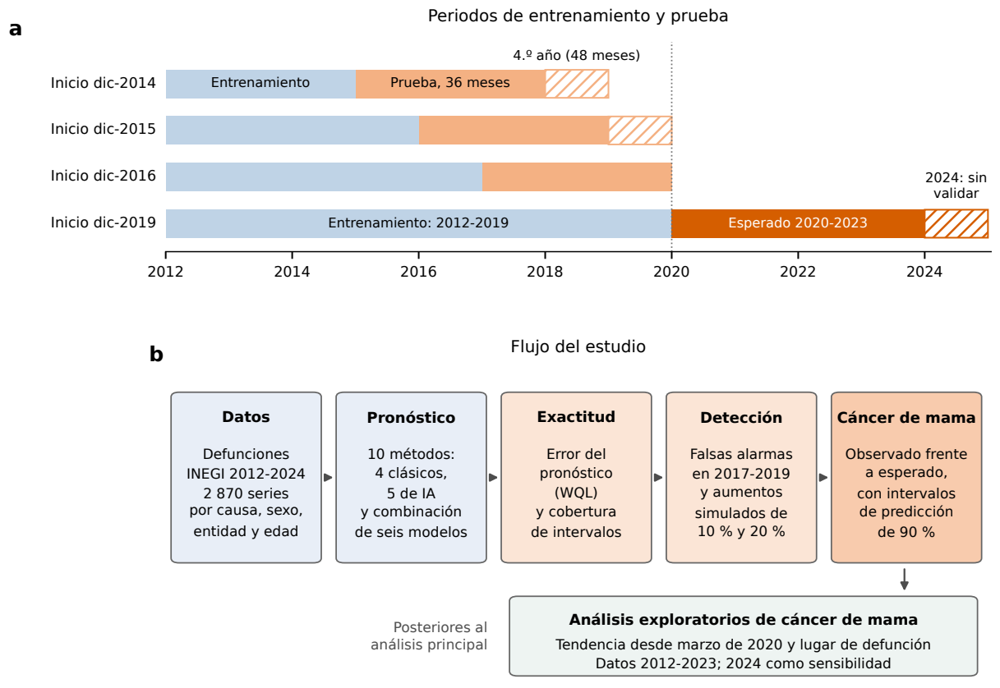


**Figura 1.** Diseño del estudio. a: periodos de entrenamiento y prueba; cada pronóstico utiliza datos del estudio anteriores a su inicio. La validación termina antes de 2020; el tramo rayado indica el cuarto año, evaluado desde 2014 y 2015. La mortalidad esperada se pronosticó desde diciembre de 2019; el quinto año (2024) no tiene validación. b: flujo del análisis, incluidos los estudios exploratorios de tendencia y lugar de defunción realizados después del análisis principal. WQL: pérdida de cuantiles ponderada, medida del error del pronóstico.


<p><small>Diagrama del diseño: no representa una nueva estimación estadística.</small></p><details><summary>Datos de esta figura</summary><p><a href="../src/figuras/figura_diseno_v11.py">../src/figuras/figura_diseno_v11.py</a></p></details>


### Del pronóstico al error: un cálculo visible

El ensamble toma la mediana de seis modelos **por serie, mes y cuantil**. Para los cuantiles 0.1, 0.5 y 0.9, la WQL resume la pérdida asimétrica del pronóstico y la divide entre el volumen observado. La cobertura comprueba si cada observación cae entre los cuantiles 0.1 y 0.9. Las siguientes celdas reproducen estos cálculos para el origen de diciembre de 2016 y los cotejan con la tabla de métricas generada por el benchmark.


```python
corpus = pd.read_csv(DATOS / "benchmark/datos/corpus2_mortalidad_mensual.csv.gz", index_col=0)
assert corpus.shape[0] == 2870
observado = corpus[[str(i) for i in range(60, 96)]].to_numpy(float)  # enero 2017–diciembre 2019
with np.load(DATOS / "benchmark/pronosticos/publicados/fc_2016-12.npz", allow_pickle=False) as z:
    ensamble = np.median(np.stack([z[m] for m in MIEMBROS]), axis=0)
cuantiles = np.array([0.1, 0.5, 0.9])
residuo = observado[..., None] - ensamble
perdida = np.maximum(cuantiles * residuo, (cuantiles - 1) * residuo)
wql = 2 * perdida.sum(axis=(1, 2)) / (3 * np.abs(observado).sum(axis=1) + 1e-9)
cobertura = 100 * ((observado >= ensamble[..., 0]) & (observado <= ensamble[..., 2])).mean(axis=1)
metricas = pd.read_csv(B / "resultados/benchmark/metricas_por_serie.csv.gz")
comparables = metricas[(metricas.model == "Ensamble (mediana)") & (metricas.origin == "2016-12")].set_index("sid").loc[corpus.index]
# El archivo de métricas se escribe con seis decimales: tolerancia de su redondeo.
np.testing.assert_allclose(wql, comparables.WQL, rtol=0, atol=5.01e-7)
np.testing.assert_allclose(cobertura, comparables.cov80, rtol=0, atol=5.01e-7)
display(pd.DataFrame({"Serie": corpus.index[:5], "WQL recalculada": wql[:5], "Cobertura 80 %, %": cobertura[:5]}))
```


<div>
<style scoped>
    .dataframe tbody tr th:only-of-type {
        vertical-align: middle;
    }

    .dataframe tbody tr th {
        vertical-align: top;
    }

    .dataframe thead th {
        text-align: right;
    }
</style>
<table border="1" class="dataframe">
  <thead>
    <tr style="text-align: right;">
      <th></th>
      <th>Serie</th>
      <th>WQL recalculada</th>
      <th>Cobertura 80 %, %</th>
    </tr>
  </thead>
  <tbody>
    <tr>
      <th>0</th>
      <td>Accidentes de tránsito|H|E01|0-39</td>
      <td>0.221093</td>
      <td>63.888889</td>
    </tr>
    <tr>
      <th>1</th>
      <td>Accidentes de tránsito|H|E01|Todas</td>
      <td>0.157341</td>
      <td>80.555556</td>
    </tr>
    <tr>
      <th>2</th>
      <td>Accidentes de tránsito|H|E02|0-39</td>
      <td>0.495165</td>
      <td>41.666667</td>
    </tr>
    <tr>
      <th>3</th>
      <td>Accidentes de tránsito|H|E02|40-64</td>
      <td>0.656956</td>
      <td>58.333333</td>
    </tr>
    <tr>
      <th>4</th>
      <td>Accidentes de tránsito|H|E02|Todas</td>
      <td>0.624242</td>
      <td>33.333333</td>
    </tr>
  </tbody>
</table>
</div>


```python
inventario.append(mostrar_figura(REPO, SALIDA, '2'))
```


<h3 id="figura-2">Figura 2</h3><p><b>recalculado</b> · <a href="../ejecuciones/figuras_revision/20261020T172839Z_5c70e4a4/figuras/figuras/Figura_2.pdf">PDF vectorial</a> · <a href="../src/figuras/exportar_figuras_v13.py">Código del generador</a></p>


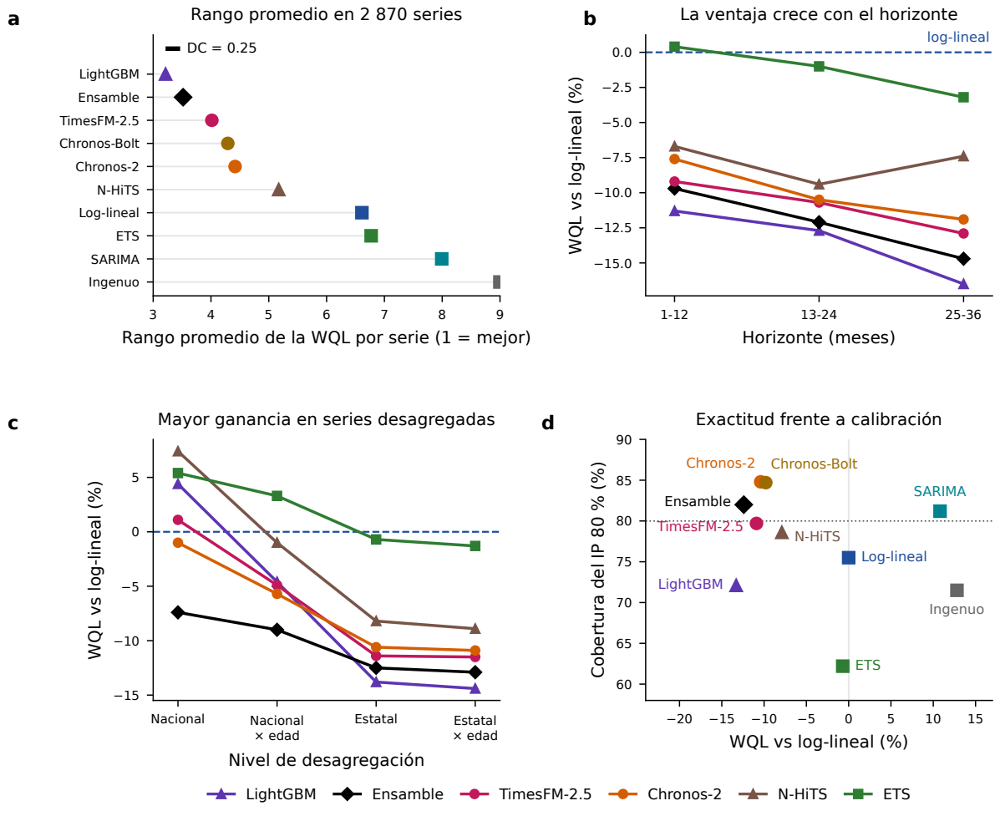


**Figura 2.** Exactitud de diez modelos en 2 870 series mensuales de mortalidad (tres fechas de inicio, con pruebas anteriores a 2020, 36 meses). a: rango promedio de la WQL en cada serie (1 = mejor) y diferencia crítica (DC) de Nemenyi; con 28 conglomerados de causa, DC = 2.56 (tabla S10). b: Error (WQL) relativo al log-lineal por plazo del pronóstico (negativo = menor error). c: Error (WQL) relativo por nivel geográfico y grupo de edad. d: exactitud y proporción de observaciones dentro del intervalo de predicción de 80 % (línea: 80 %). LightGBM y N-HiTS se entrenaron conjuntamente con las series del estudio; Chronos-2 se evaluó sin adaptación local.


<p><small>Métricas recalculadas desde los NPZ guardados; no se vuelven a entrenar los modelos.</small></p><details><summary>Datos de esta figura</summary><p><a href="../ejecuciones/figuras_revision/20261020T172839Z_5c70e4a4/benchmark/benchmark/resultados/benchmark/numeros_repro.json">../ejecuciones/figuras_revision/20261020T172839Z_5c70e4a4/benchmark/benchmark/resultados/benchmark/numeros_repro.json</a> · <a href="../ejecuciones/figuras_revision/20261020T172839Z_5c70e4a4/benchmark/benchmark/resultados/benchmark/friedman_por_serie.json">../ejecuciones/figuras_revision/20261020T172839Z_5c70e4a4/benchmark/benchmark/resultados/benchmark/friedman_por_serie.json</a></p></details>


```python
inventario.append(mostrar_tabla(REPO, SALIDA, DATOS, tablas, '1', plegada=False))
```


<h3 id="tabla-1">Tabla 1. Exactitud y detección de exceso de los diez modelos en 2 870 series mensuales de mortalidad, 2015-2019</h3><p><b>recalculado</b>. </p><p>Fuente: <a href="../ejecuciones/figuras_revision/20261020T172839Z_5c70e4a4/benchmark/benchmark/documentos/tablas/tabla1_manuscrito.csv">../ejecuciones/figuras_revision/20261020T172839Z_5c70e4a4/benchmark/benchmark/documentos/tablas/tabla1_manuscrito.csv</a> · <a href="../ejecuciones/figuras_revision/20261020T172839Z_5c70e4a4/tablas_notebook/Tabla_1.csv">Exportar CSV</a></p><p><small>Código: src/benchmark/auditoria/reproducir_benchmark.py; analisis/p2_deteccion_temporal.py; numeros_v9.py; analisis/tabla1_y_S15.py · <a href="../scripts/gmm.py">Ejecutor</a></small></p><div style="overflow:auto;max-height:480px"><table border="1" class="dataframe">
  <thead>
    <tr style="text-align: right;">
      <th>Modelo</th>
      <th>Familia</th>
      <th>Rango (1 = mejor)</th>
      <th>Reducción del error frente al log-lineal, % (IC 95 %)</th>
      <th>Cobertura del intervalo de 80 % (%)</th>
      <th>Falsas alarmas, 2017-2019 (%)</th>
      <th>Exceso de 20 % detectado (%)</th>
    </tr>
  </thead>
  <tbody>
    <tr>
      <td>LightGBM</td>
      <td>Global (IA)</td>
      <td>3.21</td>
      <td>13.3 (10.6 a 16.2)</td>
      <td>72.1</td>
      <td>4.1</td>
      <td>21.6</td>
    </tr>
    <tr>
      <td>Ensamble</td>
      <td>Clásicos e IA</td>
      <td>3.52</td>
      <td>12.4 (9.9 a 14.8)</td>
      <td>82</td>
      <td>4.5</td>
      <td>22.2</td>
    </tr>
    <tr>
      <td>TimesFM-2.5</td>
      <td>Fundacional (IA)</td>
      <td>4.01</td>
      <td>10.9 (6.9 a 14.7)</td>
      <td>79.7</td>
      <td>5.1</td>
      <td>23</td>
    </tr>
    <tr>
      <td>Chronos-Bolt</td>
      <td>Fundacional (IA)</td>
      <td>4.29</td>
      <td>9.8 (5.4 a 13.9)</td>
      <td>84.7</td>
      <td>4.8</td>
      <td>22.9</td>
    </tr>
    <tr>
      <td>Chronos-2</td>
      <td>Fundacional (IA)</td>
      <td>4.42</td>
      <td>10.4 (7.0 a 13.6)</td>
      <td>84.8</td>
      <td>4.5</td>
      <td>20.2</td>
    </tr>
    <tr>
      <td>N-HiTS</td>
      <td>Global (IA)</td>
      <td>5.17</td>
      <td>7.9 (4.6 a 11.4)</td>
      <td>78.6</td>
      <td>4.2</td>
      <td>25.7</td>
    </tr>
    <tr>
      <td>Log-lineal</td>
      <td>Clásico</td>
      <td>6.61</td>
      <td>referencia</td>
      <td>75.5</td>
      <td>3.6</td>
      <td>17.1</td>
    </tr>
    <tr>
      <td>ETS</td>
      <td>Clásico</td>
      <td>6.77</td>
      <td>0.7 (−3.0 a 4.1)</td>
      <td>62.2</td>
      <td>4.6</td>
      <td>23</td>
    </tr>
    <tr>
      <td>SARIMA</td>
      <td>Clásico</td>
      <td>7.99</td>
      <td>−10.8 (−12.6 a −9.1)</td>
      <td>81.2</td>
      <td>3.1</td>
      <td>15.8</td>
    </tr>
    <tr>
      <td>Ingenuo estacional</td>
      <td>Clásico</td>
      <td>9</td>
      <td>−12.8 (−17.6 a −8.2)</td>
      <td>71.5</td>
      <td>3.9</td>
      <td>21.8</td>
    </tr>
  </tbody>
</table></div><p><small>WQL: pérdida de cuantiles ponderada; menor es mejor. IC 95 % por bootstrap de 28 conglomerados de causa. El intervalo mensual nominal es de 80 %; el detector D1 es unilateral.</small></p>


**Lectura.** La reducción de WQL expresa una mejora de pronóstico frente al log-lineal; no una disminución de la mortalidad. La cobertura debe leerse frente al 80 % nominal. La dependencia entre series se examina con 28 conglomerados de causa, porque las series nacionales, estatales y por edad comparten registros.

### Falsas alarmas y detección

Un método puede mejorar el error sin detectar la mayoría de los aumentos simulados. La figura 3 y la tabla S9 permiten leer ambas propiedades con un objetivo común de falsas alarmas. Los aumentos de 10 % y 20 % se simulan sobre mortalidad ya observada; los controles positivos son un análisis distinto.


```python
inventario.append(mostrar_figura(REPO, SALIDA, '3'))
```


<h3 id="figura-3">Figura 3</h3><p><b>recalculado</b> · <a href="../ejecuciones/figuras_revision/20261020T172839Z_5c70e4a4/figuras/figuras/Figura_3.pdf">PDF vectorial</a> · <a href="../src/figuras/exportar_figuras_v13.py">Código del generador</a></p>


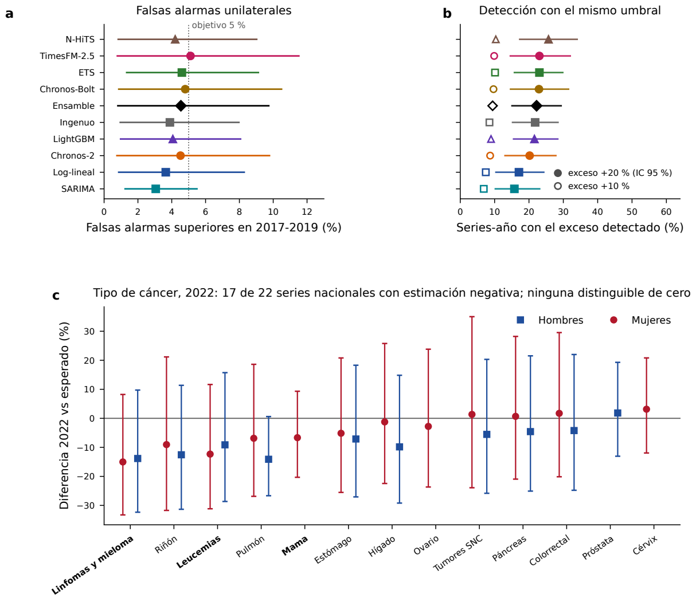


**Figura 3.** Falsas alarmas y detección de exceso en 2017-2019, años sin pandemia, con un umbral superior calibrado en años previos para cada año del plazo del pronóstico (objetivo común, 5 %). a: proporción de evaluaciones anuales de las series señaladas como exceso (IC 95 %). b: proporción en que se detectó un exceso simulado de 20 % (símbolos llenos, IC 95 %) o de 10 % (vacíos). c: diferencia entre mortalidad observada y esperada en 2022 en las series nacionales de cáncer (combinación de seis modelos; barras: intervalo de predicción de 90 %). LightGBM y N-HiTS se entrenaron conjuntamente con las series del estudio; Chronos-2 se evaluó sin adaptación local.


<p><small>Detector y atlas recalculados desde los NPZ guardados, conservando la separación temporal.</small></p><details><summary>Datos de esta figura</summary><p><a href="../ejecuciones/figuras_revision/20261020T172839Z_5c70e4a4/benchmark/benchmark/resultados/p2_deteccion_resultados.csv">../ejecuciones/figuras_revision/20261020T172839Z_5c70e4a4/benchmark/benchmark/resultados/p2_deteccion_resultados.csv</a> · <a href="../ejecuciones/figuras_revision/20261020T172839Z_5c70e4a4/benchmark/benchmark/resultados/benchmark/atlas_repro.csv.gz">../ejecuciones/figuras_revision/20261020T172839Z_5c70e4a4/benchmark/benchmark/resultados/benchmark/atlas_repro.csv.gz</a></p></details>


```python
inventario.append(mostrar_tabla(REPO, SALIDA, DATOS, tablas, 'S9', plegada=False))
```


<h3 id="tabla-S9">Tabla S9. Falsas alarmas y detección de exceso con el detector unilateral temporal por horizonte (D1; umbral con el origen 2014, ajuste con 2015, prueba con 2016; años 2017-2019; 2 870 series × 3 años).</h3><p><b>recalculado</b>. </p><p>Fuente: <a href="../ejecuciones/figuras_revision/20261020T172839Z_5c70e4a4/benchmark/benchmark/documentos/tablas/tablaS9_deteccion_v9.csv">../ejecuciones/figuras_revision/20261020T172839Z_5c70e4a4/benchmark/benchmark/documentos/tablas/tablaS9_deteccion_v9.csv</a> · <a href="../ejecuciones/figuras_revision/20261020T172839Z_5c70e4a4/tablas_notebook/Tabla_S9.csv">Exportar CSV</a></p><p><small>Código: p2_deteccion_temporal.py; tablas_v9.py · <a href="../scripts/gmm.py">Ejecutor</a></small></p><div style="overflow:auto;max-height:480px"><table border="1" class="dataframe">
  <thead>
    <tr style="text-align: right;">
      <th>Modelo</th>
      <th>Falsas alarmas superiores, D1 (%)</th>
      <th>Por año de prueba 2017 / 2018 / 2019 (%)</th>
      <th>Umbral superior mediano (%)</th>
      <th>Detección +10 %, D1 (%)</th>
      <th>Detección +20 %, D1 (%)</th>
      <th>Δ detección +20 % vs log-lineal (pp)</th>
      <th>Bilateral 90 % (D3): superior / inferior (%)</th>
    </tr>
  </thead>
  <tbody>
    <tr>
      <td>LightGBM</td>
      <td>4.1 (1.0-8.1)</td>
      <td>3.7 / 4.7 / 3.8</td>
      <td>38</td>
      <td>9.0 (4.3-14.7)</td>
      <td>21.6 (15.5-28.4)</td>
      <td>+4.5 (0.8 a 8.8)</td>
      <td>6.1 / 4.6</td>
    </tr>
    <tr>
      <td>Ensamble</td>
      <td>4.5 (0.8-9.7)</td>
      <td>3.6 / 5.3 / 4.7</td>
      <td>49</td>
      <td>9.4 (4.4-15.7)</td>
      <td>22.2 (15.1-29.4)</td>
      <td>+5.1 (1.8 a 9.0)</td>
      <td>7.2 / 1.5</td>
    </tr>
    <tr>
      <td>TimesFM-2.5</td>
      <td>5.1 (0.8-11.5)</td>
      <td>4.4 / 5.8 / 5.2</td>
      <td>51</td>
      <td>9.9 (3.8-17.6)</td>
      <td>23.0 (14.6-32.0)</td>
      <td>+6.0 (1.4 a 11.7)</td>
      <td>8.7 / 1.4</td>
    </tr>
    <tr>
      <td>Chronos-2</td>
      <td>4.5 (0.8-9.8)</td>
      <td>3.4 / 5.5 / 4.6</td>
      <td>49</td>
      <td>8.7 (3.5-15.6)</td>
      <td>20.2 (13.0-27.8)</td>
      <td>+3.1 (−0.9 a 7.6)</td>
      <td>7.5 / 1.7</td>
    </tr>
    <tr>
      <td>Chronos-Bolt</td>
      <td>4.8 (0.9-10.5)</td>
      <td>4.4 / 5.3 / 4.7</td>
      <td>47</td>
      <td>9.7 (3.8-17.0)</td>
      <td>22.9 (14.6-31.5)</td>
      <td>+5.8 (0.6 a 11.7)</td>
      <td>7.6 / 2.1</td>
    </tr>
    <tr>
      <td>N-HiTS</td>
      <td>4.2 (0.8-9.0)</td>
      <td>3.5 / 5.2 / 3.9</td>
      <td>39</td>
      <td>10.3 (5.1-16.4)</td>
      <td>25.7 (17.3-34.0)</td>
      <td>+8.6 (3.9 a 13.7)</td>
      <td>5.4 / 4.0</td>
    </tr>
    <tr>
      <td>Log-lineal</td>
      <td>3.6 (0.9-8.3)</td>
      <td>3.6 / 3.8 / 3.6</td>
      <td>56</td>
      <td>7.4 (3.1-12.8)</td>
      <td>17.1 (10.4-24.3)</td>
      <td>referencia</td>
      <td>4.5 / 2.1</td>
    </tr>
    <tr>
      <td>ETS amortiguado</td>
      <td>4.6 (1.3-9.1)</td>
      <td>3.8 / 5.2 / 4.8</td>
      <td>57</td>
      <td>10.1 (5.4-15.7)</td>
      <td>23.0 (15.8-29.8)</td>
      <td>+6.0 (2.7 a 9.5)</td>
      <td>6.9 / 1.7</td>
    </tr>
    <tr>
      <td>SARIMA</td>
      <td>3.1 (1.2-5.5)</td>
      <td>2.7 / 3.2 / 3.2</td>
      <td>59</td>
      <td>6.8 (3.8-10.3)</td>
      <td>15.8 (10.2-23.1)</td>
      <td>−1.3 (−3.8 a 0.8)</td>
      <td>3.4 / 1.3</td>
    </tr>
    <tr>
      <td>Ingenuo estacional</td>
      <td>3.9 (1.0-8.0)</td>
      <td>3.5 / 4.6 / 3.6</td>
      <td>50</td>
      <td>8.5 (4.1-13.8)</td>
      <td>21.8 (15.2-28.4)</td>
      <td>+4.7 (0.8 a 9.1)</td>
      <td>6.4 / 2.1</td>
    </tr>
  </tbody>
</table></div><p><small>Umbral con origen 2014, ajuste 2015, prueba 2016 (2017-2019).</small></p>


```python
inventario.append(mostrar_tabla(REPO, SALIDA, DATOS, tablas, 'S10', plegada=True))
```


<details id="tabla-S10"><summary><b>Tabla S10. Sensibilidad de Friedman/Nemenyi a la dependencia entre series (rango promedio de la WQL; 1 = mejor).</b></summary><p><b>recalculado</b>. </p><p>Fuente: <a href="../ejecuciones/figuras_revision/20261020T172839Z_5c70e4a4/benchmark/benchmark/documentos/tablas/tablaS10_friedman_sensibilidad.csv">../ejecuciones/figuras_revision/20261020T172839Z_5c70e4a4/benchmark/benchmark/documentos/tablas/tablaS10_friedman_sensibilidad.csv</a> · <a href="../ejecuciones/figuras_revision/20261020T172839Z_5c70e4a4/tablas_notebook/Tabla_S10.csv">Exportar CSV</a></p><p><small>Código: p4_friedman_sensibilidad.py; tablas_v9.py · <a href="../scripts/gmm.py">Ejecutor</a></small></p><div style="overflow:auto;max-height:480px"><table border="1" class="dataframe">
  <thead>
    <tr style="text-align: right;">
      <th>Modelo</th>
      <th>Principal (por serie)</th>
      <th>Grupo de causa</th>
      <th>Causa × sexo</th>
      <th>Sin anidamiento</th>
      <th>Nacionales</th>
      <th>Nacionales × edad</th>
      <th>Estatales</th>
      <th>Estatales × edad</th>
    </tr>
  </thead>
  <tbody>
    <tr>
      <td>N</td>
      <td>2870</td>
      <td>28</td>
      <td>52</td>
      <td>1063</td>
      <td>52</td>
      <td>149</td>
      <td>1127</td>
      <td>1542</td>
    </tr>
    <tr>
      <td>DC</td>
      <td>0.25</td>
      <td>2.56</td>
      <td>1.88</td>
      <td>0.42</td>
      <td>1.88</td>
      <td>1.11</td>
      <td>0.4</td>
      <td>0.34</td>
    </tr>
    <tr>
      <td>LightGBM</td>
      <td>3.21</td>
      <td>1.93</td>
      <td>2.03</td>
      <td>3.08</td>
      <td>5.63</td>
      <td>4.46</td>
      <td>3.14</td>
      <td>3.07</td>
    </tr>
    <tr>
      <td>Ensamble</td>
      <td>3.52</td>
      <td>3.25</td>
      <td>3.22</td>
      <td>3.61</td>
      <td>2.62</td>
      <td>3.1</td>
      <td>3.58</td>
      <td>3.54</td>
    </tr>
    <tr>
      <td>TimesFM-2.5</td>
      <td>4.01</td>
      <td>3.18</td>
      <td>3.12</td>
      <td>3.87</td>
      <td>4.85</td>
      <td>4.29</td>
      <td>3.93</td>
      <td>4.02</td>
    </tr>
    <tr>
      <td>Chronos-2</td>
      <td>4.42</td>
      <td>4.12</td>
      <td>4.15</td>
      <td>4.35</td>
      <td>4.46</td>
      <td>4.31</td>
      <td>4.39</td>
      <td>4.44</td>
    </tr>
    <tr>
      <td>Chronos-Bolt</td>
      <td>4.29</td>
      <td>3.34</td>
      <td>3.42</td>
      <td>4.07</td>
      <td>5.81</td>
      <td>5.04</td>
      <td>4.24</td>
      <td>4.21</td>
    </tr>
    <tr>
      <td>N-HiTS</td>
      <td>5.17</td>
      <td>5.64</td>
      <td>5.57</td>
      <td>5.2</td>
      <td>5.52</td>
      <td>5.29</td>
      <td>5.22</td>
      <td>5.11</td>
    </tr>
    <tr>
      <td>Log-lineal</td>
      <td>6.61</td>
      <td>7.46</td>
      <td>7.42</td>
      <td>6.84</td>
      <td>5.23</td>
      <td>5.76</td>
      <td>6.65</td>
      <td>6.71</td>
    </tr>
    <tr>
      <td>ETS amortiguado</td>
      <td>6.77</td>
      <td>7.29</td>
      <td>7.26</td>
      <td>6.77</td>
      <td>5.83</td>
      <td>6.48</td>
      <td>6.8</td>
      <td>6.81</td>
    </tr>
    <tr>
      <td>SARIMA</td>
      <td>7.99</td>
      <td>8.93</td>
      <td>9.01</td>
      <td>8.24</td>
      <td>6.35</td>
      <td>7.2</td>
      <td>8.06</td>
      <td>8.07</td>
    </tr>
    <tr>
      <td>Ingenuo estacional</td>
      <td>9</td>
      <td>9.86</td>
      <td>9.8</td>
      <td>8.97</td>
      <td>8.71</td>
      <td>9.06</td>
      <td>8.98</td>
      <td>9.01</td>
    </tr>
  </tbody>
</table></div></details>


```python
inventario.append(mostrar_tabla(REPO, SALIDA, DATOS, tablas, 'S10B', plegada=True))
```


<details id="tabla-S10B"><summary><b>Tabla S10B. Diferencias de rango promedio entre pares de modelos consecutivos con IC 95 % por bootstrap de grupos de causa (2 000 réplicas).</b></summary><p><b>recalculado</b>. </p><p>Fuente: <a href="../ejecuciones/figuras_revision/20261020T172839Z_5c70e4a4/benchmark/benchmark/documentos/tablas/tablaS10B_pares_bootstrap.csv">../ejecuciones/figuras_revision/20261020T172839Z_5c70e4a4/benchmark/benchmark/documentos/tablas/tablaS10B_pares_bootstrap.csv</a> · <a href="../ejecuciones/figuras_revision/20261020T172839Z_5c70e4a4/tablas_notebook/Tabla_S10B.csv">Exportar CSV</a></p><p><small>Código: p4_friedman_sensibilidad.py; tablas_v9.py · <a href="../scripts/gmm.py">Ejecutor</a></small></p><div style="overflow:auto;max-height:480px"><table border="1" class="dataframe">
  <thead>
    <tr style="text-align: right;">
      <th>a</th>
      <th>b</th>
      <th>dif</th>
      <th>lo</th>
      <th>hi</th>
    </tr>
  </thead>
  <tbody>
    <tr>
      <td>LightGBM global</td>
      <td>Ensamble (mediana)</td>
      <td>-0.303833</td>
      <td>-0.90384</td>
      <td>0.288711</td>
    </tr>
    <tr>
      <td>Ensamble (mediana)</td>
      <td>TimesFM-2.5</td>
      <td>-0.496864</td>
      <td>-1.05524</td>
      <td>0.114395</td>
    </tr>
    <tr>
      <td>TimesFM-2.5</td>
      <td>Chronos-2</td>
      <td>-0.401394</td>
      <td>-0.756731</td>
      <td>-0.0117308</td>
    </tr>
    <tr>
      <td>Chronos-2</td>
      <td>Chronos-Bolt</td>
      <td>0.125436</td>
      <td>-0.185416</td>
      <td>0.436157</td>
    </tr>
    <tr>
      <td>Chronos-2</td>
      <td>N-HiTS global</td>
      <td>-0.755749</td>
      <td>-1.11875</td>
      <td>-0.428801</td>
    </tr>
    <tr>
      <td>N-HiTS global</td>
      <td>Log-lineal</td>
      <td>-1.43937</td>
      <td>-2.13895</td>
      <td>-0.823324</td>
    </tr>
    <tr>
      <td>Log-lineal</td>
      <td>ETS amortiguado</td>
      <td>-0.159582</td>
      <td>-0.815174</td>
      <td>0.474724</td>
    </tr>
  </tbody>
</table></div></details>


En el panel 3c, la posición de cada cáncer combina datos del conjunto de series y sus intervalos. Una diferencia agregada entre cánceres no convierte cada diferencia individual en un resultado distinguible de cero. Los resultados completos del detector, sus controles y variantes aparecen en el suplemento del notebook.

<a id="mama"></a>
## 4. Aplicación al cáncer de mama

El ensamble y la regresión log-lineal se aplican a C50 en mujeres ≥ 20 años. La diferencia porcentual se calcula como **100 × (observado / esperado − 1)**. Un intervalo que incluye cero expresa compatibilidad con la referencia previa bajo los supuestos usados.

Los intervalos anuales nominales de 90 % transfieren errores de conteos de series de volumen similar a la TEE. Esa transferencia no está validada como garantía de cobertura de tasas. En 2024 no se validó el quinto año: se conserva la estimación puntual y se aplica la corrección de registro tardío correspondiente a cada indicador.


```python
intervalos = pd.read_csv(B / "resultados/p1_intervalos_mama_entre_series.csv")
nacional = intervalos[(intervalos.target == "asmr") & (intervalos.year <= 2023)].copy()
nacional["Diferencia recalculada, %"] = 100 * (nacional.observado / nacional.esperado - 1)
# Observado y esperado están escritos con cuatro decimales; verificar a la precisión publicada.
np.testing.assert_allclose(nacional["Diferencia recalculada, %"], nacional.pscore, rtol=0, atol=0.0002)
display(nacional[["year", "Diferencia recalculada, %", "lo_todas", "hi_todas"]].rename(columns={
    "year":"Año", "lo_todas":"IP 90 % inferior", "hi_todas":"IP 90 % superior"}))
```


<div>
<style scoped>
    .dataframe tbody tr th:only-of-type {
        vertical-align: middle;
    }

    .dataframe tbody tr th {
        vertical-align: top;
    }

    .dataframe thead th {
        text-align: right;
    }
</style>
<table border="1" class="dataframe">
  <thead>
    <tr style="text-align: right;">
      <th></th>
      <th>Año</th>
      <th>Diferencia recalculada, %</th>
      <th>IP 90 % inferior</th>
      <th>IP 90 % superior</th>
    </tr>
  </thead>
  <tbody>
    <tr>
      <th>0</th>
      <td>2020</td>
      <td>1.201531</td>
      <td>-7.5190</td>
      <td>10.7444</td>
    </tr>
    <tr>
      <th>1</th>
      <td>2021</td>
      <td>-2.178227</td>
      <td>-14.1628</td>
      <td>11.4797</td>
    </tr>
    <tr>
      <th>2</th>
      <td>2022</td>
      <td>-6.280072</td>
      <td>-19.9755</td>
      <td>9.7592</td>
    </tr>
    <tr>
      <th>3</th>
      <td>2023</td>
      <td>-7.811594</td>
      <td>-24.9194</td>
      <td>13.1944</td>
    </tr>
  </tbody>
</table>
</div>


```python
inventario.append(mostrar_figura(REPO, SALIDA, '4'))
```


<h3 id="figura-4">Figura 4</h3><p><b>recalculado</b> · <a href="../ejecuciones/figuras_revision/20261020T172839Z_5c70e4a4/figuras/figuras/Figura_4.pdf">PDF vectorial</a> · <a href="../src/figuras/exportar_figuras_v13.py">Código del generador</a></p>


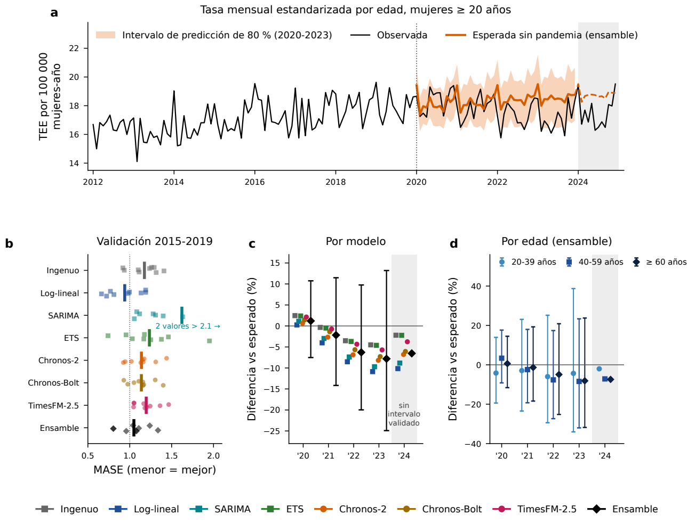


**Figura 4.** Cáncer de mama en mujeres de 20 años o más, 2012-2024. a: tasa estandarizada por edad (TEE) mensual, anualizada por 100 000 mujeres-año, observada y esperada sin pandemia (combinación de seis modelos; banda: intervalo de predicción mensual de 80 %, 2020-2023; discontinua: 2024, solo estimación puntual). b: error de validación en la serie nacional en nueve fechas de inicio trimestrales (puntos) y su media (barra). MASE: error absoluto medio del pronóstico dividido entre el del pronóstico ingenuo estacional dentro del periodo de entrenamiento; < 1 indica menor error que ese ingenuo, no una comparación con el ingenuo en el periodo de prueba. c: diferencia anual entre TEE observada y esperada por modelo; combinación con intervalo de predicción de 90 % de nivel nominal. d: diferencia por edad (combinación). Sombreado: 2024, sin validación del quinto año y con registro tardío corregido.


<p><small>Intervalos y resúmenes recalculados; los pronósticos y backtests tsfm_* son insumos originales guardados.</small></p><details><summary>Datos de esta figura</summary><p><a href="../ejecuciones/figuras_revision/20261020T172839Z_5c70e4a4/benchmark/benchmark/resultados/p1_intervalos_mama_entre_series.csv">../ejecuciones/figuras_revision/20261020T172839Z_5c70e4a4/benchmark/benchmark/resultados/p1_intervalos_mama_entre_series.csv</a> · <a href="../ejecuciones/figuras_revision/20261020T172839Z_5c70e4a4/figuras/trabajo/benchmark/entradas/tsfm_contrafactual_mensual.csv">../ejecuciones/figuras_revision/20261020T172839Z_5c70e4a4/figuras/trabajo/benchmark/entradas/tsfm_contrafactual_mensual.csv</a></p></details>


```python
inventario.append(mostrar_tabla(REPO, SALIDA, DATOS, tablas, '2', plegada=False))
```


<h3 id="tabla-2">Tabla 2. Mortalidad por cáncer de mama observada y esperada sin pandemia (combinación de seis modelos) en mujeres de 20 años o más, y diferencia porcentual con intervalo de predicción de 90 %, 2020-2024</h3><p><b>recalculado</b>. </p><p>Fuente: <a href="../ejecuciones/figuras_revision/20261020T172839Z_5c70e4a4/benchmark/benchmark/documentos/tablas/tabla2_v9.csv">../ejecuciones/figuras_revision/20261020T172839Z_5c70e4a4/benchmark/benchmark/documentos/tablas/tabla2_v9.csv</a> · <a href="../ejecuciones/figuras_revision/20261020T172839Z_5c70e4a4/tablas_notebook/Tabla_2.csv">Exportar CSV</a></p><p><small>Código: src/benchmark/analisis/p1_intervalos_mama.py; tablas_v9.py · <a href="../scripts/gmm.py">Ejecutor</a></small></p><div style="overflow:auto;max-height:480px"><table border="1" class="dataframe">
  <thead>
    <tr style="text-align: right;">
      <th>Serie</th>
      <th>2020</th>
      <th>2021</th>
      <th>2022</th>
      <th>2023</th>
      <th>2024†</th>
    </tr>
  </thead>
  <tbody>
    <tr>
      <td>A. Nacional, mujeres ≥ 20 años</td>
      <td></td>
      <td></td>
      <td></td>
      <td></td>
      <td></td>
    </tr>
    <tr>
      <td>TEE observada (por 100 000 mujeres-año)</td>
      <td>18.4</td>
      <td>17.9</td>
      <td>17.3</td>
      <td>17.1</td>
      <td>17.5</td>
    </tr>
    <tr>
      <td>TEE esperada sin pandemia</td>
      <td>18.2</td>
      <td>18.3</td>
      <td>18.5</td>
      <td>18.6</td>
      <td>18.8</td>
    </tr>
    <tr>
      <td>Diferencia, % (IP 90 %)</td>
      <td>+1.2 (−7.5 a 10.7)</td>
      <td>−2.2 (−14.2 a 11.5)</td>
      <td>−6.3 (−20.0 a 9.8)</td>
      <td>−7.8 (−24.9 a 13.2)</td>
      <td>−6.5</td>
    </tr>
    <tr>
      <td>Defunciones observadas</td>
      <td>7 886</td>
      <td>7 845</td>
      <td>7 790</td>
      <td>7 935</td>
      <td>8 370</td>
    </tr>
    <tr>
      <td>Defunciones esperadas sin pandemia</td>
      <td>7 798</td>
      <td>8 054</td>
      <td>8 351</td>
      <td>8 618</td>
      <td>8 902</td>
    </tr>
    <tr>
      <td>Diferencia, % (IP 90 %)</td>
      <td>+1.1 (−7.6 a 10.7)</td>
      <td>−2.6 (−14.5 a 11.0)</td>
      <td>−6.7 (−20.3 a 9.2)</td>
      <td>−7.9 (−25.0 a 13.1)</td>
      <td>−6.0</td>
    </tr>
    <tr>
      <td>TEE, modelo log-lineal (sensibilidad), % (IP 90 %)</td>
      <td>+0.2 (−8.1 a 9.3)</td>
      <td>−4.0 (−16.3 a 10.0)</td>
      <td>−8.5 (−23.0 a 8.7)</td>
      <td>−10.9 (−27.5 a 9.6)</td>
      <td>−10.2</td>
    </tr>
    <tr>
      <td>B. Diferencia por subgrupo (TEE), % (IP 90 %)</td>
      <td></td>
      <td></td>
      <td></td>
      <td></td>
      <td></td>
    </tr>
    <tr>
      <td>20-39 años</td>
      <td>−4.2 (−19.4 a 13.9)</td>
      <td>−2.9 (−23.5 a 23.1)</td>
      <td>−6.0 (−29.4 a 25.2)</td>
      <td>−4.4 (−34.1 a 38.7)</td>
      <td>−2.0</td>
    </tr>
    <tr>
      <td>40-59 años</td>
      <td>+3.4 (−9.2 a 17.6)</td>
      <td>−2.4 (−19.3 a 18.0)</td>
      <td>−7.6 (−27.4 a 17.4)</td>
      <td>−8.4 (−32.0 a 23.4)</td>
      <td>−7.2</td>
    </tr>
    <tr>
      <td>≥ 60 años</td>
      <td>+0.6 (−11.6 a 14.5)</td>
      <td>−1.4 (−18.4 a 19.3)</td>
      <td>−4.9 (−25.2 a 20.9)</td>
      <td>−8.1 (−31.8 a 23.8)</td>
      <td>−7.4</td>
    </tr>
    <tr>
      <td>Norte</td>
      <td>+6.0 (−6.9 a 20.6)</td>
      <td>−2.5 (−19.3 a 17.9)</td>
      <td>−4.0 (−24.5 a 22.0)</td>
      <td>−5.6 (−29.9 a 27.2)</td>
      <td>−12.4</td>
    </tr>
    <tr>
      <td>Centro-Occidente</td>
      <td>−1.2 (−13.2 a 12.5)</td>
      <td>+1.4 (−16.2 a 22.6)</td>
      <td>−7.0 (−26.8 a 18.3)</td>
      <td>−4.1 (−28.8 a 29.2)</td>
      <td>−4.3</td>
    </tr>
    <tr>
      <td>Centro</td>
      <td>+4.1 (−8.5 a 18.5)</td>
      <td>−2.1 (−19.0 a 18.4)</td>
      <td>−0.9 (−22.1 a 25.9)</td>
      <td>−3.8 (−28.6 a 29.6)</td>
      <td>+2.7</td>
    </tr>
    <tr>
      <td>Sur-Sureste</td>
      <td>−2.4 (−17.9 a 16.1)</td>
      <td>−1.6 (−22.4 a 24.8)</td>
      <td>−11.7 (−33.7 a 17.5)</td>
      <td>−15.3 (−41.6 a 22.9)</td>
      <td>−8.8</td>
    </tr>
    <tr>
      <td>Media de 22 series nacionales de cáncer (conteos), %</td>
      <td>+0.1</td>
      <td>−3.5</td>
      <td>−6.1</td>
      <td>−5.3</td>
      <td>—</td>
    </tr>
  </tbody>
</table></div><p><small>TEE por 100 000 mujeres-año, media de 12 tasas mensuales anualizadas. IP 90 % de nivel nominal calibrado con errores de conteos entre series; no es IC de parámetros. 2024†: observación corregida por registro tardío, sin validación del quinto año; solo estimación puntual.</small></p>


```python
inventario.append(mostrar_tabla(REPO, SALIDA, DATOS, tablas, 'S2H', plegada=True))
```


<details id="tabla-S2H"><summary><b>Tabla S2H. Validación específica de la TEE nacional de cáncer de mama: MASE por modelo (nueve orígenes trimestrales, 2014-2016, 36 meses).</b></summary><p><b>recalculado</b>. </p><p>Fuente: <a href="../ejecuciones/figuras_revision/20261020T172839Z_5c70e4a4/benchmark/benchmark/documentos/tablas/tablaS2H_mase_mama.csv">../ejecuciones/figuras_revision/20261020T172839Z_5c70e4a4/benchmark/benchmark/documentos/tablas/tablaS2H_mase_mama.csv</a> · <a href="../ejecuciones/figuras_revision/20261020T172839Z_5c70e4a4/tablas_notebook/Tabla_S2H.csv">Exportar CSV</a></p><p><small>Código: tablas_v9.py · <a href="../scripts/gmm.py">Ejecutor</a></small></p><div style="overflow:auto;max-height:480px"><table border="1" class="dataframe">
  <thead>
    <tr style="text-align: right;">
      <th>Modelo</th>
      <th>MASE medio</th>
      <th>MASE mediano</th>
      <th>Mínimo-máximo</th>
      <th>Cobertura observada del IP 80 % (%)</th>
      <th>Orígenes con MASE menor que el log-lineal (de 9)</th>
    </tr>
  </thead>
  <tbody>
    <tr>
      <td>Log-lineal</td>
      <td>0.94</td>
      <td>0.982</td>
      <td>0.66-1.19</td>
      <td>80.2</td>
      <td>—</td>
    </tr>
    <tr>
      <td>Ensamble</td>
      <td>1.049</td>
      <td>1.074</td>
      <td>0.80-1.34</td>
      <td>79.9</td>
      <td>1</td>
    </tr>
    <tr>
      <td>Chronos-Bolt</td>
      <td>1.139</td>
      <td>1.157</td>
      <td>0.93-1.40</td>
      <td>85.8</td>
      <td>1</td>
    </tr>
    <tr>
      <td>Chronos-2</td>
      <td>1.139</td>
      <td>1.151</td>
      <td>0.92-1.44</td>
      <td>82.7</td>
      <td>1</td>
    </tr>
    <tr>
      <td>Ingenuo estacional</td>
      <td>1.175</td>
      <td>1.236</td>
      <td>0.92-1.41</td>
      <td>76.2</td>
      <td>0</td>
    </tr>
    <tr>
      <td>TimesFM-2.5</td>
      <td>1.196</td>
      <td>1.18</td>
      <td>1.05-1.47</td>
      <td>67.9</td>
      <td>1</td>
    </tr>
    <tr>
      <td>ETS amortiguado</td>
      <td>1.234</td>
      <td>1.175</td>
      <td>0.74-1.95</td>
      <td>58.3</td>
      <td>2</td>
    </tr>
    <tr>
      <td>SARIMA</td>
      <td>1.622</td>
      <td>1.308</td>
      <td>1.05-3.39</td>
      <td>80.6</td>
      <td>2</td>
    </tr>
  </tbody>
</table></div></details>


**Lectura.** En 2022 y 2023 las diferencias de TEE son aproximadamente −6.3 % y −7.8 %; sus intervalos incluyen cero. En la validación específica de mama, la comparación de MASE es diferente de la clasificación general de los 2 870 conteos. Los pronósticos y backtests originales de la aplicación (`tsfm_*`) son insumos guardados; aquí se recalculan sus resúmenes e intervalos disponibles.

### Reconstruir una tasa estandarizada

Para cada mes se divide el conteo de cada quinquenio por la población femenina correspondiente, se anualiza multiplicando por 12 y se pondera con la población estándar de la OMS. WPP se interpola al día 15 de cada mes. La tasa anual es el **promedio de las tasas mensuales anualizadas**. En esta comprobación usamos 2012–2023, sin aplicar a la tasa observada la corrección específica de 2024.


```python
raw = pd.read_csv(DATOS / "c50/paquete_original/editorial/datos/c50_raw_2012_2024.csv.gz", dtype=str)
raw = raw.apply(lambda col: col.str.strip())
for col in ["sexo", "edad", "mes_ocurr", "anio_ocur", "anio_regis", "ent_resid", "tloc_resid", "sitio_ocur"]:
    raw[col] = pd.to_numeric(raw[col], errors="coerce")
c50 = raw[(raw.sexo == 2) & raw.edad.between(4020, 4997)
          & raw.mes_ocurr.between(1, 12) & raw.anio_ocur.between(2012, 2024)].copy()
c50["edad_anios"] = c50.edad - 4000
c50["fecha"] = pd.to_datetime(dict(year=c50.anio_ocur, month=c50.mes_ocurr, day=1))
c50["quinquenio"] = np.minimum(c50.edad_anios // 5 * 5, 85).astype(int)
meses = pd.date_range("2012-01-01", "2024-12-01", freq="MS")
pesos = pd.Series({20:8220, 25:7930, 30:7610, 35:7150, 40:6590, 45:6040, 50:5370,
                   55:4550, 60:3720, 65:2960, 70:2210, 75:1520, 80:910, 85:635}, dtype=float)
pesos /= pesos.sum()
wpp = pd.read_csv(DATOS / "c50/paquete_original/editorial/datos/wpp_mex_female_age5.csv")
wpp["quinquenio"] = np.minimum(wpp.AgeGrpStart, 85)
poblacion = wpp[wpp.quinquenio >= 20].groupby(["Time", "quinquenio"]).PopFemale.sum().unstack() * 1000
poblacion.index = pd.to_datetime(poblacion.index.astype(str) + "-07-01")
dia15 = meses + pd.Timedelta(days=14)
poblacion = poblacion.reindex(poblacion.index.union(dia15)).interpolate("time").loc[dia15]
poblacion.index = meses
conteos = c50.groupby(["fecha", "quinquenio"]).size().unstack(fill_value=0).reindex(index=meses, columns=pesos.index, fill_value=0)
tee = (conteos.div(poblacion[pesos.index]) * 12 * 100_000 * pesos).sum(axis=1)
series_originales = pd.read_csv(DATOS / "benchmark/datos/series_mensuales_C50.csv", parse_dates=["fecha"]).set_index("fecha")
np.testing.assert_allclose(tee.loc["2012":"2023"], series_originales.loc["2012":"2023", "asmr"], rtol=1e-9, atol=1e-12)
display(tee.loc["2020":"2023"].groupby(lambda fecha: fecha.year).mean().rename("TEE anual observada").to_frame().round(1))
```


<div>
<style scoped>
    .dataframe tbody tr th:only-of-type {
        vertical-align: middle;
    }

    .dataframe tbody tr th {
        vertical-align: top;
    }

    .dataframe thead th {
        text-align: right;
    }
</style>
<table border="1" class="dataframe">
  <thead>
    <tr style="text-align: right;">
      <th></th>
      <th>TEE anual observada</th>
    </tr>
  </thead>
  <tbody>
    <tr>
      <th>2020</th>
      <td>18.4</td>
    </tr>
    <tr>
      <th>2021</th>
      <td>17.9</td>
    </tr>
    <tr>
      <th>2022</th>
      <td>17.3</td>
    </tr>
    <tr>
      <th>2023</th>
      <td>17.1</td>
    </tr>
  </tbody>
</table>
</div>


<a id="exploratorios"></a>
## 5. Tendencia y lugar de defunción

La tendencia ajusta el logaritmo de la TEE mensual con tiempo, un cambio de nivel desde marzo de 2020, un cambio de pendiente e indicadores de mes. La pendiente posterior combina los coeficientes de tiempo y cambio de pendiente. La covarianza temporal robusta se conserva en los scripts originales.

Para lugar de defunción, los modelos logísticos ajustan edad, entidad y mes. Sus probabilidades estandarizadas se comparan con la continuación descriptiva de la tendencia previa. Las bandas son **IC de parámetros o medias ajustadas**, distintos de los intervalos predictivos de la aplicación principal.


```python
inventario.append(mostrar_figura(REPO, SALIDA, '5'))
```


<h3 id="figura-5">Figura 5</h3><p><b>recalculado</b> · <a href="../ejecuciones/figuras_revision/20261020T172839Z_5c70e4a4/figuras/figuras/Figura_5.pdf">PDF vectorial</a> · <a href="../src/c50/figuras_c50.py">Código del generador</a></p>


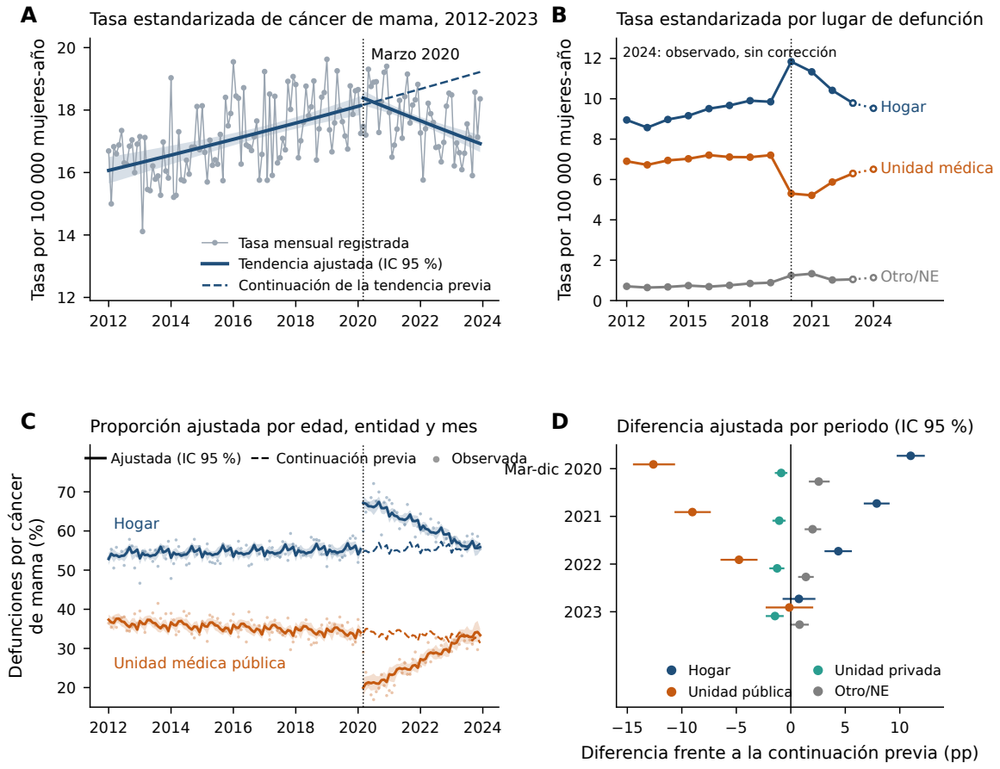


**Figura 5.** Análisis exploratorios de cáncer de mama en mujeres de 20 años o más. a: tasa estandarizada por edad (TEE), tendencia segmentada y continuación de la tendencia previa a marzo de 2020 (discontinua); banda: IC 95 % de la tendencia. b: media anual de las tasas mensuales por lugar; unidades médicas: públicas y privadas; 2024 (símbolo vacío), observado sin corrección. c: proporciones ajustadas por edad, entidad y mes (bandas: IC 95 %), continuación previa y valores observados (puntos). d: diferencias ajustadas frente a la continuación previa, en puntos porcentuales; IC 95 % por 10 000 simulaciones. Ajustes: 2012-2023; covarianza temporal robusta con 12 rezagos. Las líneas discontinuas son continuaciones descriptivas de modelos ajustados a toda la serie. Los IC no son intervalos de predicción; las diferencias no identifican causas.


<p><small>Resultados C50 recalculados desde el extracto distribuido. IC de parámetros y medias ajustadas; análisis exploratorio.</small></p><details><summary>Datos de esta figura</summary><p><a href="../ejecuciones/figuras_revision/20261020T172839Z_5c70e4a4/c50/c50/resultados/lugar_defuncion.json">../ejecuciones/figuras_revision/20261020T172839Z_5c70e4a4/c50/c50/resultados/lugar_defuncion.json</a> · <a href="../ejecuciones/figuras_revision/20261020T172839Z_5c70e4a4/c50/c50/resultados/tendencia_ampliaciones.json">../ejecuciones/figuras_revision/20261020T172839Z_5c70e4a4/c50/c50/resultados/tendencia_ampliaciones.json</a></p></details>


```python
inventario.append(mostrar_tabla(REPO, SALIDA, DATOS, tablas, 'S19', plegada=True))
```


<details id="tabla-S19"><summary><b>Tabla S19. Tendencia de la tasa estandarizada por edad (TEE) de cáncer de mama en mujeres ≥ 20 años: estimaciones con IC 95 % en todas las variantes ejecutadas.</b></summary><p><b>recalculado</b>. </p><p>Fuente: <a href="../ejecuciones/figuras_revision/20261020T172839Z_5c70e4a4/c50/c50/tablas/tablaS_tendencia_ampliaciones.csv">../ejecuciones/figuras_revision/20261020T172839Z_5c70e4a4/c50/c50/tablas/tablaS_tendencia_ampliaciones.csv</a> · <a href="../ejecuciones/figuras_revision/20261020T172839Z_5c70e4a4/c50/c50/reproduccion/pk/exploracion_previa/estimaciones_ITS.csv">../ejecuciones/figuras_revision/20261020T172839Z_5c70e4a4/c50/c50/reproduccion/pk/exploracion_previa/estimaciones_ITS.csv</a> · <a href="../ejecuciones/figuras_revision/20261020T172839Z_5c70e4a4/tablas_notebook/Tabla_S19.csv">Exportar CSV</a></p><p><small>Código: c50: reproducir_its_previa.py; tendencia_ampliaciones.py · <a href="../scripts/gmm.py">Ejecutor</a></small></p><div style="overflow:auto;max-height:480px"><table border="1" class="dataframe">
  <thead>
    <tr style="text-align: right;">
      <th>parametro</th>
      <th>Análisis</th>
      <th>Serie</th>
      <th>Cambio de pendiente, %</th>
      <th>Pendiente posterior, %/año</th>
      <th>Pendiente previa, %/año</th>
      <th>Cambio de nivel, %</th>
    </tr>
  </thead>
  <tbody>
    <tr>
      <th></th>
      <td>2023 + registro tardío (media)</td>
      <td>Nacional</td>
      <td>-3.57 (-4.38 a -2.75)</td>
      <td>-2.11 (-2.80 a -1.41)</td>
      <td>1.52 (1.04 a 1.99)</td>
      <td>1.13 (-1.03 a 3.33)</td>
    </tr>
    <tr>
      <th></th>
      <td>2023 + registro tardío (máximo)</td>
      <td>Nacional</td>
      <td>-3.55 (-4.37 a -2.72)</td>
      <td>-2.09 (-2.78 a -1.39)</td>
      <td>1.52 (1.04 a 1.99)</td>
      <td>1.11 (-1.06 a 3.32)</td>
    </tr>
    <tr>
      <th></th>
      <td>HAC6</td>
      <td>Nacional</td>
      <td>-3.64 (-4.69 a -2.58)</td>
      <td>-2.18 (-3.13 a -1.22)</td>
      <td>1.52 (1.06 a 1.98)</td>
      <td>1.21 (-1.53 a 4.02)</td>
    </tr>
    <tr>
      <th></th>
      <td>cuasi-Poisson por edad</td>
      <td>Nacional</td>
      <td>-3.64 (-4.36 a -2.91)</td>
      <td>-2.21 (-2.83 a -1.58)</td>
      <td>1.49 (1.06 a 1.92)</td>
      <td>1.24 (-0.79 a 3.31)</td>
    </tr>
    <tr>
      <th></th>
      <td>edad, modelo conjunto DK</td>
      <td>20-39</td>
      <td>-0.92 (-2.59 a 0.78)</td>
      <td>0.21 (-1.14 a 1.58)</td>
      <td>1.14 (0.05 a 2.24)</td>
      <td>-4.31 (-8.24 a -0.21)</td>
    </tr>
    <tr>
      <th></th>
      <td>edad, modelo conjunto DK</td>
      <td>40-59</td>
      <td>-4.57 (-5.84 a -3.28)</td>
      <td>-3.62 (-4.71 a -2.52)</td>
      <td>0.99 (0.29 a 1.70)</td>
      <td>2.41 (-1.41 a 6.39)</td>
    </tr>
    <tr>
      <th></th>
      <td>edad, modelo conjunto DK</td>
      <td>60+</td>
      <td>-3.26 (-4.51 a -2.00)</td>
      <td>-1.26 (-2.40 a -0.10)</td>
      <td>2.07 (1.65 a 2.49)</td>
      <td>0.79 (-1.74 a 3.40)</td>
    </tr>
    <tr>
      <th></th>
      <td>edad_exploratorio</td>
      <td>asmr_20-39</td>
      <td>-0.92 (-2.68 a 0.87)</td>
      <td>0.21 (-1.21 a 1.65)</td>
      <td>1.14 (-0.01 a 2.30)</td>
      <td>-4.31 (-8.44 a 0.02)</td>
    </tr>
    <tr>
      <th></th>
      <td>edad_exploratorio</td>
      <td>asmr_40-59</td>
      <td>-4.57 (-5.91 a -3.21)</td>
      <td>-3.62 (-4.77 a -2.47)</td>
      <td>0.99 (0.25 a 1.73)</td>
      <td>2.41 (-1.61 a 6.60)</td>
    </tr>
    <tr>
      <th></th>
      <td>edad_exploratorio</td>
      <td>asmr_60+</td>
      <td>-3.26 (-4.57 a -1.94)</td>
      <td>-1.26 (-2.46 a -0.04)</td>
      <td>2.07 (1.63 a 2.51)</td>
      <td>0.79 (-1.88 a 3.54)</td>
    </tr>
    <tr>
      <th></th>
      <td>incluye_2024_corregido</td>
      <td>Nacional</td>
      <td>-2.71 (-3.64 a -1.78)</td>
      <td>-1.24 (-2.09 a -0.39)</td>
      <td>1.51 (1.04 a 1.99)</td>
      <td>-0.10 (-2.95 a 2.83)</td>
    </tr>
    <tr>
      <th></th>
      <td>principal</td>
      <td>Nacional</td>
      <td>-3.64 (-4.44 a -2.84)</td>
      <td>-2.18 (-2.85 a -1.51)</td>
      <td>1.52 (1.04 a 1.99)</td>
      <td>1.21 (-0.91 a 3.37)</td>
    </tr>
    <tr>
      <th></th>
      <td>sin_2020</td>
      <td>Nacional</td>
      <td>-2.88 (-4.30 a -1.43)</td>
      <td>-1.37 (-2.78 a 0.06)</td>
      <td>1.55 (1.05 a 2.05)</td>
      <td>-3.55 (-6.96 a -0.01)</td>
    </tr>
    <tr>
      <th></th>
      <td>solo residentes 1-32</td>
      <td>Nacional</td>
      <td>-3.54 (-4.34 a -2.73)</td>
      <td>-2.15 (-2.86 a -1.45)</td>
      <td>1.44 (1.00 a 1.87)</td>
      <td>1.51 (-0.56 a 3.63)</td>
    </tr>
  </tbody>
</table></div></details><p><small>Pendientes en % anual; nivel en % instantáneo. IC 95 % de parámetros, no intervalos de predicción. Ajustes nacionales y separados: HAC con corrección n/(n−k). Modelo conjunto de edades: Driscoll-Kraay 12, corrección 144/143. Se conservan todas las variantes y los modelos por edad; no se seleccionan por significación.</small></p>


```python
inventario.append(mostrar_tabla(REPO, SALIDA, DATOS, tablas, 'S20', plegada=True))
```


<details id="tabla-S20"><summary><b>Tabla S20. Lugar de defunción por cáncer de mama: razones de momios (RM) del modelo logístico segmentado, análisis principal y sensibilidades.</b></summary><p><b>recalculado</b>. </p><p>Fuente: <a href="../ejecuciones/figuras_revision/20261020T172839Z_5c70e4a4/c50/c50/tablas/tablaS_lugar_razones_momios.csv">../ejecuciones/figuras_revision/20261020T172839Z_5c70e4a4/c50/c50/tablas/tablaS_lugar_razones_momios.csv</a> · <a href="../ejecuciones/figuras_revision/20261020T172839Z_5c70e4a4/tablas_notebook/Tabla_S20.csv">Exportar CSV</a></p><p><small>Código: c50: lugar_defuncion.py (NSIM=10000, semilla 20260930); tablas_lugar.py · <a href="../scripts/gmm.py">Ejecutor</a></small></p><div style="overflow:auto;max-height:480px"><table border="1" class="dataframe">
  <thead>
    <tr style="text-align: right;">
      <th>parametro</th>
      <th>Desenlace</th>
      <th>Análisis</th>
      <th>Cambio de nivel, RM</th>
      <th>Cambio de pendiente, RM/año</th>
      <th>Pendiente previa, RM/año</th>
      <th>Eventos / defunciones</th>
      <th>Wald nivel y pendiente, p</th>
    </tr>
  </thead>
  <tbody>
    <tr>
      <th></th>
      <td>Hogar</td>
      <td>principal</td>
      <td>1.727 (1.623 a 1.838)</td>
      <td>0.855 (0.836 a 0.875)</td>
      <td>1.006 (0.999 a 1.013)</td>
      <td>47310 / 82859</td>
      <td>1.39e-68</td>
    </tr>
    <tr>
      <th></th>
      <td>Hogar</td>
      <td>sens_2024_ponderado_completitud</td>
      <td>1.690 (1.580 a 1.808)</td>
      <td>0.868 (0.850 a 0.887)</td>
      <td>1.006 (0.999 a 1.013)</td>
      <td>51948 / 91221</td>
      <td>3.58e-58</td>
    </tr>
    <tr>
      <th></th>
      <td>Hogar</td>
      <td>sens_2024_sin_ponderar</td>
      <td>1.688 (1.577 a 1.807)</td>
      <td>0.869 (0.850 a 0.888)</td>
      <td>1.006 (0.999 a 1.013)</td>
      <td>51856 / 91037</td>
      <td>1.09e-55</td>
    </tr>
    <tr>
      <th></th>
      <td>Hogar</td>
      <td>sens_HAC6</td>
      <td>1.727 (1.600 a 1.865)</td>
      <td>0.855 (0.834 a 0.877)</td>
      <td>1.006 (0.999 a 1.014)</td>
      <td>47310 / 82859</td>
      <td>3.99e-47</td>
    </tr>
    <tr>
      <th></th>
      <td>Hogar</td>
      <td>sens_abril2020</td>
      <td>1.739 (1.643 a 1.841)</td>
      <td>0.844 (0.825 a 0.863)</td>
      <td>1.008 (1.001 a 1.015)</td>
      <td>47310 / 82859</td>
      <td>3.65e-88</td>
    </tr>
    <tr>
      <th></th>
      <td>Hogar</td>
      <td>sens_lugar_conocido</td>
      <td>1.789 (1.672 a 1.915)</td>
      <td>0.847 (0.826 a 0.868)</td>
      <td>1.004 (0.997 a 1.011)</td>
      <td>47310 / 81981</td>
      <td>6.72e-64</td>
    </tr>
    <tr>
      <th></th>
      <td>Hogar</td>
      <td>sens_no_residentes</td>
      <td>1.722 (1.619 a 1.832)</td>
      <td>0.855 (0.836 a 0.875)</td>
      <td>1.007 (1.000 a 1.014)</td>
      <td>47378 / 83174</td>
      <td>2.96e-68</td>
    </tr>
    <tr>
      <th></th>
      <td>Hogar</td>
      <td>sens_region</td>
      <td>1.716 (1.610 a 1.829)</td>
      <td>0.855 (0.836 a 0.875)</td>
      <td>1.007 (1.000 a 1.014)</td>
      <td>47310 / 82859</td>
      <td>2.03e-64</td>
    </tr>
    <tr>
      <th></th>
      <td>Otro/NE</td>
      <td>principal</td>
      <td>1.654 (1.387 a 1.971)</td>
      <td>0.900 (0.846 a 0.958)</td>
      <td>1.023 (1.005 a 1.042)</td>
      <td>4284 / 82859</td>
      <td>1.37e-07</td>
    </tr>
    <tr>
      <th></th>
      <td>Unidad privada</td>
      <td>principal</td>
      <td>0.857 (0.767 a 0.958)</td>
      <td>0.963 (0.925 a 1.002)</td>
      <td>1.017 (1.002 a 1.032)</td>
      <td>4502 / 82859</td>
      <td>0.000637</td>
    </tr>
    <tr>
      <th></th>
      <td>Unidad privada</td>
      <td>sens_2024_ponderado_completitud</td>
      <td>0.841 (0.749 a 0.944)</td>
      <td>0.976 (0.949 a 1.004)</td>
      <td>1.017 (1.002 a 1.032)</td>
      <td>4917 / 91221</td>
      <td>0.00088</td>
    </tr>
    <tr>
      <th></th>
      <td>Unidad privada</td>
      <td>sens_2024_sin_ponderar</td>
      <td>0.841 (0.749 a 0.944)</td>
      <td>0.976 (0.949 a 1.004)</td>
      <td>1.017 (1.002 a 1.032)</td>
      <td>4908 / 91037</td>
      <td>0.000908</td>
    </tr>
    <tr>
      <th></th>
      <td>Unidad privada</td>
      <td>sens_HAC6</td>
      <td>0.857 (0.770 a 0.955)</td>
      <td>0.963 (0.924 a 1.003)</td>
      <td>1.017 (1.002 a 1.031)</td>
      <td>4502 / 82859</td>
      <td>0.000581</td>
    </tr>
    <tr>
      <th></th>
      <td>Unidad privada</td>
      <td>sens_abril2020</td>
      <td>0.856 (0.763 a 0.961)</td>
      <td>0.965 (0.927 a 1.005)</td>
      <td>1.016 (1.001 a 1.030)</td>
      <td>4502 / 82859</td>
      <td>0.000762</td>
    </tr>
    <tr>
      <th></th>
      <td>Unidad privada</td>
      <td>sens_lugar_conocido</td>
      <td>0.867 (0.777 a 0.967)</td>
      <td>0.961 (0.922 a 1.000)</td>
      <td>1.016 (1.001 a 1.030)</td>
      <td>4502 / 81981</td>
      <td>0.000736</td>
    </tr>
    <tr>
      <th></th>
      <td>Unidad privada</td>
      <td>sens_no_residentes</td>
      <td>0.877 (0.786 a 0.977)</td>
      <td>0.966 (0.927 a 1.006)</td>
      <td>1.011 (0.997 a 1.026)</td>
      <td>4638 / 83174</td>
      <td>0.00227</td>
    </tr>
    <tr>
      <th></th>
      <td>Unidad privada</td>
      <td>sens_region</td>
      <td>0.863 (0.772 a 0.965)</td>
      <td>0.966 (0.929 a 1.005)</td>
      <td>1.014 (0.999 a 1.029)</td>
      <td>4502 / 82859</td>
      <td>0.00166</td>
    </tr>
    <tr>
      <th></th>
      <td>Unidad pública</td>
      <td>principal</td>
      <td>0.471 (0.415 a 0.535)</td>
      <td>1.254 (1.194 a 1.318)</td>
      <td>0.985 (0.976 a 0.994)</td>
      <td>26763 / 82859</td>
      <td>4.35e-30</td>
    </tr>
    <tr>
      <th></th>
      <td>Unidad pública</td>
      <td>sens_2024_ponderado_completitud</td>
      <td>0.498 (0.430 a 0.577)</td>
      <td>1.208 (1.155 a 1.263)</td>
      <td>0.985 (0.976 a 0.994)</td>
      <td>29521 / 91221</td>
      <td>5.42e-20</td>
    </tr>
    <tr>
      <th></th>
      <td>Unidad pública</td>
      <td>sens_2024_sin_ponderar</td>
      <td>0.499 (0.430 a 0.579)</td>
      <td>1.206 (1.152 a 1.263)</td>
      <td>0.985 (0.976 a 0.994)</td>
      <td>29448 / 91037</td>
      <td>2.34e-19</td>
    </tr>
    <tr>
      <th></th>
      <td>Unidad pública</td>
      <td>sens_HAC6</td>
      <td>0.471 (0.409 a 0.543)</td>
      <td>1.254 (1.190 a 1.322)</td>
      <td>0.985 (0.977 a 0.994)</td>
      <td>26763 / 82859</td>
      <td>2.39e-24</td>
    </tr>
    <tr>
      <th></th>
      <td>Unidad pública</td>
      <td>sens_abril2020</td>
      <td>0.463 (0.414 a 0.517)</td>
      <td>1.279 (1.219 a 1.343)</td>
      <td>0.984 (0.975 a 0.992)</td>
      <td>26763 / 82859</td>
      <td>1.4e-41</td>
    </tr>
    <tr>
      <th></th>
      <td>Unidad pública</td>
      <td>sens_lugar_conocido</td>
      <td>0.476 (0.420 a 0.540)</td>
      <td>1.253 (1.193 a 1.316)</td>
      <td>0.983 (0.974 a 0.993)</td>
      <td>26763 / 81981</td>
      <td>6.14e-30</td>
    </tr>
    <tr>
      <th></th>
      <td>Unidad pública</td>
      <td>sens_no_residentes</td>
      <td>0.469 (0.413 a 0.533)</td>
      <td>1.254 (1.194 a 1.317)</td>
      <td>0.986 (0.977 a 0.995)</td>
      <td>26830 / 83174</td>
      <td>2.77e-30</td>
    </tr>
    <tr>
      <th></th>
      <td>Unidad pública</td>
      <td>sens_region</td>
      <td>0.474 (0.417 a 0.538)</td>
      <td>1.253 (1.193 a 1.317)</td>
      <td>0.985 (0.976 a 0.994)</td>
      <td>26763 / 82859</td>
      <td>1.23e-29</td>
    </tr>
    <tr>
      <th></th>
      <td>Vía pública/otro</td>
      <td>sens_catalogo_alt</td>
      <td>1.481 (1.259 a 1.742)</td>
      <td>0.906 (0.847 a 0.971)</td>
      <td>1.061 (1.045 a 1.077)</td>
      <td>3406 / 82859</td>
      <td>9.74e-06</td>
    </tr>
  </tbody>
</table></div></details>


```python
inventario.append(mostrar_tabla(REPO, SALIDA, DATOS, tablas, 'S21A', plegada=True))
```


<details id="tabla-S21A"><summary><b>Tabla S21A. Proporción estandarizada de defunciones según lugar, continuación de la tendencia previa y diferencia en puntos porcentuales (pp), 2019-2023.</b></summary><p><b>recalculado</b>. </p><p>Fuente: <a href="../ejecuciones/figuras_revision/20261020T172839Z_5c70e4a4/c50/c50/tablas/tablaS_lugar_proporciones_estandarizadas.csv">../ejecuciones/figuras_revision/20261020T172839Z_5c70e4a4/c50/c50/tablas/tablaS_lugar_proporciones_estandarizadas.csv</a> · <a href="../ejecuciones/figuras_revision/20261020T172839Z_5c70e4a4/tablas_notebook/Tabla_S21A.csv">Exportar CSV</a></p><p><small>Código: c50: lugar_defuncion.py; tablas_lugar.py · <a href="../scripts/gmm.py">Ejecutor</a></small></p><div style="overflow:auto;max-height:480px"><table border="1" class="dataframe">
  <thead>
    <tr style="text-align: right;">
      <th>Desenlace</th>
      <th>Periodo</th>
      <th>Ajustada, % (IC 95 %)</th>
      <th>Continuación previa, % (IC 95 %)</th>
      <th>Diferencia principal, pp (IC 95 %)</th>
      <th>Diferencia indicadores posteriores, pp (IC 95 %)</th>
    </tr>
  </thead>
  <tbody>
    <tr>
      <td>Hogar</td>
      <td>2019</td>
      <td>55.2 (54.4 a 55.9)</td>
      <td>55.2 (54.4 a 55.9)</td>
      <td>0.0 (0.0 a 0.0)</td>
      <td>0.0 (0.0 a 0.0)</td>
    </tr>
    <tr>
      <td>Hogar</td>
      <td>mar-dic 2020</td>
      <td>66.4 (65.4 a 67.4)</td>
      <td>55.4 (54.5 a 56.4)</td>
      <td>11.0 (9.7 a 12.3)</td>
      <td>11.3 (9.9 a 12.6)</td>
    </tr>
    <tr>
      <td>Hogar</td>
      <td>2021</td>
      <td>63.3 (62.7 a 64.0)</td>
      <td>55.5 (54.4 a 56.5)</td>
      <td>7.9 (6.7 a 9.1)</td>
      <td>7.7 (5.8 a 9.6)</td>
    </tr>
    <tr>
      <td>Hogar</td>
      <td>2022</td>
      <td>60.0 (59.6 a 60.3)</td>
      <td>55.6 (54.4 a 56.8)</td>
      <td>4.4 (3.1 a 5.6)</td>
      <td>4.2 (2.6 a 5.8)</td>
    </tr>
    <tr>
      <td>Hogar</td>
      <td>2023</td>
      <td>56.5 (56.0 a 57.0)</td>
      <td>55.7 (54.4 a 57.1)</td>
      <td>0.7 (-0.8 a 2.3)</td>
      <td>1.1 (-0.3 a 2.6)</td>
    </tr>
    <tr>
      <td>Unidad pública</td>
      <td>2019</td>
      <td>34.2 (33.4 a 35.1)</td>
      <td>34.2 (33.4 a 35.1)</td>
      <td>0.0 (0.0 a 0.0)</td>
      <td>0.0 (0.0 a 0.0)</td>
    </tr>
    <tr>
      <td>Unidad pública</td>
      <td>mar-dic 2020</td>
      <td>21.2 (19.7 a 22.9)</td>
      <td>33.8 (32.8 a 34.9)</td>
      <td>-12.6 (-14.5 a -10.6)</td>
      <td>-13.2 (-14.9 a -11.4)</td>
    </tr>
    <tr>
      <td>Unidad pública</td>
      <td>2021</td>
      <td>24.6 (23.4 a 25.9)</td>
      <td>33.6 (32.4 a 34.9)</td>
      <td>-9.0 (-10.7 a -7.3)</td>
      <td>-9.1 (-11.4 a -6.8)</td>
    </tr>
    <tr>
      <td>Unidad pública</td>
      <td>2022</td>
      <td>28.5 (27.6 a 29.5)</td>
      <td>33.3 (31.9 a 34.7)</td>
      <td>-4.8 (-6.4 a -3.1)</td>
      <td>-3.5 (-5.5 a -1.5)</td>
    </tr>
    <tr>
      <td>Unidad pública</td>
      <td>2023</td>
      <td>32.8 (31.4 a 34.3)</td>
      <td>33.0 (31.4 a 34.6)</td>
      <td>-0.1 (-2.3 a 2.1)</td>
      <td>-1.1 (-2.7 a 0.5)</td>
    </tr>
    <tr>
      <td>Unidad privada</td>
      <td>2019</td>
      <td>5.9 (5.6 a 6.4)</td>
      <td>5.9 (5.6 a 6.4)</td>
      <td>0.0 (0.0 a 0.0)</td>
      <td>0.0 (0.0 a 0.0)</td>
    </tr>
    <tr>
      <td>Unidad privada</td>
      <td>mar-dic 2020</td>
      <td>5.2 (4.9 a 5.5)</td>
      <td>6.1 (5.6 a 6.6)</td>
      <td>-0.9 (-1.5 a -0.3)</td>
      <td>-0.6 (-1.1 a -0.1)</td>
    </tr>
    <tr>
      <td>Unidad privada</td>
      <td>2021</td>
      <td>5.1 (4.9 a 5.3)</td>
      <td>6.1 (5.6 a 6.8)</td>
      <td>-1.1 (-1.7 a -0.5)</td>
      <td>-1.2 (-1.8 a -0.6)</td>
    </tr>
    <tr>
      <td>Unidad privada</td>
      <td>2022</td>
      <td>5.0 (4.8 a 5.3)</td>
      <td>6.2 (5.7 a 6.9)</td>
      <td>-1.3 (-2.0 a -0.6)</td>
      <td>-1.7 (-2.5 a -1.1)</td>
    </tr>
    <tr>
      <td>Unidad privada</td>
      <td>2023</td>
      <td>4.9 (4.5 a 5.3)</td>
      <td>6.3 (5.7 a 7.1)</td>
      <td>-1.5 (-2.3 a -0.7)</td>
      <td>-1.2 (-2.0 a -0.5)</td>
    </tr>
    <tr>
      <td>Otro/NE</td>
      <td>2019</td>
      <td>4.7 (4.4 a 5.0)</td>
      <td>4.7 (4.4 a 5.0)</td>
      <td>0.0 (0.0 a 0.0)</td>
      <td>0.0 (0.0 a 0.0)</td>
    </tr>
    <tr>
      <td>Otro/NE</td>
      <td>mar-dic 2020</td>
      <td>7.3 (6.6 a 8.2)</td>
      <td>4.7 (4.4 a 5.2)</td>
      <td>2.6 (1.7 a 3.6)</td>
      <td>2.4 (1.5 a 3.3)</td>
    </tr>
    <tr>
      <td>Otro/NE</td>
      <td>2021</td>
      <td>6.9 (6.4 a 7.5)</td>
      <td>4.9 (4.5 a 5.4)</td>
      <td>2.0 (1.3 a 2.8)</td>
      <td>2.5 (1.6 a 3.3)</td>
    </tr>
    <tr>
      <td>Otro/NE</td>
      <td>2022</td>
      <td>6.4 (6.0 a 6.9)</td>
      <td>5.0 (4.5 a 5.6)</td>
      <td>1.4 (0.7 a 2.1)</td>
      <td>0.9 (0.1 a 1.6)</td>
    </tr>
    <tr>
      <td>Otro/NE</td>
      <td>2023</td>
      <td>5.9 (5.4 a 6.5)</td>
      <td>5.1 (4.5 a 5.8)</td>
      <td>0.8 (-0.03 a 1.7)</td>
      <td>1.0 (0.3 a 1.6)</td>
    </tr>
  </tbody>
</table></div></details>


```python
inventario.append(mostrar_tabla(REPO, SALIDA, DATOS, tablas, 'S21B', plegada=True))
```


<details id="tabla-S21B"><summary><b>Tabla S21B. Diferencia entre la proporción ajustada en 2023 y en 2019, según modelo de lugar de defunción (pp, IC 95 %).</b></summary><p><b>recalculado</b>. </p><p>Fuente: <a href="../ejecuciones/figuras_revision/20261020T172839Z_5c70e4a4/c50/c50/resultados/lugar_defuncion.json">../ejecuciones/figuras_revision/20261020T172839Z_5c70e4a4/c50/c50/resultados/lugar_defuncion.json</a> · <a href="../ejecuciones/figuras_revision/20261020T172839Z_5c70e4a4/tablas_notebook/Tabla_S21B.csv">Exportar CSV</a></p><p><small>Código: c50: lugar_defuncion.py; numeros_v11.py · <a href="../scripts/gmm.py">Ejecutor</a></small></p><div style="overflow:auto;max-height:480px"><table border="1" class="dataframe">
  <thead>
    <tr style="text-align: right;">
      <th>Desenlace</th>
      <th>Tendencia segmentada (pp, IC 95 %)</th>
      <th>Indicadores anuales (pp, IC 95 %)</th>
      <th>Indicadores de todos los años (pp, IC 95 %)</th>
    </tr>
  </thead>
  <tbody>
    <tr>
      <td>Hogar</td>
      <td>1.3 (0.4 a 2.3)</td>
      <td>1.7 (0.7 a 2.6)</td>
      <td>2.2 (0.7 a 3.6)</td>
    </tr>
    <tr>
      <td>Unidad pública</td>
      <td>-1.4 (-3.1 a 0.4)</td>
      <td>-2.3 (-3.3 a -1.3)</td>
      <td>-3.1 (-4.4 a -1.7)</td>
    </tr>
    <tr>
      <td>Unidad privada</td>
      <td>-1.1 (-1.6 a -0.5)</td>
      <td>-0.8 (-1.3 a -0.4)</td>
      <td>-0.3 (-0.6 a -0.01)</td>
    </tr>
    <tr>
      <td>Otro/NE</td>
      <td>1.2 (0.6 a 1.9)</td>
      <td>1.4 (1.0 a 1.8)</td>
      <td>1.2 (0.9 a 1.5)</td>
    </tr>
  </tbody>
</table></div></details><p><small>Diferencia entre probabilidades estandarizadas de 2023 y 2019, en puntos porcentuales; IC 95 % por simulación. No compara tasas poblacionales.</small></p>


**Lectura.** La pendiente de TEE disminuye después de marzo de 2020 en el ajuste principal; al excluir 2020, su incertidumbre permite una pendiente nula. El aumento de la proporción domiciliaria en 2020 no permite atribuir causas ni medir por sí mismo acceso o calidad de atención. Las continuaciones previas se derivan de modelos ajustados a toda la serie.

<a id="apvp"></a>
## 6. Mortalidad prematura y tamaño de localidad

Los APVP asignan a cada muerte a los 20–74 años **75 − edad cumplida − 0.5** años. Desde los 75 años la contribución es cero. Se mantienen todas las residencias para el indicador nacional.

El cálculo visible de 2023 se realiza directamente desde los registros filtrados y se coteja con la salida de C50. Para APVP de 2024 se conserva en el análisis completo la corrección por registro tardío, descrita en las notas de las tablas.


```python
c50["apvp"] = np.maximum(75 - c50.edad_anios - 0.5, 0)
registros_2023 = c50[c50.anio_ocur == 2023]
apvp_2023 = registros_2023.apvp.sum()
apvp_anuales = pd.read_csv(C / "resultados/v12_apvp_localidad/APVP_anual.csv").set_index("anio")
np.testing.assert_allclose(apvp_2023, apvp_anuales.loc[2023, "APVP_total"], rtol=0, atol=1e-9)
aporte_40_59 = 100 * registros_2023.loc[registros_2023.edad_anios.between(40, 59), "apvp"].sum() / apvp_2023
assert apvp_2023 == 120893 and round(aporte_40_59, 1) == 65.2
print(f"2023: {apvp_2023:,.0f} APVP; {aporte_40_59:.1f} % en mujeres de 40–59 años.")
```

    2023: 120,893 APVP; 65.2 % en mujeres de 40–59 años.


```python
inventario.append(mostrar_tabla(REPO, SALIDA, DATOS, tablas, 'S25A', plegada=False))
```


<h3 id="tabla-S25A">Tabla S25A. Años potenciales de vida perdidos antes de los 75 años por cáncer de mama</h3><p><b>recalculado</b>. </p><p>Fuente: <a href="../ejecuciones/figuras_revision/20261020T172839Z_5c70e4a4/c50/c50/resultados/v12_apvp_localidad/APVP_anual.csv">../ejecuciones/figuras_revision/20261020T172839Z_5c70e4a4/c50/c50/resultados/v12_apvp_localidad/APVP_anual.csv</a> · <a href="../ejecuciones/figuras_revision/20261020T172839Z_5c70e4a4/tablas_notebook/Tabla_S25A.csv">Exportar CSV</a></p><p><small>Código: c50: c50_apvp_localidad_v12.py · <a href="../scripts/gmm.py">Ejecutor</a></small></p><div style="overflow:auto;max-height:480px"><table border="1" class="dataframe">
  <thead>
    <tr style="text-align: right;">
      <th>anio</th>
      <th>APVP_total</th>
      <th>APVP_tasa_estandarizada</th>
    </tr>
  </thead>
  <tbody>
    <tr>
      <td>2012</td>
      <td>94633</td>
      <td>277.8</td>
    </tr>
    <tr>
      <td>2013</td>
      <td>91743.5</td>
      <td>261.7</td>
    </tr>
    <tr>
      <td>2014</td>
      <td>100056</td>
      <td>276.8</td>
    </tr>
    <tr>
      <td>2015</td>
      <td>101994</td>
      <td>275.9</td>
    </tr>
    <tr>
      <td>2016</td>
      <td>107788</td>
      <td>284.4</td>
    </tr>
    <tr>
      <td>2017</td>
      <td>112692</td>
      <td>289.7</td>
    </tr>
    <tr>
      <td>2018</td>
      <td>116088</td>
      <td>291.5</td>
    </tr>
    <tr>
      <td>2019</td>
      <td>118591</td>
      <td>291</td>
    </tr>
    <tr>
      <td>2020</td>
      <td>123822</td>
      <td>297.4</td>
    </tr>
    <tr>
      <td>2021</td>
      <td>120832</td>
      <td>284.7</td>
    </tr>
    <tr>
      <td>2022</td>
      <td>118302</td>
      <td>273.4</td>
    </tr>
    <tr>
      <td>2023</td>
      <td>120893</td>
      <td>274.1</td>
    </tr>
    <tr>
      <td>2024</td>
      <td>125311</td>
      <td>278.4</td>
    </tr>
  </tbody>
</table></div><p><small>APVP: mujeres de 20-74 años, suma de 75 − edad cumplida − 0.5. Tasa por 100 000 mujeres de 20-74 años, pesos OMS normalizados e interpolación WPP al día 15. 2024† corregido por registro tardío; sensibilidad fuera del periodo principal.</small></p>


```python
inventario.append(mostrar_tabla(REPO, SALIDA, DATOS, tablas, 'S25B', plegada=True))
```


<details id="tabla-S25B"><summary><b>Tabla S25B. Tendencia de la tasa de APVP y sensibilidades temporales</b></summary><p><b>recalculado</b>. </p><p>Fuente: <a href="../ejecuciones/figuras_revision/20261020T172839Z_5c70e4a4/c50/c50/resultados/v12_apvp_localidad/resumen.json">../ejecuciones/figuras_revision/20261020T172839Z_5c70e4a4/c50/c50/resultados/v12_apvp_localidad/resumen.json</a> · <a href="../ejecuciones/figuras_revision/20261020T172839Z_5c70e4a4/tablas_notebook/Tabla_S25B.csv">Exportar CSV</a></p><p><small>Código: c50: c50_apvp_localidad_v12.py · <a href="../scripts/gmm.py">Ejecutor</a></small></p><div style="overflow:auto;max-height:480px"><table border="1" class="dataframe">
  <thead>
    <tr style="text-align: right;">
      <th>Variante</th>
      <th>Parámetro</th>
      <th>Cambio % (IC 95 %)</th>
      <th>p</th>
    </tr>
  </thead>
  <tbody>
    <tr>
      <td>principal_2012_2023</td>
      <td>Pendiente previa</td>
      <td>1.15 (0.55 a 1.76)</td>
      <td>&lt; 0.001</td>
    </tr>
    <tr>
      <td>principal_2012_2023</td>
      <td>Pendiente posterior</td>
      <td>-2.55 (-3.55 a -1.53)</td>
      <td>&lt; 0.001</td>
    </tr>
    <tr>
      <td>principal_2012_2023</td>
      <td>Cambio de nivel</td>
      <td>0.37 (-3.18 a 4.04)</td>
      <td>0.842</td>
    </tr>
    <tr>
      <td>principal_2012_2023</td>
      <td>Cambio de pendiente</td>
      <td>-3.66 (-4.75 a -2.55)</td>
      <td>&lt; 0.001</td>
    </tr>
    <tr>
      <td>sin_2020_2012_2023</td>
      <td>Pendiente previa</td>
      <td>1.18 (0.55 a 1.81)</td>
      <td>&lt; 0.001</td>
    </tr>
    <tr>
      <td>sin_2020_2012_2023</td>
      <td>Pendiente posterior</td>
      <td>-1.07 (-2.67 a 0.55)</td>
      <td>0.196</td>
    </tr>
    <tr>
      <td>sin_2020_2012_2023</td>
      <td>Cambio de nivel</td>
      <td>-3.69 (-8.58 a 1.48)</td>
      <td>0.159</td>
    </tr>
    <tr>
      <td>sin_2020_2012_2023</td>
      <td>Cambio de pendiente</td>
      <td>-2.22 (-3.89 a -0.52)</td>
      <td>0.011</td>
    </tr>
    <tr>
      <td>con_2024_corregido</td>
      <td>Pendiente previa</td>
      <td>1.15 (0.55 a 1.76)</td>
      <td>&lt; 0.001</td>
    </tr>
    <tr>
      <td>con_2024_corregido</td>
      <td>Pendiente posterior</td>
      <td>-1.53 (-2.63 a -0.41)</td>
      <td>0.007</td>
    </tr>
    <tr>
      <td>con_2024_corregido</td>
      <td>Cambio de nivel</td>
      <td>-1.06 (-5.16 a 3.22)</td>
      <td>0.622</td>
    </tr>
    <tr>
      <td>con_2024_corregido</td>
      <td>Cambio de pendiente</td>
      <td>-2.65 (-3.83 a -1.45)</td>
      <td>&lt; 0.001</td>
    </tr>
  </tbody>
</table></div></details><p><small>Corte en marzo de 2020; HAC Bartlett a 12 meses calendario, corrección n/(n−k). Pendientes en % anual. Cambio de pendiente: 100 × [exp(β posterior − β previa) − 1]. IC normales de parámetros sin ajuste por multiplicidad. 2024† corregido por registro tardío.</small></p>


Para comparar localidades se restringe a residentes en México con ocurrencia en 2012–2023. Los códigos de tamaño de localidad se agrupan según el suplemento. El denominador incluye **todas las defunciones del grupo**, incluso sitio no especificado (99); la sensibilidad excluye únicamente ese código. Son proporciones entre fallecidas, no tasas de mortalidad poblacionales.


```python
residentes = c50[c50.ent_resid.between(1, 32) & (c50.anio_ocur <= 2023)].copy()
residentes["localidad"] = pd.cut(residentes.tloc_resid, [0, 3, 6, 12, 17],
    labels=["< 2 500", "2 500-14 999", "15 000-99 999", "≥ 100 000"])
local_2023 = residentes[residentes.anio_ocur == 2023].groupby("localidad", observed=True).agg(
    total=("sitio_ocur", "size"), hogar=("sitio_ocur", lambda x: (x == 11).sum()),
    sitio99=("sitio_ocur", lambda x: (x == 99).sum()))
local_2023["Hogar %"] = 100 * local_2023.hogar / local_2023.total
local_2023["Hogar % sin 99"] = 100 * local_2023.hogar / (local_2023.total - local_2023.sitio99)
local_salida = pd.read_csv(C / "resultados/v12_apvp_localidad/localidad_hogar.csv").query("anio == 2023").set_index("localidad")
np.testing.assert_allclose(local_2023["Hogar %"], local_salida.loc[local_2023.index, "hogar_pct"], rtol=1e-9, atol=1e-12)
assert round(local_2023.loc["< 2 500", "Hogar %"], 1) == 70.2
assert round(local_2023.loc["≥ 100 000", "Hogar %"], 1) == 53.0
display(local_2023.round(1))
```


<div>
<style scoped>
    .dataframe tbody tr th:only-of-type {
        vertical-align: middle;
    }

    .dataframe tbody tr th {
        vertical-align: top;
    }

    .dataframe thead th {
        text-align: right;
    }
</style>
<table border="1" class="dataframe">
  <thead>
    <tr style="text-align: right;">
      <th></th>
      <th>total</th>
      <th>hogar</th>
      <th>sitio99</th>
      <th>Hogar %</th>
      <th>Hogar % sin 99</th>
    </tr>
    <tr>
      <th>localidad</th>
      <th></th>
      <th></th>
      <th></th>
      <th></th>
      <th></th>
    </tr>
  </thead>
  <tbody>
    <tr>
      <th>&lt; 2 500</th>
      <td>851</td>
      <td>597</td>
      <td>4</td>
      <td>70.2</td>
      <td>70.5</td>
    </tr>
    <tr>
      <th>2 500-14 999</th>
      <td>892</td>
      <td>565</td>
      <td>5</td>
      <td>63.3</td>
      <td>63.7</td>
    </tr>
    <tr>
      <th>15 000-99 999</th>
      <td>1311</td>
      <td>785</td>
      <td>7</td>
      <td>59.9</td>
      <td>60.2</td>
    </tr>
    <tr>
      <th>≥ 100 000</th>
      <td>4857</td>
      <td>2576</td>
      <td>35</td>
      <td>53.0</td>
      <td>53.4</td>
    </tr>
  </tbody>
</table>
</div>


```python
inventario.append(mostrar_tabla(REPO, SALIDA, DATOS, tablas, 'S25C', plegada=False))
```


<h3 id="tabla-S25C">Tabla S25C. Defunciones en el hogar por tamaño de localidad de residencia</h3><p><b>recalculado</b>. </p><p>Fuente: <a href="../ejecuciones/figuras_revision/20261020T172839Z_5c70e4a4/c50/c50/resultados/v12_apvp_localidad/localidad_hogar.csv">../ejecuciones/figuras_revision/20261020T172839Z_5c70e4a4/c50/c50/resultados/v12_apvp_localidad/localidad_hogar.csv</a> · <a href="../ejecuciones/figuras_revision/20261020T172839Z_5c70e4a4/tablas_notebook/Tabla_S25C.csv">Exportar CSV</a></p><p><small>Código: c50: c50_apvp_localidad_v12.py · <a href="../scripts/gmm.py">Ejecutor</a></small></p><div style="overflow:auto;max-height:480px"><table border="1" class="dataframe">
  <thead>
    <tr style="text-align: right;">
      <th>Habitantes</th>
      <th>Año</th>
      <th>Hogar / total</th>
      <th>Hogar %</th>
      <th>Sitio 99 n</th>
      <th>Hogar % sin 99</th>
    </tr>
  </thead>
  <tbody>
    <tr>
      <td>&lt; 2 500</td>
      <td>2019</td>
      <td>607/897</td>
      <td>67.7</td>
      <td>11</td>
      <td>68.5</td>
    </tr>
    <tr>
      <td>&lt; 2 500</td>
      <td>2020</td>
      <td>711/942</td>
      <td>75.5</td>
      <td>14</td>
      <td>76.6</td>
    </tr>
    <tr>
      <td>&lt; 2 500</td>
      <td>2023</td>
      <td>597/851</td>
      <td>70.2</td>
      <td>4</td>
      <td>70.5</td>
    </tr>
    <tr>
      <td>2 500-14 999</td>
      <td>2019</td>
      <td>542/819</td>
      <td>66.2</td>
      <td>7</td>
      <td>66.7</td>
    </tr>
    <tr>
      <td>2 500-14 999</td>
      <td>2020</td>
      <td>627/911</td>
      <td>68.8</td>
      <td>12</td>
      <td>69.7</td>
    </tr>
    <tr>
      <td>2 500-14 999</td>
      <td>2023</td>
      <td>565/892</td>
      <td>63.3</td>
      <td>5</td>
      <td>63.7</td>
    </tr>
    <tr>
      <td>15 000-99 999</td>
      <td>2019</td>
      <td>665/1234</td>
      <td>53.9</td>
      <td>15</td>
      <td>54.6</td>
    </tr>
    <tr>
      <td>15 000-99 999</td>
      <td>2020</td>
      <td>871/1307</td>
      <td>66.6</td>
      <td>22</td>
      <td>67.8</td>
    </tr>
    <tr>
      <td>15 000-99 999</td>
      <td>2023</td>
      <td>785/1311</td>
      <td>59.9</td>
      <td>7</td>
      <td>60.2</td>
    </tr>
    <tr>
      <td>≥ 100 000</td>
      <td>2019</td>
      <td>2238/4437</td>
      <td>50.4</td>
      <td>31</td>
      <td>50.8</td>
    </tr>
    <tr>
      <td>≥ 100 000</td>
      <td>2020</td>
      <td>2830/4660</td>
      <td>60.7</td>
      <td>66</td>
      <td>61.6</td>
    </tr>
    <tr>
      <td>≥ 100 000</td>
      <td>2023</td>
      <td>2576/4857</td>
      <td>53</td>
      <td>35</td>
      <td>53.4</td>
    </tr>
  </tbody>
</table></div><p><small>Mujeres ≥ 20 años fallecidas por C50, residentes en México. Denominador: todas las defunciones de cada tamaño de localidad, incluido sitio 99; sin 99: hogar/(total−sitio 99). Proporciones crudas, sin ajuste por edad, entidad o mes; no son tasas de mortalidad.</small></p>


**Lectura.** El total de APVP puede aumentar mientras su tasa estandarizada disminuye. De igual manera, una proporción mayor de muertes en el hogar describe la distribución del lugar entre fallecidas; no demuestra mayor mortalidad de la población rural ni identifica preferencias o cuidados paliativos.

<a id="suplemento"></a>
## 7. Análisis complementarios y material suplementario

Este apartado completa la presentación de los análisis disponibles. Las tablas ya presentadas conservan su único punto de lectura en las secciones anteriores. Las restantes se agrupan por pregunta científica y mantienen la **numeración de la base histórica**, sin incorporar el análisis ajustado de localidad de otras versiones editoriales.

### Ajuste fino de Chronos-2

La figura 6 y la tabla S4 resumen resultados guardados de adaptación LoRA y ajuste completo. Se recalcula la agregación disponible, sin volver a entrenar. Las barras principales corresponden a semilla 0; los tres puntos LoRA muestran semillas 0, 1 y 2. El piloto de la figura S3 es histórico y diferente de este análisis.


```python
inventario.append(mostrar_figura(REPO, SALIDA, '6'))
```


<h3 id="figura-6">Figura 6</h3><p><b>regenerado desde resultados guardados</b> · <a href="../ejecuciones/figuras_revision/20261020T172839Z_5c70e4a4/figuras/figuras/Figura_6.pdf">PDF vectorial</a> · <a href="../src/figuras/actualizar_figuras.py">Código del generador</a></p>


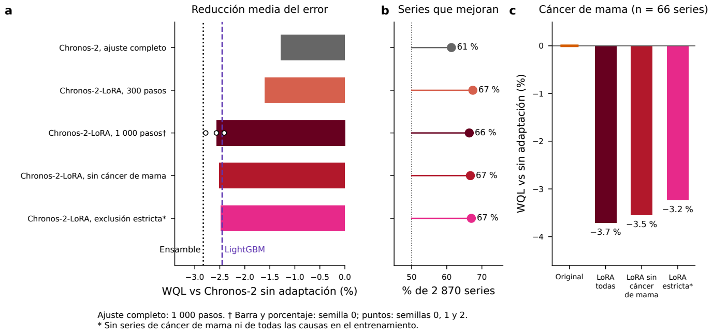


**Figura 6.** Ajuste fino de Chronos-2 (inicio en diciembre de 2016, 36 meses). Chronos-2-LoRA: adaptación mediante LoRA; ajuste completo: actualización de todos los parámetros. a: error (WQL) relativo a Chronos-2 sin adaptación (media geométrica por serie); barras con semilla 0 y puntos con semillas 0, 1 y 2 para LoRA de 1 000 pasos. b: proporción de series que mejoran con semilla 0. c: Chronos-2 sin adaptación y LoRA con todas las series, sin series de mama y con exclusión estricta (sin mama ni todas las causas). LightGBM se entrenó con datos del estudio; las líneas de referencia corresponden al mismo origen y horizonte.


<p><small>Figura desde resultados originales guardados de entrenamiento y adaptación; la tabla S4 recalcula su agregación. No se vuelve a entrenar.</small></p><details><summary>Datos de esta figura</summary><p><a href="../ejecuciones/figuras_revision/20261020T172839Z_5c70e4a4/figuras/trabajo/benchmark/entradas/finetune2_resultados.csv.gz">../ejecuciones/figuras_revision/20261020T172839Z_5c70e4a4/figuras/trabajo/benchmark/entradas/finetune2_resultados.csv.gz</a> · <a href="../ejecuciones/figuras_revision/20261020T172839Z_5c70e4a4/figuras/trabajo/benchmark/entradas/finetune_estricto_resultados.csv.gz">../ejecuciones/figuras_revision/20261020T172839Z_5c70e4a4/figuras/trabajo/benchmark/entradas/finetune_estricto_resultados.csv.gz</a></p></details>


```python
inventario.append(mostrar_tabla(REPO, SALIDA, DATOS, tablas, 'S4', plegada=True))
```


<details id="tabla-S4"><summary><b>Tabla S4. Ajuste fino de Chronos-2 (origen de diciembre de 2016, un solo origen, 2 870 series, horizonte de 36 meses).</b></summary><p><b>recalculado</b>. Agregación recalculada; el entrenamiento LoRA y el ajuste completo proceden de archivos guardados.</p><p>Fuente: <a href="../ejecuciones/figuras_revision/20261020T172839Z_5c70e4a4/benchmark/benchmark/resultados/p4b_lora_armonizado.csv">../ejecuciones/figuras_revision/20261020T172839Z_5c70e4a4/benchmark/benchmark/resultados/p4b_lora_armonizado.csv</a> · <a href="../ejecuciones/figuras_revision/20261020T172839Z_5c70e4a4/tablas_notebook/Tabla_S4.csv">Exportar CSV</a></p><p><small>Código: analisis/p4b_lora.py (agregación); lora/finetune2.py y finetune_estricto.py (nivel 4, no ejecutado) · <a href="../scripts/gmm.py">Ejecutor</a></small></p><div style="overflow:auto;max-height:480px"><table border="1" class="dataframe">
  <thead>
    <tr style="text-align: right;">
      <th>variante</th>
      <th>todas_n</th>
      <th>todas_WQL_rel_geo</th>
      <th>todas_mejora_media_pct</th>
      <th>todas_pct_series_mejoran</th>
      <th>todas_wilcoxon_p</th>
      <th>mama_n</th>
      <th>mama_WQL_rel_geo</th>
      <th>mama_mejora_media_pct</th>
      <th>mama_pct_series_mejoran</th>
      <th>mama_wilcoxon_p</th>
      <th>todascausas_n</th>
      <th>todascausas_WQL_rel_geo</th>
      <th>todascausas_mejora_media_pct</th>
      <th>todascausas_pct_series_mejoran</th>
      <th>todascausas_wilcoxon_p</th>
      <th>resto_n</th>
      <th>resto_WQL_rel_geo</th>
      <th>resto_mejora_media_pct</th>
      <th>resto_pct_series_mejoran</th>
      <th>resto_wilcoxon_p</th>
      <th>WQL_rel_media_aritm_de_razones</th>
      <th>cob80</th>
    </tr>
  </thead>
  <tbody>
    <tr>
      <td>LoRA 1000 s0</td>
      <td>2870</td>
      <td>0.974326</td>
      <td>2.56736</td>
      <td>66.4111</td>
      <td>4.70774e-77</td>
      <td>66</td>
      <td>0.962873</td>
      <td>3.71275</td>
      <td>80.303</td>
      <td>1.72555e-08</td>
      <td>264</td>
      <td>0.957075</td>
      <td>4.29254</td>
      <td>68.5606</td>
      <td>1.03918e-12</td>
      <td>2540</td>
      <td>0.976437</td>
      <td>2.35627</td>
      <td>65.8268</td>
      <td>1.58113e-61</td>
      <td>0.977062</td>
      <td>79.2828</td>
    </tr>
    <tr>
      <td>LoRA 1000 s1</td>
      <td>2870</td>
      <td>0.975887</td>
      <td>2.4113</td>
      <td>67.0732</td>
      <td>1.04874e-79</td>
      <td>66</td>
      <td>0.965103</td>
      <td>3.48974</td>
      <td>84.8485</td>
      <td>6.49169e-09</td>
      <td>264</td>
      <td>0.960877</td>
      <td>3.91229</td>
      <td>68.1818</td>
      <td>4.92273e-12</td>
      <td>2540</td>
      <td>0.977743</td>
      <td>2.22573</td>
      <td>66.4961</td>
      <td>2.68866e-64</td>
      <td>0.97861</td>
      <td>79.5383</td>
    </tr>
    <tr>
      <td>LoRA 1000 s2</td>
      <td>2870</td>
      <td>0.972183</td>
      <td>2.78167</td>
      <td>67.77</td>
      <td>1.51332e-94</td>
      <td>66</td>
      <td>0.963823</td>
      <td>3.61768</td>
      <td>81.8182</td>
      <td>3.10745e-08</td>
      <td>264</td>
      <td>0.951332</td>
      <td>4.86682</td>
      <td>75</td>
      <td>4.02835e-17</td>
      <td>2540</td>
      <td>0.974595</td>
      <td>2.54047</td>
      <td>66.6535</td>
      <td>2.79602e-74</td>
      <td>0.974966</td>
      <td>79.6651</td>
    </tr>
    <tr>
      <td>LoRA 300 s0</td>
      <td>2870</td>
      <td>0.984026</td>
      <td>1.59737</td>
      <td>67.4216</td>
      <td>7.67525e-84</td>
      <td>66</td>
      <td>0.982794</td>
      <td>1.72065</td>
      <td>77.2727</td>
      <td>5.16686e-06</td>
      <td>264</td>
      <td>0.970973</td>
      <td>2.90271</td>
      <td>71.5909</td>
      <td>9.01549e-14</td>
      <td>2540</td>
      <td>0.985425</td>
      <td>1.45748</td>
      <td>66.7323</td>
      <td>3.47751e-68</td>
      <td>0.98535</td>
      <td>80.6552</td>
    </tr>
    <tr>
      <td>LoRA 1000 sin mama</td>
      <td>2870</td>
      <td>0.97491</td>
      <td>2.50902</td>
      <td>66.7247</td>
      <td>4.47138e-76</td>
      <td>66</td>
      <td>0.964543</td>
      <td>3.54571</td>
      <td>81.8182</td>
      <td>2.15401e-08</td>
      <td>264</td>
      <td>0.957966</td>
      <td>4.20341</td>
      <td>69.697</td>
      <td>3.22901e-12</td>
      <td>2540</td>
      <td>0.976959</td>
      <td>2.30407</td>
      <td>66.0236</td>
      <td>4.73772e-61</td>
      <td>0.977609</td>
      <td>79.3748</td>
    </tr>
    <tr>
      <td>Completo 1000 s0</td>
      <td>2870</td>
      <td>0.98725</td>
      <td>1.27505</td>
      <td>61.324</td>
      <td>7.43283e-27</td>
      <td>66</td>
      <td>0.952477</td>
      <td>4.75231</td>
      <td>86.3636</td>
      <td>9.95065e-10</td>
      <td>264</td>
      <td>0.99656</td>
      <td>0.343958</td>
      <td>56.8182</td>
      <td>0.111915</td>
      <td>2540</td>
      <td>0.987206</td>
      <td>1.27938</td>
      <td>61.1417</td>
      <td>9.71329e-24</td>
      <td>0.991765</td>
      <td>79.065</td>
    </tr>
    <tr>
      <td>LoRA 1000 estricto (sin C50 ni todas las causas)</td>
      <td>2870</td>
      <td>0.975198</td>
      <td>2.48016</td>
      <td>67.0035</td>
      <td>1.57652e-82</td>
      <td>66</td>
      <td>0.967677</td>
      <td>3.23226</td>
      <td>81.8182</td>
      <td>4.97428e-08</td>
      <td>264</td>
      <td>0.96368</td>
      <td>3.63198</td>
      <td>68.9394</td>
      <td>3.70383e-11</td>
      <td>2540</td>
      <td>0.9766</td>
      <td>2.34001</td>
      <td>66.4173</td>
      <td>3.13783e-68</td>
      <td>0.97764</td>
      <td>79.397</td>
    </tr>
  </tbody>
</table></div></details><p><small>Se recalculó la agregación; el ajuste fino no se reejecutó. Exclusiones verificadas en código y corpus: 66 series C. mama; estricta 66 + 264 «Todas las causas» = 330 excluidas, 2 540 de entrenamiento (finetune_estricto_log.json).</small></p>


### Composición del corpus y validación a cuatro años

S1 reconstruye los conteos de series; los códigos CIE-10 y tipos se conservan como definiciones editoriales. S2A se reconstruye desde los NPZ de 48 meses mediante el script independiente incluido en el repositorio.


```python
inventario.append(mostrar_tabla(REPO, SALIDA, DATOS, tablas, 'S1', plegada=True))
```


<details id="tabla-S1"><summary><b>Tabla S1. Grupos de causa básica de defunción (CIE-10) y número de series incluidas por nivel.</b></summary><p><b>recalculado</b>. </p><p>Fuente: <a href="../ejecuciones/figuras_revision/20261020T172839Z_5c70e4a4/reconstruccion/tablaS1_grupos_CIE10.csv">../ejecuciones/figuras_revision/20261020T172839Z_5c70e4a4/reconstruccion/tablaS1_grupos_CIE10.csv</a> · <a href="../ejecuciones/figuras_revision/20261020T172839Z_5c70e4a4/tablas_notebook/Tabla_S1.csv">Exportar CSV</a></p><p><small>Código: src/benchmark/analisis/reconstruir_S1_S2A.py · <a href="../scripts/gmm.py">Ejecutor</a></small></p><div style="overflow:auto;max-height:480px"><table border="1" class="dataframe">
  <thead>
    <tr style="text-align: right;">
      <th>Tipo</th>
      <th>Grupo</th>
      <th>CIE10</th>
      <th>Nacional</th>
      <th>Nacional×edad</th>
      <th>Estatal</th>
      <th>Estatal×edad</th>
      <th>Total series</th>
    </tr>
  </thead>
  <tbody>
    <tr>
      <td>Cánceres</td>
      <td>C. mama</td>
      <td>C50</td>
      <td>1</td>
      <td>3</td>
      <td>27</td>
      <td>35</td>
      <td>66</td>
    </tr>
    <tr>
      <td>Cánceres</td>
      <td>C. cérvix</td>
      <td>C53</td>
      <td>1</td>
      <td>3</td>
      <td>22</td>
      <td>22</td>
      <td>48</td>
    </tr>
    <tr>
      <td>Cánceres</td>
      <td>C. ovario</td>
      <td>C56</td>
      <td>1</td>
      <td>3</td>
      <td>15</td>
      <td>11</td>
      <td>30</td>
    </tr>
    <tr>
      <td>Cánceres</td>
      <td>C. próstata</td>
      <td>C61</td>
      <td>1</td>
      <td>2</td>
      <td>27</td>
      <td>29</td>
      <td>59</td>
    </tr>
    <tr>
      <td>Cánceres</td>
      <td>C. pulmón</td>
      <td>C33-C34</td>
      <td>2</td>
      <td>6</td>
      <td>36</td>
      <td>34</td>
      <td>78</td>
    </tr>
    <tr>
      <td>Cánceres</td>
      <td>C. colorrectal</td>
      <td>C18-C21</td>
      <td>2</td>
      <td>6</td>
      <td>34</td>
      <td>27</td>
      <td>69</td>
    </tr>
    <tr>
      <td>Cánceres</td>
      <td>C. estómago</td>
      <td>C16</td>
      <td>2</td>
      <td>6</td>
      <td>37</td>
      <td>29</td>
      <td>74</td>
    </tr>
    <tr>
      <td>Cánceres</td>
      <td>C. hígado</td>
      <td>C22</td>
      <td>2</td>
      <td>6</td>
      <td>40</td>
      <td>35</td>
      <td>83</td>
    </tr>
    <tr>
      <td>Cánceres</td>
      <td>C. páncreas</td>
      <td>C25</td>
      <td>2</td>
      <td>4</td>
      <td>27</td>
      <td>17</td>
      <td>50</td>
    </tr>
    <tr>
      <td>Cánceres</td>
      <td>Leucemias</td>
      <td>C91-C95</td>
      <td>2</td>
      <td>6</td>
      <td>26</td>
      <td>15</td>
      <td>49</td>
    </tr>
    <tr>
      <td>Cánceres</td>
      <td>Linfomas y mieloma</td>
      <td>C81-C90</td>
      <td>2</td>
      <td>6</td>
      <td>23</td>
      <td>14</td>
      <td>45</td>
    </tr>
    <tr>
      <td>Cánceres</td>
      <td>C. riñón</td>
      <td>C64</td>
      <td>2</td>
      <td>4</td>
      <td>10</td>
      <td>5</td>
      <td>21</td>
    </tr>
    <tr>
      <td>Cánceres</td>
      <td>Tumores SNC</td>
      <td>C70-C72</td>
      <td>2</td>
      <td>6</td>
      <td>10</td>
      <td>1</td>
      <td>19</td>
    </tr>
    <tr>
      <td>Crónicas no transmisibles</td>
      <td>Cardiopatía isquémica</td>
      <td>I20-I25</td>
      <td>2</td>
      <td>6</td>
      <td>64</td>
      <td>134</td>
      <td>206</td>
    </tr>
    <tr>
      <td>Crónicas no transmisibles</td>
      <td>Enf. cerebrovascular</td>
      <td>I60-I69</td>
      <td>2</td>
      <td>6</td>
      <td>64</td>
      <td>103</td>
      <td>175</td>
    </tr>
    <tr>
      <td>Crónicas no transmisibles</td>
      <td>Enf. hipertensivas</td>
      <td>I10-I15</td>
      <td>2</td>
      <td>6</td>
      <td>58</td>
      <td>83</td>
      <td>149</td>
    </tr>
    <tr>
      <td>Crónicas no transmisibles</td>
      <td>Diabetes mellitus</td>
      <td>E10-E14</td>
      <td>2</td>
      <td>6</td>
      <td>64</td>
      <td>139</td>
      <td>211</td>
    </tr>
    <tr>
      <td>Crónicas no transmisibles</td>
      <td>EPOC</td>
      <td>J40-J44</td>
      <td>2</td>
      <td>6</td>
      <td>60</td>
      <td>70</td>
      <td>138</td>
    </tr>
    <tr>
      <td>Crónicas no transmisibles</td>
      <td>Enf. hepáticas</td>
      <td>K70-K76</td>
      <td>2</td>
      <td>6</td>
      <td>61</td>
      <td>119</td>
      <td>188</td>
    </tr>
    <tr>
      <td>Crónicas no transmisibles</td>
      <td>Insuficiencia renal</td>
      <td>N17-N19</td>
      <td>2</td>
      <td>6</td>
      <td>54</td>
      <td>72</td>
      <td>134</td>
    </tr>
    <tr>
      <td>Infecciosas y nutricionales</td>
      <td>Influenza y neumonía</td>
      <td>J09-J18</td>
      <td>2</td>
      <td>6</td>
      <td>61</td>
      <td>91</td>
      <td>160</td>
    </tr>
    <tr>
      <td>Infecciosas y nutricionales</td>
      <td>VIH</td>
      <td>B20-B24</td>
      <td>2</td>
      <td>5</td>
      <td>24</td>
      <td>22</td>
      <td>53</td>
    </tr>
    <tr>
      <td>Infecciosas y nutricionales</td>
      <td>Desnutrición</td>
      <td>E40-E46</td>
      <td>2</td>
      <td>6</td>
      <td>39</td>
      <td>29</td>
      <td>76</td>
    </tr>
    <tr>
      <td>Causas externas</td>
      <td>Homicidio</td>
      <td>X85-X99, Y00-Y09</td>
      <td>2</td>
      <td>6</td>
      <td>47</td>
      <td>67</td>
      <td>122</td>
    </tr>
    <tr>
      <td>Causas externas</td>
      <td>Suicidio</td>
      <td>X60-X84</td>
      <td>2</td>
      <td>5</td>
      <td>32</td>
      <td>32</td>
      <td>71</td>
    </tr>
    <tr>
      <td>Causas externas</td>
      <td>Accidentes de tránsito</td>
      <td>V01-V89</td>
      <td>2</td>
      <td>6</td>
      <td>55</td>
      <td>75</td>
      <td>138</td>
    </tr>
    <tr>
      <td>Mal definidas / todas</td>
      <td>Causas mal definidas</td>
      <td>R00-R99</td>
      <td>2</td>
      <td>6</td>
      <td>46</td>
      <td>40</td>
      <td>94</td>
    </tr>
    <tr>
      <td>Mal definidas / todas</td>
      <td>Todas las causas</td>
      <td>A00-Z99 (todas las defunciones con causa básica registrada)</td>
      <td>2</td>
      <td>6</td>
      <td>64</td>
      <td>192</td>
      <td>264</td>
    </tr>
  </tbody>
</table></div></details><p><small>Tipo y CIE10 conservados como definiciones de la entrada. No reproduce el corpus desde microdatos ni recupera el generador histórico.</small></p>


```python
inventario.append(mostrar_tabla(REPO, SALIDA, DATOS, tablas, 'S2A', plegada=True))
```


<details id="tabla-S2A"><summary><b>Tabla S2A. Validación a 48 meses de la evaluación comparativa (orígenes de diciembre de 2014 y 2015; 2 870 series; periodos de prueba hasta 2018 y 2019).</b></summary><p><b>recalculado</b>. </p><p>Fuente: <a href="../ejecuciones/figuras_revision/20261020T172839Z_5c70e4a4/reconstruccion/tablaS2A_validacion48_benchmark.csv">../ejecuciones/figuras_revision/20261020T172839Z_5c70e4a4/reconstruccion/tablaS2A_validacion48_benchmark.csv</a> · <a href="../ejecuciones/figuras_revision/20261020T172839Z_5c70e4a4/tablas_notebook/Tabla_S2A.csv">Exportar CSV</a></p><p><small>Código: src/benchmark/analisis/reconstruir_S1_S2A.py · <a href="../scripts/gmm.py">Ejecutor</a></small></p><div style="overflow:auto;max-height:480px"><table border="1" class="dataframe">
  <thead>
    <tr style="text-align: right;">
      <th>Modelo</th>
      <th>año 1</th>
      <th>año 2</th>
      <th>año 3</th>
      <th>año 4</th>
      <th>0-48</th>
      <th>cov_h1</th>
      <th>cov_h2</th>
      <th>cov_h3</th>
      <th>cov_h4</th>
      <th>rango_serie</th>
      <th>FPR_año4</th>
      <th>semiancho_año4</th>
    </tr>
  </thead>
  <tbody>
    <tr>
      <td>LightGBM global</td>
      <td>-12.3</td>
      <td>-14.7</td>
      <td>-19.5</td>
      <td>-24.8</td>
      <td>-17.9</td>
      <td>74.5</td>
      <td>70.6</td>
      <td>68.9</td>
      <td>67</td>
      <td>2.83</td>
      <td>9.7</td>
      <td>44.9</td>
    </tr>
    <tr>
      <td>Ensamble (mediana)</td>
      <td>-10.3</td>
      <td>-13.6</td>
      <td>-16.7</td>
      <td>-20</td>
      <td>-15.8</td>
      <td>81.3</td>
      <td>81.9</td>
      <td>82.4</td>
      <td>82.6</td>
      <td>3.47</td>
      <td>9.6</td>
      <td>52.5</td>
    </tr>
    <tr>
      <td>TimesFM-2.5</td>
      <td>-10</td>
      <td>-12.3</td>
      <td>-15.6</td>
      <td>-18.3</td>
      <td>-14.3</td>
      <td>80.5</td>
      <td>79.4</td>
      <td>77.8</td>
      <td>75.6</td>
      <td>3.91</td>
      <td>9.5</td>
      <td>57.9</td>
    </tr>
    <tr>
      <td>Chronos-Bolt</td>
      <td>-7.2</td>
      <td>-12.1</td>
      <td>-14.2</td>
      <td>-17.2</td>
      <td>-13.5</td>
      <td>84.2</td>
      <td>85.1</td>
      <td>85.3</td>
      <td>84.1</td>
      <td>4.03</td>
      <td>9.8</td>
      <td>54.3</td>
    </tr>
    <tr>
      <td>Chronos-2</td>
      <td>-8</td>
      <td>-12.5</td>
      <td>-14.2</td>
      <td>-16.8</td>
      <td>-13.6</td>
      <td>84.3</td>
      <td>85.7</td>
      <td>86.3</td>
      <td>86.5</td>
      <td>4.29</td>
      <td>10</td>
      <td>54.6</td>
    </tr>
    <tr>
      <td>Log-lineal</td>
      <td>0</td>
      <td>0</td>
      <td>0</td>
      <td>0</td>
      <td>0</td>
      <td>77.6</td>
      <td>74.7</td>
      <td>73.1</td>
      <td>71.8</td>
      <td>6.51</td>
      <td>6.1</td>
      <td>101.4</td>
    </tr>
    <tr>
      <td>ETS amortiguado</td>
      <td>0.9</td>
      <td>-0.3</td>
      <td>-3.6</td>
      <td>-7.1</td>
      <td>-2.1</td>
      <td>61.5</td>
      <td>59.2</td>
      <td>58.1</td>
      <td>56.4</td>
      <td>6.57</td>
      <td>9</td>
      <td>64.2</td>
    </tr>
    <tr>
      <td>N-HiTS global</td>
      <td>-7.3</td>
      <td>-11.6</td>
      <td>-7.7</td>
      <td>23.3</td>
      <td>1.8</td>
      <td>80.8</td>
      <td>80.2</td>
      <td>71.5</td>
      <td>39.2</td>
      <td>7.18</td>
      <td>3.7</td>
      <td>94.6</td>
    </tr>
    <tr>
      <td>SARIMA</td>
      <td>6.5</td>
      <td>11.5</td>
      <td>20.4</td>
      <td>30.6</td>
      <td>19.9</td>
      <td>78.7</td>
      <td>81.5</td>
      <td>82.9</td>
      <td>83.9</td>
      <td>7.94</td>
      <td>5.1</td>
      <td>147</td>
    </tr>
    <tr>
      <td>Ingenuo estacional</td>
      <td>14.9</td>
      <td>10.8</td>
      <td>5.7</td>
      <td>-0.2</td>
      <td>7.1</td>
      <td>75.1</td>
      <td>70.7</td>
      <td>67.8</td>
      <td>65.6</td>
      <td>8.27</td>
      <td>10.3</td>
      <td>51.4</td>
    </tr>
  </tbody>
</table></div></details><p><small>Código nuevo de Codex; generador histórico no recuperado. Reproduce desde los NPZ h48 guardados, no los regenera.</small></p>


```python
inventario.append(mostrar_tabla(REPO, SALIDA, DATOS, tablas, 'S15', plegada=True))
```


<details id="tabla-S15"><summary><b>Tabla S15. Versión completa de la tabla 1: desempeño de los diez modelos en 2 870 series (orígenes de diciembre de 2014, 2015 y 2016; 36 meses).</b></summary><p><b>recalculado</b>. </p><p>Fuente: <a href="../ejecuciones/figuras_revision/20261020T172839Z_5c70e4a4/benchmark/benchmark/documentos/tablas/tablaS15_desempeno_completo.csv">../ejecuciones/figuras_revision/20261020T172839Z_5c70e4a4/benchmark/benchmark/documentos/tablas/tablaS15_desempeno_completo.csv</a> · <a href="../ejecuciones/figuras_revision/20261020T172839Z_5c70e4a4/tablas_notebook/Tabla_S15.csv">Exportar CSV</a></p><p><small>Código: analisis/tabla1_y_S15.py (paso añadido, extraído de generar_manuscrito.py) · <a href="../scripts/gmm.py">Ejecutor</a></small></p><div style="overflow:auto;max-height:480px"><table border="1" class="dataframe">
  <thead>
    <tr style="text-align: right;">
      <th>Modelo</th>
      <th>Familia</th>
      <th>Rango WQL</th>
      <th>Reducción de WQL vs log-lineal, % (IC 95 %)</th>
      <th>Cobertura observada del IP 80 % (%)</th>
      <th>Falsas alarmas, IP bilateral 90 % (%)</th>
      <th>Semiancho IP 90 % (%)</th>
      <th>Falsas alarmas superiores, unilateral (%)</th>
      <th>Detección de +20 %, unilateral (%)</th>
    </tr>
  </thead>
  <tbody>
    <tr>
      <td>LightGBM</td>
      <td>Global (IA)</td>
      <td>3.21</td>
      <td>13.3 (10.6 a 16.2)</td>
      <td>72.1</td>
      <td>10.1</td>
      <td>30</td>
      <td>4.1</td>
      <td>21.6</td>
    </tr>
    <tr>
      <td>Ensamble</td>
      <td>Ensamble (clásicos + fundacionales)</td>
      <td>3.52</td>
      <td>12.4 (9.9 a 14.8)</td>
      <td>82</td>
      <td>8.6</td>
      <td>34</td>
      <td>4.5</td>
      <td>22.2</td>
    </tr>
    <tr>
      <td>TimesFM-2.5</td>
      <td>Fundacional (IA)</td>
      <td>4.01</td>
      <td>10.9 (6.9 a 14.7)</td>
      <td>79.7</td>
      <td>10</td>
      <td>36</td>
      <td>5.1</td>
      <td>23</td>
    </tr>
    <tr>
      <td>Chronos-Bolt</td>
      <td>Fundacional (IA)</td>
      <td>4.29</td>
      <td>9.8 (5.4 a 13.9)</td>
      <td>84.7</td>
      <td>9.6</td>
      <td>34</td>
      <td>4.8</td>
      <td>22.9</td>
    </tr>
    <tr>
      <td>Chronos-2</td>
      <td>Fundacional (IA)</td>
      <td>4.42</td>
      <td>10.4 (7.0 a 13.6)</td>
      <td>84.8</td>
      <td>9</td>
      <td>35</td>
      <td>4.5</td>
      <td>20.2</td>
    </tr>
    <tr>
      <td>N-HiTS</td>
      <td>Global (IA)</td>
      <td>5.17</td>
      <td>7.9 (4.6 a 11.4)</td>
      <td>78.6</td>
      <td>9</td>
      <td>31</td>
      <td>4.2</td>
      <td>25.7</td>
    </tr>
    <tr>
      <td>Log-lineal</td>
      <td>Clásico</td>
      <td>6.61</td>
      <td>referencia</td>
      <td>75.5</td>
      <td>6.4</td>
      <td>45</td>
      <td>3.6</td>
      <td>17.1</td>
    </tr>
    <tr>
      <td>ETS</td>
      <td>Clásico</td>
      <td>6.77</td>
      <td>0.7 (−3.0 a 4.1)</td>
      <td>62.2</td>
      <td>8.1</td>
      <td>39</td>
      <td>4.6</td>
      <td>23</td>
    </tr>
    <tr>
      <td>SARIMA</td>
      <td>Clásico</td>
      <td>7.99</td>
      <td>−10.8 (−12.6 a −9.1)</td>
      <td>81.2</td>
      <td>4.7</td>
      <td>52</td>
      <td>3.1</td>
      <td>15.8</td>
    </tr>
    <tr>
      <td>Ingenuo estacional</td>
      <td>Clásico</td>
      <td>9</td>
      <td>−12.8 (−17.6 a −8.2)</td>
      <td>71.5</td>
      <td>8.5</td>
      <td>35</td>
      <td>3.9</td>
      <td>21.8</td>
    </tr>
  </tbody>
</table></div></details><p><small>El ejecutor original no lo regeneraba.</small></p>


### Incertidumbre de la aplicación a mama

Las tablas S2B–S2G separan rangos por serie, calibración entre series, composición del conjunto y comprobaciones con separación temporal. No convierten el nivel nominal del IP en una cobertura demostrada para TEE. S3 presenta variantes desde un CSV guardado cuyo generador no fue localizado. S6 y S8 también dependen de etapas guardadas.


```python
inventario.append(mostrar_tabla(REPO, SALIDA, DATOS, tablas, 'S2B', plegada=True))
```


<details id="tabla-S2B"><summary><b>Tabla S2B. Cáncer de mama: diferencia entre mortalidad observada y esperada (ensamble) con tres enfoques de incertidumbre, 2020-2024.</b></summary><p><b>recalculado</b>. </p><p>Fuente: <a href="../ejecuciones/figuras_revision/20261020T172839Z_5c70e4a4/benchmark/benchmark/documentos/tablas/tablaS2B_v9.csv">../ejecuciones/figuras_revision/20261020T172839Z_5c70e4a4/benchmark/benchmark/documentos/tablas/tablaS2B_v9.csv</a> · <a href="../ejecuciones/figuras_revision/20261020T172839Z_5c70e4a4/tablas_notebook/Tabla_S2B.csv">Exportar CSV</a></p><p><small>Código: analisis/p1_intervalos_mama.py; tablas_v9.py · <a href="../scripts/gmm.py">Ejecutor</a></small></p><div style="overflow:auto;max-height:480px"><table border="1" class="dataframe">
  <thead>
    <tr style="text-align: right;">
      <th>Serie</th>
      <th>Año</th>
      <th>Diferencia (%)</th>
      <th>Rango por serie (descriptivo)</th>
      <th>IP 90 % entre series (todas)</th>
      <th>IP 90 % entre series (nacionales)</th>
      <th>Estrato de volumen</th>
    </tr>
  </thead>
  <tbody>
    <tr>
      <td>Nacional, TEE</td>
      <td>2020</td>
      <td>+1.2</td>
      <td>−5.4 a 8.3</td>
      <td>−7.5 a 10.7</td>
      <td>−9.0 a 12.5</td>
      <td>300-1000</td>
    </tr>
    <tr>
      <td>Nacional, TEE</td>
      <td>2021</td>
      <td>−2.2</td>
      <td>−7.5 a 3.4</td>
      <td>−14.2 a 11.5</td>
      <td>−15.5 a 13.3</td>
      <td>300-1000</td>
    </tr>
    <tr>
      <td>Nacional, TEE</td>
      <td>2022</td>
      <td>−6.3</td>
      <td>−13.5 a 1.5</td>
      <td>−20.0 a 9.8</td>
      <td>−26.0 a 18.8</td>
      <td>300-1000</td>
    </tr>
    <tr>
      <td>Nacional, TEE</td>
      <td>2023</td>
      <td>−7.8</td>
      <td>−14.7 a −0.4</td>
      <td>−24.9 a 13.2</td>
      <td>−31.1 a 23.3</td>
      <td>300-1000</td>
    </tr>
    <tr>
      <td>Nacional, TEE</td>
      <td>2024</td>
      <td>−6.5</td>
      <td>−13.7 a 1.2</td>
      <td>(−23.9 a 14.8)</td>
      <td>(−30.1 a 25.0)</td>
      <td>300-1000</td>
    </tr>
    <tr>
      <td>20-39 años (TEE)</td>
      <td>2020</td>
      <td>−4.2</td>
      <td>−19.1 a 13.4</td>
      <td>−19.4 a 13.9</td>
      <td>−16.3 a 9.7</td>
      <td>25-100</td>
    </tr>
    <tr>
      <td>20-39 años (TEE)</td>
      <td>2021</td>
      <td>−2.9</td>
      <td>−17.8 a 14.6</td>
      <td>−23.5 a 23.1</td>
      <td>−16.7 a 13.1</td>
      <td>25-100</td>
    </tr>
    <tr>
      <td>20-39 años (TEE)</td>
      <td>2022</td>
      <td>−6.0</td>
      <td>−18.5 a 8.4</td>
      <td>−29.4 a 25.2</td>
      <td>−20.5 a 11.1</td>
      <td>25-100</td>
    </tr>
    <tr>
      <td>20-39 años (TEE)</td>
      <td>2023</td>
      <td>−4.4</td>
      <td>−18.2 a 11.9</td>
      <td>−34.1 a 38.7</td>
      <td>−22.8 a 18.5</td>
      <td>25-100</td>
    </tr>
    <tr>
      <td>20-39 años (TEE)</td>
      <td>2024</td>
      <td>−2.0</td>
      <td>−15.1 a 13.0</td>
      <td>(−32.5 a 42.1)</td>
      <td>(−20.9 a 21.3)</td>
      <td>25-100</td>
    </tr>
    <tr>
      <td>40-59 años (TEE)</td>
      <td>2020</td>
      <td>+3.4</td>
      <td>−1.3 a 8.3</td>
      <td>−9.2 a 17.6</td>
      <td>−6.7 a 14.5</td>
      <td>100-300</td>
    </tr>
    <tr>
      <td>40-59 años (TEE)</td>
      <td>2021</td>
      <td>−2.4</td>
      <td>−8.2 a 3.8</td>
      <td>−19.3 a 18.0</td>
      <td>−16.3 a 13.8</td>
      <td>100-300</td>
    </tr>
    <tr>
      <td>40-59 años (TEE)</td>
      <td>2022</td>
      <td>−7.6</td>
      <td>−14.8 a 0.1</td>
      <td>−27.4 a 17.4</td>
      <td>−23.0 a 10.8</td>
      <td>100-300</td>
    </tr>
    <tr>
      <td>40-59 años (TEE)</td>
      <td>2023</td>
      <td>−8.4</td>
      <td>−16.0 a −0.2</td>
      <td>−32.0 a 23.4</td>
      <td>−28.6 a 17.4</td>
      <td>100-300</td>
    </tr>
    <tr>
      <td>40-59 años (TEE)</td>
      <td>2024</td>
      <td>−7.2</td>
      <td>−14.3 a 0.6</td>
      <td>(−31.1 a 25.1)</td>
      <td>(−27.6 a 19.0)</td>
      <td>100-300</td>
    </tr>
    <tr>
      <td>≥ 60 años (TEE)</td>
      <td>2020</td>
      <td>+0.6</td>
      <td>−6.8 a 8.6</td>
      <td>−11.6 a 14.5</td>
      <td>−9.2 a 11.5</td>
      <td>100-300</td>
    </tr>
    <tr>
      <td>≥ 60 años (TEE)</td>
      <td>2021</td>
      <td>−1.4</td>
      <td>−9.2 a 7.1</td>
      <td>−18.4 a 19.3</td>
      <td>−15.4 a 15.0</td>
      <td>100-300</td>
    </tr>
    <tr>
      <td>≥ 60 años (TEE)</td>
      <td>2022</td>
      <td>−4.9</td>
      <td>−11.4 a 2.0</td>
      <td>−25.2 a 20.9</td>
      <td>−20.7 a 14.0</td>
      <td>100-300</td>
    </tr>
    <tr>
      <td>≥ 60 años (TEE)</td>
      <td>2023</td>
      <td>−8.1</td>
      <td>−16.4 a 0.9</td>
      <td>−31.8 a 23.8</td>
      <td>−28.3 a 17.7</td>
      <td>100-300</td>
    </tr>
    <tr>
      <td>≥ 60 años (TEE)</td>
      <td>2024</td>
      <td>−7.4</td>
      <td>−13.7 a −0.6</td>
      <td>(−31.3 a 24.7)</td>
      <td>(−27.8 a 18.7)</td>
      <td>100-300</td>
    </tr>
    <tr>
      <td>Norte (TEE)</td>
      <td>2020</td>
      <td>+6.0</td>
      <td>−5.9 a 19.4</td>
      <td>−6.9 a 20.6</td>
      <td>−4.3 a 17.4</td>
      <td>100-300</td>
    </tr>
    <tr>
      <td>Norte (TEE)</td>
      <td>2021</td>
      <td>−2.5</td>
      <td>−14.0 a 10.7</td>
      <td>−19.3 a 17.9</td>
      <td>−16.3 a 13.7</td>
      <td>100-300</td>
    </tr>
    <tr>
      <td>Norte (TEE)</td>
      <td>2022</td>
      <td>−4.0</td>
      <td>−15.7 a 9.3</td>
      <td>−24.5 a 22.0</td>
      <td>−20.0 a 15.1</td>
      <td>100-300</td>
    </tr>
    <tr>
      <td>Norte (TEE)</td>
      <td>2023</td>
      <td>−5.6</td>
      <td>−13.0 a 2.4</td>
      <td>−29.9 a 27.2</td>
      <td>−26.3 a 21.0</td>
      <td>100-300</td>
    </tr>
    <tr>
      <td>Norte (TEE)</td>
      <td>2024</td>
      <td>−12.4</td>
      <td>−23.1 a −0.2</td>
      <td>(−35.0 a 18.0)</td>
      <td>(−31.6 a 12.3)</td>
      <td>100-300</td>
    </tr>
    <tr>
      <td>Centro-Occidente (TEE)</td>
      <td>2020</td>
      <td>−1.2</td>
      <td>−11.2 a 10.0</td>
      <td>−13.2 a 12.5</td>
      <td>−10.8 a 9.5</td>
      <td>100-300</td>
    </tr>
    <tr>
      <td>Centro-Occidente (TEE)</td>
      <td>2021</td>
      <td>+1.4</td>
      <td>−5.5 a 8.7</td>
      <td>−16.2 a 22.6</td>
      <td>−13.1 a 18.2</td>
      <td>100-300</td>
    </tr>
    <tr>
      <td>Centro-Occidente (TEE)</td>
      <td>2022</td>
      <td>−7.0</td>
      <td>−18.5 a 6.2</td>
      <td>−26.8 a 18.3</td>
      <td>−22.4 a 11.6</td>
      <td>100-300</td>
    </tr>
    <tr>
      <td>Centro-Occidente (TEE)</td>
      <td>2023</td>
      <td>−4.1</td>
      <td>−13.3 a 6.0</td>
      <td>−28.8 a 29.2</td>
      <td>−25.2 a 22.9</td>
      <td>100-300</td>
    </tr>
    <tr>
      <td>Centro-Occidente (TEE)</td>
      <td>2024</td>
      <td>−4.3</td>
      <td>−16.1 a 9.3</td>
      <td>(−28.9 a 29.0)</td>
      <td>(−25.3 a 22.7)</td>
      <td>100-300</td>
    </tr>
    <tr>
      <td>Centro (TEE)</td>
      <td>2020</td>
      <td>+4.1</td>
      <td>−2.7 a 11.3</td>
      <td>−8.5 a 18.5</td>
      <td>−6.0 a 15.3</td>
      <td>100-300</td>
    </tr>
    <tr>
      <td>Centro (TEE)</td>
      <td>2021</td>
      <td>−2.1</td>
      <td>−6.8 a 2.9</td>
      <td>−19.0 a 18.4</td>
      <td>−16.0 a 14.1</td>
      <td>100-300</td>
    </tr>
    <tr>
      <td>Centro (TEE)</td>
      <td>2022</td>
      <td>−0.9</td>
      <td>−7.2 a 5.8</td>
      <td>−22.1 a 25.9</td>
      <td>−17.4 a 18.8</td>
      <td>100-300</td>
    </tr>
    <tr>
      <td>Centro (TEE)</td>
      <td>2023</td>
      <td>−3.8</td>
      <td>−11.8 a 4.9</td>
      <td>−28.6 a 29.6</td>
      <td>−25.0 a 23.3</td>
      <td>100-300</td>
    </tr>
    <tr>
      <td>Centro (TEE)</td>
      <td>2024</td>
      <td>+2.7</td>
      <td>−3.8 a 9.6</td>
      <td>(−23.8 a 38.4)</td>
      <td>(−19.9 a 31.6)</td>
      <td>100-300</td>
    </tr>
    <tr>
      <td>Sur-Sureste (TEE)</td>
      <td>2020</td>
      <td>−2.4</td>
      <td>−12.4 a 8.8</td>
      <td>−17.9 a 16.1</td>
      <td>−14.7 a 11.7</td>
      <td>25-100</td>
    </tr>
    <tr>
      <td>Sur-Sureste (TEE)</td>
      <td>2021</td>
      <td>−1.6</td>
      <td>−11.6 a 9.5</td>
      <td>−22.4 a 24.8</td>
      <td>−15.5 a 14.6</td>
      <td>25-100</td>
    </tr>
    <tr>
      <td>Sur-Sureste (TEE)</td>
      <td>2022</td>
      <td>−11.7</td>
      <td>−21.7 a −0.5</td>
      <td>−33.7 a 17.5</td>
      <td>−25.3 a 4.3</td>
      <td>25-100</td>
    </tr>
    <tr>
      <td>Sur-Sureste (TEE)</td>
      <td>2023</td>
      <td>−15.3</td>
      <td>−28.1 a −0.2</td>
      <td>−41.6 a 22.9</td>
      <td>−31.6 a 4.9</td>
      <td>25-100</td>
    </tr>
    <tr>
      <td>Sur-Sureste (TEE)</td>
      <td>2024</td>
      <td>−8.8</td>
      <td>−19.0 a 2.8</td>
      <td>(−37.1 a 32.3)</td>
      <td>(−26.3 a 13.0)</td>
      <td>25-100</td>
    </tr>
    <tr>
      <td>Nacional, defunciones</td>
      <td>2020</td>
      <td>+1.1</td>
      <td>−6.7 a 9.7</td>
      <td>−7.6 a 10.7</td>
      <td>−9.0 a 12.4</td>
      <td>300-1000</td>
    </tr>
    <tr>
      <td>Nacional, defunciones</td>
      <td>2021</td>
      <td>−2.6</td>
      <td>−11.2 a 6.9</td>
      <td>−14.5 a 11.0</td>
      <td>−15.9 a 12.8</td>
      <td>300-1000</td>
    </tr>
    <tr>
      <td>Nacional, defunciones</td>
      <td>2022</td>
      <td>−6.7</td>
      <td>−18.5 a 6.7</td>
      <td>−20.3 a 9.2</td>
      <td>−26.4 a 18.2</td>
      <td>300-1000</td>
    </tr>
    <tr>
      <td>Nacional, defunciones</td>
      <td>2023</td>
      <td>−7.9</td>
      <td>−21.8 a 8.5</td>
      <td>−25.0 a 13.1</td>
      <td>−31.2 a 23.2</td>
      <td>300-1000</td>
    </tr>
    <tr>
      <td>Nacional, defunciones</td>
      <td>2024</td>
      <td>−6.0</td>
      <td>−17.8 a 7.6</td>
      <td>(−23.4 a 15.4)</td>
      <td>(−29.7 a 25.8)</td>
      <td>300-1000</td>
    </tr>
    <tr>
      <td>Con seguridad social (defunciones)</td>
      <td>2020</td>
      <td>+6.9</td>
      <td>1.3 a 12.7</td>
      <td>−2.3 a 17.0</td>
      <td>−3.9 a 18.8</td>
      <td>300-1000</td>
    </tr>
    <tr>
      <td>Con seguridad social (defunciones)</td>
      <td>2021</td>
      <td>+1.2</td>
      <td>−5.9 a 8.9</td>
      <td>−11.2 a 15.4</td>
      <td>−12.6 a 17.2</td>
      <td>300-1000</td>
    </tr>
    <tr>
      <td>Con seguridad social (defunciones)</td>
      <td>2022</td>
      <td>+0.9</td>
      <td>−9.3 a 12.1</td>
      <td>−13.9 a 18.1</td>
      <td>−20.4 a 27.8</td>
      <td>300-1000</td>
    </tr>
    <tr>
      <td>Con seguridad social (defunciones)</td>
      <td>2023</td>
      <td>−1.7</td>
      <td>−14.9 a 13.6</td>
      <td>−19.9 a 20.7</td>
      <td>−26.5 a 31.5</td>
      <td>300-1000</td>
    </tr>
    <tr>
      <td>Con seguridad social (defunciones)</td>
      <td>2024</td>
      <td>+0.2</td>
      <td>−9.9 a 11.4</td>
      <td>(−18.4 a 23.0)</td>
      <td>(−25.1 a 34.0)</td>
      <td>300-1000</td>
    </tr>
    <tr>
      <td>Sin seguridad social (defunciones)</td>
      <td>2020</td>
      <td>−5.5</td>
      <td>−20.6 a 12.3</td>
      <td>−17.0 a 7.5</td>
      <td>−14.8 a 4.7</td>
      <td>100-300</td>
    </tr>
    <tr>
      <td>Sin seguridad social (defunciones)</td>
      <td>2021</td>
      <td>−6.0</td>
      <td>−20.7 a 11.4</td>
      <td>−22.3 a 13.7</td>
      <td>−19.4 a 9.6</td>
      <td>100-300</td>
    </tr>
    <tr>
      <td>Sin seguridad social (defunciones)</td>
      <td>2022</td>
      <td>−15.3</td>
      <td>−30.9 a 3.8</td>
      <td>−33.4 a 7.6</td>
      <td>−29.4 a 1.6</td>
      <td>100-300</td>
    </tr>
    <tr>
      <td>Sin seguridad social (defunciones)</td>
      <td>2023</td>
      <td>−13.9</td>
      <td>−33.1 a 10.7</td>
      <td>−36.1 a 16.0</td>
      <td>−32.8 a 10.3</td>
      <td>100-300</td>
    </tr>
    <tr>
      <td>Sin seguridad social (defunciones)</td>
      <td>2024</td>
      <td>−10.4</td>
      <td>−26.8 a 9.8</td>
      <td>(−33.5 a 20.8)</td>
      <td>(−30.1 a 14.9)</td>
      <td>100-300</td>
    </tr>
  </tbody>
</table></div></details>


```python
inventario.append(mostrar_tabla(REPO, SALIDA, DATOS, tablas, 'S2C', plegada=True))
```


<details id="tabla-S2C"><summary><b>Tabla S2C. Condiciones de validez de los rangos por serie (TEE nacional, ensamble).</b></summary><p><b>recalculado</b>. </p><p>Fuente: <a href="../ejecuciones/figuras_revision/20261020T172839Z_5c70e4a4/benchmark/benchmark/documentos/tablas/tablaS2C_diagnostico_por_serie.csv">../ejecuciones/figuras_revision/20261020T172839Z_5c70e4a4/benchmark/benchmark/documentos/tablas/tablaS2C_diagnostico_por_serie.csv</a> · <a href="../ejecuciones/figuras_revision/20261020T172839Z_5c70e4a4/tablas_notebook/Tabla_S2C.csv">Exportar CSV</a></p><p><small>Código: p1_intervalos_mama.py; tablas_v9.py · <a href="../scripts/gmm.py">Ejecutor</a></small></p><div style="overflow:auto;max-height:480px"><table border="1" class="dataframe">
  <thead>
    <tr style="text-align: right;">
      <th>Año del horizonte</th>
      <th>Errores de calibración (n)</th>
      <th>Rango requerido, entero superior de (n + 1) × 0.9</th>
      <th>Rango usado</th>
      <th>Nivel nominal del máximo, n/(n+1) (%)</th>
      <th>Correlación entre orígenes consecutivos</th>
      <th>Sesgo medio (%)</th>
      <th>Máximo |error| (log)</th>
    </tr>
  </thead>
  <tbody>
    <tr>
      <td>1</td>
      <td>9</td>
      <td>9</td>
      <td>9</td>
      <td>90</td>
      <td>0.57</td>
      <td>1.7</td>
      <td>0.068</td>
    </tr>
    <tr>
      <td>2</td>
      <td>9</td>
      <td>9</td>
      <td>9</td>
      <td>90</td>
      <td>0.38</td>
      <td>2.4</td>
      <td>0.056</td>
    </tr>
    <tr>
      <td>3</td>
      <td>9</td>
      <td>9</td>
      <td>9</td>
      <td>90</td>
      <td>0.55</td>
      <td>4.1</td>
      <td>0.08</td>
    </tr>
    <tr>
      <td>4</td>
      <td>5</td>
      <td>6</td>
      <td>5</td>
      <td>83.3</td>
      <td>0.998</td>
      <td>6.9</td>
      <td>0.078</td>
    </tr>
  </tbody>
</table></div></details>


```python
inventario.append(mostrar_tabla(REPO, SALIDA, DATOS, tablas, 'S2D', plegada=True))
```


<details id="tabla-S2D"><summary><b>Tabla S2D. Placebo de conteos con separación temporal por horizonte para la calibración entre series (ensamble; bilateral, nominal 10 %; estratos de volumen de 2012-2014).</b></summary><p><b>recalculado</b>. </p><p>Fuente: <a href="../ejecuciones/figuras_revision/20261020T172839Z_5c70e4a4/benchmark/benchmark/documentos/tablas/tablaS2D_placebo_entre_series.csv">../ejecuciones/figuras_revision/20261020T172839Z_5c70e4a4/benchmark/benchmark/documentos/tablas/tablaS2D_placebo_entre_series.csv</a> · <a href="../ejecuciones/figuras_revision/20261020T172839Z_5c70e4a4/tablas_notebook/Tabla_S2D.csv">Exportar CSV</a></p><p><small>Código: p1_intervalos_mama.py; tablas_v9.py · <a href="../scripts/gmm.py">Ejecutor</a></small></p><div style="overflow:auto;max-height:480px"><table border="1" class="dataframe">
  <thead>
    <tr style="text-align: right;">
      <th>variante</th>
      <th>bloque</th>
      <th>vol</th>
      <th>n_cal</th>
      <th>n_prueba</th>
      <th>FPR</th>
      <th>sesgo_prueba_pct</th>
    </tr>
  </thead>
  <tbody>
    <tr>
      <td>Mondrian volumen (todas las series)</td>
      <td>1</td>
      <td>100-300</td>
      <td>486</td>
      <td>243</td>
      <td>9.88</td>
      <td>3.39</td>
    </tr>
    <tr>
      <td>Mondrian volumen (todas las series)</td>
      <td>1</td>
      <td>25-100</td>
      <td>1370</td>
      <td>685</td>
      <td>8.61</td>
      <td>3.11</td>
    </tr>
    <tr>
      <td>Mondrian volumen (todas las series)</td>
      <td>1</td>
      <td>300-1000</td>
      <td>262</td>
      <td>131</td>
      <td>3.05</td>
      <td>1.44</td>
    </tr>
    <tr>
      <td>Mondrian volumen (todas las series)</td>
      <td>1</td>
      <td>todos</td>
      <td>5740</td>
      <td>2870</td>
      <td>8.26</td>
      <td>4.69</td>
    </tr>
    <tr>
      <td>Mondrian volumen (todas las series)</td>
      <td>2</td>
      <td>100-300</td>
      <td>486</td>
      <td>243</td>
      <td>4.94</td>
      <td>2.56</td>
    </tr>
    <tr>
      <td>Mondrian volumen (todas las series)</td>
      <td>2</td>
      <td>25-100</td>
      <td>1370</td>
      <td>685</td>
      <td>9.93</td>
      <td>2.64</td>
    </tr>
    <tr>
      <td>Mondrian volumen (todas las series)</td>
      <td>2</td>
      <td>300-1000</td>
      <td>262</td>
      <td>131</td>
      <td>4.58</td>
      <td>1.8</td>
    </tr>
    <tr>
      <td>Mondrian volumen (todas las series)</td>
      <td>2</td>
      <td>todos</td>
      <td>5740</td>
      <td>2870</td>
      <td>9.3</td>
      <td>4.8</td>
    </tr>
    <tr>
      <td>Mondrian volumen (todas las series)</td>
      <td>3</td>
      <td>100-300</td>
      <td>486</td>
      <td>243</td>
      <td>4.53</td>
      <td>4.66</td>
    </tr>
    <tr>
      <td>Mondrian volumen (todas las series)</td>
      <td>3</td>
      <td>25-100</td>
      <td>1370</td>
      <td>685</td>
      <td>8.47</td>
      <td>4.07</td>
    </tr>
    <tr>
      <td>Mondrian volumen (todas las series)</td>
      <td>3</td>
      <td>300-1000</td>
      <td>262</td>
      <td>131</td>
      <td>6.87</td>
      <td>3.5</td>
    </tr>
    <tr>
      <td>Mondrian volumen (todas las series)</td>
      <td>3</td>
      <td>todos</td>
      <td>5740</td>
      <td>2870</td>
      <td>8.71</td>
      <td>7.08</td>
    </tr>
    <tr>
      <td>Mondrian volumen (todas las series)</td>
      <td>4</td>
      <td>100-300</td>
      <td>243</td>
      <td>243</td>
      <td>8.23</td>
      <td>10.78</td>
    </tr>
    <tr>
      <td>Mondrian volumen (todas las series)</td>
      <td>4</td>
      <td>25-100</td>
      <td>685</td>
      <td>685</td>
      <td>10.51</td>
      <td>8.41</td>
    </tr>
    <tr>
      <td>Mondrian volumen (todas las series)</td>
      <td>4</td>
      <td>300-1000</td>
      <td>131</td>
      <td>131</td>
      <td>7.63</td>
      <td>6.33</td>
    </tr>
    <tr>
      <td>Mondrian volumen (todas las series)</td>
      <td>4</td>
      <td>todos</td>
      <td>2870</td>
      <td>2870</td>
      <td>9.72</td>
      <td>10.95</td>
    </tr>
    <tr>
      <td>Solo series nacionales, por volumen</td>
      <td>1</td>
      <td>100-300</td>
      <td>106</td>
      <td>53</td>
      <td>11.32</td>
      <td>2.84</td>
    </tr>
    <tr>
      <td>Solo series nacionales, por volumen</td>
      <td>1</td>
      <td>25-100</td>
      <td>130</td>
      <td>65</td>
      <td>10.77</td>
      <td>2.84</td>
    </tr>
    <tr>
      <td>Solo series nacionales, por volumen</td>
      <td>1</td>
      <td>300-1000</td>
      <td>76</td>
      <td>38</td>
      <td>2.63</td>
      <td>2.33</td>
    </tr>
    <tr>
      <td>Solo series nacionales, por volumen</td>
      <td>1</td>
      <td>todos</td>
      <td>402</td>
      <td>201</td>
      <td>9.45</td>
      <td>2.27</td>
    </tr>
    <tr>
      <td>Solo series nacionales, por volumen</td>
      <td>2</td>
      <td>100-300</td>
      <td>106</td>
      <td>53</td>
      <td>7.55</td>
      <td>4.4</td>
    </tr>
    <tr>
      <td>Solo series nacionales, por volumen</td>
      <td>2</td>
      <td>25-100</td>
      <td>130</td>
      <td>65</td>
      <td>1.54</td>
      <td>2.33</td>
    </tr>
    <tr>
      <td>Solo series nacionales, por volumen</td>
      <td>2</td>
      <td>300-1000</td>
      <td>76</td>
      <td>38</td>
      <td>13.16</td>
      <td>4.62</td>
    </tr>
    <tr>
      <td>Solo series nacionales, por volumen</td>
      <td>2</td>
      <td>todos</td>
      <td>402</td>
      <td>201</td>
      <td>5.97</td>
      <td>3.12</td>
    </tr>
    <tr>
      <td>Solo series nacionales, por volumen</td>
      <td>3</td>
      <td>100-300</td>
      <td>106</td>
      <td>53</td>
      <td>13.21</td>
      <td>7.68</td>
    </tr>
    <tr>
      <td>Solo series nacionales, por volumen</td>
      <td>3</td>
      <td>25-100</td>
      <td>130</td>
      <td>65</td>
      <td>3.08</td>
      <td>4.5</td>
    </tr>
    <tr>
      <td>Solo series nacionales, por volumen</td>
      <td>3</td>
      <td>300-1000</td>
      <td>76</td>
      <td>38</td>
      <td>13.16</td>
      <td>6.87</td>
    </tr>
    <tr>
      <td>Solo series nacionales, por volumen</td>
      <td>3</td>
      <td>todos</td>
      <td>402</td>
      <td>201</td>
      <td>8.96</td>
      <td>5.24</td>
    </tr>
    <tr>
      <td>Solo series nacionales, por volumen</td>
      <td>4</td>
      <td>100-300</td>
      <td>53</td>
      <td>53</td>
      <td>7.55</td>
      <td>11.39</td>
    </tr>
    <tr>
      <td>Solo series nacionales, por volumen</td>
      <td>4</td>
      <td>25-100</td>
      <td>65</td>
      <td>65</td>
      <td>9.23</td>
      <td>4.66</td>
    </tr>
    <tr>
      <td>Solo series nacionales, por volumen</td>
      <td>4</td>
      <td>300-1000</td>
      <td>38</td>
      <td>38</td>
      <td>10.53</td>
      <td>6.64</td>
    </tr>
    <tr>
      <td>Solo series nacionales, por volumen</td>
      <td>4</td>
      <td>todos</td>
      <td>201</td>
      <td>201</td>
      <td>6.97</td>
      <td>7.32</td>
    </tr>
  </tbody>
</table></div></details>


```python
inventario.append(mostrar_tabla(REPO, SALIDA, DATOS, tablas, 'S2E', plegada=True))
```


<details id="tabla-S2E"><summary><b>Tabla S2E. Errores de calibración entre series por estrato de volumen que provienen de series de cáncer de mama o de todas las causas.</b></summary><p><b>recalculado</b>. </p><p>Fuente: <a href="../ejecuciones/figuras_revision/20261020T172839Z_5c70e4a4/benchmark/benchmark/documentos/tablas/tablaS2F_pool_calibracion.csv">../ejecuciones/figuras_revision/20261020T172839Z_5c70e4a4/benchmark/benchmark/documentos/tablas/tablaS2F_pool_calibracion.csv</a> · <a href="../ejecuciones/figuras_revision/20261020T172839Z_5c70e4a4/tablas_notebook/Tabla_S2E.csv">Exportar CSV</a></p><p><small>Código: p1b_auditoria_intervalos.py; tablas_v9.py · <a href="../scripts/gmm.py">Ejecutor</a></small></p><div style="overflow:auto;max-height:480px"><table border="1" class="dataframe">
  <thead>
    <tr style="text-align: right;">
      <th>Año del horizonte</th>
      <th>Estrato (defunciones/mes)</th>
      <th>Errores de calibración</th>
      <th>De series C50 o «todas las causas»</th>
      <th>% con C50 o todas las causas</th>
    </tr>
  </thead>
  <tbody>
    <tr>
      <td>1</td>
      <td>100-300</td>
      <td>786</td>
      <td>258</td>
      <td>32.8</td>
    </tr>
    <tr>
      <td>1</td>
      <td>25-100</td>
      <td>2118</td>
      <td>192</td>
      <td>9.1</td>
    </tr>
    <tr>
      <td>1</td>
      <td>300-1000</td>
      <td>420</td>
      <td>270</td>
      <td>64.3</td>
    </tr>
    <tr>
      <td>2</td>
      <td>100-300</td>
      <td>786</td>
      <td>258</td>
      <td>32.8</td>
    </tr>
    <tr>
      <td>2</td>
      <td>25-100</td>
      <td>2118</td>
      <td>192</td>
      <td>9.1</td>
    </tr>
    <tr>
      <td>2</td>
      <td>300-1000</td>
      <td>420</td>
      <td>270</td>
      <td>64.3</td>
    </tr>
    <tr>
      <td>3</td>
      <td>100-300</td>
      <td>786</td>
      <td>258</td>
      <td>32.8</td>
    </tr>
    <tr>
      <td>3</td>
      <td>25-100</td>
      <td>2118</td>
      <td>192</td>
      <td>9.1</td>
    </tr>
    <tr>
      <td>3</td>
      <td>300-1000</td>
      <td>420</td>
      <td>270</td>
      <td>64.3</td>
    </tr>
    <tr>
      <td>4</td>
      <td>100-300</td>
      <td>524</td>
      <td>172</td>
      <td>32.8</td>
    </tr>
    <tr>
      <td>4</td>
      <td>25-100</td>
      <td>1412</td>
      <td>128</td>
      <td>9.1</td>
    </tr>
    <tr>
      <td>4</td>
      <td>300-1000</td>
      <td>280</td>
      <td>180</td>
      <td>64.3</td>
    </tr>
  </tbody>
</table></div></details><p><small>El CSV interno se llama S2F; la tabla del artículo es S2E.</small></p>


```python
inventario.append(mostrar_tabla(REPO, SALIDA, DATOS, tablas, 'S2F', plegada=True))
```


<details id="tabla-S2F"><summary><b>Tabla S2F. Comprobación con separación temporal: errores de validación de las series de mama frente a umbrales calculados con años previos y sin series de mama ni de todas las causas.</b></summary><p><b>recalculado</b>. </p><p>Fuente: <a href="../ejecuciones/figuras_revision/20261020T172839Z_5c70e4a4/benchmark/benchmark/documentos/tablas/tablaS2G_comprobacion_separada.csv">../ejecuciones/figuras_revision/20261020T172839Z_5c70e4a4/benchmark/benchmark/documentos/tablas/tablaS2G_comprobacion_separada.csv</a> · <a href="../ejecuciones/figuras_revision/20261020T172839Z_5c70e4a4/tablas_notebook/Tabla_S2F.csv">Exportar CSV</a></p><p><small>Código: p1b_auditoria_intervalos.py; tablas_v9.py · <a href="../scripts/gmm.py">Ejecutor</a></small></p><div style="overflow:auto;max-height:480px"><table border="1" class="dataframe">
  <thead>
    <tr style="text-align: right;">
      <th>Año del horizonte</th>
      <th>Serie de mama</th>
      <th>Variable</th>
      <th>Año de prueba</th>
      <th>Años de calibración</th>
      <th>Estrato</th>
      <th>n</th>
      <th>Umbral</th>
      <th>Error</th>
      <th>Fuera</th>
    </tr>
  </thead>
  <tbody>
    <tr>
      <td>1</td>
      <td>Nacional, TEE</td>
      <td>tasa</td>
      <td>2017</td>
      <td>2015, 2016</td>
      <td>300-1000</td>
      <td>96</td>
      <td>0.119</td>
      <td>+0.042</td>
      <td>no</td>
    </tr>
    <tr>
      <td>1</td>
      <td>Nacional, defunciones</td>
      <td>conteo</td>
      <td>2017</td>
      <td>2015, 2016</td>
      <td>300-1000</td>
      <td>96</td>
      <td>0.119</td>
      <td>+0.061</td>
      <td>no</td>
    </tr>
    <tr>
      <td>1</td>
      <td>20-39 años (TEE)</td>
      <td>tasa</td>
      <td>2017</td>
      <td>2015, 2016</td>
      <td>25-100</td>
      <td>1234</td>
      <td>0.174</td>
      <td>+0.082</td>
      <td>no</td>
    </tr>
    <tr>
      <td>1</td>
      <td>40-59 años (TEE)</td>
      <td>tasa</td>
      <td>2017</td>
      <td>2015, 2016</td>
      <td>100-300</td>
      <td>308</td>
      <td>0.141</td>
      <td>+0.040</td>
      <td>no</td>
    </tr>
    <tr>
      <td>1</td>
      <td>≥ 60 años (TEE)</td>
      <td>tasa</td>
      <td>2017</td>
      <td>2015, 2016</td>
      <td>100-300</td>
      <td>308</td>
      <td>0.141</td>
      <td>+0.019</td>
      <td>no</td>
    </tr>
    <tr>
      <td>2</td>
      <td>Nacional, TEE</td>
      <td>tasa</td>
      <td>2018</td>
      <td>2016, 2017</td>
      <td>300-1000</td>
      <td>96</td>
      <td>0.147</td>
      <td>+0.055</td>
      <td>no</td>
    </tr>
    <tr>
      <td>2</td>
      <td>Nacional, defunciones</td>
      <td>conteo</td>
      <td>2018</td>
      <td>2016, 2017</td>
      <td>300-1000</td>
      <td>96</td>
      <td>0.147</td>
      <td>+0.093</td>
      <td>no</td>
    </tr>
    <tr>
      <td>2</td>
      <td>20-39 años (TEE)</td>
      <td>tasa</td>
      <td>2018</td>
      <td>2016, 2017</td>
      <td>25-100</td>
      <td>1234</td>
      <td>0.232</td>
      <td>−0.008</td>
      <td>no</td>
    </tr>
    <tr>
      <td>2</td>
      <td>40-59 años (TEE)</td>
      <td>tasa</td>
      <td>2018</td>
      <td>2016, 2017</td>
      <td>100-300</td>
      <td>308</td>
      <td>0.217</td>
      <td>+0.061</td>
      <td>no</td>
    </tr>
    <tr>
      <td>2</td>
      <td>≥ 60 años (TEE)</td>
      <td>tasa</td>
      <td>2018</td>
      <td>2016, 2017</td>
      <td>100-300</td>
      <td>308</td>
      <td>0.217</td>
      <td>+0.035</td>
      <td>no</td>
    </tr>
    <tr>
      <td>3</td>
      <td>Nacional, TEE</td>
      <td>tasa</td>
      <td>2019</td>
      <td>2017, 2018</td>
      <td>300-1000</td>
      <td>96</td>
      <td>0.181</td>
      <td>+0.058</td>
      <td>no</td>
    </tr>
    <tr>
      <td>3</td>
      <td>Nacional, defunciones</td>
      <td>conteo</td>
      <td>2019</td>
      <td>2017, 2018</td>
      <td>300-1000</td>
      <td>96</td>
      <td>0.181</td>
      <td>+0.112</td>
      <td>no</td>
    </tr>
    <tr>
      <td>3</td>
      <td>20-39 años (TEE)</td>
      <td>tasa</td>
      <td>2019</td>
      <td>2017, 2018</td>
      <td>25-100</td>
      <td>1234</td>
      <td>0.285</td>
      <td>+0.076</td>
      <td>no</td>
    </tr>
    <tr>
      <td>3</td>
      <td>40-59 años (TEE)</td>
      <td>tasa</td>
      <td>2019</td>
      <td>2017, 2018</td>
      <td>100-300</td>
      <td>308</td>
      <td>0.274</td>
      <td>+0.038</td>
      <td>no</td>
    </tr>
    <tr>
      <td>3</td>
      <td>≥ 60 años (TEE)</td>
      <td>tasa</td>
      <td>2019</td>
      <td>2017, 2018</td>
      <td>100-300</td>
      <td>308</td>
      <td>0.274</td>
      <td>+0.046</td>
      <td>no</td>
    </tr>
    <tr>
      <td>4</td>
      <td>Nacional, TEE</td>
      <td>tasa</td>
      <td>2019</td>
      <td>2018</td>
      <td>300-1000</td>
      <td>48</td>
      <td>0.291</td>
      <td>+0.035</td>
      <td>no</td>
    </tr>
    <tr>
      <td>4</td>
      <td>Nacional, defunciones</td>
      <td>conteo</td>
      <td>2019</td>
      <td>2018</td>
      <td>300-1000</td>
      <td>48</td>
      <td>0.291</td>
      <td>+0.055</td>
      <td>no</td>
    </tr>
    <tr>
      <td>4</td>
      <td>20-39 años (TEE)</td>
      <td>tasa</td>
      <td>2019</td>
      <td>2018</td>
      <td>25-100</td>
      <td>617</td>
      <td>0.348</td>
      <td>+0.130</td>
      <td>no</td>
    </tr>
    <tr>
      <td>4</td>
      <td>40-59 años (TEE)</td>
      <td>tasa</td>
      <td>2019</td>
      <td>2018</td>
      <td>100-300</td>
      <td>154</td>
      <td>0.367</td>
      <td>+0.025</td>
      <td>no</td>
    </tr>
    <tr>
      <td>4</td>
      <td>≥ 60 años (TEE)</td>
      <td>tasa</td>
      <td>2019</td>
      <td>2018</td>
      <td>100-300</td>
      <td>154</td>
      <td>0.367</td>
      <td>+0.030</td>
      <td>no</td>
    </tr>
    <tr>
      <td>4</td>
      <td>Norte (TEE)</td>
      <td>tasa</td>
      <td>2019</td>
      <td>2018</td>
      <td>100-300</td>
      <td>154</td>
      <td>0.367</td>
      <td>−0.064</td>
      <td>no</td>
    </tr>
    <tr>
      <td>4</td>
      <td>Centro-Occidente (TEE)</td>
      <td>tasa</td>
      <td>2019</td>
      <td>2018</td>
      <td>100-300</td>
      <td>154</td>
      <td>0.367</td>
      <td>+0.068</td>
      <td>no</td>
    </tr>
    <tr>
      <td>4</td>
      <td>Centro (TEE)</td>
      <td>tasa</td>
      <td>2019</td>
      <td>2018</td>
      <td>100-300</td>
      <td>154</td>
      <td>0.367</td>
      <td>+0.048</td>
      <td>no</td>
    </tr>
    <tr>
      <td>4</td>
      <td>Sur-Sureste (TEE)</td>
      <td>tasa</td>
      <td>2019</td>
      <td>2018</td>
      <td>25-100</td>
      <td>617</td>
      <td>0.348</td>
      <td>+0.164</td>
      <td>no</td>
    </tr>
    <tr>
      <td>4</td>
      <td>Con seguridad social (defunciones)</td>
      <td>conteo</td>
      <td>2019</td>
      <td>2018</td>
      <td>100-300</td>
      <td>154</td>
      <td>0.367</td>
      <td>+0.114</td>
      <td>no</td>
    </tr>
    <tr>
      <td>4</td>
      <td>Sin seguridad social (defunciones)</td>
      <td>conteo</td>
      <td>2019</td>
      <td>2018</td>
      <td>100-300</td>
      <td>154</td>
      <td>0.367</td>
      <td>+0.077</td>
      <td>no</td>
    </tr>
  </tbody>
</table></div></details><p><small>El CSV interno se llama S2G; la tabla del artículo es S2F.</small></p>


```python
inventario.append(mostrar_tabla(REPO, SALIDA, DATOS, tablas, 'S2G', plegada=True))
```


<details id="tabla-S2G"><summary><b>Tabla S2G. Sensibilidad de los intervalos de predicción de mama a excluir de la calibración las series de cáncer de mama y de todas las causas, 2020-2023.</b></summary><p><b>recalculado</b>. </p><p>Fuente: <a href="../ejecuciones/figuras_revision/20261020T172839Z_5c70e4a4/benchmark/benchmark/resultados/p1b_sensibilidad_sin_C50.csv">../ejecuciones/figuras_revision/20261020T172839Z_5c70e4a4/benchmark/benchmark/resultados/p1b_sensibilidad_sin_C50.csv</a> · <a href="../ejecuciones/figuras_revision/20261020T172839Z_5c70e4a4/tablas_notebook/Tabla_S2G.csv">Exportar CSV</a></p><p><small>Código: p1b_auditoria_intervalos.py · <a href="../scripts/gmm.py">Ejecutor</a></small></p><div style="overflow:auto;max-height:480px"><table border="1" class="dataframe">
  <thead>
    <tr style="text-align: right;">
      <th>target</th>
      <th>year</th>
      <th>pscore</th>
      <th>lo_todas</th>
      <th>hi_todas</th>
      <th>lo_sin_C50_ni_todas</th>
      <th>hi_sin_C50_ni_todas</th>
    </tr>
  </thead>
  <tbody>
    <tr>
      <td>asmr</td>
      <td>2020</td>
      <td>1.20157</td>
      <td>-7.51899</td>
      <td>10.7444</td>
      <td>-9.68692</td>
      <td>13.4028</td>
    </tr>
    <tr>
      <td>asmr</td>
      <td>2021</td>
      <td>-2.17823</td>
      <td>-14.1628</td>
      <td>11.4797</td>
      <td>-15.8303</td>
      <td>13.6881</td>
    </tr>
    <tr>
      <td>asmr</td>
      <td>2022</td>
      <td>-6.28007</td>
      <td>-19.9755</td>
      <td>9.7592</td>
      <td>-24.473</td>
      <td>16.2951</td>
    </tr>
    <tr>
      <td>asmr</td>
      <td>2023</td>
      <td>-7.81157</td>
      <td>-24.9194</td>
      <td>13.1944</td>
      <td>-29.1953</td>
      <td>20.0303</td>
    </tr>
    <tr>
      <td>deaths_adj</td>
      <td>2020</td>
      <td>1.12913</td>
      <td>-7.5852</td>
      <td>10.6652</td>
      <td>-9.75157</td>
      <td>13.3216</td>
    </tr>
    <tr>
      <td>deaths_adj</td>
      <td>2021</td>
      <td>-2.59589</td>
      <td>-14.5293</td>
      <td>11.0037</td>
      <td>-16.1897</td>
      <td>13.2027</td>
    </tr>
    <tr>
      <td>deaths_adj</td>
      <td>2022</td>
      <td>-6.71536</td>
      <td>-20.3472</td>
      <td>9.24941</td>
      <td>-24.8237</td>
      <td>15.755</td>
    </tr>
    <tr>
      <td>deaths_adj</td>
      <td>2023</td>
      <td>-7.9219</td>
      <td>-25.0092</td>
      <td>13.0589</td>
      <td>-29.2801</td>
      <td>19.8866</td>
    </tr>
    <tr>
      <td>asmr_20-39</td>
      <td>2020</td>
      <td>-4.18037</td>
      <td>-19.4166</td>
      <td>13.9367</td>
      <td>-19.7154</td>
      <td>14.3607</td>
    </tr>
    <tr>
      <td>asmr_20-39</td>
      <td>2021</td>
      <td>-2.9439</td>
      <td>-23.4645</td>
      <td>23.0786</td>
      <td>-23.9288</td>
      <td>23.8299</td>
    </tr>
    <tr>
      <td>asmr_20-39</td>
      <td>2022</td>
      <td>-6.00023</td>
      <td>-29.408</td>
      <td>25.1693</td>
      <td>-29.9504</td>
      <td>26.1386</td>
    </tr>
    <tr>
      <td>asmr_20-39</td>
      <td>2023</td>
      <td>-4.35953</td>
      <td>-34.061</td>
      <td>38.7207</td>
      <td>-35.1548</td>
      <td>41.0606</td>
    </tr>
    <tr>
      <td>asmr_40-59</td>
      <td>2020</td>
      <td>3.3584</td>
      <td>-9.18672</td>
      <td>17.6365</td>
      <td>-10.0738</td>
      <td>18.7969</td>
    </tr>
    <tr>
      <td>asmr_40-59</td>
      <td>2021</td>
      <td>-2.41593</td>
      <td>-19.2926</td>
      <td>17.9898</td>
      <td>-20.4996</td>
      <td>19.7811</td>
    </tr>
    <tr>
      <td>asmr_40-59</td>
      <td>2022</td>
      <td>-7.64904</td>
      <td>-27.3523</td>
      <td>17.3981</td>
      <td>-28.1901</td>
      <td>18.7678</td>
    </tr>
    <tr>
      <td>asmr_40-59</td>
      <td>2023</td>
      <td>-8.43523</td>
      <td>-32.0357</td>
      <td>23.3605</td>
      <td>-34.1467</td>
      <td>27.315</td>
    </tr>
    <tr>
      <td>asmr_60+</td>
      <td>2020</td>
      <td>0.605095</td>
      <td>-11.6058</td>
      <td>14.5029</td>
      <td>-12.4693</td>
      <td>15.6324</td>
    </tr>
    <tr>
      <td>asmr_60+</td>
      <td>2021</td>
      <td>-1.35016</td>
      <td>-18.4112</td>
      <td>19.2784</td>
      <td>-19.6313</td>
      <td>21.0893</td>
    </tr>
    <tr>
      <td>asmr_60+</td>
      <td>2022</td>
      <td>-4.92913</td>
      <td>-25.2127</td>
      <td>20.8557</td>
      <td>-26.0752</td>
      <td>22.2657</td>
    </tr>
    <tr>
      <td>asmr_60+</td>
      <td>2023</td>
      <td>-8.13341</td>
      <td>-31.8117</td>
      <td>23.7671</td>
      <td>-33.9297</td>
      <td>27.7346</td>
    </tr>
    <tr>
      <td>asmr_Norte</td>
      <td>2020</td>
      <td>5.99276</td>
      <td>-6.8721</td>
      <td>20.6348</td>
      <td>-7.78178</td>
      <td>21.8248</td>
    </tr>
    <tr>
      <td>asmr_Norte</td>
      <td>2021</td>
      <td>-2.45111</td>
      <td>-19.3217</td>
      <td>17.9473</td>
      <td>-20.5282</td>
      <td>19.738</td>
    </tr>
    <tr>
      <td>asmr_Norte</td>
      <td>2022</td>
      <td>-4.0088</td>
      <td>-24.4888</td>
      <td>22.0257</td>
      <td>-25.3596</td>
      <td>23.4493</td>
    </tr>
    <tr>
      <td>asmr_Norte</td>
      <td>2023</td>
      <td>-5.59799</td>
      <td>-29.9298</td>
      <td>27.183</td>
      <td>-32.1062</td>
      <td>31.26</td>
    </tr>
    <tr>
      <td>asmr_Centro-Occidente</td>
      <td>2020</td>
      <td>-1.16484</td>
      <td>-13.161</td>
      <td>12.4884</td>
      <td>-14.0092</td>
      <td>13.5981</td>
    </tr>
    <tr>
      <td>asmr_Centro-Occidente</td>
      <td>2021</td>
      <td>1.35846</td>
      <td>-16.171</td>
      <td>22.5535</td>
      <td>-17.4246</td>
      <td>24.4141</td>
    </tr>
    <tr>
      <td>asmr_Centro-Occidente</td>
      <td>2022</td>
      <td>-6.96452</td>
      <td>-26.8139</td>
      <td>18.2683</td>
      <td>-27.6579</td>
      <td>19.6481</td>
    </tr>
    <tr>
      <td>asmr_Centro-Occidente</td>
      <td>2023</td>
      <td>-4.10296</td>
      <td>-28.8201</td>
      <td>29.1971</td>
      <td>-31.031</td>
      <td>33.3387</td>
    </tr>
    <tr>
      <td>asmr_Centro</td>
      <td>2020</td>
      <td>4.09907</td>
      <td>-8.53595</td>
      <td>18.4795</td>
      <td>-9.42937</td>
      <td>19.6482</td>
    </tr>
    <tr>
      <td>asmr_Centro</td>
      <td>2021</td>
      <td>-2.10146</td>
      <td>-19.0325</td>
      <td>18.37</td>
      <td>-20.2434</td>
      <td>20.1671</td>
    </tr>
    <tr>
      <td>asmr_Centro</td>
      <td>2022</td>
      <td>-0.933879</td>
      <td>-22.0699</td>
      <td>25.9346</td>
      <td>-22.9686</td>
      <td>27.4038</td>
    </tr>
    <tr>
      <td>asmr_Centro</td>
      <td>2023</td>
      <td>-3.81705</td>
      <td>-28.6079</td>
      <td>29.5823</td>
      <td>-30.8253</td>
      <td>33.7362</td>
    </tr>
    <tr>
      <td>asmr_Sur-Sureste</td>
      <td>2020</td>
      <td>-2.39735</td>
      <td>-17.9171</td>
      <td>16.0568</td>
      <td>-18.2215</td>
      <td>16.4887</td>
    </tr>
    <tr>
      <td>asmr_Sur-Sureste</td>
      <td>2021</td>
      <td>-1.60466</td>
      <td>-22.4084</td>
      <td>24.7769</td>
      <td>-22.8792</td>
      <td>25.5386</td>
    </tr>
    <tr>
      <td>asmr_Sur-Sureste</td>
      <td>2022</td>
      <td>-11.7367</td>
      <td>-33.7159</td>
      <td>17.5307</td>
      <td>-34.2253</td>
      <td>18.4408</td>
    </tr>
    <tr>
      <td>asmr_Sur-Sureste</td>
      <td>2023</td>
      <td>-15.2785</td>
      <td>-41.5891</td>
      <td>22.8834</td>
      <td>-42.558</td>
      <td>24.9561</td>
    </tr>
    <tr>
      <td>deaths_SS</td>
      <td>2020</td>
      <td>6.87424</td>
      <td>-2.33514</td>
      <td>16.952</td>
      <td>-4.62459</td>
      <td>19.7594</td>
    </tr>
    <tr>
      <td>deaths_SS</td>
      <td>2021</td>
      <td>1.22615</td>
      <td>-11.1755</td>
      <td>15.3594</td>
      <td>-12.901</td>
      <td>17.6447</td>
    </tr>
    <tr>
      <td>deaths_SS</td>
      <td>2022</td>
      <td>0.860466</td>
      <td>-13.8784</td>
      <td>18.1218</td>
      <td>-18.7185</td>
      <td>25.1556</td>
    </tr>
    <tr>
      <td>deaths_SS</td>
      <td>2023</td>
      <td>-1.70211</td>
      <td>-19.9437</td>
      <td>20.696</td>
      <td>-24.503</td>
      <td>27.9849</td>
    </tr>
    <tr>
      <td>deaths_noSS</td>
      <td>2020</td>
      <td>-5.54542</td>
      <td>-17.0098</td>
      <td>7.50271</td>
      <td>-17.8205</td>
      <td>8.56316</td>
    </tr>
    <tr>
      <td>deaths_noSS</td>
      <td>2021</td>
      <td>-5.99629</td>
      <td>-22.2538</td>
      <td>13.6608</td>
      <td>-23.4165</td>
      <td>15.3864</td>
    </tr>
    <tr>
      <td>deaths_noSS</td>
      <td>2022</td>
      <td>-15.3175</td>
      <td>-33.3847</td>
      <td>7.64988</td>
      <td>-34.1529</td>
      <td>8.90578</td>
    </tr>
    <tr>
      <td>deaths_noSS</td>
      <td>2023</td>
      <td>-13.9316</td>
      <td>-36.1154</td>
      <td>15.9556</td>
      <td>-38.0997</td>
      <td>19.6726</td>
    </tr>
  </tbody>
</table></div></details><p><small>Configuración de exclusión de calibración (C50 y todas las causas). Las dos cifras no encontradas son rótulos de edad (40, 60).</small></p>


```python
inventario.append(mostrar_tabla(REPO, SALIDA, DATOS, tablas, 'S3', plegada=True))
```


<details id="tabla-S3"><summary><b>Tabla S3. Variantes de predicción conformal entre series en el placebo 2017-2019 (nominal, 90 %).</b></summary><p><b>regenerado desde resultados guardados</b>. CSV guardado; generador no localizado.</p><p>Fuente: <a href="../data/external/benchmark/entradas/conformal_variantes_placebo.csv">../data/external/benchmark/entradas/conformal_variantes_placebo.csv</a> · <a href="../ejecuciones/figuras_revision/20261020T172839Z_5c70e4a4/tablas_notebook/Tabla_S3.csv">Exportar CSV</a></p><p><small>Código: (generador no localizado) · <a href="../scripts/gmm.py">Ejecutor</a></small></p><div style="overflow:auto;max-height:480px"><table border="1" class="dataframe">
  <thead>
    <tr style="text-align: right;">
      <th>Unnamed: 0</th>
      <th>Unnamed: 1</th>
      <th>Chronos-2</th>
      <th>Chronos-Bolt</th>
      <th>ETS amortiguado</th>
      <th>Ensamble (mediana)</th>
      <th>Ingenuo estacional</th>
      <th>LightGBM global</th>
      <th>Log-lineal</th>
      <th>N-HiTS global</th>
      <th>SARIMA</th>
      <th>TimesFM-2.5</th>
    </tr>
  </thead>
  <tbody>
    <tr>
      <td>Mondrian volumen</td>
      <td>FPR</td>
      <td>9</td>
      <td>9.6</td>
      <td>8.1</td>
      <td>8.6</td>
      <td>8.5</td>
      <td>10.1</td>
      <td>6.4</td>
      <td>9</td>
      <td>4.7</td>
      <td>10</td>
    </tr>
    <tr>
      <td>Mondrian volumen</td>
      <td>semiancho_mediana</td>
      <td>34.6</td>
      <td>33.9</td>
      <td>38.8</td>
      <td>34.1</td>
      <td>35</td>
      <td>30</td>
      <td>45.2</td>
      <td>30.9</td>
      <td>51.9</td>
      <td>36.1</td>
    </tr>
    <tr>
      <td>Mondrian volumen</td>
      <td>FPR_nacional</td>
      <td>7.1</td>
      <td>7.7</td>
      <td>9.6</td>
      <td>7.1</td>
      <td>6.4</td>
      <td>9</td>
      <td>5.8</td>
      <td>7.7</td>
      <td>5.8</td>
      <td>7.7</td>
    </tr>
    <tr>
      <td>Mondrian volumen</td>
      <td>semiancho_nacional</td>
      <td>16</td>
      <td>19.3</td>
      <td>18.9</td>
      <td>16.3</td>
      <td>18.5</td>
      <td>14.5</td>
      <td>18</td>
      <td>15.9</td>
      <td>20.6</td>
      <td>16.7</td>
    </tr>
    <tr>
      <td>Mondrian volumen×nivel</td>
      <td>FPR</td>
      <td>8.8</td>
      <td>9.3</td>
      <td>8</td>
      <td>8.4</td>
      <td>8.3</td>
      <td>9.6</td>
      <td>6.1</td>
      <td>8.8</td>
      <td>4.5</td>
      <td>9.8</td>
    </tr>
    <tr>
      <td>Mondrian volumen×nivel</td>
      <td>semiancho_mediana</td>
      <td>35.6</td>
      <td>34.5</td>
      <td>40.1</td>
      <td>34.9</td>
      <td>35.3</td>
      <td>31.2</td>
      <td>48.5</td>
      <td>32.1</td>
      <td>57.2</td>
      <td>36.8</td>
    </tr>
    <tr>
      <td>Mondrian volumen×nivel</td>
      <td>FPR_nacional</td>
      <td>5.8</td>
      <td>5.1</td>
      <td>6.4</td>
      <td>7.1</td>
      <td>5.1</td>
      <td>3.8</td>
      <td>5.1</td>
      <td>5.1</td>
      <td>4.5</td>
      <td>7.1</td>
    </tr>
    <tr>
      <td>Mondrian volumen×nivel</td>
      <td>semiancho_nacional</td>
      <td>15.8</td>
      <td>17.7</td>
      <td>24.8</td>
      <td>13.7</td>
      <td>19.1</td>
      <td>16.6</td>
      <td>20.4</td>
      <td>14.4</td>
      <td>21.4</td>
      <td>17.7</td>
    </tr>
    <tr>
      <td>Normalizado por ruido</td>
      <td>FPR</td>
      <td>7.2</td>
      <td>6.2</td>
      <td>6.9</td>
      <td>7</td>
      <td>6.5</td>
      <td>9.6</td>
      <td>6.4</td>
      <td>8.1</td>
      <td>4.3</td>
      <td>7.8</td>
    </tr>
    <tr>
      <td>Normalizado por ruido</td>
      <td>semiancho_mediana</td>
      <td>37.8</td>
      <td>41.3</td>
      <td>41.3</td>
      <td>36</td>
      <td>39.2</td>
      <td>31.3</td>
      <td>43.3</td>
      <td>34.6</td>
      <td>50.6</td>
      <td>39.4</td>
    </tr>
    <tr>
      <td>Normalizado por ruido</td>
      <td>FPR_nacional</td>
      <td>14.1</td>
      <td>14.7</td>
      <td>21.8</td>
      <td>14.1</td>
      <td>19.2</td>
      <td>18.6</td>
      <td>9.6</td>
      <td>23.1</td>
      <td>10.3</td>
      <td>16</td>
    </tr>
    <tr>
      <td>Normalizado por ruido</td>
      <td>semiancho_nacional</td>
      <td>10</td>
      <td>11.1</td>
      <td>11.1</td>
      <td>9.7</td>
      <td>10.6</td>
      <td>8.3</td>
      <td>12</td>
      <td>9.2</td>
      <td>13.7</td>
      <td>10.7</td>
    </tr>
    <tr>
      <td>Normalizado + volumen</td>
      <td>FPR</td>
      <td>8.4</td>
      <td>8.4</td>
      <td>7.4</td>
      <td>7.9</td>
      <td>7.7</td>
      <td>9.4</td>
      <td>5.7</td>
      <td>8.2</td>
      <td>4</td>
      <td>8.8</td>
    </tr>
    <tr>
      <td>Normalizado + volumen</td>
      <td>semiancho_mediana</td>
      <td>33.3</td>
      <td>32.9</td>
      <td>37.2</td>
      <td>33</td>
      <td>33.7</td>
      <td>29</td>
      <td>43.5</td>
      <td>30.8</td>
      <td>49.8</td>
      <td>34.2</td>
    </tr>
    <tr>
      <td>Normalizado + volumen</td>
      <td>FPR_nacional</td>
      <td>5.8</td>
      <td>4.5</td>
      <td>5.8</td>
      <td>5.8</td>
      <td>5.8</td>
      <td>5.8</td>
      <td>5.8</td>
      <td>6.4</td>
      <td>4.5</td>
      <td>7.1</td>
    </tr>
    <tr>
      <td>Normalizado + volumen</td>
      <td>semiancho_nacional</td>
      <td>15.8</td>
      <td>17.4</td>
      <td>17.2</td>
      <td>14.7</td>
      <td>17</td>
      <td>14.1</td>
      <td>15.5</td>
      <td>13.9</td>
      <td>17.5</td>
      <td>16.3</td>
    </tr>
  </tbody>
</table></div></details>


```python
inventario.append(mostrar_tabla(REPO, SALIDA, DATOS, tablas, 'S6', plegada=True))
```


<details id="tabla-S6"><summary><b>Tabla S6. Recalibración de los intervalos mensuales de 80 % con regresión cuantílica conformal (CQR), origen de diciembre de 2016, 2 870 series.</b></summary><p><b>regenerado desde resultados guardados</b>. CSV guardado; generador no localizado.</p><p>Fuente: <a href="../data/external/benchmark/entradas/cqr_recalibracion_2016.csv">../data/external/benchmark/entradas/cqr_recalibracion_2016.csv</a> · <a href="../ejecuciones/figuras_revision/20261020T172839Z_5c70e4a4/tablas_notebook/Tabla_S6.csv">Exportar CSV</a></p><p><small>Código: (generador no localizado) · <a href="../scripts/gmm.py">Ejecutor</a></small></p><div style="overflow:auto;max-height:480px"><table border="1" class="dataframe">
  <thead>
    <tr style="text-align: right;">
      <th>model</th>
      <th>cob80_original</th>
      <th>cob80_CQR</th>
      <th>ancho_rel_original</th>
      <th>ancho_rel_CQR</th>
      <th>WQL_original</th>
      <th>WQL_CQR</th>
      <th>WQL_CQR_rel_loglin</th>
    </tr>
  </thead>
  <tbody>
    <tr>
      <td>Chronos-2</td>
      <td>83.643</td>
      <td>77.485</td>
      <td>79.487</td>
      <td>67.78</td>
      <td>0.151</td>
      <td>0.151</td>
      <td>0.898</td>
    </tr>
    <tr>
      <td>Chronos-Bolt</td>
      <td>84.384</td>
      <td>79.065</td>
      <td>81.916</td>
      <td>70.658</td>
      <td>0.152</td>
      <td>0.152</td>
      <td>0.9</td>
    </tr>
    <tr>
      <td>TimesFM-2.5</td>
      <td>80.677</td>
      <td>81.246</td>
      <td>75.137</td>
      <td>74.924</td>
      <td>0.151</td>
      <td>0.151</td>
      <td>0.899</td>
    </tr>
    <tr>
      <td>Ingenuo estacional</td>
      <td>72.02</td>
      <td>80.714</td>
      <td>76.923</td>
      <td>89.139</td>
      <td>0.194</td>
      <td>0.192</td>
      <td>1.137</td>
    </tr>
    <tr>
      <td>Log-lineal</td>
      <td>76.325</td>
      <td>81.46</td>
      <td>76.134</td>
      <td>82.983</td>
      <td>0.168</td>
      <td>0.168</td>
      <td>1</td>
    </tr>
    <tr>
      <td>SARIMA</td>
      <td>81.555</td>
      <td>80.206</td>
      <td>86.343</td>
      <td>80.201</td>
      <td>0.18</td>
      <td>0.179</td>
      <td>1.062</td>
    </tr>
    <tr>
      <td>ETS amortiguado</td>
      <td>67.522</td>
      <td>85.628</td>
      <td>60.647</td>
      <td>89.296</td>
      <td>0.165</td>
      <td>0.164</td>
      <td>0.974</td>
    </tr>
    <tr>
      <td>LightGBM global</td>
      <td>73.735</td>
      <td>81.896</td>
      <td>62.769</td>
      <td>71.542</td>
      <td>0.147</td>
      <td>0.147</td>
      <td>0.873</td>
    </tr>
    <tr>
      <td>N-HiTS global</td>
      <td>76.663</td>
      <td>77.337</td>
      <td>67.244</td>
      <td>67.727</td>
      <td>0.153</td>
      <td>0.153</td>
      <td>0.911</td>
    </tr>
    <tr>
      <td>Ensamble (mediana)</td>
      <td>82.307</td>
      <td>80.215</td>
      <td>76.1</td>
      <td>70.645</td>
      <td>0.148</td>
      <td>0.148</td>
      <td>0.88</td>
    </tr>
  </tbody>
</table></div></details>


```python
inventario.append(mostrar_tabla(REPO, SALIDA, DATOS, tablas, 'S8', plegada=True))
```


<details id="tabla-S8"><summary><b>Tabla S8. Diferencia entre defunciones observadas y esperadas por cáncer de mama en mujeres (conteos; % e intervalo de predicción conformal de 90 %), por modelo y grupo de edad, 2020-2023.</b></summary><p><b>regenerado desde resultados guardados</b>. CSV guardado; generador no localizado.</p><p>Fuente: <a href="../data/external/benchmark/entradas/tablaS8_conteos_mama_todos_modelos.csv">../data/external/benchmark/entradas/tablaS8_conteos_mama_todos_modelos.csv</a> · <a href="../ejecuciones/figuras_revision/20261020T172839Z_5c70e4a4/tablas_notebook/Tabla_S8.csv">Exportar CSV</a></p><p><small>Código: (generador no localizado) · <a href="../scripts/gmm.py">Ejecutor</a></small></p><div style="overflow:auto;max-height:480px"><table border="1" class="dataframe">
  <thead>
    <tr style="text-align: right;">
      <th>sid</th>
      <th>model</th>
      <th>year</th>
      <th>obs</th>
      <th>exp</th>
      <th>pscore</th>
      <th>lo</th>
      <th>hi</th>
      <th>grp</th>
      <th>sex</th>
      <th>geo</th>
      <th>ab</th>
      <th>level</th>
      <th>tipo</th>
      <th>signif</th>
      <th>vol</th>
      <th>q</th>
      <th>lo2</th>
      <th>hi2</th>
    </tr>
  </thead>
  <tbody>
    <tr>
      <td>C. mama|M|Nacional|0-39</td>
      <td>Chronos-2</td>
      <td>2020</td>
      <td>521</td>
      <td>540.357</td>
      <td>-3.58226</td>
      <td>-19.5087</td>
      <td>15.4955</td>
      <td>C. mama</td>
      <td>2</td>
      <td>Nacional</td>
      <td>0-39</td>
      <td>Nacional×edad</td>
      <td>Cánceres</td>
      <td>ns</td>
      <td>25-100</td>
      <td>0.142296</td>
      <td>-16.3707</td>
      <td>11.1617</td>
    </tr>
    <tr>
      <td>C. mama|M|Nacional|40-64</td>
      <td>Chronos-2</td>
      <td>2020</td>
      <td>4451</td>
      <td>4365.93</td>
      <td>1.94839</td>
      <td>-7.99912</td>
      <td>12.9715</td>
      <td>C. mama</td>
      <td>2</td>
      <td>Nacional</td>
      <td>40-64</td>
      <td>Nacional×edad</td>
      <td>Cánceres</td>
      <td>ns</td>
      <td>300-1000</td>
      <td>0.132997</td>
      <td>-10.7475</td>
      <td>16.4502</td>
    </tr>
    <tr>
      <td>C. mama|M|Nacional|65+</td>
      <td>Chronos-2</td>
      <td>2020</td>
      <td>2915</td>
      <td>2830.82</td>
      <td>2.97373</td>
      <td>-10.6021</td>
      <td>18.6111</td>
      <td>C. mama</td>
      <td>2</td>
      <td>Nacional</td>
      <td>65+</td>
      <td>Nacional×edad</td>
      <td>Cánceres</td>
      <td>ns</td>
      <td>100-300</td>
      <td>0.132528</td>
      <td>-9.80752</td>
      <td>17.5662</td>
    </tr>
    <tr>
      <td>C. mama|M|Nacional|Todas</td>
      <td>Chronos-2</td>
      <td>2020</td>
      <td>7887</td>
      <td>7805.17</td>
      <td>1.04846</td>
      <td>-8.81124</td>
      <td>11.9742</td>
      <td>C. mama</td>
      <td>2</td>
      <td>Nacional</td>
      <td>Todas</td>
      <td>Nacional</td>
      <td>Cánceres</td>
      <td>ns</td>
      <td>300-1000</td>
      <td>0.10741</td>
      <td>-9.24254</td>
      <td>12.5064</td>
    </tr>
    <tr>
      <td>C. mama|M|Nacional|0-39</td>
      <td>Chronos-Bolt</td>
      <td>2020</td>
      <td>521</td>
      <td>545.579</td>
      <td>-4.50516</td>
      <td>-21.0988</td>
      <td>15.5783</td>
      <td>C. mama</td>
      <td>2</td>
      <td>Nacional</td>
      <td>0-39</td>
      <td>Nacional×edad</td>
      <td>Cánceres</td>
      <td>ns</td>
      <td>25-100</td>
      <td>0.144805</td>
      <td>-17.3787</td>
      <td>10.3742</td>
    </tr>
    <tr>
      <td>C. mama|M|Nacional|40-64</td>
      <td>Chronos-Bolt</td>
      <td>2020</td>
      <td>4451</td>
      <td>4348.84</td>
      <td>2.34903</td>
      <td>-8.41725</td>
      <td>14.381</td>
      <td>C. mama</td>
      <td>2</td>
      <td>Nacional</td>
      <td>40-64</td>
      <td>Nacional×edad</td>
      <td>Cánceres</td>
      <td>ns</td>
      <td>300-1000</td>
      <td>0.121387</td>
      <td>-9.35035</td>
      <td>15.5584</td>
    </tr>
    <tr>
      <td>C. mama|M|Nacional|65+</td>
      <td>Chronos-Bolt</td>
      <td>2020</td>
      <td>2915</td>
      <td>2917.98</td>
      <td>-0.102267</td>
      <td>-14.177</td>
      <td>16.2807</td>
      <td>C. mama</td>
      <td>2</td>
      <td>Nacional</td>
      <td>65+</td>
      <td>Nacional×edad</td>
      <td>Cánceres</td>
      <td>ns</td>
      <td>100-300</td>
      <td>0.137753</td>
      <td>-12.9577</td>
      <td>14.6518</td>
    </tr>
    <tr>
      <td>C. mama|M|Nacional|Todas</td>
      <td>Chronos-Bolt</td>
      <td>2020</td>
      <td>7887</td>
      <td>7912.61</td>
      <td>-0.323677</td>
      <td>-10.8088</td>
      <td>11.3941</td>
      <td>C. mama</td>
      <td>2</td>
      <td>Nacional</td>
      <td>Todas</td>
      <td>Nacional</td>
      <td>Cánceres</td>
      <td>ns</td>
      <td>300-1000</td>
      <td>0.141721</td>
      <td>-13.4946</td>
      <td>14.8525</td>
    </tr>
    <tr>
      <td>C. mama|M|Nacional|0-39</td>
      <td>TimesFM-2.5</td>
      <td>2020</td>
      <td>521</td>
      <td>528.942</td>
      <td>-1.50158</td>
      <td>-18.4641</td>
      <td>18.9897</td>
      <td>C. mama</td>
      <td>2</td>
      <td>Nacional</td>
      <td>0-39</td>
      <td>Nacional×edad</td>
      <td>Cánceres</td>
      <td>ns</td>
      <td>25-100</td>
      <td>0.141085</td>
      <td>-14.4624</td>
      <td>13.4231</td>
    </tr>
    <tr>
      <td>C. mama|M|Nacional|40-64</td>
      <td>TimesFM-2.5</td>
      <td>2020</td>
      <td>4451</td>
      <td>4250.97</td>
      <td>4.7054</td>
      <td>-5.13887</td>
      <td>15.5713</td>
      <td>C. mama</td>
      <td>2</td>
      <td>Nacional</td>
      <td>40-64</td>
      <td>Nacional×edad</td>
      <td>Cánceres</td>
      <td>ns</td>
      <td>300-1000</td>
      <td>0.133453</td>
      <td>-8.37561</td>
      <td>19.654</td>
    </tr>
    <tr>
      <td>C. mama|M|Nacional|65+</td>
      <td>TimesFM-2.5</td>
      <td>2020</td>
      <td>2915</td>
      <td>2790.62</td>
      <td>4.45697</td>
      <td>-9.25604</td>
      <td>20.2423</td>
      <td>C. mama</td>
      <td>2</td>
      <td>Nacional</td>
      <td>65+</td>
      <td>Nacional×edad</td>
      <td>Cánceres</td>
      <td>ns</td>
      <td>100-300</td>
      <td>0.142381</td>
      <td>-9.40543</td>
      <td>20.4405</td>
    </tr>
    <tr>
      <td>C. mama|M|Nacional|Todas</td>
      <td>TimesFM-2.5</td>
      <td>2020</td>
      <td>7887</td>
      <td>7662.03</td>
      <td>2.93617</td>
      <td>-6.74176</td>
      <td>13.6184</td>
      <td>C. mama</td>
      <td>2</td>
      <td>Nacional</td>
      <td>Todas</td>
      <td>Nacional</td>
      <td>Cánceres</td>
      <td>ns</td>
      <td>300-1000</td>
      <td>0.120733</td>
      <td>-8.7707</td>
      <td>16.1453</td>
    </tr>
    <tr>
      <td>C. mama|M|Nacional|0-39</td>
      <td>Ingenuo estacional</td>
      <td>2020</td>
      <td>521</td>
      <td>546.429</td>
      <td>-4.6536</td>
      <td>-19.5051</td>
      <td>12.938</td>
      <td>C. mama</td>
      <td>2</td>
      <td>Nacional</td>
      <td>0-39</td>
      <td>Nacional×edad</td>
      <td>Cánceres</td>
      <td>ns</td>
      <td>25-100</td>
      <td>0.137144</td>
      <td>-16.8728</td>
      <td>9.36169</td>
    </tr>
    <tr>
      <td>C. mama|M|Nacional|40-64</td>
      <td>Ingenuo estacional</td>
      <td>2020</td>
      <td>4451</td>
      <td>4225.43</td>
      <td>5.33842</td>
      <td>-3.80002</td>
      <td>15.345</td>
      <td>C. mama</td>
      <td>2</td>
      <td>Nacional</td>
      <td>40-64</td>
      <td>Nacional×edad</td>
      <td>Cánceres</td>
      <td>ns</td>
      <td>300-1000</td>
      <td>0.120354</td>
      <td>-6.60631</td>
      <td>18.8108</td>
    </tr>
    <tr>
      <td>C. mama|M|Nacional|65+</td>
      <td>Ingenuo estacional</td>
      <td>2020</td>
      <td>2915</td>
      <td>2712.29</td>
      <td>7.47392</td>
      <td>-6.2271</td>
      <td>23.1768</td>
      <td>C. mama</td>
      <td>2</td>
      <td>Nacional</td>
      <td>65+</td>
      <td>Nacional×edad</td>
      <td>Cánceres</td>
      <td>ns</td>
      <td>100-300</td>
      <td>0.178108</td>
      <td>-10.0603</td>
      <td>28.4265</td>
    </tr>
    <tr>
      <td>C. mama|M|Nacional|Todas</td>
      <td>Ingenuo estacional</td>
      <td>2020</td>
      <td>7887</td>
      <td>7446.14</td>
      <td>5.92061</td>
      <td>-3.26834</td>
      <td>15.9825</td>
      <td>C. mama</td>
      <td>2</td>
      <td>Nacional</td>
      <td>Todas</td>
      <td>Nacional</td>
      <td>Cánceres</td>
      <td>ns</td>
      <td>300-1000</td>
      <td>0.120902</td>
      <td>-6.14151</td>
      <td>19.5329</td>
    </tr>
    <tr>
      <td>C. mama|M|Nacional|0-39</td>
      <td>Log-lineal</td>
      <td>2020</td>
      <td>521</td>
      <td>540.724</td>
      <td>-3.64777</td>
      <td>-20.2064</td>
      <td>16.347</td>
      <td>C. mama</td>
      <td>2</td>
      <td>Nacional</td>
      <td>0-39</td>
      <td>Nacional×edad</td>
      <td>Cánceres</td>
      <td>ns</td>
      <td>25-100</td>
      <td>0.15541</td>
      <td>-17.5163</td>
      <td>12.5525</td>
    </tr>
    <tr>
      <td>C. mama|M|Nacional|40-64</td>
      <td>Log-lineal</td>
      <td>2020</td>
      <td>4451</td>
      <td>4470.35</td>
      <td>-0.432745</td>
      <td>-8.70543</td>
      <td>8.58958</td>
      <td>C. mama</td>
      <td>2</td>
      <td>Nacional</td>
      <td>40-64</td>
      <td>Nacional×edad</td>
      <td>Cánceres</td>
      <td>ns</td>
      <td>300-1000</td>
      <td>0.15124</td>
      <td>-14.4079</td>
      <td>15.8242</td>
    </tr>
    <tr>
      <td>C. mama|M|Nacional|65+</td>
      <td>Log-lineal</td>
      <td>2020</td>
      <td>2915</td>
      <td>2879.64</td>
      <td>1.22793</td>
      <td>-11.8195</td>
      <td>16.2059</td>
      <td>C. mama</td>
      <td>2</td>
      <td>Nacional</td>
      <td>65+</td>
      <td>Nacional×edad</td>
      <td>Cánceres</td>
      <td>ns</td>
      <td>100-300</td>
      <td>0.168522</td>
      <td>-14.4713</td>
      <td>19.8088</td>
    </tr>
    <tr>
      <td>C. mama|M|Nacional|Todas</td>
      <td>Log-lineal</td>
      <td>2020</td>
      <td>7887</td>
      <td>7872.95</td>
      <td>0.178469</td>
      <td>-8.145</td>
      <td>9.25618</td>
      <td>C. mama</td>
      <td>2</td>
      <td>Nacional</td>
      <td>Todas</td>
      <td>Nacional</td>
      <td>Cánceres</td>
      <td>ns</td>
      <td>300-1000</td>
      <td>0.117478</td>
      <td>-10.9253</td>
      <td>12.6664</td>
    </tr>
    <tr>
      <td>C. mama|M|Nacional|0-39</td>
      <td>SARIMA</td>
      <td>2020</td>
      <td>521</td>
      <td>548.284</td>
      <td>-4.97634</td>
      <td>-21.7134</td>
      <td>15.339</td>
      <td>C. mama</td>
      <td>2</td>
      <td>Nacional</td>
      <td>0-39</td>
      <td>Nacional×edad</td>
      <td>Cánceres</td>
      <td>ns</td>
      <td>25-100</td>
      <td>0.182367</td>
      <td>-20.8172</td>
      <td>14.0336</td>
    </tr>
    <tr>
      <td>C. mama|M|Nacional|40-64</td>
      <td>SARIMA</td>
      <td>2020</td>
      <td>4451</td>
      <td>4323.13</td>
      <td>2.95772</td>
      <td>-7.70517</td>
      <td>14.8525</td>
      <td>C. mama</td>
      <td>2</td>
      <td>Nacional</td>
      <td>40-64</td>
      <td>Nacional×edad</td>
      <td>Cánceres</td>
      <td>ns</td>
      <td>300-1000</td>
      <td>0.146176</td>
      <td>-11.0439</td>
      <td>19.1632</td>
    </tr>
    <tr>
      <td>C. mama|M|Nacional|65+</td>
      <td>SARIMA</td>
      <td>2020</td>
      <td>2915</td>
      <td>2881.37</td>
      <td>1.16699</td>
      <td>-11.0148</td>
      <td>15.0164</td>
      <td>C. mama</td>
      <td>2</td>
      <td>Nacional</td>
      <td>65+</td>
      <td>Nacional×edad</td>
      <td>Cánceres</td>
      <td>ns</td>
      <td>100-300</td>
      <td>0.151929</td>
      <td>-13.0926</td>
      <td>17.7663</td>
    </tr>
    <tr>
      <td>C. mama|M|Nacional|Todas</td>
      <td>SARIMA</td>
      <td>2020</td>
      <td>7887</td>
      <td>7813.28</td>
      <td>0.943518</td>
      <td>-9.51077</td>
      <td>12.6056</td>
      <td>C. mama</td>
      <td>2</td>
      <td>Nacional</td>
      <td>Todas</td>
      <td>Nacional</td>
      <td>Cánceres</td>
      <td>ns</td>
      <td>300-1000</td>
      <td>0.110652</td>
      <td>-9.63031</td>
      <td>12.7546</td>
    </tr>
    <tr>
      <td>C. mama|M|Nacional|0-39</td>
      <td>ETS amortiguado</td>
      <td>2020</td>
      <td>521</td>
      <td>520.603</td>
      <td>0.0761938</td>
      <td>-16.7704</td>
      <td>20.3328</td>
      <td>C. mama</td>
      <td>2</td>
      <td>Nacional</td>
      <td>0-39</td>
      <td>Nacional×edad</td>
      <td>Cánceres</td>
      <td>ns</td>
      <td>25-100</td>
      <td>0.143887</td>
      <td>-13.3355</td>
      <td>15.5633</td>
    </tr>
    <tr>
      <td>C. mama|M|Nacional|40-64</td>
      <td>ETS amortiguado</td>
      <td>2020</td>
      <td>4451</td>
      <td>4130.91</td>
      <td>7.7486</td>
      <td>-3.27437</td>
      <td>20.0278</td>
      <td>C. mama</td>
      <td>2</td>
      <td>Nacional</td>
      <td>40-64</td>
      <td>Nacional×edad</td>
      <td>Cánceres</td>
      <td>ns</td>
      <td>300-1000</td>
      <td>0.114943</td>
      <td>-3.95103</td>
      <td>20.8733</td>
    </tr>
    <tr>
      <td>C. mama|M|Nacional|65+</td>
      <td>ETS amortiguado</td>
      <td>2020</td>
      <td>2915</td>
      <td>2769.04</td>
      <td>5.27133</td>
      <td>-8.23305</td>
      <td>20.763</td>
      <td>C. mama</td>
      <td>2</td>
      <td>Nacional</td>
      <td>65+</td>
      <td>Nacional×edad</td>
      <td>Cánceres</td>
      <td>ns</td>
      <td>100-300</td>
      <td>0.126531</td>
      <td>-7.24046</td>
      <td>19.4708</td>
    </tr>
    <tr>
      <td>C. mama|M|Nacional|Todas</td>
      <td>ETS amortiguado</td>
      <td>2020</td>
      <td>7887</td>
      <td>7608.66</td>
      <td>3.65822</td>
      <td>-6.94629</td>
      <td>15.4712</td>
      <td>C. mama</td>
      <td>2</td>
      <td>Nacional</td>
      <td>Todas</td>
      <td>Nacional</td>
      <td>Cánceres</td>
      <td>ns</td>
      <td>300-1000</td>
      <td>0.13488</td>
      <td>-9.42125</td>
      <td>18.6264</td>
    </tr>
    <tr>
      <td>C. mama|M|Nacional|0-39</td>
      <td>LightGBM global</td>
      <td>2020</td>
      <td>521</td>
      <td>552.165</td>
      <td>-5.64422</td>
      <td>-19.3726</td>
      <td>10.4217</td>
      <td>C. mama</td>
      <td>2</td>
      <td>Nacional</td>
      <td>0-39</td>
      <td>Nacional×edad</td>
      <td>Cánceres</td>
      <td>ns</td>
      <td>25-100</td>
      <td>0.128982</td>
      <td>-17.0622</td>
      <td>7.34571</td>
    </tr>
    <tr>
      <td>C. mama|M|Nacional|40-64</td>
      <td>LightGBM global</td>
      <td>2020</td>
      <td>4451</td>
      <td>4403.53</td>
      <td>1.07804</td>
      <td>-7.29021</td>
      <td>10.2016</td>
      <td>C. mama</td>
      <td>2</td>
      <td>Nacional</td>
      <td>40-64</td>
      <td>Nacional×edad</td>
      <td>Cánceres</td>
      <td>ns</td>
      <td>300-1000</td>
      <td>0.136001</td>
      <td>-11.7749</td>
      <td>15.8034</td>
    </tr>
    <tr>
      <td>C. mama|M|Nacional|65+</td>
      <td>LightGBM global</td>
      <td>2020</td>
      <td>2915</td>
      <td>2873.94</td>
      <td>1.42869</td>
      <td>-10.7231</td>
      <td>15.2345</td>
      <td>C. mama</td>
      <td>2</td>
      <td>Nacional</td>
      <td>65+</td>
      <td>Nacional×edad</td>
      <td>Cánceres</td>
      <td>ns</td>
      <td>100-300</td>
      <td>0.185942</td>
      <td>-15.7816</td>
      <td>22.1559</td>
    </tr>
    <tr>
      <td>C. mama|M|Nacional|Todas</td>
      <td>LightGBM global</td>
      <td>2020</td>
      <td>7887</td>
      <td>7807.19</td>
      <td>1.02224</td>
      <td>-7.34139</td>
      <td>10.1408</td>
      <td>C. mama</td>
      <td>2</td>
      <td>Nacional</td>
      <td>Todas</td>
      <td>Nacional</td>
      <td>Cánceres</td>
      <td>ns</td>
      <td>300-1000</td>
      <td>0.11975</td>
      <td>-10.3789</td>
      <td>13.8737</td>
    </tr>
    <tr>
      <td>C. mama|M|Nacional|0-39</td>
      <td>N-HiTS global</td>
      <td>2020</td>
      <td>521</td>
      <td>546.441</td>
      <td>-4.65573</td>
      <td>-19.5529</td>
      <td>13.0001</td>
      <td>C. mama</td>
      <td>2</td>
      <td>Nacional</td>
      <td>0-39</td>
      <td>Nacional×edad</td>
      <td>Cánceres</td>
      <td>ns</td>
      <td>25-100</td>
      <td>0.135802</td>
      <td>-16.7629</td>
      <td>9.21253</td>
    </tr>
    <tr>
      <td>C. mama|M|Nacional|40-64</td>
      <td>N-HiTS global</td>
      <td>2020</td>
      <td>4451</td>
      <td>4255.81</td>
      <td>4.58651</td>
      <td>-4.74998</td>
      <td>14.8382</td>
      <td>C. mama</td>
      <td>2</td>
      <td>Nacional</td>
      <td>40-64</td>
      <td>Nacional×edad</td>
      <td>Cánceres</td>
      <td>ns</td>
      <td>300-1000</td>
      <td>0.131432</td>
      <td>-8.29446</td>
      <td>19.2767</td>
    </tr>
    <tr>
      <td>C. mama|M|Nacional|65+</td>
      <td>N-HiTS global</td>
      <td>2020</td>
      <td>2915</td>
      <td>2807.72</td>
      <td>3.82075</td>
      <td>-9.20422</td>
      <td>18.7142</td>
      <td>C. mama</td>
      <td>2</td>
      <td>Nacional</td>
      <td>65+</td>
      <td>Nacional×edad</td>
      <td>Cánceres</td>
      <td>ns</td>
      <td>100-300</td>
      <td>0.157391</td>
      <td>-11.2987</td>
      <td>21.5174</td>
    </tr>
    <tr>
      <td>C. mama|M|Nacional|Todas</td>
      <td>N-HiTS global</td>
      <td>2020</td>
      <td>7887</td>
      <td>7575.46</td>
      <td>4.11246</td>
      <td>-5.1817</td>
      <td>14.3176</td>
      <td>C. mama</td>
      <td>2</td>
      <td>Nacional</td>
      <td>Todas</td>
      <td>Nacional</td>
      <td>Cánceres</td>
      <td>ns</td>
      <td>300-1000</td>
      <td>0.115565</td>
      <td>-7.25005</td>
      <td>16.867</td>
    </tr>
    <tr>
      <td>C. mama|M|Nacional|0-39</td>
      <td>Ensamble (mediana)</td>
      <td>2020</td>
      <td>521</td>
      <td>535.891</td>
      <td>-2.7788</td>
      <td>-18.2395</td>
      <td>15.6055</td>
      <td>C. mama</td>
      <td>2</td>
      <td>Nacional</td>
      <td>0-39</td>
      <td>Nacional×edad</td>
      <td>Cánceres</td>
      <td>ns</td>
      <td>25-100</td>
      <td>0.138293</td>
      <td>-15.3356</td>
      <td>11.6403</td>
    </tr>
    <tr>
      <td>C. mama|M|Nacional|40-64</td>
      <td>Ensamble (mediana)</td>
      <td>2020</td>
      <td>4451</td>
      <td>4327.91</td>
      <td>2.84398</td>
      <td>-6.02776</td>
      <td>12.5533</td>
      <td>C. mama</td>
      <td>2</td>
      <td>Nacional</td>
      <td>40-64</td>
      <td>Nacional×edad</td>
      <td>Cánceres</td>
      <td>ns</td>
      <td>300-1000</td>
      <td>0.141342</td>
      <td>-10.7117</td>
      <td>18.4577</td>
    </tr>
    <tr>
      <td>C. mama|M|Nacional|65+</td>
      <td>Ensamble (mediana)</td>
      <td>2020</td>
      <td>2915</td>
      <td>2845.04</td>
      <td>2.45887</td>
      <td>-10.068</td>
      <td>16.7307</td>
      <td>C. mama</td>
      <td>2</td>
      <td>Nacional</td>
      <td>65+</td>
      <td>Nacional×edad</td>
      <td>Cánceres</td>
      <td>ns</td>
      <td>100-300</td>
      <td>0.116165</td>
      <td>-8.77796</td>
      <td>15.0799</td>
    </tr>
    <tr>
      <td>C. mama|M|Nacional|Todas</td>
      <td>Ensamble (mediana)</td>
      <td>2020</td>
      <td>7887</td>
      <td>7794.74</td>
      <td>1.18359</td>
      <td>-7.54492</td>
      <td>10.7361</td>
      <td>C. mama</td>
      <td>2</td>
      <td>Nacional</td>
      <td>Todas</td>
      <td>Nacional</td>
      <td>Cánceres</td>
      <td>ns</td>
      <td>300-1000</td>
      <td>0.105783</td>
      <td>-8.97323</td>
      <td>12.4737</td>
    </tr>
    <tr>
      <td>C. mama|M|Nacional|0-39</td>
      <td>Chronos-2</td>
      <td>2021</td>
      <td>528</td>
      <td>529.394</td>
      <td>-0.263374</td>
      <td>-21.6187</td>
      <td>26.9103</td>
      <td>C. mama</td>
      <td>2</td>
      <td>Nacional</td>
      <td>0-39</td>
      <td>Nacional×edad</td>
      <td>Cánceres</td>
      <td>ns</td>
      <td>25-100</td>
      <td>0.161493</td>
      <td>-15.1369</td>
      <td>17.2169</td>
    </tr>
    <tr>
      <td>C. mama|M|Nacional|40-64</td>
      <td>Chronos-2</td>
      <td>2021</td>
      <td>4330</td>
      <td>4466.74</td>
      <td>-3.06138</td>
      <td>-15.6417</td>
      <td>11.3951</td>
      <td>C. mama</td>
      <td>2</td>
      <td>Nacional</td>
      <td>40-64</td>
      <td>Nacional×edad</td>
      <td>Cánceres</td>
      <td>ns</td>
      <td>300-1000</td>
      <td>0.332247</td>
      <td>-30.4649</td>
      <td>35.1418</td>
    </tr>
    <tr>
      <td>C. mama|M|Nacional|65+</td>
      <td>Chronos-2</td>
      <td>2021</td>
      <td>2987</td>
      <td>2944.16</td>
      <td>1.45513</td>
      <td>-16.9715</td>
      <td>23.9712</td>
      <td>C. mama</td>
      <td>2</td>
      <td>Nacional</td>
      <td>65+</td>
      <td>Nacional×edad</td>
      <td>Cánceres</td>
      <td>ns</td>
      <td>100-300</td>
      <td>0.200614</td>
      <td>-16.9865</td>
      <td>23.9937</td>
    </tr>
    <tr>
      <td>C. mama|M|Nacional|Todas</td>
      <td>Chronos-2</td>
      <td>2021</td>
      <td>7845</td>
      <td>8037.67</td>
      <td>-2.39705</td>
      <td>-15.0636</td>
      <td>12.1585</td>
      <td>C. mama</td>
      <td>2</td>
      <td>Nacional</td>
      <td>Todas</td>
      <td>Nacional</td>
      <td>Cánceres</td>
      <td>ns</td>
      <td>300-1000</td>
      <td>0.162403</td>
      <td>-17.0278</td>
      <td>14.8137</td>
    </tr>
    <tr>
      <td>C. mama|M|Nacional|0-39</td>
      <td>Chronos-Bolt</td>
      <td>2021</td>
      <td>528</td>
      <td>529.029</td>
      <td>-0.194471</td>
      <td>-22.4426</td>
      <td>28.4358</td>
      <td>C. mama</td>
      <td>2</td>
      <td>Nacional</td>
      <td>0-39</td>
      <td>Nacional×edad</td>
      <td>Cánceres</td>
      <td>ns</td>
      <td>25-100</td>
      <td>0.181044</td>
      <td>-16.7224</td>
      <td>19.6137</td>
    </tr>
    <tr>
      <td>C. mama|M|Nacional|40-64</td>
      <td>Chronos-Bolt</td>
      <td>2021</td>
      <td>4330</td>
      <td>4366.7</td>
      <td>-0.840567</td>
      <td>-14.999</td>
      <td>15.6762</td>
      <td>C. mama</td>
      <td>2</td>
      <td>Nacional</td>
      <td>40-64</td>
      <td>Nacional×edad</td>
      <td>Cánceres</td>
      <td>ns</td>
      <td>300-1000</td>
      <td>0.323554</td>
      <td>-28.2509</td>
      <td>37.0414</td>
    </tr>
    <tr>
      <td>C. mama|M|Nacional|65+</td>
      <td>Chronos-Bolt</td>
      <td>2021</td>
      <td>2987</td>
      <td>3023.67</td>
      <td>-1.21286</td>
      <td>-19.6223</td>
      <td>21.4131</td>
      <td>C. mama</td>
      <td>2</td>
      <td>Nacional</td>
      <td>65+</td>
      <td>Nacional×edad</td>
      <td>Cánceres</td>
      <td>ns</td>
      <td>100-300</td>
      <td>0.242203</td>
      <td>-22.4623</td>
      <td>25.86</td>
    </tr>
    <tr>
      <td>C. mama|M|Nacional|Todas</td>
      <td>Chronos-Bolt</td>
      <td>2021</td>
      <td>7845</td>
      <td>8112.44</td>
      <td>-3.29668</td>
      <td>-17.1044</td>
      <td>12.811</td>
      <td>C. mama</td>
      <td>2</td>
      <td>Nacional</td>
      <td>Todas</td>
      <td>Nacional</td>
      <td>Cánceres</td>
      <td>ns</td>
      <td>300-1000</td>
      <td>0.161572</td>
      <td>-17.7243</td>
      <td>13.6609</td>
    </tr>
    <tr>
      <td>C. mama|M|Nacional|0-39</td>
      <td>TimesFM-2.5</td>
      <td>2021</td>
      <td>528</td>
      <td>523.558</td>
      <td>0.848417</td>
      <td>-22.8432</td>
      <td>31.8147</td>
      <td>C. mama</td>
      <td>2</td>
      <td>Nacional</td>
      <td>0-39</td>
      <td>Nacional×edad</td>
      <td>Cánceres</td>
      <td>ns</td>
      <td>25-100</td>
      <td>0.175329</td>
      <td>-15.3699</td>
      <td>20.1748</td>
    </tr>
    <tr>
      <td>C. mama|M|Nacional|40-64</td>
      <td>TimesFM-2.5</td>
      <td>2021</td>
      <td>4330</td>
      <td>4302.8</td>
      <td>0.632071</td>
      <td>-12.6361</td>
      <td>15.9153</td>
      <td>C. mama</td>
      <td>2</td>
      <td>Nacional</td>
      <td>40-64</td>
      <td>Nacional×edad</td>
      <td>Cánceres</td>
      <td>ns</td>
      <td>300-1000</td>
      <td>0.318696</td>
      <td>-26.8307</td>
      <td>38.4026</td>
    </tr>
    <tr>
      <td>C. mama|M|Nacional|65+</td>
      <td>TimesFM-2.5</td>
      <td>2021</td>
      <td>2987</td>
      <td>2842.51</td>
      <td>5.08337</td>
      <td>-15.0295</td>
      <td>29.9571</td>
      <td>C. mama</td>
      <td>2</td>
      <td>Nacional</td>
      <td>65+</td>
      <td>Nacional×edad</td>
      <td>Cánceres</td>
      <td>ns</td>
      <td>100-300</td>
      <td>0.263317</td>
      <td>-19.2436</td>
      <td>36.7386</td>
    </tr>
    <tr>
      <td>C. mama|M|Nacional|Todas</td>
      <td>TimesFM-2.5</td>
      <td>2021</td>
      <td>7845</td>
      <td>7763.59</td>
      <td>1.04856</td>
      <td>-12.2745</td>
      <td>16.395</td>
      <td>C. mama</td>
      <td>2</td>
      <td>Nacional</td>
      <td>Todas</td>
      <td>Nacional</td>
      <td>Cánceres</td>
      <td>ns</td>
      <td>300-1000</td>
      <td>0.171784</td>
      <td>-14.9008</td>
      <td>19.9872</td>
    </tr>
    <tr>
      <td>C. mama|M|Nacional|0-39</td>
      <td>Ingenuo estacional</td>
      <td>2021</td>
      <td>528</td>
      <td>541.929</td>
      <td>-2.57019</td>
      <td>-23.6698</td>
      <td>24.3618</td>
      <td>C. mama</td>
      <td>2</td>
      <td>Nacional</td>
      <td>0-39</td>
      <td>Nacional×edad</td>
      <td>Cánceres</td>
      <td>ns</td>
      <td>25-100</td>
      <td>0.175463</td>
      <td>-18.2497</td>
      <td>16.1166</td>
    </tr>
    <tr>
      <td>C. mama|M|Nacional|40-64</td>
      <td>Ingenuo estacional</td>
      <td>2021</td>
      <td>4330</td>
      <td>4226.43</td>
      <td>2.45056</td>
      <td>-11.3777</td>
      <td>18.4366</td>
      <td>C. mama</td>
      <td>2</td>
      <td>Nacional</td>
      <td>40-64</td>
      <td>Nacional×edad</td>
      <td>Cánceres</td>
      <td>ns</td>
      <td>300-1000</td>
      <td>0.347517</td>
      <td>-27.6248</td>
      <td>45.0237</td>
    </tr>
    <tr>
      <td>C. mama|M|Nacional|65+</td>
      <td>Ingenuo estacional</td>
      <td>2021</td>
      <td>2987</td>
      <td>2714.79</td>
      <td>10.0271</td>
      <td>-9.60989</td>
      <td>33.9302</td>
      <td>C. mama</td>
      <td>2</td>
      <td>Nacional</td>
      <td>65+</td>
      <td>Nacional×edad</td>
      <td>Cánceres</td>
      <td>ns</td>
      <td>100-300</td>
      <td>0.194546</td>
      <td>-9.42478</td>
      <td>33.6564</td>
    </tr>
    <tr>
      <td>C. mama|M|Nacional|Todas</td>
      <td>Ingenuo estacional</td>
      <td>2021</td>
      <td>7845</td>
      <td>7464.64</td>
      <td>5.09545</td>
      <td>-9.08983</td>
      <td>21.4942</td>
      <td>C. mama</td>
      <td>2</td>
      <td>Nacional</td>
      <td>Todas</td>
      <td>Nacional</td>
      <td>Cánceres</td>
      <td>ns</td>
      <td>300-1000</td>
      <td>0.174947</td>
      <td>-11.7722</td>
      <td>25.188</td>
    </tr>
    <tr>
      <td>C. mama|M|Nacional|0-39</td>
      <td>Log-lineal</td>
      <td>2021</td>
      <td>528</td>
      <td>552.274</td>
      <td>-4.39526</td>
      <td>-26.9659</td>
      <td>25.1507</td>
      <td>C. mama</td>
      <td>2</td>
      <td>Nacional</td>
      <td>0-39</td>
      <td>Nacional×edad</td>
      <td>Cánceres</td>
      <td>ns</td>
      <td>25-100</td>
      <td>0.213799</td>
      <td>-22.7982</td>
      <td>18.3944</td>
    </tr>
    <tr>
      <td>C. mama|M|Nacional|40-64</td>
      <td>Log-lineal</td>
      <td>2021</td>
      <td>4330</td>
      <td>4661.99</td>
      <td>-7.12121</td>
      <td>-19.0044</td>
      <td>6.5054</td>
      <td>C. mama</td>
      <td>2</td>
      <td>Nacional</td>
      <td>40-64</td>
      <td>Nacional×edad</td>
      <td>Cánceres</td>
      <td>ns</td>
      <td>300-1000</td>
      <td>0.1907</td>
      <td>-23.2467</td>
      <td>12.3922</td>
    </tr>
    <tr>
      <td>C. mama|M|Nacional|65+</td>
      <td>Log-lineal</td>
      <td>2021</td>
      <td>2987</td>
      <td>3033.54</td>
      <td>-1.5341</td>
      <td>-19.8624</td>
      <td>20.986</td>
      <td>C. mama</td>
      <td>2</td>
      <td>Nacional</td>
      <td>65+</td>
      <td>Nacional×edad</td>
      <td>Cánceres</td>
      <td>ns</td>
      <td>100-300</td>
      <td>0.165782</td>
      <td>-16.5767</td>
      <td>16.2209</td>
    </tr>
    <tr>
      <td>C. mama|M|Nacional|Todas</td>
      <td>Log-lineal</td>
      <td>2021</td>
      <td>7845</td>
      <td>8250.47</td>
      <td>-4.91447</td>
      <td>-17.08</td>
      <td>9.0359</td>
      <td>C. mama</td>
      <td>2</td>
      <td>Nacional</td>
      <td>Todas</td>
      <td>Nacional</td>
      <td>Cánceres</td>
      <td>ns</td>
      <td>300-1000</td>
      <td>0.139937</td>
      <td>-17.3314</td>
      <td>9.3675</td>
    </tr>
    <tr>
      <td>C. mama|M|Nacional|0-39</td>
      <td>SARIMA</td>
      <td>2021</td>
      <td>528</td>
      <td>558.508</td>
      <td>-5.46238</td>
      <td>-29.789</td>
      <td>27.293</td>
      <td>C. mama</td>
      <td>2</td>
      <td>Nacional</td>
      <td>0-39</td>
      <td>Nacional×edad</td>
      <td>Cánceres</td>
      <td>ns</td>
      <td>25-100</td>
      <td>0.24528</td>
      <td>-26.0257</td>
      <td>20.8171</td>
    </tr>
    <tr>
      <td>C. mama|M|Nacional|40-64</td>
      <td>SARIMA</td>
      <td>2021</td>
      <td>4330</td>
      <td>4459.78</td>
      <td>-2.91008</td>
      <td>-17.5233</td>
      <td>14.2924</td>
      <td>C. mama</td>
      <td>2</td>
      <td>Nacional</td>
      <td>40-64</td>
      <td>Nacional×edad</td>
      <td>Cánceres</td>
      <td>ns</td>
      <td>300-1000</td>
      <td>0.270256</td>
      <td>-25.9025</td>
      <td>27.2169</td>
    </tr>
    <tr>
      <td>C. mama|M|Nacional|65+</td>
      <td>SARIMA</td>
      <td>2021</td>
      <td>2987</td>
      <td>3032.39</td>
      <td>-1.49681</td>
      <td>-20.9096</td>
      <td>22.6809</td>
      <td>C. mama</td>
      <td>2</td>
      <td>Nacional</td>
      <td>65+</td>
      <td>Nacional×edad</td>
      <td>Cánceres</td>
      <td>ns</td>
      <td>100-300</td>
      <td>0.257645</td>
      <td>-23.8699</td>
      <td>27.4513</td>
    </tr>
    <tr>
      <td>C. mama|M|Nacional|Todas</td>
      <td>SARIMA</td>
      <td>2021</td>
      <td>7845</td>
      <td>8164.78</td>
      <td>-3.91659</td>
      <td>-18.3784</td>
      <td>13.1075</td>
      <td>C. mama</td>
      <td>2</td>
      <td>Nacional</td>
      <td>Todas</td>
      <td>Nacional</td>
      <td>Cánceres</td>
      <td>ns</td>
      <td>300-1000</td>
      <td>0.150229</td>
      <td>-17.3192</td>
      <td>11.6586</td>
    </tr>
    <tr>
      <td>C. mama|M|Nacional|0-39</td>
      <td>ETS amortiguado</td>
      <td>2021</td>
      <td>528</td>
      <td>522.556</td>
      <td>1.04183</td>
      <td>-21.6481</td>
      <td>30.3025</td>
      <td>C. mama</td>
      <td>2</td>
      <td>Nacional</td>
      <td>0-39</td>
      <td>Nacional×edad</td>
      <td>Cánceres</td>
      <td>ns</td>
      <td>25-100</td>
      <td>0.17849</td>
      <td>-15.4752</td>
      <td>20.7865</td>
    </tr>
    <tr>
      <td>C. mama|M|Nacional|40-64</td>
      <td>ETS amortiguado</td>
      <td>2021</td>
      <td>4330</td>
      <td>4078.36</td>
      <td>6.17026</td>
      <td>-9.0176</td>
      <td>23.8935</td>
      <td>C. mama</td>
      <td>2</td>
      <td>Nacional</td>
      <td>40-64</td>
      <td>Nacional×edad</td>
      <td>Cánceres</td>
      <td>ns</td>
      <td>300-1000</td>
      <td>0.291417</td>
      <td>-20.6691</td>
      <td>42.09</td>
    </tr>
    <tr>
      <td>C. mama|M|Nacional|65+</td>
      <td>ETS amortiguado</td>
      <td>2021</td>
      <td>2987</td>
      <td>2896.74</td>
      <td>3.11598</td>
      <td>-15.9632</td>
      <td>26.5268</td>
      <td>C. mama</td>
      <td>2</td>
      <td>Nacional</td>
      <td>65+</td>
      <td>Nacional×edad</td>
      <td>Cánceres</td>
      <td>ns</td>
      <td>100-300</td>
      <td>0.213555</td>
      <td>-16.7124</td>
      <td>27.665</td>
    </tr>
    <tr>
      <td>C. mama|M|Nacional|Todas</td>
      <td>ETS amortiguado</td>
      <td>2021</td>
      <td>7845</td>
      <td>7687.7</td>
      <td>2.04608</td>
      <td>-12.5518</td>
      <td>19.0808</td>
      <td>C. mama</td>
      <td>2</td>
      <td>Nacional</td>
      <td>Todas</td>
      <td>Nacional</td>
      <td>Cánceres</td>
      <td>ns</td>
      <td>300-1000</td>
      <td>0.202993</td>
      <td>-16.7014</td>
      <td>25.013</td>
    </tr>
    <tr>
      <td>C. mama|M|Nacional|0-39</td>
      <td>LightGBM global</td>
      <td>2021</td>
      <td>528</td>
      <td>570.721</td>
      <td>-7.48543</td>
      <td>-26.1812</td>
      <td>15.9453</td>
      <td>C. mama</td>
      <td>2</td>
      <td>Nacional</td>
      <td>0-39</td>
      <td>Nacional×edad</td>
      <td>Cánceres</td>
      <td>ns</td>
      <td>25-100</td>
      <td>0.153477</td>
      <td>-20.6484</td>
      <td>7.86102</td>
    </tr>
    <tr>
      <td>C. mama|M|Nacional|40-64</td>
      <td>LightGBM global</td>
      <td>2021</td>
      <td>4330</td>
      <td>4623.84</td>
      <td>-6.35494</td>
      <td>-17.555</td>
      <td>6.36664</td>
      <td>C. mama</td>
      <td>2</td>
      <td>Nacional</td>
      <td>40-64</td>
      <td>Nacional×edad</td>
      <td>Cánceres</td>
      <td>ns</td>
      <td>300-1000</td>
      <td>0.246438</td>
      <td>-26.8089</td>
      <td>19.8151</td>
    </tr>
    <tr>
      <td>C. mama|M|Nacional|65+</td>
      <td>LightGBM global</td>
      <td>2021</td>
      <td>2987</td>
      <td>3014.74</td>
      <td>-0.920234</td>
      <td>-17.3189</td>
      <td>18.7309</td>
      <td>C. mama</td>
      <td>2</td>
      <td>Nacional</td>
      <td>65+</td>
      <td>Nacional×edad</td>
      <td>Cánceres</td>
      <td>ns</td>
      <td>100-300</td>
      <td>0.18397</td>
      <td>-17.5696</td>
      <td>19.0919</td>
    </tr>
    <tr>
      <td>C. mama|M|Nacional|Todas</td>
      <td>LightGBM global</td>
      <td>2021</td>
      <td>7845</td>
      <td>8195.32</td>
      <td>-4.27463</td>
      <td>-15.7235</td>
      <td>8.72956</td>
      <td>C. mama</td>
      <td>2</td>
      <td>Nacional</td>
      <td>Todas</td>
      <td>Nacional</td>
      <td>Cánceres</td>
      <td>ns</td>
      <td>300-1000</td>
      <td>0.122085</td>
      <td>-15.276</td>
      <td>8.15527</td>
    </tr>
    <tr>
      <td>C. mama|M|Nacional|0-39</td>
      <td>N-HiTS global</td>
      <td>2021</td>
      <td>528</td>
      <td>554.685</td>
      <td>-4.81087</td>
      <td>-23.4786</td>
      <td>18.411</td>
      <td>C. mama</td>
      <td>2</td>
      <td>Nacional</td>
      <td>0-39</td>
      <td>Nacional×edad</td>
      <td>Cánceres</td>
      <td>ns</td>
      <td>25-100</td>
      <td>0.158264</td>
      <td>-18.7442</td>
      <td>11.5117</td>
    </tr>
    <tr>
      <td>C. mama|M|Nacional|40-64</td>
      <td>N-HiTS global</td>
      <td>2021</td>
      <td>4330</td>
      <td>4277.47</td>
      <td>1.22808</td>
      <td>-10.6981</td>
      <td>14.7469</td>
      <td>C. mama</td>
      <td>2</td>
      <td>Nacional</td>
      <td>40-64</td>
      <td>Nacional×edad</td>
      <td>Cánceres</td>
      <td>ns</td>
      <td>300-1000</td>
      <td>0.273239</td>
      <td>-22.9744</td>
      <td>33.0354</td>
    </tr>
    <tr>
      <td>C. mama|M|Nacional|65+</td>
      <td>N-HiTS global</td>
      <td>2021</td>
      <td>2987</td>
      <td>2839.26</td>
      <td>5.2036</td>
      <td>-12.3942</td>
      <td>26.3364</td>
      <td>C. mama</td>
      <td>2</td>
      <td>Nacional</td>
      <td>65+</td>
      <td>Nacional×edad</td>
      <td>Cánceres</td>
      <td>ns</td>
      <td>100-300</td>
      <td>0.165404</td>
      <td>-10.8345</td>
      <td>24.1265</td>
    </tr>
    <tr>
      <td>C. mama|M|Nacional|Todas</td>
      <td>N-HiTS global</td>
      <td>2021</td>
      <td>7845</td>
      <td>7630.4</td>
      <td>2.8124</td>
      <td>-9.3004</td>
      <td>16.5428</td>
      <td>C. mama</td>
      <td>2</td>
      <td>Nacional</td>
      <td>Todas</td>
      <td>Nacional</td>
      <td>Cánceres</td>
      <td>ns</td>
      <td>300-1000</td>
      <td>0.111777</td>
      <td>-8.06062</td>
      <td>14.9713</td>
    </tr>
    <tr>
      <td>C. mama|M|Nacional|0-39</td>
      <td>Ensamble (mediana)</td>
      <td>2021</td>
      <td>528</td>
      <td>532.067</td>
      <td>-0.764403</td>
      <td>-21.8301</td>
      <td>25.9781</td>
      <td>C. mama</td>
      <td>2</td>
      <td>Nacional</td>
      <td>0-39</td>
      <td>Nacional×edad</td>
      <td>Cánceres</td>
      <td>ns</td>
      <td>25-100</td>
      <td>0.161109</td>
      <td>-15.5307</td>
      <td>16.5832</td>
    </tr>
    <tr>
      <td>C. mama|M|Nacional|40-64</td>
      <td>Ensamble (mediana)</td>
      <td>2021</td>
      <td>4330</td>
      <td>4400.05</td>
      <td>-1.592</td>
      <td>-13.7117</td>
      <td>12.23</td>
      <td>C. mama</td>
      <td>2</td>
      <td>Nacional</td>
      <td>40-64</td>
      <td>Nacional×edad</td>
      <td>Cánceres</td>
      <td>ns</td>
      <td>300-1000</td>
      <td>0.316447</td>
      <td>-28.2868</td>
      <td>35.0397</td>
    </tr>
    <tr>
      <td>C. mama|M|Nacional|65+</td>
      <td>Ensamble (mediana)</td>
      <td>2021</td>
      <td>2987</td>
      <td>2972.61</td>
      <td>0.484099</td>
      <td>-16.9474</td>
      <td>21.5742</td>
      <td>C. mama</td>
      <td>2</td>
      <td>Nacional</td>
      <td>65+</td>
      <td>Nacional×edad</td>
      <td>Cánceres</td>
      <td>ns</td>
      <td>100-300</td>
      <td>0.215783</td>
      <td>-19.0188</td>
      <td>24.6839</td>
    </tr>
    <tr>
      <td>C. mama|M|Nacional|Todas</td>
      <td>Ensamble (mediana)</td>
      <td>2021</td>
      <td>7845</td>
      <td>8049.57</td>
      <td>-2.54139</td>
      <td>-14.5442</td>
      <td>11.1473</td>
      <td>C. mama</td>
      <td>2</td>
      <td>Nacional</td>
      <td>Todas</td>
      <td>Nacional</td>
      <td>Cánceres</td>
      <td>ns</td>
      <td>300-1000</td>
      <td>0.154098</td>
      <td>-16.4597</td>
      <td>13.6958</td>
    </tr>
    <tr>
      <td>C. mama|M|Nacional|0-39</td>
      <td>Chronos-2</td>
      <td>2022</td>
      <td>523</td>
      <td>539.892</td>
      <td>-3.12878</td>
      <td>-28.6407</td>
      <td>31.504</td>
      <td>C. mama</td>
      <td>2</td>
      <td>Nacional</td>
      <td>0-39</td>
      <td>Nacional×edad</td>
      <td>Cánceres</td>
      <td>ns</td>
      <td>25-100</td>
      <td>0.177658</td>
      <td>-18.8967</td>
      <td>15.7047</td>
    </tr>
    <tr>
      <td>C. mama|M|Nacional|40-64</td>
      <td>Chronos-2</td>
      <td>2022</td>
      <td>4233</td>
      <td>4564.2</td>
      <td>-7.25643</td>
      <td>-21.3505</td>
      <td>9.36335</td>
      <td>C. mama</td>
      <td>2</td>
      <td>Nacional</td>
      <td>40-64</td>
      <td>Nacional×edad</td>
      <td>Cánceres</td>
      <td>ns</td>
      <td>300-1000</td>
      <td>0.368793</td>
      <td>-35.8615</td>
      <td>34.1061</td>
    </tr>
    <tr>
      <td>C. mama|M|Nacional|65+</td>
      <td>Chronos-2</td>
      <td>2022</td>
      <td>3034</td>
      <td>3059.11</td>
      <td>-0.820894</td>
      <td>-22.945</td>
      <td>27.6555</td>
      <td>C. mama</td>
      <td>2</td>
      <td>Nacional</td>
      <td>65+</td>
      <td>Nacional×edad</td>
      <td>Cánceres</td>
      <td>ns</td>
      <td>100-300</td>
      <td>0.315084</td>
      <td>-27.6262</td>
      <td>35.9125</td>
    </tr>
    <tr>
      <td>C. mama|M|Nacional|Todas</td>
      <td>Chronos-2</td>
      <td>2022</td>
      <td>7790</td>
      <td>8303.48</td>
      <td>-6.18392</td>
      <td>-20.441</td>
      <td>10.6281</td>
      <td>C. mama</td>
      <td>2</td>
      <td>Nacional</td>
      <td>Todas</td>
      <td>Nacional</td>
      <td>Cánceres</td>
      <td>ns</td>
      <td>300-1000</td>
      <td>0.187726</td>
      <td>-22.2413</td>
      <td>13.1894</td>
    </tr>
    <tr>
      <td>C. mama|M|Nacional|0-39</td>
      <td>Chronos-Bolt</td>
      <td>2022</td>
      <td>523</td>
      <td>543.707</td>
      <td>-3.80839</td>
      <td>-30.1081</td>
      <td>32.3877</td>
      <td>C. mama</td>
      <td>2</td>
      <td>Nacional</td>
      <td>0-39</td>
      <td>Nacional×edad</td>
      <td>Cánceres</td>
      <td>ns</td>
      <td>25-100</td>
      <td>0.183399</td>
      <td>-19.9267</td>
      <td>15.5544</td>
    </tr>
    <tr>
      <td>C. mama|M|Nacional|40-64</td>
      <td>Chronos-Bolt</td>
      <td>2022</td>
      <td>4233</td>
      <td>4465.59</td>
      <td>-5.20845</td>
      <td>-20.7913</td>
      <td>13.44</td>
      <td>C. mama</td>
      <td>2</td>
      <td>Nacional</td>
      <td>40-64</td>
      <td>Nacional×edad</td>
      <td>Cánceres</td>
      <td>ns</td>
      <td>300-1000</td>
      <td>0.415069</td>
      <td>-37.4097</td>
      <td>43.5595</td>
    </tr>
    <tr>
      <td>C. mama|M|Nacional|65+</td>
      <td>Chronos-Bolt</td>
      <td>2022</td>
      <td>3034</td>
      <td>3170.58</td>
      <td>-4.30761</td>
      <td>-26.4367</td>
      <td>24.4782</td>
      <td>C. mama</td>
      <td>2</td>
      <td>Nacional</td>
      <td>65+</td>
      <td>Nacional×edad</td>
      <td>Cánceres</td>
      <td>ns</td>
      <td>100-300</td>
      <td>0.327737</td>
      <td>-31.0486</td>
      <td>32.8042</td>
    </tr>
    <tr>
      <td>C. mama|M|Nacional|Todas</td>
      <td>Chronos-Bolt</td>
      <td>2022</td>
      <td>7790</td>
      <td>8454.95</td>
      <td>-7.86458</td>
      <td>-23.0108</td>
      <td>10.2613</td>
      <td>C. mama</td>
      <td>2</td>
      <td>Nacional</td>
      <td>Todas</td>
      <td>Nacional</td>
      <td>Cánceres</td>
      <td>ns</td>
      <td>300-1000</td>
      <td>0.163371</td>
      <td>-21.7516</td>
      <td>8.48697</td>
    </tr>
    <tr>
      <td>C. mama|M|Nacional|0-39</td>
      <td>TimesFM-2.5</td>
      <td>2022</td>
      <td>523</td>
      <td>523.694</td>
      <td>-0.132596</td>
      <td>-27.8092</td>
      <td>38.1546</td>
      <td>C. mama</td>
      <td>2</td>
      <td>Nacional</td>
      <td>0-39</td>
      <td>Nacional×edad</td>
      <td>Cánceres</td>
      <td>ns</td>
      <td>25-100</td>
      <td>0.193154</td>
      <td>-17.6738</td>
      <td>21.1462</td>
    </tr>
    <tr>
      <td>C. mama|M|Nacional|40-64</td>
      <td>TimesFM-2.5</td>
      <td>2022</td>
      <td>4233</td>
      <td>4399.89</td>
      <td>-3.79298</td>
      <td>-18.8791</td>
      <td>14.0987</td>
      <td>C. mama</td>
      <td>2</td>
      <td>Nacional</td>
      <td>40-64</td>
      <td>Nacional×edad</td>
      <td>Cánceres</td>
      <td>ns</td>
      <td>300-1000</td>
      <td>0.370707</td>
      <td>-33.5935</td>
      <td>39.3808</td>
    </tr>
    <tr>
      <td>C. mama|M|Nacional|65+</td>
      <td>TimesFM-2.5</td>
      <td>2022</td>
      <td>3034</td>
      <td>2914.22</td>
      <td>4.11031</td>
      <td>-20.772</td>
      <td>36.8071</td>
      <td>C. mama</td>
      <td>2</td>
      <td>Nacional</td>
      <td>65+</td>
      <td>Nacional×edad</td>
      <td>Cánceres</td>
      <td>ns</td>
      <td>100-300</td>
      <td>0.327795</td>
      <td>-24.9874</td>
      <td>44.4952</td>
    </tr>
    <tr>
      <td>C. mama|M|Nacional|Todas</td>
      <td>TimesFM-2.5</td>
      <td>2022</td>
      <td>7790</td>
      <td>7993.73</td>
      <td>-2.54862</td>
      <td>-17.8298</td>
      <td>15.5745</td>
      <td>C. mama</td>
      <td>2</td>
      <td>Nacional</td>
      <td>Todas</td>
      <td>Nacional</td>
      <td>Cánceres</td>
      <td>ns</td>
      <td>300-1000</td>
      <td>0.223002</td>
      <td>-22.0279</td>
      <td>21.797</td>
    </tr>
    <tr>
      <td>C. mama|M|Nacional|0-39</td>
      <td>Ingenuo estacional</td>
      <td>2022</td>
      <td>523</td>
      <td>543.429</td>
      <td>-3.7592</td>
      <td>-28.9909</td>
      <td>30.438</td>
      <td>C. mama</td>
      <td>2</td>
      <td>Nacional</td>
      <td>0-39</td>
      <td>Nacional×edad</td>
      <td>Cánceres</td>
      <td>ns</td>
      <td>25-100</td>
      <td>0.19513</td>
      <td>-20.8201</td>
      <td>16.9778</td>
    </tr>
    <tr>
      <td>C. mama|M|Nacional|40-64</td>
      <td>Ingenuo estacional</td>
      <td>2022</td>
      <td>4233</td>
      <td>4225.43</td>
      <td>0.179184</td>
      <td>-16.8459</td>
      <td>20.69</td>
      <td>C. mama</td>
      <td>2</td>
      <td>Nacional</td>
      <td>40-64</td>
      <td>Nacional×edad</td>
      <td>Cánceres</td>
      <td>ns</td>
      <td>300-1000</td>
      <td>0.411736</td>
      <td>-33.6314</td>
      <td>51.2141</td>
    </tr>
    <tr>
      <td>C. mama|M|Nacional|65+</td>
      <td>Ingenuo estacional</td>
      <td>2022</td>
      <td>3034</td>
      <td>2714.79</td>
      <td>11.7584</td>
      <td>-12.9927</td>
      <td>43.5503</td>
      <td>C. mama</td>
      <td>2</td>
      <td>Nacional</td>
      <td>65+</td>
      <td>Nacional×edad</td>
      <td>Cánceres</td>
      <td>ns</td>
      <td>100-300</td>
      <td>0.250347</td>
      <td>-12.9927</td>
      <td>43.5503</td>
    </tr>
    <tr>
      <td>C. mama|M|Nacional|Todas</td>
      <td>Ingenuo estacional</td>
      <td>2022</td>
      <td>7790</td>
      <td>7466.64</td>
      <td>4.33069</td>
      <td>-13.3999</td>
      <td>25.6915</td>
      <td>C. mama</td>
      <td>2</td>
      <td>Nacional</td>
      <td>Todas</td>
      <td>Nacional</td>
      <td>Cánceres</td>
      <td>ns</td>
      <td>300-1000</td>
      <td>0.200291</td>
      <td>-14.6061</td>
      <td>27.4669</td>
    </tr>
    <tr>
      <td>C. mama|M|Nacional|0-39</td>
      <td>Log-lineal</td>
      <td>2022</td>
      <td>523</td>
      <td>566.297</td>
      <td>-7.64567</td>
      <td>-34.6044</td>
      <td>30.4264</td>
      <td>C. mama</td>
      <td>2</td>
      <td>Nacional</td>
      <td>0-39</td>
      <td>Nacional×edad</td>
      <td>Cánceres</td>
      <td>ns</td>
      <td>25-100</td>
      <td>0.252991</td>
      <td>-28.2892</td>
      <td>18.9405</td>
    </tr>
    <tr>
      <td>C. mama|M|Nacional|40-64</td>
      <td>Log-lineal</td>
      <td>2022</td>
      <td>4233</td>
      <td>4863.32</td>
      <td>-12.9607</td>
      <td>-26.7924</td>
      <td>3.48428</td>
      <td>C. mama</td>
      <td>2</td>
      <td>Nacional</td>
      <td>40-64</td>
      <td>Nacional×edad</td>
      <td>Cánceres</td>
      <td>ns</td>
      <td>300-1000</td>
      <td>0.273171</td>
      <td>-33.7664</td>
      <td>14.3805</td>
    </tr>
    <tr>
      <td>C. mama|M|Nacional|65+</td>
      <td>Log-lineal</td>
      <td>2022</td>
      <td>3034</td>
      <td>3214.42</td>
      <td>-5.61272</td>
      <td>-27.108</td>
      <td>22.2214</td>
      <td>C. mama</td>
      <td>2</td>
      <td>Nacional</td>
      <td>65+</td>
      <td>Nacional×edad</td>
      <td>Cánceres</td>
      <td>ns</td>
      <td>100-300</td>
      <td>0.245825</td>
      <td>-26.1836</td>
      <td>20.6908</td>
    </tr>
    <tr>
      <td>C. mama|M|Nacional|Todas</td>
      <td>Log-lineal</td>
      <td>2022</td>
      <td>7790</td>
      <td>8655.39</td>
      <td>-9.99824</td>
      <td>-24.3007</td>
      <td>7.0065</td>
      <td>C. mama</td>
      <td>2</td>
      <td>Nacional</td>
      <td>Todas</td>
      <td>Nacional</td>
      <td>Cánceres</td>
      <td>ns</td>
      <td>300-1000</td>
      <td>0.192174</td>
      <td>-25.7339</td>
      <td>9.0715</td>
    </tr>
    <tr>
      <td>C. mama|M|Nacional|0-39</td>
      <td>SARIMA</td>
      <td>2022</td>
      <td>523</td>
      <td>572.204</td>
      <td>-8.59909</td>
      <td>-37.4938</td>
      <td>33.6527</td>
      <td>C. mama</td>
      <td>2</td>
      <td>Nacional</td>
      <td>0-39</td>
      <td>Nacional×edad</td>
      <td>Cánceres</td>
      <td>ns</td>
      <td>25-100</td>
      <td>0.292109</td>
      <td>-31.7521</td>
      <td>22.4086</td>
    </tr>
    <tr>
      <td>C. mama|M|Nacional|40-64</td>
      <td>SARIMA</td>
      <td>2022</td>
      <td>4233</td>
      <td>4614.6</td>
      <td>-8.26947</td>
      <td>-24.9881</td>
      <td>12.1754</td>
      <td>C. mama</td>
      <td>2</td>
      <td>Nacional</td>
      <td>40-64</td>
      <td>Nacional×edad</td>
      <td>Cánceres</td>
      <td>ns</td>
      <td>300-1000</td>
      <td>0.312966</td>
      <td>-32.9197</td>
      <td>25.4392</td>
    </tr>
    <tr>
      <td>C. mama|M|Nacional|65+</td>
      <td>SARIMA</td>
      <td>2022</td>
      <td>3034</td>
      <td>3217.16</td>
      <td>-5.69313</td>
      <td>-28.9298</td>
      <td>25.1408</td>
      <td>C. mama</td>
      <td>2</td>
      <td>Nacional</td>
      <td>65+</td>
      <td>Nacional×edad</td>
      <td>Cánceres</td>
      <td>ns</td>
      <td>100-300</td>
      <td>0.319559</td>
      <td>-31.4889</td>
      <td>29.8153</td>
    </tr>
    <tr>
      <td>C. mama|M|Nacional|Todas</td>
      <td>SARIMA</td>
      <td>2022</td>
      <td>7790</td>
      <td>8504.92</td>
      <td>-8.40601</td>
      <td>-25.0997</td>
      <td>12.0084</td>
      <td>C. mama</td>
      <td>2</td>
      <td>Nacional</td>
      <td>Todas</td>
      <td>Nacional</td>
      <td>Cánceres</td>
      <td>ns</td>
      <td>300-1000</td>
      <td>0.287696</td>
      <td>-31.3055</td>
      <td>22.127</td>
    </tr>
    <tr>
      <td>C. mama|M|Nacional|0-39</td>
      <td>ETS amortiguado</td>
      <td>2022</td>
      <td>523</td>
      <td>526.984</td>
      <td>-0.75599</td>
      <td>-28.5681</td>
      <td>37.8848</td>
      <td>C. mama</td>
      <td>2</td>
      <td>Nacional</td>
      <td>0-39</td>
      <td>Nacional×edad</td>
      <td>Cánceres</td>
      <td>ns</td>
      <td>25-100</td>
      <td>0.201365</td>
      <td>-18.8567</td>
      <td>21.3825</td>
    </tr>
    <tr>
      <td>C. mama|M|Nacional|40-64</td>
      <td>ETS amortiguado</td>
      <td>2022</td>
      <td>4233</td>
      <td>4041.46</td>
      <td>4.73928</td>
      <td>-13.4733</td>
      <td>26.7853</td>
      <td>C. mama</td>
      <td>2</td>
      <td>Nacional</td>
      <td>40-64</td>
      <td>Nacional×edad</td>
      <td>Cánceres</td>
      <td>ns</td>
      <td>300-1000</td>
      <td>0.389927</td>
      <td>-29.0804</td>
      <td>54.6866</td>
    </tr>
    <tr>
      <td>C. mama|M|Nacional|65+</td>
      <td>ETS amortiguado</td>
      <td>2022</td>
      <td>3034</td>
      <td>3004.33</td>
      <td>0.987687</td>
      <td>-21.7489</td>
      <td>30.3307</td>
      <td>C. mama</td>
      <td>2</td>
      <td>Nacional</td>
      <td>65+</td>
      <td>Nacional×edad</td>
      <td>Cánceres</td>
      <td>ns</td>
      <td>100-300</td>
      <td>0.29442</td>
      <td>-24.7679</td>
      <td>35.5606</td>
    </tr>
    <tr>
      <td>C. mama|M|Nacional|Todas</td>
      <td>ETS amortiguado</td>
      <td>2022</td>
      <td>7790</td>
      <td>7753.48</td>
      <td>0.471059</td>
      <td>-16.9993</td>
      <td>21.6187</td>
      <td>C. mama</td>
      <td>2</td>
      <td>Nacional</td>
      <td>Todas</td>
      <td>Nacional</td>
      <td>Cánceres</td>
      <td>ns</td>
      <td>300-1000</td>
      <td>0.291039</td>
      <td>-24.8992</td>
      <td>34.4118</td>
    </tr>
    <tr>
      <td>C. mama|M|Nacional|0-39</td>
      <td>LightGBM global</td>
      <td>2022</td>
      <td>523</td>
      <td>587.233</td>
      <td>-10.9383</td>
      <td>-32.392</td>
      <td>17.3233</td>
      <td>C. mama</td>
      <td>2</td>
      <td>Nacional</td>
      <td>0-39</td>
      <td>Nacional×edad</td>
      <td>Cánceres</td>
      <td>ns</td>
      <td>25-100</td>
      <td>0.161199</td>
      <td>-24.1975</td>
      <td>4.64026</td>
    </tr>
    <tr>
      <td>C. mama|M|Nacional|40-64</td>
      <td>LightGBM global</td>
      <td>2022</td>
      <td>4233</td>
      <td>4913.05</td>
      <td>-13.8417</td>
      <td>-26.4732</td>
      <td>0.959889</td>
      <td>C. mama</td>
      <td>2</td>
      <td>Nacional</td>
      <td>40-64</td>
      <td>Nacional×edad</td>
      <td>Cánceres</td>
      <td>ns</td>
      <td>300-1000</td>
      <td>0.24855</td>
      <td>-32.8025</td>
      <td>10.4692</td>
    </tr>
    <tr>
      <td>C. mama|M|Nacional|65+</td>
      <td>LightGBM global</td>
      <td>2022</td>
      <td>3034</td>
      <td>3204.76</td>
      <td>-5.32833</td>
      <td>-24.4688</td>
      <td>18.6625</td>
      <td>C. mama</td>
      <td>2</td>
      <td>Nacional</td>
      <td>65+</td>
      <td>Nacional×edad</td>
      <td>Cánceres</td>
      <td>ns</td>
      <td>100-300</td>
      <td>0.191692</td>
      <td>-21.8428</td>
      <td>14.6756</td>
    </tr>
    <tr>
      <td>C. mama|M|Nacional|Todas</td>
      <td>LightGBM global</td>
      <td>2022</td>
      <td>7790</td>
      <td>8706.79</td>
      <td>-10.5296</td>
      <td>-23.6467</td>
      <td>4.84093</td>
      <td>C. mama</td>
      <td>2</td>
      <td>Nacional</td>
      <td>Todas</td>
      <td>Nacional</td>
      <td>Cánceres</td>
      <td>ns</td>
      <td>300-1000</td>
      <td>0.207456</td>
      <td>-27.292</td>
      <td>10.0973</td>
    </tr>
    <tr>
      <td>C. mama|M|Nacional|0-39</td>
      <td>N-HiTS global</td>
      <td>2022</td>
      <td>523</td>
      <td>562.138</td>
      <td>-6.96238</td>
      <td>-29.1429</td>
      <td>22.1614</td>
      <td>C. mama</td>
      <td>2</td>
      <td>Nacional</td>
      <td>0-39</td>
      <td>Nacional×edad</td>
      <td>Cánceres</td>
      <td>ns</td>
      <td>25-100</td>
      <td>0.17834</td>
      <td>-22.1593</td>
      <td>11.2015</td>
    </tr>
    <tr>
      <td>C. mama|M|Nacional|40-64</td>
      <td>N-HiTS global</td>
      <td>2022</td>
      <td>4233</td>
      <td>4300.08</td>
      <td>-1.56007</td>
      <td>-14.6176</td>
      <td>13.4944</td>
      <td>C. mama</td>
      <td>2</td>
      <td>Nacional</td>
      <td>40-64</td>
      <td>Nacional×edad</td>
      <td>Cánceres</td>
      <td>ns</td>
      <td>300-1000</td>
      <td>0.275211</td>
      <td>-25.2436</td>
      <td>29.6266</td>
    </tr>
    <tr>
      <td>C. mama|M|Nacional|65+</td>
      <td>N-HiTS global</td>
      <td>2022</td>
      <td>3034</td>
      <td>2866.52</td>
      <td>5.84247</td>
      <td>-14.8433</td>
      <td>31.553</td>
      <td>C. mama</td>
      <td>2</td>
      <td>Nacional</td>
      <td>65+</td>
      <td>Nacional×edad</td>
      <td>Cánceres</td>
      <td>ns</td>
      <td>100-300</td>
      <td>0.19471</td>
      <td>-12.8839</td>
      <td>28.5943</td>
    </tr>
    <tr>
      <td>C. mama|M|Nacional|Todas</td>
      <td>N-HiTS global</td>
      <td>2022</td>
      <td>7790</td>
      <td>7679.01</td>
      <td>1.44536</td>
      <td>-12.0108</td>
      <td>16.9594</td>
      <td>C. mama</td>
      <td>2</td>
      <td>Nacional</td>
      <td>Todas</td>
      <td>Nacional</td>
      <td>Cánceres</td>
      <td>ns</td>
      <td>300-1000</td>
      <td>0.221291</td>
      <td>-18.6932</td>
      <td>26.5719</td>
    </tr>
    <tr>
      <td>C. mama|M|Nacional|0-39</td>
      <td>Ensamble (mediana)</td>
      <td>2022</td>
      <td>523</td>
      <td>541.322</td>
      <td>-3.38463</td>
      <td>-27.4747</td>
      <td>28.7072</td>
      <td>C. mama</td>
      <td>2</td>
      <td>Nacional</td>
      <td>0-39</td>
      <td>Nacional×edad</td>
      <td>Cánceres</td>
      <td>ns</td>
      <td>25-100</td>
      <td>0.170088</td>
      <td>-18.4962</td>
      <td>14.5288</td>
    </tr>
    <tr>
      <td>C. mama|M|Nacional|40-64</td>
      <td>Ensamble (mediana)</td>
      <td>2022</td>
      <td>4233</td>
      <td>4510.26</td>
      <td>-6.14723</td>
      <td>-19.8737</td>
      <td>9.93069</td>
      <td>C. mama</td>
      <td>2</td>
      <td>Nacional</td>
      <td>40-64</td>
      <td>Nacional×edad</td>
      <td>Cánceres</td>
      <td>ns</td>
      <td>300-1000</td>
      <td>0.348886</td>
      <td>-33.7893</td>
      <td>33.0351</td>
    </tr>
    <tr>
      <td>C. mama|M|Nacional|65+</td>
      <td>Ensamble (mediana)</td>
      <td>2022</td>
      <td>3034</td>
      <td>3108.08</td>
      <td>-2.38349</td>
      <td>-23.3512</td>
      <td>24.3201</td>
      <td>C. mama</td>
      <td>2</td>
      <td>Nacional</td>
      <td>65+</td>
      <td>Nacional×edad</td>
      <td>Cánceres</td>
      <td>ns</td>
      <td>100-300</td>
      <td>0.280523</td>
      <td>-26.2616</td>
      <td>29.2268</td>
    </tr>
    <tr>
      <td>C. mama|M|Nacional|Todas</td>
      <td>Ensamble (mediana)</td>
      <td>2022</td>
      <td>7790</td>
      <td>8346.16</td>
      <td>-6.66364</td>
      <td>-20.3146</td>
      <td>9.32581</td>
      <td>C. mama</td>
      <td>2</td>
      <td>Nacional</td>
      <td>Todas</td>
      <td>Nacional</td>
      <td>Cánceres</td>
      <td>ns</td>
      <td>300-1000</td>
      <td>0.169449</td>
      <td>-21.212</td>
      <td>10.5711</td>
    </tr>
    <tr>
      <td>C. mama|M|Nacional|0-39</td>
      <td>Chronos-2</td>
      <td>2023</td>
      <td>534</td>
      <td>531.851</td>
      <td>0.404081</td>
      <td>-26.0383</td>
      <td>36.2999</td>
      <td>C. mama</td>
      <td>2</td>
      <td>Nacional</td>
      <td>0-39</td>
      <td>Nacional×edad</td>
      <td>Cánceres</td>
      <td>ns</td>
      <td>25-100</td>
      <td>0.177658</td>
      <td>-18.014</td>
      <td>22.9597</td>
    </tr>
    <tr>
      <td>C. mama|M|Nacional|40-64</td>
      <td>Chronos-2</td>
      <td>2023</td>
      <td>4300</td>
      <td>4654.5</td>
      <td>-7.61626</td>
      <td>-21.6557</td>
      <td>8.93904</td>
      <td>C. mama</td>
      <td>2</td>
      <td>Nacional</td>
      <td>40-64</td>
      <td>Nacional×edad</td>
      <td>Cánceres</td>
      <td>ns</td>
      <td>300-1000</td>
      <td>0.368793</td>
      <td>-46.9139</td>
      <td>60.7721</td>
    </tr>
    <tr>
      <td>C. mama|M|Nacional|65+</td>
      <td>Chronos-2</td>
      <td>2023</td>
      <td>3103</td>
      <td>3172.13</td>
      <td>-2.17919</td>
      <td>-24.0003</td>
      <td>25.9072</td>
      <td>C. mama</td>
      <td>2</td>
      <td>Nacional</td>
      <td>65+</td>
      <td>Nacional×edad</td>
      <td>Cánceres</td>
      <td>ns</td>
      <td>100-300</td>
      <td>0.315084</td>
      <td>-39.9281</td>
      <td>59.2908</td>
    </tr>
    <tr>
      <td>C. mama|M|Nacional|Todas</td>
      <td>Chronos-2</td>
      <td>2023</td>
      <td>7937</td>
      <td>8547.64</td>
      <td>-7.14391</td>
      <td>-21.2551</td>
      <td>9.49602</td>
      <td>C. mama</td>
      <td>2</td>
      <td>Nacional</td>
      <td>Todas</td>
      <td>Nacional</td>
      <td>Cánceres</td>
      <td>ns</td>
      <td>300-1000</td>
      <td>0.187726</td>
      <td>-32.4041</td>
      <td>27.5558</td>
    </tr>
    <tr>
      <td>C. mama|M|Nacional|0-39</td>
      <td>Chronos-Bolt</td>
      <td>2023</td>
      <td>534</td>
      <td>532.512</td>
      <td>0.279483</td>
      <td>-27.1379</td>
      <td>38.0139</td>
      <td>C. mama</td>
      <td>2</td>
      <td>Nacional</td>
      <td>0-39</td>
      <td>Nacional×edad</td>
      <td>Cánceres</td>
      <td>ns</td>
      <td>25-100</td>
      <td>0.183399</td>
      <td>-20.2534</td>
      <td>26.0989</td>
    </tr>
    <tr>
      <td>C. mama|M|Nacional|40-64</td>
      <td>Chronos-Bolt</td>
      <td>2023</td>
      <td>4300</td>
      <td>4518.38</td>
      <td>-4.83315</td>
      <td>-20.4777</td>
      <td>13.8891</td>
      <td>C. mama</td>
      <td>2</td>
      <td>Nacional</td>
      <td>40-64</td>
      <td>Nacional×edad</td>
      <td>Cánceres</td>
      <td>ns</td>
      <td>300-1000</td>
      <td>0.415069</td>
      <td>-43.7031</td>
      <td>60.8745</td>
    </tr>
    <tr>
      <td>C. mama|M|Nacional|65+</td>
      <td>Chronos-Bolt</td>
      <td>2023</td>
      <td>3103</td>
      <td>3324.38</td>
      <td>-6.65927</td>
      <td>-28.2445</td>
      <td>21.4191</td>
      <td>C. mama</td>
      <td>2</td>
      <td>Nacional</td>
      <td>65+</td>
      <td>Nacional×edad</td>
      <td>Cánceres</td>
      <td>ns</td>
      <td>100-300</td>
      <td>0.327737</td>
      <td>-42.1497</td>
      <td>50.6039</td>
    </tr>
    <tr>
      <td>C. mama|M|Nacional|Todas</td>
      <td>Chronos-Bolt</td>
      <td>2023</td>
      <td>7937</td>
      <td>8704.89</td>
      <td>-8.82137</td>
      <td>-23.8103</td>
      <td>9.11632</td>
      <td>C. mama</td>
      <td>2</td>
      <td>Nacional</td>
      <td>Todas</td>
      <td>Nacional</td>
      <td>Cánceres</td>
      <td>ns</td>
      <td>300-1000</td>
      <td>0.163371</td>
      <td>-40.1081</td>
      <td>38.8091</td>
    </tr>
    <tr>
      <td>C. mama|M|Nacional|0-39</td>
      <td>TimesFM-2.5</td>
      <td>2023</td>
      <td>534</td>
      <td>521.572</td>
      <td>2.38285</td>
      <td>-25.9908</td>
      <td>41.6344</td>
      <td>C. mama</td>
      <td>2</td>
      <td>Nacional</td>
      <td>0-39</td>
      <td>Nacional×edad</td>
      <td>Cánceres</td>
      <td>ns</td>
      <td>25-100</td>
      <td>0.193154</td>
      <td>-19.4639</td>
      <td>30.1557</td>
    </tr>
    <tr>
      <td>C. mama|M|Nacional|40-64</td>
      <td>TimesFM-2.5</td>
      <td>2023</td>
      <td>4300</td>
      <td>4486.7</td>
      <td>-4.16118</td>
      <td>-19.1895</td>
      <td>13.662</td>
      <td>C. mama</td>
      <td>2</td>
      <td>Nacional</td>
      <td>40-64</td>
      <td>Nacional×edad</td>
      <td>Cánceres</td>
      <td>ns</td>
      <td>300-1000</td>
      <td>0.370707</td>
      <td>-43.6051</td>
      <td>62.8706</td>
    </tr>
    <tr>
      <td>C. mama|M|Nacional|65+</td>
      <td>TimesFM-2.5</td>
      <td>2023</td>
      <td>3103</td>
      <td>2976.95</td>
      <td>4.23434</td>
      <td>-20.6776</td>
      <td>36.9701</td>
      <td>C. mama</td>
      <td>2</td>
      <td>Nacional</td>
      <td>65+</td>
      <td>Nacional×edad</td>
      <td>Cánceres</td>
      <td>ns</td>
      <td>100-300</td>
      <td>0.327795</td>
      <td>-33.7865</td>
      <td>64.0874</td>
    </tr>
    <tr>
      <td>C. mama|M|Nacional|Todas</td>
      <td>TimesFM-2.5</td>
      <td>2023</td>
      <td>7937</td>
      <td>8197.58</td>
      <td>-3.17873</td>
      <td>-18.3612</td>
      <td>14.8272</td>
      <td>C. mama</td>
      <td>2</td>
      <td>Nacional</td>
      <td>Todas</td>
      <td>Nacional</td>
      <td>Cánceres</td>
      <td>ns</td>
      <td>300-1000</td>
      <td>0.223002</td>
      <td>-39.1852</td>
      <td>54.146</td>
    </tr>
    <tr>
      <td>C. mama|M|Nacional|0-39</td>
      <td>Ingenuo estacional</td>
      <td>2023</td>
      <td>534</td>
      <td>545.429</td>
      <td>-2.09534</td>
      <td>-27.7632</td>
      <td>32.6931</td>
      <td>C. mama</td>
      <td>2</td>
      <td>Nacional</td>
      <td>0-39</td>
      <td>Nacional×edad</td>
      <td>Cánceres</td>
      <td>ns</td>
      <td>25-100</td>
      <td>0.19513</td>
      <td>-21.9878</td>
      <td>22.8694</td>
    </tr>
    <tr>
      <td>C. mama|M|Nacional|40-64</td>
      <td>Ingenuo estacional</td>
      <td>2023</td>
      <td>4300</td>
      <td>4224.93</td>
      <td>1.77687</td>
      <td>-15.5197</td>
      <td>22.6148</td>
      <td>C. mama</td>
      <td>2</td>
      <td>Nacional</td>
      <td>40-64</td>
      <td>Nacional×edad</td>
      <td>Cánceres</td>
      <td>ns</td>
      <td>300-1000</td>
      <td>0.411736</td>
      <td>-42.3155</td>
      <td>79.5722</td>
    </tr>
    <tr>
      <td>C. mama|M|Nacional|65+</td>
      <td>Ingenuo estacional</td>
      <td>2023</td>
      <td>3103</td>
      <td>2710.29</td>
      <td>14.4898</td>
      <td>-10.8662</td>
      <td>47.0587</td>
      <td>C. mama</td>
      <td>2</td>
      <td>Nacional</td>
      <td>65+</td>
      <td>Nacional×edad</td>
      <td>Cánceres</td>
      <td>ns</td>
      <td>100-300</td>
      <td>0.250347</td>
      <td>-20.2242</td>
      <td>64.3092</td>
    </tr>
    <tr>
      <td>C. mama|M|Nacional|Todas</td>
      <td>Ingenuo estacional</td>
      <td>2023</td>
      <td>7937</td>
      <td>7463.14</td>
      <td>6.3493</td>
      <td>-11.7243</td>
      <td>28.1234</td>
      <td>C. mama</td>
      <td>2</td>
      <td>Nacional</td>
      <td>Todas</td>
      <td>Nacional</td>
      <td>Cánceres</td>
      <td>ns</td>
      <td>300-1000</td>
      <td>0.200291</td>
      <td>-29.2512</td>
      <td>59.8639</td>
    </tr>
    <tr>
      <td>C. mama|M|Nacional|0-39</td>
      <td>Log-lineal</td>
      <td>2023</td>
      <td>534</td>
      <td>578.309</td>
      <td>-7.6618</td>
      <td>-34.6158</td>
      <td>30.4037</td>
      <td>C. mama</td>
      <td>2</td>
      <td>Nacional</td>
      <td>0-39</td>
      <td>Nacional×edad</td>
      <td>Cánceres</td>
      <td>ns</td>
      <td>25-100</td>
      <td>0.252991</td>
      <td>-34.46</td>
      <td>30.0937</td>
    </tr>
    <tr>
      <td>C. mama|M|Nacional|40-64</td>
      <td>Log-lineal</td>
      <td>2023</td>
      <td>4300</td>
      <td>5080.97</td>
      <td>-15.3705</td>
      <td>-28.8192</td>
      <td>0.619225</td>
      <td>C. mama</td>
      <td>2</td>
      <td>Nacional</td>
      <td>40-64</td>
      <td>Nacional×edad</td>
      <td>Cánceres</td>
      <td>ns</td>
      <td>300-1000</td>
      <td>0.273171</td>
      <td>-58.1253</td>
      <td>71.0376</td>
    </tr>
    <tr>
      <td>C. mama|M|Nacional|65+</td>
      <td>Log-lineal</td>
      <td>2023</td>
      <td>3103</td>
      <td>3391.91</td>
      <td>-8.5177</td>
      <td>-29.3514</td>
      <td>18.4597</td>
      <td>C. mama</td>
      <td>2</td>
      <td>Nacional</td>
      <td>65+</td>
      <td>Nacional×edad</td>
      <td>Cánceres</td>
      <td>ns</td>
      <td>100-300</td>
      <td>0.245825</td>
      <td>-32.0968</td>
      <td>23.2492</td>
    </tr>
    <tr>
      <td>C. mama|M|Nacional|Todas</td>
      <td>Log-lineal</td>
      <td>2023</td>
      <td>7937</td>
      <td>9040.94</td>
      <td>-12.2105</td>
      <td>-26.1614</td>
      <td>4.37625</td>
      <td>C. mama</td>
      <td>2</td>
      <td>Nacional</td>
      <td>Todas</td>
      <td>Nacional</td>
      <td>Cánceres</td>
      <td>ns</td>
      <td>300-1000</td>
      <td>0.192174</td>
      <td>-29.0322</td>
      <td>8.59853</td>
    </tr>
    <tr>
      <td>C. mama|M|Nacional|0-39</td>
      <td>SARIMA</td>
      <td>2023</td>
      <td>534</td>
      <td>583.494</td>
      <td>-8.48235</td>
      <td>-37.4139</td>
      <td>33.8234</td>
      <td>C. mama</td>
      <td>2</td>
      <td>Nacional</td>
      <td>0-39</td>
      <td>Nacional×edad</td>
      <td>Cánceres</td>
      <td>ns</td>
      <td>25-100</td>
      <td>0.292109</td>
      <td>-39.5558</td>
      <td>38.5655</td>
    </tr>
    <tr>
      <td>C. mama|M|Nacional|40-64</td>
      <td>SARIMA</td>
      <td>2023</td>
      <td>4300</td>
      <td>4766.28</td>
      <td>-9.78297</td>
      <td>-26.2257</td>
      <td>10.3245</td>
      <td>C. mama</td>
      <td>2</td>
      <td>Nacional</td>
      <td>40-64</td>
      <td>Nacional×edad</td>
      <td>Cánceres</td>
      <td>ns</td>
      <td>300-1000</td>
      <td>0.312966</td>
      <td>-44.7197</td>
      <td>47.2334</td>
    </tr>
    <tr>
      <td>C. mama|M|Nacional|65+</td>
      <td>SARIMA</td>
      <td>2023</td>
      <td>3103</td>
      <td>3396.93</td>
      <td>-8.65286</td>
      <td>-31.1602</td>
      <td>21.2134</td>
      <td>C. mama</td>
      <td>2</td>
      <td>Nacional</td>
      <td>65+</td>
      <td>Nacional×edad</td>
      <td>Cánceres</td>
      <td>ns</td>
      <td>100-300</td>
      <td>0.319559</td>
      <td>-51.3379</td>
      <td>71.4744</td>
    </tr>
    <tr>
      <td>C. mama|M|Nacional|Todas</td>
      <td>SARIMA</td>
      <td>2023</td>
      <td>7937</td>
      <td>8869.32</td>
      <td>-10.5117</td>
      <td>-26.8217</td>
      <td>9.43334</td>
      <td>C. mama</td>
      <td>2</td>
      <td>Nacional</td>
      <td>Todas</td>
      <td>Nacional</td>
      <td>Cánceres</td>
      <td>ns</td>
      <td>300-1000</td>
      <td>0.287696</td>
      <td>-33.802</td>
      <td>20.9728</td>
    </tr>
    <tr>
      <td>C. mama|M|Nacional|0-39</td>
      <td>ETS amortiguado</td>
      <td>2023</td>
      <td>534</td>
      <td>526.949</td>
      <td>1.33813</td>
      <td>-27.0608</td>
      <td>40.7943</td>
      <td>C. mama</td>
      <td>2</td>
      <td>Nacional</td>
      <td>0-39</td>
      <td>Nacional×edad</td>
      <td>Cánceres</td>
      <td>ns</td>
      <td>25-100</td>
      <td>0.201365</td>
      <td>-19.8727</td>
      <td>28.1636</td>
    </tr>
    <tr>
      <td>C. mama|M|Nacional|40-64</td>
      <td>ETS amortiguado</td>
      <td>2023</td>
      <td>4300</td>
      <td>4019.39</td>
      <td>6.98138</td>
      <td>-11.621</td>
      <td>29.4993</td>
      <td>C. mama</td>
      <td>2</td>
      <td>Nacional</td>
      <td>40-64</td>
      <td>Nacional×edad</td>
      <td>Cánceres</td>
      <td>ns</td>
      <td>300-1000</td>
      <td>0.389927</td>
      <td>-32.7794</td>
      <td>70.2606</td>
    </tr>
    <tr>
      <td>C. mama|M|Nacional|65+</td>
      <td>ETS amortiguado</td>
      <td>2023</td>
      <td>3103</td>
      <td>3086.95</td>
      <td>0.519861</td>
      <td>-22.1114</td>
      <td>29.7269</td>
      <td>C. mama</td>
      <td>2</td>
      <td>Nacional</td>
      <td>65+</td>
      <td>Nacional×edad</td>
      <td>Cánceres</td>
      <td>ns</td>
      <td>100-300</td>
      <td>0.29442</td>
      <td>-33.8741</td>
      <td>52.8032</td>
    </tr>
    <tr>
      <td>C. mama|M|Nacional|Todas</td>
      <td>ETS amortiguado</td>
      <td>2023</td>
      <td>7937</td>
      <td>7788.98</td>
      <td>1.90034</td>
      <td>-15.8186</td>
      <td>23.3488</td>
      <td>C. mama</td>
      <td>2</td>
      <td>Nacional</td>
      <td>Todas</td>
      <td>Nacional</td>
      <td>Cánceres</td>
      <td>ns</td>
      <td>300-1000</td>
      <td>0.291039</td>
      <td>-32.0057</td>
      <td>52.7139</td>
    </tr>
    <tr>
      <td>C. mama|M|Nacional|0-39</td>
      <td>LightGBM global</td>
      <td>2023</td>
      <td>534</td>
      <td>601.367</td>
      <td>-11.2024</td>
      <td>-32.5925</td>
      <td>16.9754</td>
      <td>C. mama</td>
      <td>2</td>
      <td>Nacional</td>
      <td>0-39</td>
      <td>Nacional×edad</td>
      <td>Cánceres</td>
      <td>ns</td>
      <td>25-100</td>
      <td>0.161199</td>
      <td>-26.5454</td>
      <td>7.34557</td>
    </tr>
    <tr>
      <td>C. mama|M|Nacional|40-64</td>
      <td>LightGBM global</td>
      <td>2023</td>
      <td>4300</td>
      <td>5118.93</td>
      <td>-15.9981</td>
      <td>-28.3135</td>
      <td>-1.56705</td>
      <td>C. mama</td>
      <td>2</td>
      <td>Nacional</td>
      <td>40-64</td>
      <td>Nacional×edad</td>
      <td>Cánceres</td>
      <td>déficit</td>
      <td>300-1000</td>
      <td>0.24855</td>
      <td>-51.8757</td>
      <td>46.6268</td>
    </tr>
    <tr>
      <td>C. mama|M|Nacional|65+</td>
      <td>LightGBM global</td>
      <td>2023</td>
      <td>3103</td>
      <td>3359.39</td>
      <td>-7.63207</td>
      <td>-26.3068</td>
      <td>15.775</td>
      <td>C. mama</td>
      <td>2</td>
      <td>Nacional</td>
      <td>65+</td>
      <td>Nacional×edad</td>
      <td>Cánceres</td>
      <td>ns</td>
      <td>100-300</td>
      <td>0.191692</td>
      <td>-30.8513</td>
      <td>23.3838</td>
    </tr>
    <tr>
      <td>C. mama|M|Nacional|Todas</td>
      <td>LightGBM global</td>
      <td>2023</td>
      <td>7937</td>
      <td>9133.6</td>
      <td>-13.1011</td>
      <td>-25.8412</td>
      <td>1.82773</td>
      <td>C. mama</td>
      <td>2</td>
      <td>Nacional</td>
      <td>Todas</td>
      <td>Nacional</td>
      <td>Cánceres</td>
      <td>ns</td>
      <td>300-1000</td>
      <td>0.207456</td>
      <td>-33.4053</td>
      <td>13.3938</td>
    </tr>
    <tr>
      <td>C. mama|M|Nacional|0-39</td>
      <td>N-HiTS global</td>
      <td>2023</td>
      <td>534</td>
      <td>572.913</td>
      <td>-6.79207</td>
      <td>-29.0132</td>
      <td>22.3851</td>
      <td>C. mama</td>
      <td>2</td>
      <td>Nacional</td>
      <td>0-39</td>
      <td>Nacional×edad</td>
      <td>Cánceres</td>
      <td>ns</td>
      <td>25-100</td>
      <td>0.17834</td>
      <td>-37.5501</td>
      <td>39.1147</td>
    </tr>
    <tr>
      <td>C. mama|M|Nacional|40-64</td>
      <td>N-HiTS global</td>
      <td>2023</td>
      <td>4300</td>
      <td>4326.48</td>
      <td>-0.612044</td>
      <td>-13.7953</td>
      <td>14.5874</td>
      <td>C. mama</td>
      <td>2</td>
      <td>Nacional</td>
      <td>40-64</td>
      <td>Nacional×edad</td>
      <td>Cánceres</td>
      <td>ns</td>
      <td>300-1000</td>
      <td>0.275211</td>
      <td>-38.7652</td>
      <td>61.3129</td>
    </tr>
    <tr>
      <td>C. mama|M|Nacional|65+</td>
      <td>N-HiTS global</td>
      <td>2023</td>
      <td>3103</td>
      <td>2902.06</td>
      <td>6.92416</td>
      <td>-13.973</td>
      <td>32.8975</td>
      <td>C. mama</td>
      <td>2</td>
      <td>Nacional</td>
      <td>65+</td>
      <td>Nacional×edad</td>
      <td>Cánceres</td>
      <td>ns</td>
      <td>100-300</td>
      <td>0.19471</td>
      <td>-24.9599</td>
      <td>52.3556</td>
    </tr>
    <tr>
      <td>C. mama|M|Nacional|Todas</td>
      <td>N-HiTS global</td>
      <td>2023</td>
      <td>7937</td>
      <td>7731.33</td>
      <td>2.66019</td>
      <td>-10.9571</td>
      <td>18.36</td>
      <td>C. mama</td>
      <td>2</td>
      <td>Nacional</td>
      <td>Todas</td>
      <td>Nacional</td>
      <td>Cánceres</td>
      <td>ns</td>
      <td>300-1000</td>
      <td>0.221291</td>
      <td>-28.1159</td>
      <td>46.6125</td>
    </tr>
    <tr>
      <td>C. mama|M|Nacional|0-39</td>
      <td>Ensamble (mediana)</td>
      <td>2023</td>
      <td>534</td>
      <td>535.988</td>
      <td>-0.370888</td>
      <td>-25.2124</td>
      <td>32.7219</td>
      <td>C. mama</td>
      <td>2</td>
      <td>Nacional</td>
      <td>0-39</td>
      <td>Nacional×edad</td>
      <td>Cánceres</td>
      <td>ns</td>
      <td>25-100</td>
      <td>0.170088</td>
      <td>-19.9291</td>
      <td>23.9646</td>
    </tr>
    <tr>
      <td>C. mama|M|Nacional|40-64</td>
      <td>Ensamble (mediana)</td>
      <td>2023</td>
      <td>4300</td>
      <td>4592.05</td>
      <td>-6.35998</td>
      <td>-20.0553</td>
      <td>9.6815</td>
      <td>C. mama</td>
      <td>2</td>
      <td>Nacional</td>
      <td>40-64</td>
      <td>Nacional×edad</td>
      <td>Cánceres</td>
      <td>ns</td>
      <td>300-1000</td>
      <td>0.348886</td>
      <td>-44.9046</td>
      <td>59.1504</td>
    </tr>
    <tr>
      <td>C. mama|M|Nacional|65+</td>
      <td>Ensamble (mediana)</td>
      <td>2023</td>
      <td>3103</td>
      <td>3246.54</td>
      <td>-4.42129</td>
      <td>-24.9513</td>
      <td>21.7248</td>
      <td>C. mama</td>
      <td>2</td>
      <td>Nacional</td>
      <td>65+</td>
      <td>Nacional×edad</td>
      <td>Cánceres</td>
      <td>ns</td>
      <td>100-300</td>
      <td>0.280523</td>
      <td>-42.6853</td>
      <td>59.3882</td>
    </tr>
    <tr>
      <td>C. mama|M|Nacional|Todas</td>
      <td>Ensamble (mediana)</td>
      <td>2023</td>
      <td>7937</td>
      <td>8612.94</td>
      <td>-7.84799</td>
      <td>-21.3257</td>
      <td>7.93857</td>
      <td>C. mama</td>
      <td>2</td>
      <td>Nacional</td>
      <td>Todas</td>
      <td>Nacional</td>
      <td>Cánceres</td>
      <td>ns</td>
      <td>300-1000</td>
      <td>0.169449</td>
      <td>-35.3946</td>
      <td>31.4439</td>
    </tr>
  </tbody>
</table></div></details>


### Detector: controles positivos y sensibilidades

Se conservan los controles de 2020–2021, los diseños alternativos y los desplazamientos de umbral. La separación temporal del detector D1 se mantiene en los scripts; la tabla S9 principal está en la sección 3.


```python
inventario.append(mostrar_tabla(REPO, SALIDA, DATOS, tablas, 'S9B', plegada=True))
```


<details id="tabla-S9B"><summary><b>Tabla S9B. Controles positivos: series-año de 2020-2021 con exceso detectado (diabetes, cardiopatía isquémica y todas las causas; nacionales y estatales, todas las edades).</b></summary><p><b>recalculado</b>. </p><p>Fuente: <a href="../ejecuciones/figuras_revision/20261020T172839Z_5c70e4a4/benchmark/benchmark/documentos/tablas/tablaS9B_control_positivo_v9.csv">../ejecuciones/figuras_revision/20261020T172839Z_5c70e4a4/benchmark/benchmark/documentos/tablas/tablaS9B_control_positivo_v9.csv</a> · <a href="../ejecuciones/figuras_revision/20261020T172839Z_5c70e4a4/tablas_notebook/Tabla_S9B.csv">Exportar CSV</a></p><p><small>Código: p2_deteccion_temporal.py; tablas_v9.py · <a href="../scripts/gmm.py">Ejecutor</a></small></p><div style="overflow:auto;max-height:480px"><table border="1" class="dataframe">
  <thead>
    <tr style="text-align: right;">
      <th>Modelo</th>
      <th>Series-año</th>
      <th>Series</th>
      <th>Detección (%)</th>
    </tr>
  </thead>
  <tbody>
    <tr>
      <td>LightGBM</td>
      <td>396</td>
      <td>198</td>
      <td>81.1</td>
    </tr>
    <tr>
      <td>Ensamble</td>
      <td>396</td>
      <td>198</td>
      <td>81.1</td>
    </tr>
    <tr>
      <td>TimesFM-2.5</td>
      <td>396</td>
      <td>198</td>
      <td>83.1</td>
    </tr>
    <tr>
      <td>Chronos-2</td>
      <td>396</td>
      <td>198</td>
      <td>82.3</td>
    </tr>
    <tr>
      <td>Chronos-Bolt</td>
      <td>396</td>
      <td>198</td>
      <td>80.6</td>
    </tr>
    <tr>
      <td>N-HiTS</td>
      <td>396</td>
      <td>198</td>
      <td>83.8</td>
    </tr>
    <tr>
      <td>Log-lineal</td>
      <td>396</td>
      <td>198</td>
      <td>71.2</td>
    </tr>
    <tr>
      <td>ETS amortiguado</td>
      <td>396</td>
      <td>198</td>
      <td>82.3</td>
    </tr>
    <tr>
      <td>SARIMA</td>
      <td>396</td>
      <td>198</td>
      <td>73.5</td>
    </tr>
    <tr>
      <td>Ingenuo estacional</td>
      <td>396</td>
      <td>198</td>
      <td>85.4</td>
    </tr>
  </tbody>
</table></div></details>


```python
inventario.append(mostrar_tabla(REPO, SALIDA, DATOS, tablas, 'S9C', plegada=True))
```


<details id="tabla-S9C"><summary><b>Tabla S9C. Diseños de detección de exceso: principal (D1) y sensibilidades (D0, D2, D3).</b></summary><p><b>recalculado</b>. </p><p>Fuente: <a href="../ejecuciones/figuras_revision/20261020T172839Z_5c70e4a4/benchmark/benchmark/documentos/tablas/tablaS9C_disenos_deteccion.csv">../ejecuciones/figuras_revision/20261020T172839Z_5c70e4a4/benchmark/benchmark/documentos/tablas/tablaS9C_disenos_deteccion.csv</a> · <a href="../ejecuciones/figuras_revision/20261020T172839Z_5c70e4a4/tablas_notebook/Tabla_S9C.csv">Exportar CSV</a></p><p><small>Código: p2_deteccion_temporal.py (ESTRATOS=2012-2019); tablas_v9.py · <a href="../scripts/gmm.py">Ejecutor</a></small></p><div style="overflow:auto;max-height:480px"><table border="1" class="dataframe">
  <thead>
    <tr style="text-align: right;">
      <th>Diseño</th>
      <th>Modelo</th>
      <th>Falsas alarmas superiores (%)</th>
      <th>Falsas alarmas inferiores (%)</th>
      <th>Falsas alarmas bilaterales (%)</th>
      <th>Detección +10 % (%)</th>
      <th>Detección +20 % (%)</th>
    </tr>
  </thead>
  <tbody>
    <tr>
      <td>D1 unilateral temporal (principal; estratos 2012-2014)</td>
      <td>LightGBM</td>
      <td>4.1</td>
      <td>0</td>
      <td>4.1</td>
      <td>9</td>
      <td>21.6</td>
    </tr>
    <tr>
      <td>D1 unilateral temporal (principal; estratos 2012-2014)</td>
      <td>Ensamble</td>
      <td>4.5</td>
      <td>0</td>
      <td>4.5</td>
      <td>9.4</td>
      <td>22.2</td>
    </tr>
    <tr>
      <td>D1 unilateral temporal (principal; estratos 2012-2014)</td>
      <td>TimesFM-2.5</td>
      <td>5.1</td>
      <td>0</td>
      <td>5.1</td>
      <td>9.9</td>
      <td>23</td>
    </tr>
    <tr>
      <td>D1 unilateral temporal (principal; estratos 2012-2014)</td>
      <td>Chronos-2</td>
      <td>4.5</td>
      <td>0</td>
      <td>4.5</td>
      <td>8.7</td>
      <td>20.2</td>
    </tr>
    <tr>
      <td>D1 unilateral temporal (principal; estratos 2012-2014)</td>
      <td>Chronos-Bolt</td>
      <td>4.8</td>
      <td>0</td>
      <td>4.8</td>
      <td>9.7</td>
      <td>22.9</td>
    </tr>
    <tr>
      <td>D1 unilateral temporal (principal; estratos 2012-2014)</td>
      <td>N-HiTS</td>
      <td>4.2</td>
      <td>0</td>
      <td>4.2</td>
      <td>10.3</td>
      <td>25.7</td>
    </tr>
    <tr>
      <td>D1 unilateral temporal (principal; estratos 2012-2014)</td>
      <td>Log-lineal</td>
      <td>3.6</td>
      <td>0</td>
      <td>3.6</td>
      <td>7.4</td>
      <td>17.1</td>
    </tr>
    <tr>
      <td>D1 unilateral temporal (principal; estratos 2012-2014)</td>
      <td>ETS amortiguado</td>
      <td>4.6</td>
      <td>0</td>
      <td>4.6</td>
      <td>10.1</td>
      <td>23</td>
    </tr>
    <tr>
      <td>D1 unilateral temporal (principal; estratos 2012-2014)</td>
      <td>SARIMA</td>
      <td>3.1</td>
      <td>0</td>
      <td>3.1</td>
      <td>6.8</td>
      <td>15.8</td>
    </tr>
    <tr>
      <td>D1 unilateral temporal (principal; estratos 2012-2014)</td>
      <td>Ingenuo estacional</td>
      <td>3.9</td>
      <td>0</td>
      <td>3.9</td>
      <td>8.5</td>
      <td>21.8</td>
    </tr>
    <tr>
      <td>D1 con estratos 2012-2019 (sensibilidad)</td>
      <td>LightGBM</td>
      <td>4</td>
      <td>0</td>
      <td>4</td>
      <td>8.8</td>
      <td>20.9</td>
    </tr>
    <tr>
      <td>D1 con estratos 2012-2019 (sensibilidad)</td>
      <td>Ensamble</td>
      <td>4.5</td>
      <td>0</td>
      <td>4.5</td>
      <td>8.9</td>
      <td>21.7</td>
    </tr>
    <tr>
      <td>D1 con estratos 2012-2019 (sensibilidad)</td>
      <td>TimesFM-2.5</td>
      <td>5.3</td>
      <td>0</td>
      <td>5.3</td>
      <td>9.7</td>
      <td>22.4</td>
    </tr>
    <tr>
      <td>D1 con estratos 2012-2019 (sensibilidad)</td>
      <td>Chronos-2</td>
      <td>4.5</td>
      <td>0</td>
      <td>4.5</td>
      <td>8.4</td>
      <td>19.8</td>
    </tr>
    <tr>
      <td>D1 con estratos 2012-2019 (sensibilidad)</td>
      <td>Chronos-Bolt</td>
      <td>4.9</td>
      <td>0</td>
      <td>4.9</td>
      <td>9.4</td>
      <td>22.4</td>
    </tr>
    <tr>
      <td>D1 con estratos 2012-2019 (sensibilidad)</td>
      <td>N-HiTS</td>
      <td>4.2</td>
      <td>0</td>
      <td>4.2</td>
      <td>10.3</td>
      <td>24.2</td>
    </tr>
    <tr>
      <td>D1 con estratos 2012-2019 (sensibilidad)</td>
      <td>Log-lineal</td>
      <td>3.7</td>
      <td>0</td>
      <td>3.7</td>
      <td>7.2</td>
      <td>16.8</td>
    </tr>
    <tr>
      <td>D1 con estratos 2012-2019 (sensibilidad)</td>
      <td>ETS amortiguado</td>
      <td>4.4</td>
      <td>0</td>
      <td>4.4</td>
      <td>9.5</td>
      <td>22.2</td>
    </tr>
    <tr>
      <td>D1 con estratos 2012-2019 (sensibilidad)</td>
      <td>SARIMA</td>
      <td>3.1</td>
      <td>0</td>
      <td>3.1</td>
      <td>6.8</td>
      <td>15.7</td>
    </tr>
    <tr>
      <td>D1 con estratos 2012-2019 (sensibilidad)</td>
      <td>Ingenuo estacional</td>
      <td>4.1</td>
      <td>0</td>
      <td>4.1</td>
      <td>8.8</td>
      <td>22</td>
    </tr>
    <tr>
      <td>D2 unilateral sin ajuste</td>
      <td>LightGBM</td>
      <td>4.4</td>
      <td>0</td>
      <td>4.4</td>
      <td>10.3</td>
      <td>23.7</td>
    </tr>
    <tr>
      <td>D2 unilateral sin ajuste</td>
      <td>Ensamble</td>
      <td>4.8</td>
      <td>0</td>
      <td>4.8</td>
      <td>11</td>
      <td>25.8</td>
    </tr>
    <tr>
      <td>D2 unilateral sin ajuste</td>
      <td>TimesFM-2.5</td>
      <td>5.8</td>
      <td>0</td>
      <td>5.8</td>
      <td>12.7</td>
      <td>27.8</td>
    </tr>
    <tr>
      <td>D2 unilateral sin ajuste</td>
      <td>Chronos-2</td>
      <td>5.2</td>
      <td>0</td>
      <td>5.2</td>
      <td>10.8</td>
      <td>25.3</td>
    </tr>
    <tr>
      <td>D2 unilateral sin ajuste</td>
      <td>Chronos-Bolt</td>
      <td>5.4</td>
      <td>0</td>
      <td>5.4</td>
      <td>11.6</td>
      <td>27.4</td>
    </tr>
    <tr>
      <td>D2 unilateral sin ajuste</td>
      <td>N-HiTS</td>
      <td>4.7</td>
      <td>0</td>
      <td>4.7</td>
      <td>11.6</td>
      <td>28.9</td>
    </tr>
    <tr>
      <td>D2 unilateral sin ajuste</td>
      <td>Log-lineal</td>
      <td>3.4</td>
      <td>0</td>
      <td>3.4</td>
      <td>7.1</td>
      <td>16.1</td>
    </tr>
    <tr>
      <td>D2 unilateral sin ajuste</td>
      <td>ETS amortiguado</td>
      <td>5</td>
      <td>0</td>
      <td>5</td>
      <td>10.7</td>
      <td>24.1</td>
    </tr>
    <tr>
      <td>D2 unilateral sin ajuste</td>
      <td>SARIMA</td>
      <td>2.5</td>
      <td>0</td>
      <td>2.5</td>
      <td>5.3</td>
      <td>13</td>
    </tr>
    <tr>
      <td>D2 unilateral sin ajuste</td>
      <td>Ingenuo estacional</td>
      <td>4.4</td>
      <td>0</td>
      <td>4.4</td>
      <td>10.7</td>
      <td>26.5</td>
    </tr>
    <tr>
      <td>D3 bilateral 90 %</td>
      <td>LightGBM</td>
      <td>6.1</td>
      <td>4.6</td>
      <td>10.6</td>
      <td>14.2</td>
      <td>32.4</td>
    </tr>
    <tr>
      <td>D3 bilateral 90 %</td>
      <td>Ensamble</td>
      <td>7.2</td>
      <td>1.5</td>
      <td>8.8</td>
      <td>18.9</td>
      <td>39.3</td>
    </tr>
    <tr>
      <td>D3 bilateral 90 %</td>
      <td>TimesFM-2.5</td>
      <td>8.7</td>
      <td>1.4</td>
      <td>10.1</td>
      <td>21.5</td>
      <td>43.1</td>
    </tr>
    <tr>
      <td>D3 bilateral 90 %</td>
      <td>Chronos-2</td>
      <td>7.5</td>
      <td>1.7</td>
      <td>9.2</td>
      <td>18.2</td>
      <td>38.8</td>
    </tr>
    <tr>
      <td>D3 bilateral 90 %</td>
      <td>Chronos-Bolt</td>
      <td>7.6</td>
      <td>2.1</td>
      <td>9.7</td>
      <td>18.7</td>
      <td>39.3</td>
    </tr>
    <tr>
      <td>D3 bilateral 90 %</td>
      <td>N-HiTS</td>
      <td>5.4</td>
      <td>4</td>
      <td>9.4</td>
      <td>15.6</td>
      <td>34.3</td>
    </tr>
    <tr>
      <td>D3 bilateral 90 %</td>
      <td>Log-lineal</td>
      <td>4.5</td>
      <td>2.1</td>
      <td>6.6</td>
      <td>9.8</td>
      <td>22.5</td>
    </tr>
    <tr>
      <td>D3 bilateral 90 %</td>
      <td>ETS amortiguado</td>
      <td>6.9</td>
      <td>1.7</td>
      <td>8.5</td>
      <td>17.2</td>
      <td>35.9</td>
    </tr>
    <tr>
      <td>D3 bilateral 90 %</td>
      <td>SARIMA</td>
      <td>3.4</td>
      <td>1.3</td>
      <td>4.7</td>
      <td>8.7</td>
      <td>19</td>
    </tr>
    <tr>
      <td>D3 bilateral 90 %</td>
      <td>Ingenuo estacional</td>
      <td>6.4</td>
      <td>2.1</td>
      <td>8.6</td>
      <td>17.6</td>
      <td>38.2</td>
    </tr>
    <tr>
      <td>D0 factor k común (años compartidos; no independiente)</td>
      <td>LightGBM</td>
      <td>5.7</td>
      <td>4</td>
      <td>9.7</td>
      <td>13.4</td>
      <td>30.2</td>
    </tr>
    <tr>
      <td>D0 factor k común (años compartidos; no independiente)</td>
      <td>Ensamble</td>
      <td>6.7</td>
      <td>1.4</td>
      <td>8</td>
      <td>17.5</td>
      <td>35.3</td>
    </tr>
    <tr>
      <td>D0 factor k común (años compartidos; no independiente)</td>
      <td>TimesFM-2.5</td>
      <td>7.8</td>
      <td>1.1</td>
      <td>8.9</td>
      <td>19.4</td>
      <td>37.9</td>
    </tr>
    <tr>
      <td>D0 factor k común (años compartidos; no independiente)</td>
      <td>Chronos-2</td>
      <td>6.8</td>
      <td>1.3</td>
      <td>8.1</td>
      <td>16.3</td>
      <td>33.3</td>
    </tr>
    <tr>
      <td>D0 factor k común (años compartidos; no independiente)</td>
      <td>Chronos-Bolt</td>
      <td>6.7</td>
      <td>1.8</td>
      <td>8.4</td>
      <td>16.4</td>
      <td>33.4</td>
    </tr>
    <tr>
      <td>D0 factor k común (años compartidos; no independiente)</td>
      <td>N-HiTS</td>
      <td>5.2</td>
      <td>3.8</td>
      <td>9</td>
      <td>15</td>
      <td>33.4</td>
    </tr>
    <tr>
      <td>D0 factor k común (años compartidos; no independiente)</td>
      <td>Log-lineal</td>
      <td>4.9</td>
      <td>2.6</td>
      <td>7.5</td>
      <td>11.5</td>
      <td>24.6</td>
    </tr>
    <tr>
      <td>D0 factor k común (años compartidos; no independiente)</td>
      <td>ETS amortiguado</td>
      <td>6.6</td>
      <td>1.5</td>
      <td>8</td>
      <td>16.5</td>
      <td>32.6</td>
    </tr>
    <tr>
      <td>D0 factor k común (años compartidos; no independiente)</td>
      <td>SARIMA</td>
      <td>4.2</td>
      <td>1.9</td>
      <td>6.1</td>
      <td>10.9</td>
      <td>22.6</td>
    </tr>
    <tr>
      <td>D0 factor k común (años compartidos; no independiente)</td>
      <td>Ingenuo estacional</td>
      <td>6</td>
      <td>1.9</td>
      <td>7.9</td>
      <td>16.4</td>
      <td>35.4</td>
    </tr>
  </tbody>
</table></div></details>


```python
inventario.append(mostrar_tabla(REPO, SALIDA, DATOS, tablas, 'S9D', plegada=True))
```


<details id="tabla-S9D"><summary><b>Tabla S9D. Desplazamiento aditivo δ (escala logarítmica) del umbral superior por modelo y año del horizonte (D1).</b></summary><p><b>recalculado</b>. </p><p>Fuente: <a href="../ejecuciones/figuras_revision/20261020T172839Z_5c70e4a4/benchmark/benchmark/documentos/tablas/tablaS9D_delta.csv">../ejecuciones/figuras_revision/20261020T172839Z_5c70e4a4/benchmark/benchmark/documentos/tablas/tablaS9D_delta.csv</a> · <a href="../ejecuciones/figuras_revision/20261020T172839Z_5c70e4a4/tablas_notebook/Tabla_S9D.csv">Exportar CSV</a></p><p><small>Código: p2_deteccion_temporal.py; tablas_v9.py · <a href="../scripts/gmm.py">Ejecutor</a></small></p><div style="overflow:auto;max-height:480px"><table border="1" class="dataframe">
  <thead>
    <tr style="text-align: right;">
      <th>Modelo</th>
      <th>δ (ajuste 2016)</th>
      <th>δ (ajuste 2017)</th>
      <th>δ (ajuste 2018)</th>
    </tr>
  </thead>
  <tbody>
    <tr>
      <td>LightGBM</td>
      <td>0.023</td>
      <td>+0.005</td>
      <td>+0.037</td>
    </tr>
    <tr>
      <td>Ensamble</td>
      <td>0.035</td>
      <td>+0.014</td>
      <td>+0.056</td>
    </tr>
    <tr>
      <td>TimesFM-2.5</td>
      <td>0.05</td>
      <td>+0.022</td>
      <td>+0.073</td>
    </tr>
    <tr>
      <td>Chronos-2</td>
      <td>0.054</td>
      <td>+0.025</td>
      <td>+0.079</td>
    </tr>
    <tr>
      <td>Chronos-Bolt</td>
      <td>0.043</td>
      <td>+0.015</td>
      <td>+0.082</td>
    </tr>
    <tr>
      <td>N-HiTS</td>
      <td>0.004</td>
      <td>−0.001</td>
      <td>+0.095</td>
    </tr>
    <tr>
      <td>Log-lineal</td>
      <td>0.023</td>
      <td>−0.036</td>
      <td>−0.080</td>
    </tr>
    <tr>
      <td>ETS amortiguado</td>
      <td>0.03</td>
      <td>−0.011</td>
      <td>+0.003</td>
    </tr>
    <tr>
      <td>SARIMA</td>
      <td>0.001</td>
      <td>−0.073</td>
      <td>−0.180</td>
    </tr>
    <tr>
      <td>Ingenuo estacional</td>
      <td>0.027</td>
      <td>+0.026</td>
      <td>+0.077</td>
    </tr>
  </tbody>
</table></div></details>


### Subgrupos, desplazamiento temporal y clasificador C50

La figura S1 reúne subgrupos y escenarios de defunciones adelantadas. Estos escenarios son hipótesis deterministas, no estimaciones de la fracción causal del déficit. La figura S2 y la tabla S5 se regeneran desde productos guardados del clasificador de causas mal definidas; no se vuelve a ajustar el clasificador ni a calcular SHAP desde microdatos nacionales completos.


```python
inventario.append(mostrar_figura(REPO, SALIDA, 'S1'))
```


<h3 id="figura-S1">Figura S1</h3><p><b>recalculado</b> · <a href="../ejecuciones/figuras_revision/20261020T172839Z_5c70e4a4/figuras/figuras/Figura_S1.pdf">PDF vectorial</a> · <a href="../src/figuras/exportar_figuras_v13.py">Código del generador</a></p>


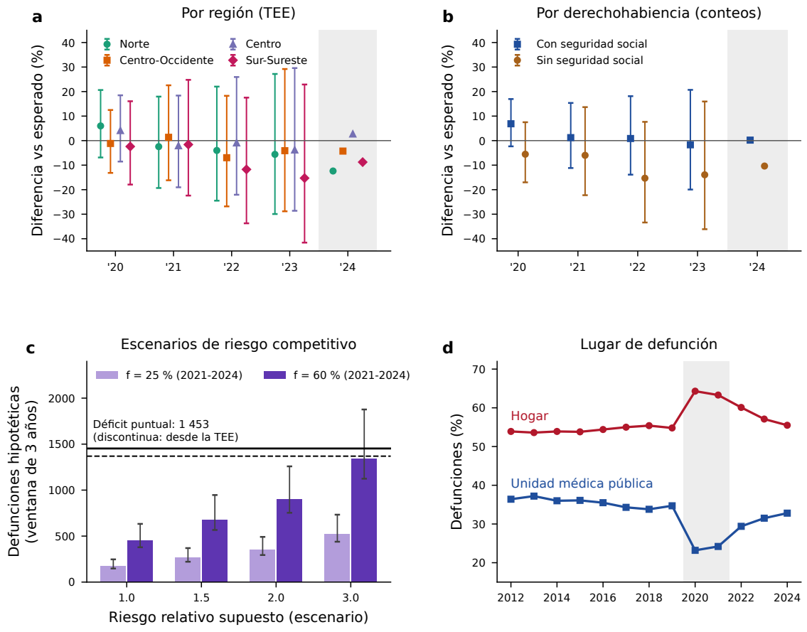


**Figura S1.** Aplicación al cáncer de mama. a: región (TEE). b: derechohabiencia (conteos). Barras: intervalo de predicción de 90 % de nivel nominal calibrado con errores de conteos del conjunto de series (2020-2023); 2024 (sombreado) solo estimación puntual. c: escenarios deterministas de defunciones por cáncer de mama adelantadas a 2021-2023 por muertes por COVID-19 (barras: escenario de referencia por riesgo relativo supuesto y fracción f; líneas de error: mínimo y máximo con las variantes de la tabla S11B), frente al déficit puntual en conteos (línea continua) y al derivado de la TEE (discontinua), cuyos intervalos anuales incluyen el cero. Son supuestos, no estimaciones. d: lugar de defunción.


<p><small>Intervalos y escenarios recalculados; los pronósticos y la distribución por lugar del panel d se conservan como entradas originales guardadas.</small></p><details><summary>Datos de esta figura</summary><p><a href="../ejecuciones/figuras_revision/20261020T172839Z_5c70e4a4/benchmark/benchmark/resultados/p1_intervalos_mama_entre_series.csv">../ejecuciones/figuras_revision/20261020T172839Z_5c70e4a4/benchmark/benchmark/resultados/p1_intervalos_mama_entre_series.csv</a> · <a href="../ejecuciones/figuras_revision/20261020T172839Z_5c70e4a4/benchmark/benchmark/resultados/p3_cosecha.json">../ejecuciones/figuras_revision/20261020T172839Z_5c70e4a4/benchmark/benchmark/resultados/p3_cosecha.json</a> · <a href="../ejecuciones/figuras_revision/20261020T172839Z_5c70e4a4/figuras/trabajo/benchmark/entradas/lugar_defuncion_C50.csv">../ejecuciones/figuras_revision/20261020T172839Z_5c70e4a4/figuras/trabajo/benchmark/entradas/lugar_defuncion_C50.csv</a></p></details>


```python
inventario.append(mostrar_tabla(REPO, SALIDA, DATOS, tablas, 'S11', plegada=True))
```


<details id="tabla-S11"><summary><b>Tabla S11. Déficit puntual de cáncer de mama, escenarios de desplazamiento temporal (cosecha) y causas mal definidas: ventana principal 2021-2023 y sensibilidad 2021-2024.</b></summary><p><b>recalculado</b>. </p><p>Fuente: <a href="../ejecuciones/figuras_revision/20261020T172839Z_5c70e4a4/benchmark/benchmark/documentos/tablas/tablaS11_cosecha.csv">../ejecuciones/figuras_revision/20261020T172839Z_5c70e4a4/benchmark/benchmark/documentos/tablas/tablaS11_cosecha.csv</a> · <a href="../ejecuciones/figuras_revision/20261020T172839Z_5c70e4a4/tablas_notebook/Tabla_S11.csv">Exportar CSV</a></p><p><small>Código: p3_cosecha_2021_2023.py; tablas_v9.py · <a href="../scripts/gmm.py">Ejecutor</a></small></p><div style="overflow:auto;max-height:480px"><table border="1" class="dataframe">
  <thead>
    <tr style="text-align: right;">
      <th>Ventana</th>
      <th>Déficit puntual en conteos</th>
      <th>Déficit aproximado desde la TEE</th>
      <th>Escenario de referencia, RR 1-3 y f 25-60 %</th>
      <th>Todas las variantes</th>
      <th>C50 adicional estimada en causas mal definidas vs 2017-2019</th>
      <th>Mal definidas / déficit en conteos (%)</th>
    </tr>
  </thead>
  <tbody>
    <tr>
      <td>2021-2023 (principal)</td>
      <td>1 452.5</td>
      <td>1 369.1</td>
      <td>176-1 341</td>
      <td>148-1 877</td>
      <td>47</td>
      <td>3.2</td>
    </tr>
    <tr>
      <td>2021-2024 (sensibilidad)</td>
      <td>1 984.6</td>
      <td>1 953.7</td>
      <td>227-1 618</td>
      <td>191-2 266</td>
      <td>58</td>
      <td>2.9</td>
    </tr>
  </tbody>
</table></div></details><p><small>p3 verifica además que reproduce entradas/cosecha_simulaciones.npy (configuración retirada; solo trazabilidad).</small></p>


```python
inventario.append(mostrar_tabla(REPO, SALIDA, DATOS, tablas, 'S11B', plegada=True))
```


<details id="tabla-S11B"><summary><b>Tabla S11B. Escenarios deterministas: mujeres con cáncer de mama entre las defunciones femeninas por COVID-19 de 2020-2022 (H) y defunciones por cáncer de mama adelantadas a 2021-2023 (A).</b></summary><p><b>recalculado</b>. </p><p>Fuente: <a href="../ejecuciones/figuras_revision/20261020T172839Z_5c70e4a4/benchmark/benchmark/documentos/tablas/tablaS11B_escenarios_cosecha.csv">../ejecuciones/figuras_revision/20261020T172839Z_5c70e4a4/benchmark/benchmark/documentos/tablas/tablaS11B_escenarios_cosecha.csv</a> · <a href="../ejecuciones/figuras_revision/20261020T172839Z_5c70e4a4/tablas_notebook/Tabla_S11B.csv">Exportar CSV</a></p><p><small>Código: p3_cosecha_2021_2023.py; tablas_v9.py · <a href="../scripts/gmm.py">Ejecutor</a></small></p><div style="overflow:auto;max-height:480px"><table border="1" class="dataframe">
  <thead>
    <tr style="text-align: right;">
      <th>RR supuesto</th>
      <th>Mujeres con cáncer de mama entre las defunciones por COVID-19 (H)</th>
      <th>A 2021-2023, f = 25 %</th>
      <th>A 2021-2023, f = 60 %</th>
      <th>Intervalo con todas las variantes</th>
    </tr>
  </thead>
  <tbody>
    <tr>
      <td>1</td>
      <td>909</td>
      <td>176</td>
      <td>452</td>
      <td>148-633</td>
    </tr>
    <tr>
      <td>1.5</td>
      <td>1 360</td>
      <td>264</td>
      <td>676</td>
      <td>221-947</td>
    </tr>
    <tr>
      <td>2</td>
      <td>1 808</td>
      <td>351</td>
      <td>899</td>
      <td>294-1 258</td>
    </tr>
    <tr>
      <td>3</td>
      <td>2 697</td>
      <td>523</td>
      <td>1 341</td>
      <td>439-1 877</td>
    </tr>
  </tbody>
</table></div></details>


```python
inventario.append(mostrar_tabla(REPO, SALIDA, DATOS, tablas, 'S11C', plegada=True))
```


<details id="tabla-S11C"><summary><b>Tabla S11C. Parámetros de los escenarios de desplazamiento temporal: fuente, población, medida, transformación, valores y justificación.</b></summary><p><b>recalculado</b>. </p><p>Fuente: <a href="../ejecuciones/figuras_revision/20261020T172839Z_5c70e4a4/benchmark/benchmark/documentos/tablas/tablaS11C_parametros_cosecha.csv">../ejecuciones/figuras_revision/20261020T172839Z_5c70e4a4/benchmark/benchmark/documentos/tablas/tablaS11C_parametros_cosecha.csv</a> · <a href="../ejecuciones/figuras_revision/20261020T172839Z_5c70e4a4/tablas_notebook/Tabla_S11C.csv">Exportar CSV</a></p><p><small>Código: tablas_v9.py (importa codigo/documentos/referencias.py) · <a href="../scripts/gmm.py">Ejecutor</a></small></p><div style="overflow:auto;max-height:480px"><table border="1" class="dataframe">
  <thead>
    <tr style="text-align: right;">
      <th>Parámetro</th>
      <th>Fuente</th>
      <th>Población</th>
      <th>Medida original</th>
      <th>Transformación</th>
      <th>Valores usados</th>
      <th>Justificación / nota</th>
    </tr>
  </thead>
  <tbody>
    <tr>
      <td>D: defunciones femeninas por COVID-19, ≥ 20 años, 2020-2022, por edad</td>
      <td>INEGI, estadísticas de defunciones (código U07 como causa básica)</td>
      <td>Mujeres fallecidas en México</td>
      <td>Conteo</td>
      <td>Ninguna</td>
      <td>Dato observado</td>
      <td>Registro nacional</td>
    </tr>
    <tr>
      <td>P5: prevalencia a 5 años de cáncer de mama</td>
      <td>GLOBOCAN 2024, ficha de México (103 771; 154.0 por 100 000 mujeres)</td>
      <td>Mujeres en México, 2024</td>
      <td>Casos prevalentes a 5 años</td>
      <td>kP = 1.00 o 0.90 para aproximar 2020-2021</td>
      <td>Supuesto (kP)</td>
      <td>La cifra ya corresponde a mujeres; no se aplica factor por sexo</td>
    </tr>
    <tr>
      <td>a: distribución por edad de los casos prevalentes</td>
      <td>Aproximación con la edad de las defunciones C50 (INEGI 2017-2019)</td>
      <td>Mujeres fallecidas por C50</td>
      <td>Proporción por grupo de edad</td>
      <td>a = w·(edad de las defunciones C50) + (1 − w)·(la misma, un grupo quinquenal más joven); w = 0.5 (referencia), 1 (edad de las defunciones C50) o 0 (≈ 5 años más joven)</td>
      <td>Supuesto</td>
      <td>Los casos prevalentes son más jóvenes que las defunciones; sin dato nacional</td>
    </tr>
    <tr>
      <td>RR: riesgo de morir por COVID-19, mujeres con frente a sin cáncer de mama, en la población</td>
      <td>No se identificó una estimación directamente transferible. Zewde et al. (ref. 26): OR 1.93 y HR 1.54 de mortalidad intrahospitalaria, pacientes hospitalizados con cualquier cáncer</td>
      <td>No equivalente</td>
      <td>OR/HR intrahospitalarios</td>
      <td>No se transforma (OR→RR exige un riesgo basal no disponible)</td>
      <td>Escenarios: 1.0, 1.5, 2.0 y 3.0</td>
      <td>1.0 = sin riesgo adicional</td>
    </tr>
    <tr>
      <td>U: subregistro de defunciones por COVID-19</td>
      <td>Sin fuente específica</td>
      <td>—</td>
      <td>—</td>
      <td>—</td>
      <td>U = 1.0 o 1.4</td>
      <td>Referencia 1.0 (solo defunciones registradas)</td>
    </tr>
    <tr>
      <td>f: fracción que habría muerto por cáncer de mama en la ventana</td>
      <td>Sin fuente específica</td>
      <td>—</td>
      <td>—</td>
      <td>f(2021-2023) = 1 − (1 − f)^(3/4) (riesgo constante)</td>
      <td>f(2021-2024) = 0.25 o 0.60</td>
      <td>Depende del estadio, que no se conoce</td>
    </tr>
    <tr>
      <td>Déficit puntual (denominador)</td>
      <td>Este estudio: Σ(esperadas − observadas), ensamble</td>
      <td>Mujeres ≥ 20 años</td>
      <td>Defunciones</td>
      <td>Ninguna</td>
      <td>Estimación puntual</td>
      <td>Sus intervalos anuales incluyen el cero</td>
    </tr>
  </tbody>
</table></div></details><p><small>Numeración bibliográfica editorial; no afecta resultados. Ver PENDIENTES.</small></p>


```python
inventario.append(mostrar_tabla(REPO, SALIDA, DATOS, tablas, 'S12A', plegada=True))
```


<details id="tabla-S12A"><summary><b>Tabla S12A. Defunciones por cáncer de mama (mujeres ≥ 20 años) por código de derechohabiencia y año de ocurrencia.</b></summary><p><b>recalculado</b>. </p><p>Fuente: <a href="../ejecuciones/figuras_revision/20261020T172839Z_5c70e4a4/benchmark/benchmark/documentos/tablas/tablaS12A_derechohab_codigos.csv">../ejecuciones/figuras_revision/20261020T172839Z_5c70e4a4/benchmark/benchmark/documentos/tablas/tablaS12A_derechohab_codigos.csv</a> · <a href="../ejecuciones/figuras_revision/20261020T172839Z_5c70e4a4/tablas_notebook/Tabla_S12A.csv">Exportar CSV</a></p><p><small>Código: p5_derechohab.py; tablas_v9.py · <a href="../scripts/gmm.py">Ejecutor</a></small></p><div style="overflow:auto;max-height:480px"><table border="1" class="dataframe">
  <thead>
    <tr style="text-align: right;">
      <th>Código</th>
      <th>2012</th>
      <th>2013</th>
      <th>2014</th>
      <th>2015</th>
      <th>2016</th>
      <th>2017</th>
      <th>2018</th>
      <th>2019</th>
      <th>2020</th>
      <th>2021</th>
      <th>2022</th>
      <th>2023</th>
      <th>2024</th>
    </tr>
  </thead>
  <tbody>
    <tr>
      <td>1</td>
      <td>579</td>
      <td>522</td>
      <td>509</td>
      <td>519</td>
      <td>534</td>
      <td>481</td>
      <td>543</td>
      <td>569</td>
      <td>1241</td>
      <td>1842</td>
      <td>1983</td>
      <td>2209</td>
      <td>2337</td>
    </tr>
    <tr>
      <td>10</td>
      <td>0</td>
      <td>0</td>
      <td>0</td>
      <td>0</td>
      <td>0</td>
      <td>0</td>
      <td>0</td>
      <td>0</td>
      <td>0</td>
      <td>0</td>
      <td>15</td>
      <td>30</td>
      <td>32</td>
    </tr>
    <tr>
      <td>2</td>
      <td>2489</td>
      <td>2438</td>
      <td>2717</td>
      <td>2692</td>
      <td>2811</td>
      <td>2892</td>
      <td>2977</td>
      <td>3146</td>
      <td>3350</td>
      <td>3306</td>
      <td>3449</td>
      <td>3555</td>
      <td>3700</td>
    </tr>
    <tr>
      <td>3</td>
      <td>561</td>
      <td>592</td>
      <td>602</td>
      <td>643</td>
      <td>644</td>
      <td>741</td>
      <td>741</td>
      <td>790</td>
      <td>814</td>
      <td>774</td>
      <td>791</td>
      <td>757</td>
      <td>818</td>
    </tr>
    <tr>
      <td>4</td>
      <td>65</td>
      <td>84</td>
      <td>65</td>
      <td>79</td>
      <td>75</td>
      <td>80</td>
      <td>86</td>
      <td>95</td>
      <td>97</td>
      <td>77</td>
      <td>76</td>
      <td>86</td>
      <td>81</td>
    </tr>
    <tr>
      <td>5</td>
      <td>28</td>
      <td>32</td>
      <td>33</td>
      <td>29</td>
      <td>38</td>
      <td>32</td>
      <td>40</td>
      <td>48</td>
      <td>49</td>
      <td>52</td>
      <td>36</td>
      <td>23</td>
      <td>30</td>
    </tr>
    <tr>
      <td>6</td>
      <td>18</td>
      <td>15</td>
      <td>22</td>
      <td>16</td>
      <td>16</td>
      <td>17</td>
      <td>15</td>
      <td>5</td>
      <td>20</td>
      <td>13</td>
      <td>12</td>
      <td>13</td>
      <td>14</td>
    </tr>
    <tr>
      <td>7</td>
      <td>1302</td>
      <td>1348</td>
      <td>1475</td>
      <td>1642</td>
      <td>1806</td>
      <td>1861</td>
      <td>2013</td>
      <td>1980</td>
      <td>1134</td>
      <td>554</td>
      <td>182</td>
      <td>12</td>
      <td>4</td>
    </tr>
    <tr>
      <td>8</td>
      <td>190</td>
      <td>140</td>
      <td>175</td>
      <td>210</td>
      <td>210</td>
      <td>260</td>
      <td>239</td>
      <td>255</td>
      <td>272</td>
      <td>304</td>
      <td>305</td>
      <td>323</td>
      <td>298</td>
    </tr>
    <tr>
      <td>9</td>
      <td>15</td>
      <td>8</td>
      <td>15</td>
      <td>8</td>
      <td>11</td>
      <td>14</td>
      <td>8</td>
      <td>5</td>
      <td>9</td>
      <td>10</td>
      <td>62</td>
      <td>113</td>
      <td>132</td>
    </tr>
    <tr>
      <td>99</td>
      <td>363</td>
      <td>383</td>
      <td>372</td>
      <td>435</td>
      <td>498</td>
      <td>527</td>
      <td>583</td>
      <td>602</td>
      <td>900</td>
      <td>913</td>
      <td>879</td>
      <td>814</td>
      <td>742</td>
    </tr>
  </tbody>
</table></div></details>


```python
inventario.append(mostrar_tabla(REPO, SALIDA, DATOS, tablas, 'S12B', plegada=True))
```


<details id="tabla-S12B"><summary><b>Tabla S12B. Distribución porcentual por grupo armonizado de derechohabiencia y año.</b></summary><p><b>recalculado</b>. </p><p>Fuente: <a href="../ejecuciones/figuras_revision/20261020T172839Z_5c70e4a4/benchmark/benchmark/documentos/tablas/tablaS12B_derechohab_grupos.csv">../ejecuciones/figuras_revision/20261020T172839Z_5c70e4a4/benchmark/benchmark/documentos/tablas/tablaS12B_derechohab_grupos.csv</a> · <a href="../ejecuciones/figuras_revision/20261020T172839Z_5c70e4a4/tablas_notebook/Tabla_S12B.csv">Exportar CSV</a></p><p><small>Código: p5_derechohab.py; tablas_v9.py · <a href="../scripts/gmm.py">Ejecutor</a></small></p><div style="overflow:auto;max-height:480px"><table border="1" class="dataframe">
  <thead>
    <tr style="text-align: right;">
      <th>Grupo</th>
      <th>2012</th>
      <th>2013</th>
      <th>2014</th>
      <th>2015</th>
      <th>2016</th>
      <th>2017</th>
      <th>2018</th>
      <th>2019</th>
      <th>2020</th>
      <th>2021</th>
      <th>2022</th>
      <th>2023</th>
      <th>2024</th>
    </tr>
  </thead>
  <tbody>
    <tr>
      <td>Con seguridad social</td>
      <td>56.3</td>
      <td>56.8</td>
      <td>57.5</td>
      <td>55.1</td>
      <td>54</td>
      <td>54.5</td>
      <td>53.3</td>
      <td>54.5</td>
      <td>54.9</td>
      <td>53.8</td>
      <td>56.2</td>
      <td>56.3</td>
      <td>57.1</td>
    </tr>
    <tr>
      <td>Otra o no especificada</td>
      <td>9.9</td>
      <td>9.4</td>
      <td>9.1</td>
      <td>10.3</td>
      <td>10.7</td>
      <td>11.4</td>
      <td>11.3</td>
      <td>11.4</td>
      <td>14.9</td>
      <td>15.5</td>
      <td>15.2</td>
      <td>14.3</td>
      <td>12.7</td>
    </tr>
    <tr>
      <td>Sin seguridad social</td>
      <td>33.8</td>
      <td>33.8</td>
      <td>33.4</td>
      <td>34.6</td>
      <td>35.4</td>
      <td>34.1</td>
      <td>35.4</td>
      <td>34.1</td>
      <td>30.2</td>
      <td>30.7</td>
      <td>28.6</td>
      <td>29.4</td>
      <td>30.2</td>
    </tr>
  </tbody>
</table></div></details>


```python
inventario.append(mostrar_tabla(REPO, SALIDA, DATOS, tablas, 'S12C', plegada=True))
```


<details id="tabla-S12C"><summary><b>Tabla S12C. Catálogos oficiales de derechohabiencia del INEGI por periodo (datos abiertos de defunciones registradas).</b></summary><p><b>recalculado</b>. </p><p>Fuente: <a href="../ejecuciones/figuras_revision/20261020T172839Z_5c70e4a4/benchmark/benchmark/documentos/tablas/tablaS12C_catalogos_inegi.csv">../ejecuciones/figuras_revision/20261020T172839Z_5c70e4a4/benchmark/benchmark/documentos/tablas/tablaS12C_catalogos_inegi.csv</a> · <a href="../ejecuciones/figuras_revision/20261020T172839Z_5c70e4a4/tablas_notebook/Tabla_S12C.csv">Exportar CSV</a></p><p><small>Código: p5_derechohab.py; tablas_v9.py · <a href="../scripts/gmm.py">Ejecutor</a></small></p><div style="overflow:auto;max-height:480px"><table border="1" class="dataframe">
  <thead>
    <tr style="text-align: right;">
      <th>Código</th>
      <th>2012-2017</th>
      <th>2018-2022</th>
      <th>2023</th>
      <th>2024</th>
    </tr>
  </thead>
  <tbody>
    <tr>
      <td>1</td>
      <td>Ninguna</td>
      <td>Ninguna</td>
      <td>Ninguna</td>
      <td>Ninguna</td>
    </tr>
    <tr>
      <td>2</td>
      <td>IMSS</td>
      <td>IMSS</td>
      <td>IMSS</td>
      <td>IMSS</td>
    </tr>
    <tr>
      <td>3</td>
      <td>ISSSTE</td>
      <td>ISSSTE</td>
      <td>ISSSTE</td>
      <td>ISSSTE</td>
    </tr>
    <tr>
      <td>4</td>
      <td>PEMEX</td>
      <td>PEMEX</td>
      <td>PEMEX</td>
      <td>PEMEX</td>
    </tr>
    <tr>
      <td>5</td>
      <td>SEDENA</td>
      <td>SEDENA</td>
      <td>SEDENA</td>
      <td>SEDENA</td>
    </tr>
    <tr>
      <td>6</td>
      <td>SEMAR</td>
      <td>SEMAR</td>
      <td>SEMAR</td>
      <td>SEMAR</td>
    </tr>
    <tr>
      <td>7</td>
      <td>Seguro popular</td>
      <td>Seguro Popular</td>
      <td>Reportado como equivalente al Seguro Popular</td>
      <td>Reportado como equivalente al Seguro Popular</td>
    </tr>
    <tr>
      <td>8</td>
      <td>Otra</td>
      <td>Otra</td>
      <td>Otra</td>
      <td>Otra</td>
    </tr>
    <tr>
      <td>9</td>
      <td>IMSS oportunidades</td>
      <td>IMSS PROSPERA</td>
      <td>IMSS BIENESTAR</td>
      <td>IMSS BIENESTAR</td>
    </tr>
    <tr>
      <td>10</td>
      <td>—</td>
      <td>—</td>
      <td>Instituto de Seguridad Social para las Fuerzas Armadas Mexicanas (ISSFAM)</td>
      <td>Instituto de Seguridad Social para las Fuerzas Armadas Mexicanas (ISSFAM)</td>
    </tr>
    <tr>
      <td>12</td>
      <td>—</td>
      <td>—</td>
      <td>—</td>
      <td>OPD Servicios de Salud IMSS BIENESTAR</td>
    </tr>
    <tr>
      <td>99</td>
      <td>Derechohabiencia no especificada</td>
      <td>No especificada</td>
      <td>No especificada</td>
      <td>No especificada</td>
    </tr>
  </tbody>
</table></div></details>


```python
inventario.append(mostrar_figura(REPO, SALIDA, 'S2'))
```


<h3 id="figura-S2">Figura S2</h3><p><b>regenerado desde resultados guardados</b> · <a href="../ejecuciones/figuras_revision/20261020T172839Z_5c70e4a4/figuras/figuras/Figura_S2.pdf">PDF vectorial</a> · <a href="../src/figuras/exportar_figuras_v13.py">Código del generador</a></p>


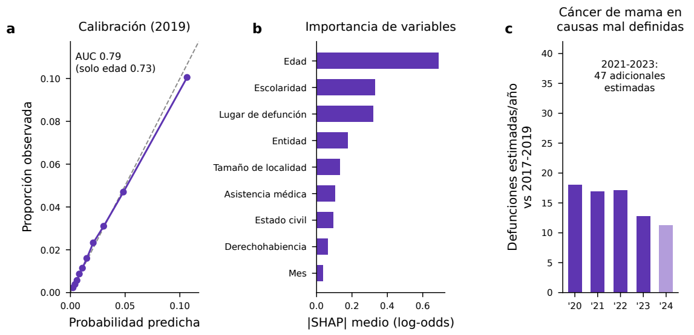


**Figura S2.** Clasificador de causa C50 aplicado a defunciones con causa mal definida. a: calibración en 2019 (defunciones con causa conocida). b: importancia de variables (SHAP). c: defunciones C50 estimadas en causas mal definidas por encima del promedio de 2017-2019 (2024 en tono claro: sensibilidad).


<p><small>Resultados guardados del clasificador C50 y de SHAP; no se vuelve a entrenar ni a inferir sobre microdatos nacionales completos.</small></p><details><summary>Datos de esta figura</summary><p><a href="../ejecuciones/figuras_revision/20261020T172839Z_5c70e4a4/figuras/trabajo/benchmark/entradas/subregistro_resultados.csv">../ejecuciones/figuras_revision/20261020T172839Z_5c70e4a4/figuras/trabajo/benchmark/entradas/subregistro_resultados.csv</a> · <a href="../ejecuciones/figuras_revision/20261020T172839Z_5c70e4a4/figuras/trabajo/benchmark/entradas/subregistro_calibracion.csv">../ejecuciones/figuras_revision/20261020T172839Z_5c70e4a4/figuras/trabajo/benchmark/entradas/subregistro_calibracion.csv</a> · <a href="../ejecuciones/figuras_revision/20261020T172839Z_5c70e4a4/figuras/trabajo/benchmark/entradas/subregistro_shap.csv">../ejecuciones/figuras_revision/20261020T172839Z_5c70e4a4/figuras/trabajo/benchmark/entradas/subregistro_shap.csv</a></p></details>


```python
inventario.append(mostrar_tabla(REPO, SALIDA, DATOS, tablas, 'S5', plegada=True))
```


<details id="tabla-S5"><summary><b>Tabla S5. Desempeño del clasificador de causa C50 (LightGBM; mujeres ≥ 20 años; entrenamiento 2012-2018, validación 2019).</b></summary><p><b>regenerado desde resultados guardados</b>. Requiere microdatos nacionales completos y una etapa no incluida; CSV guardado.</p><p>Fuente: <a href="../data/external/benchmark/entradas/subregistro_desempeno.csv">../data/external/benchmark/entradas/subregistro_desempeno.csv</a> · <a href="../ejecuciones/figuras_revision/20261020T172839Z_5c70e4a4/tablas_notebook/Tabla_S5.csv">Exportar CSV</a></p><p><small>Código: construccion_datos/subregistro.py (no escribe este CSV) · <a href="../scripts/gmm.py">Ejecutor</a></small></p><div style="overflow:auto;max-height:480px"><table border="1" class="dataframe">
  <thead>
    <tr style="text-align: right;">
      <th>Métrica</th>
      <th>Valor</th>
    </tr>
  </thead>
  <tbody>
    <tr>
      <td>Defunciones de entrenamiento (2012-2018)</td>
      <td>1857898</td>
    </tr>
    <tr>
      <td>Defunciones de validación (2019)</td>
      <td>300206</td>
    </tr>
    <tr>
      <td>Proporción de C50 en validación (%)</td>
      <td>2.50</td>
    </tr>
    <tr>
      <td>Iteraciones (parada temprana)</td>
      <td>127</td>
    </tr>
    <tr>
      <td>AUC</td>
      <td>0.786</td>
    </tr>
    <tr>
      <td>AUC, modelo solo con edad</td>
      <td>0.728</td>
    </tr>
    <tr>
      <td>AUPRC</td>
      <td>0.099</td>
    </tr>
    <tr>
      <td>AUPRC, modelo solo con edad</td>
      <td>0.057</td>
    </tr>
    <tr>
      <td>Puntuación de Brier</td>
      <td>0.023</td>
    </tr>
    <tr>
      <td>Razón de casos predichos/observados</td>
      <td>1.013</td>
    </tr>
  </tbody>
</table></div></details>


### Piloto histórico y recursos computacionales

El piloto S3 utiliza 1 328 series y dos orígenes. Sus resultados no son directamente comparables con el ajuste fino principal. S7 informa costos de las ejecuciones originales: leerla aquí no constituye una nueva medición de entrenamiento. S14 compara dos juegos de pronósticos guardados; los tiempos medidos por este notebook corresponden exclusivamente al recálculo actual.


```python
inventario.append(mostrar_figura(REPO, SALIDA, 'S3'))
```


<h3 id="figura-S3">Figura S3</h3><p><b>regenerado desde resultados guardados</b> · <a href="../ejecuciones/figuras_revision/20261020T172839Z_5c70e4a4/figuras/figuras/Figura_S3.pdf">PDF vectorial</a> · <a href="../src/figuras/actualizar_figuras.py">Código del generador</a></p>


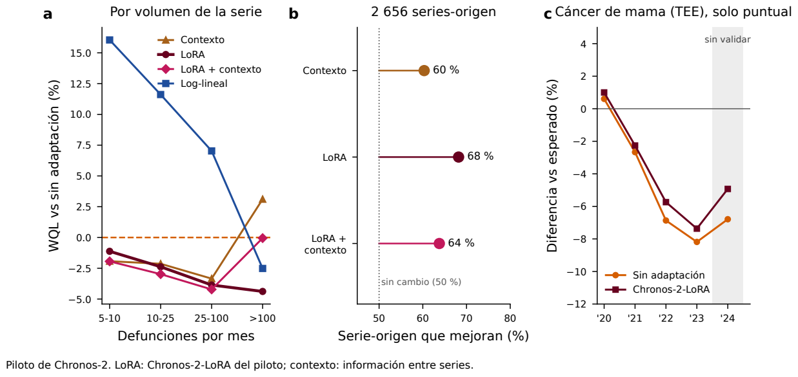


**Figura S3.** Piloto histórico de adaptación de Chronos-2: 1 328 series con media ≥ 5 defunciones/mes en 2012-2019 (estrato 5-10), con orígenes en diciembre de 2015 y diciembre de 2016. Sin adaptación: modelo original; LoRA: versión Chronos-2-LoRA del piloto; contexto: información entre series. Los resultados no se actualizaron y no son directamente comparables con la figura 6 y la tabla S4. c: solo estimaciones puntuales; 2024 (sombreado) sin validación.


<p><small>Piloto histórico desde archivos guardados; no se vuelve a ajustar y no es comparable directamente con el análisis principal.</small></p><details><summary>Datos de esta figura</summary><p><a href="../ejecuciones/figuras_revision/20261020T172839Z_5c70e4a4/figuras/trabajo/benchmark/entradas/finetune_resultados.csv.gz">../ejecuciones/figuras_revision/20261020T172839Z_5c70e4a4/figuras/trabajo/benchmark/entradas/finetune_resultados.csv.gz</a> · <a href="../ejecuciones/figuras_revision/20261020T172839Z_5c70e4a4/figuras/trabajo/benchmark/entradas/finetune_rel_por_volumen.csv">../ejecuciones/figuras_revision/20261020T172839Z_5c70e4a4/figuras/trabajo/benchmark/entradas/finetune_rel_por_volumen.csv</a></p></details>


```python
inventario.append(mostrar_tabla(REPO, SALIDA, DATOS, tablas, 'S7', plegada=True))
```


<details id="tabla-S7"><summary><b>Tabla S7. Costo computacional por origen (2 870 series, horizonte de 36 meses, 3 cuantiles).</b></summary><p><b>regenerado desde resultados guardados</b>. Tiempos medidos en la ejecución original de los modelos; no reproducibles sin nivel 4.</p><p>Fuente: <a href="../data/external/benchmark/entradas/tablaS7_costo_computacional.csv">../data/external/benchmark/entradas/tablaS7_costo_computacional.csv</a> · <a href="../ejecuciones/figuras_revision/20261020T172839Z_5c70e4a4/tablas_notebook/Tabla_S7.csv">Exportar CSV</a></p><p><small>Código: (medición de la ejecución original) · <a href="../scripts/gmm.py">Ejecutor</a></small></p><div style="overflow:auto;max-height:480px"><table border="1" class="dataframe">
  <thead>
    <tr style="text-align: right;">
      <th>Modelo</th>
      <th>Parámetros (millones)</th>
      <th>Entrenamiento (s)</th>
      <th>Pronóstico de 2 870 series (s)</th>
    </tr>
  </thead>
  <tbody>
    <tr>
      <td>Chronos-2</td>
      <td>119</td>
      <td>0 (sin entrenamiento)</td>
      <td>18</td>
    </tr>
    <tr>
      <td>Chronos-Bolt</td>
      <td>205</td>
      <td>0 (sin entrenamiento)</td>
      <td>12</td>
    </tr>
    <tr>
      <td>TimesFM-2.5</td>
      <td>200</td>
      <td>0 (sin entrenamiento)</td>
      <td>134</td>
    </tr>
    <tr>
      <td>Clásicos (4 modelos, ajuste por serie, 1 núcleo)</td>
      <td>—</td>
      <td>incluido en el ajuste</td>
      <td>445 (ajuste y pronóstico)</td>
    </tr>
    <tr>
      <td>LightGBM global</td>
      <td>—</td>
      <td>56</td>
      <td>incluida</td>
    </tr>
    <tr>
      <td>N-HiTS global</td>
      <td>—</td>
      <td>35</td>
      <td>incluida</td>
    </tr>
    <tr>
      <td>Chronos-2 + LoRA (1 000 pasos)</td>
      <td>119</td>
      <td>984-1128</td>
      <td>≈ 18 (como Chronos-2)</td>
    </tr>
    <tr>
      <td>Chronos-2, ajuste completo (1 000 pasos)</td>
      <td>119</td>
      <td>963</td>
      <td>≈ 18 (como Chronos-2)</td>
    </tr>
  </tbody>
</table></div></details>


```python
inventario.append(mostrar_tabla(REPO, SALIDA, DATOS, tablas, 'S14', plegada=True))
```


<details id="tabla-S14"><summary><b>Tabla S14. Cifras publicadas (pronósticos guardados) frente a una nueva ejecución completa con semillas fijas.</b></summary><p><b>recalculado</b>. Compara dos juegos de pronósticos guardados; no vuelve a entrenarlos.</p><p>Fuente: <a href="../ejecuciones/figuras_revision/20261020T172839Z_5c70e4a4/benchmark/benchmark/documentos/tablas/tablaS14_reproducibilidad.csv">../ejecuciones/figuras_revision/20261020T172839Z_5c70e4a4/benchmark/benchmark/documentos/tablas/tablaS14_reproducibilidad.csv</a> · <a href="../ejecuciones/figuras_revision/20261020T172839Z_5c70e4a4/tablas_notebook/Tabla_S14.csv">Exportar CSV</a></p><p><small>Código: p5_comparar_rerun.py (procesa los dos conjuntos de NPZ) · <a href="../scripts/gmm.py">Ejecutor</a></small></p><div style="overflow:auto;max-height:480px"><table border="1" class="dataframe">
  <thead>
    <tr style="text-align: right;">
      <th>Cifra</th>
      <th>Modelo</th>
      <th>Publicada</th>
      <th>Nueva</th>
      <th>Diferencia</th>
    </tr>
  </thead>
  <tbody>
    <tr>
      <td>WQL relativo al log-lineal</td>
      <td>LightGBM global</td>
      <td>0.867</td>
      <td>0.867</td>
      <td>+0.000</td>
    </tr>
    <tr>
      <td>Cobertura 80 % (%)</td>
      <td>LightGBM global</td>
      <td>72.1</td>
      <td>72.1</td>
      <td>+0.000</td>
    </tr>
    <tr>
      <td>Falsos positivos placebo (%)</td>
      <td>LightGBM global</td>
      <td>10.1</td>
      <td>10.1</td>
      <td>+0.000</td>
    </tr>
    <tr>
      <td>Semiancho mediano placebo (%)</td>
      <td>LightGBM global</td>
      <td>30.0</td>
      <td>30.0</td>
      <td>+0.000</td>
    </tr>
    <tr>
      <td>WQL relativo al log-lineal</td>
      <td>Ensamble (mediana)</td>
      <td>0.876</td>
      <td>0.876</td>
      <td>+0.000</td>
    </tr>
    <tr>
      <td>Cobertura 80 % (%)</td>
      <td>Ensamble (mediana)</td>
      <td>82.0</td>
      <td>82.0</td>
      <td>+0.000</td>
    </tr>
    <tr>
      <td>Falsos positivos placebo (%)</td>
      <td>Ensamble (mediana)</td>
      <td>8.6</td>
      <td>8.6</td>
      <td>+0.000</td>
    </tr>
    <tr>
      <td>Semiancho mediano placebo (%)</td>
      <td>Ensamble (mediana)</td>
      <td>34.1</td>
      <td>34.1</td>
      <td>+0.000</td>
    </tr>
    <tr>
      <td>WQL relativo al log-lineal</td>
      <td>TimesFM-2.5</td>
      <td>0.891</td>
      <td>0.891</td>
      <td>+0.000</td>
    </tr>
    <tr>
      <td>Cobertura 80 % (%)</td>
      <td>TimesFM-2.5</td>
      <td>79.7</td>
      <td>79.7</td>
      <td>+0.000</td>
    </tr>
    <tr>
      <td>Falsos positivos placebo (%)</td>
      <td>TimesFM-2.5</td>
      <td>10.0</td>
      <td>10.0</td>
      <td>+0.000</td>
    </tr>
    <tr>
      <td>Semiancho mediano placebo (%)</td>
      <td>TimesFM-2.5</td>
      <td>36.1</td>
      <td>36.1</td>
      <td>+0.000</td>
    </tr>
    <tr>
      <td>WQL relativo al log-lineal</td>
      <td>Chronos-2</td>
      <td>0.896</td>
      <td>0.896</td>
      <td>+0.000</td>
    </tr>
    <tr>
      <td>Cobertura 80 % (%)</td>
      <td>Chronos-2</td>
      <td>84.8</td>
      <td>84.8</td>
      <td>+0.000</td>
    </tr>
    <tr>
      <td>Falsos positivos placebo (%)</td>
      <td>Chronos-2</td>
      <td>9.0</td>
      <td>9.0</td>
      <td>+0.000</td>
    </tr>
    <tr>
      <td>Semiancho mediano placebo (%)</td>
      <td>Chronos-2</td>
      <td>34.6</td>
      <td>34.6</td>
      <td>+0.000</td>
    </tr>
    <tr>
      <td>WQL relativo al log-lineal</td>
      <td>Chronos-Bolt</td>
      <td>0.902</td>
      <td>0.902</td>
      <td>+0.000</td>
    </tr>
    <tr>
      <td>Cobertura 80 % (%)</td>
      <td>Chronos-Bolt</td>
      <td>84.7</td>
      <td>84.7</td>
      <td>+0.000</td>
    </tr>
    <tr>
      <td>Falsos positivos placebo (%)</td>
      <td>Chronos-Bolt</td>
      <td>9.6</td>
      <td>9.6</td>
      <td>+0.000</td>
    </tr>
    <tr>
      <td>Semiancho mediano placebo (%)</td>
      <td>Chronos-Bolt</td>
      <td>33.9</td>
      <td>33.9</td>
      <td>+0.000</td>
    </tr>
    <tr>
      <td>WQL relativo al log-lineal</td>
      <td>N-HiTS global</td>
      <td>0.921</td>
      <td>0.921</td>
      <td>+0.000</td>
    </tr>
    <tr>
      <td>Cobertura 80 % (%)</td>
      <td>N-HiTS global</td>
      <td>78.6</td>
      <td>78.6</td>
      <td>+0.000</td>
    </tr>
    <tr>
      <td>Falsos positivos placebo (%)</td>
      <td>N-HiTS global</td>
      <td>9.0</td>
      <td>9.0</td>
      <td>+0.000</td>
    </tr>
    <tr>
      <td>Semiancho mediano placebo (%)</td>
      <td>N-HiTS global</td>
      <td>30.9</td>
      <td>30.9</td>
      <td>+0.000</td>
    </tr>
    <tr>
      <td>WQL relativo al log-lineal</td>
      <td>Log-lineal</td>
      <td>1.000</td>
      <td>1.000</td>
      <td>+0.000</td>
    </tr>
    <tr>
      <td>Cobertura 80 % (%)</td>
      <td>Log-lineal</td>
      <td>75.5</td>
      <td>75.5</td>
      <td>+0.000</td>
    </tr>
    <tr>
      <td>Falsos positivos placebo (%)</td>
      <td>Log-lineal</td>
      <td>6.4</td>
      <td>6.4</td>
      <td>+0.000</td>
    </tr>
    <tr>
      <td>Semiancho mediano placebo (%)</td>
      <td>Log-lineal</td>
      <td>45.2</td>
      <td>45.2</td>
      <td>+0.000</td>
    </tr>
    <tr>
      <td>WQL relativo al log-lineal</td>
      <td>ETS amortiguado</td>
      <td>0.993</td>
      <td>0.993</td>
      <td>+0.000</td>
    </tr>
    <tr>
      <td>Cobertura 80 % (%)</td>
      <td>ETS amortiguado</td>
      <td>62.2</td>
      <td>62.2</td>
      <td>+0.000</td>
    </tr>
    <tr>
      <td>Falsos positivos placebo (%)</td>
      <td>ETS amortiguado</td>
      <td>8.1</td>
      <td>8.2</td>
      <td>+0.100</td>
    </tr>
    <tr>
      <td>Semiancho mediano placebo (%)</td>
      <td>ETS amortiguado</td>
      <td>38.8</td>
      <td>38.8</td>
      <td>+0.000</td>
    </tr>
    <tr>
      <td>WQL relativo al log-lineal</td>
      <td>SARIMA</td>
      <td>1.108</td>
      <td>1.108</td>
      <td>+0.000</td>
    </tr>
    <tr>
      <td>Cobertura 80 % (%)</td>
      <td>SARIMA</td>
      <td>81.2</td>
      <td>81.2</td>
      <td>+0.000</td>
    </tr>
    <tr>
      <td>Falsos positivos placebo (%)</td>
      <td>SARIMA</td>
      <td>4.7</td>
      <td>4.8</td>
      <td>+0.100</td>
    </tr>
    <tr>
      <td>Semiancho mediano placebo (%)</td>
      <td>SARIMA</td>
      <td>51.9</td>
      <td>52.6</td>
      <td>+0.7</td>
    </tr>
    <tr>
      <td>WQL relativo al log-lineal</td>
      <td>Ingenuo estacional</td>
      <td>1.128</td>
      <td>1.128</td>
      <td>+0.000</td>
    </tr>
    <tr>
      <td>Cobertura 80 % (%)</td>
      <td>Ingenuo estacional</td>
      <td>71.5</td>
      <td>71.5</td>
      <td>+0.000</td>
    </tr>
    <tr>
      <td>Falsos positivos placebo (%)</td>
      <td>Ingenuo estacional</td>
      <td>8.5</td>
      <td>8.5</td>
      <td>+0.000</td>
    </tr>
    <tr>
      <td>Semiancho mediano placebo (%)</td>
      <td>Ingenuo estacional</td>
      <td>35.0</td>
      <td>35.0</td>
      <td>+0.000</td>
    </tr>
    <tr>
      <td>Rango Friedman por serie</td>
      <td>LightGBM global</td>
      <td>3.2</td>
      <td>3.2</td>
      <td>−0.003</td>
    </tr>
    <tr>
      <td>Rango Friedman por serie</td>
      <td>Ensamble (mediana)</td>
      <td>3.5</td>
      <td>3.5</td>
      <td>+0.000</td>
    </tr>
    <tr>
      <td>Rango Friedman por serie</td>
      <td>TimesFM-2.5</td>
      <td>4.0</td>
      <td>4.0</td>
      <td>−0.001</td>
    </tr>
    <tr>
      <td>Rango Friedman por serie</td>
      <td>Chronos-2</td>
      <td>4.4</td>
      <td>4.4</td>
      <td>+0.001</td>
    </tr>
    <tr>
      <td>Rango Friedman por serie</td>
      <td>Chronos-Bolt</td>
      <td>4.3</td>
      <td>4.3</td>
      <td>+0.004</td>
    </tr>
    <tr>
      <td>Rango Friedman por serie</td>
      <td>N-HiTS global</td>
      <td>5.2</td>
      <td>5.2</td>
      <td>−0.002</td>
    </tr>
    <tr>
      <td>Rango Friedman por serie</td>
      <td>Log-lineal</td>
      <td>6.6</td>
      <td>6.6</td>
      <td>+0.006</td>
    </tr>
    <tr>
      <td>Rango Friedman por serie</td>
      <td>ETS amortiguado</td>
      <td>6.8</td>
      <td>6.8</td>
      <td>−0.003</td>
    </tr>
    <tr>
      <td>Rango Friedman por serie</td>
      <td>SARIMA</td>
      <td>8.0</td>
      <td>8.0</td>
      <td>−0.001</td>
    </tr>
    <tr>
      <td>Rango Friedman por serie</td>
      <td>Ingenuo estacional</td>
      <td>9.0</td>
      <td>9.0</td>
      <td>+0.000</td>
    </tr>
    <tr>
      <td>Mama asmr 2020: diferencia (%)</td>
      <td>Ensamble (mediana)</td>
      <td>1.202</td>
      <td>1.176</td>
      <td>−0.025</td>
    </tr>
    <tr>
      <td>Mama asmr 2021: diferencia (%)</td>
      <td>Ensamble (mediana)</td>
      <td>−2.2</td>
      <td>−2.2</td>
      <td>+0.003</td>
    </tr>
    <tr>
      <td>Mama asmr 2022: diferencia (%)</td>
      <td>Ensamble (mediana)</td>
      <td>−6.3</td>
      <td>−6.3</td>
      <td>+0.019</td>
    </tr>
    <tr>
      <td>Mama asmr 2023: diferencia (%)</td>
      <td>Ensamble (mediana)</td>
      <td>−7.8</td>
      <td>−7.8</td>
      <td>+0.037</td>
    </tr>
    <tr>
      <td>Mama deaths_adj 2020: diferencia (%)</td>
      <td>Ensamble (mediana)</td>
      <td>1.129</td>
      <td>1.150</td>
      <td>+0.021</td>
    </tr>
    <tr>
      <td>Mama deaths_adj 2021: diferencia (%)</td>
      <td>Ensamble (mediana)</td>
      <td>−2.6</td>
      <td>−2.6</td>
      <td>+0.026</td>
    </tr>
    <tr>
      <td>Mama deaths_adj 2022: diferencia (%)</td>
      <td>Ensamble (mediana)</td>
      <td>−6.7</td>
      <td>−6.7</td>
      <td>+0.005</td>
    </tr>
    <tr>
      <td>Mama deaths_adj 2023: diferencia (%)</td>
      <td>Ensamble (mediana)</td>
      <td>−7.9</td>
      <td>−7.9</td>
      <td>+0.009</td>
    </tr>
    <tr>
      <td>Mama asmr_20-39 2020: diferencia (%)</td>
      <td>Ensamble (mediana)</td>
      <td>−4.2</td>
      <td>−4.1</td>
      <td>+0.052</td>
    </tr>
    <tr>
      <td>Mama asmr_20-39 2021: diferencia (%)</td>
      <td>Ensamble (mediana)</td>
      <td>−2.9</td>
      <td>−2.9</td>
      <td>+0.046</td>
    </tr>
    <tr>
      <td>Mama asmr_20-39 2022: diferencia (%)</td>
      <td>Ensamble (mediana)</td>
      <td>−6.0</td>
      <td>−6.0</td>
      <td>+0.019</td>
    </tr>
    <tr>
      <td>Mama asmr_20-39 2023: diferencia (%)</td>
      <td>Ensamble (mediana)</td>
      <td>−4.4</td>
      <td>−4.4</td>
      <td>+0.009</td>
    </tr>
    <tr>
      <td>Mama asmr_40-59 2020: diferencia (%)</td>
      <td>Ensamble (mediana)</td>
      <td>3.4</td>
      <td>3.3</td>
      <td>−0.057</td>
    </tr>
    <tr>
      <td>Mama asmr_40-59 2021: diferencia (%)</td>
      <td>Ensamble (mediana)</td>
      <td>−2.4</td>
      <td>−2.5</td>
      <td>−0.104</td>
    </tr>
    <tr>
      <td>Mama asmr_40-59 2022: diferencia (%)</td>
      <td>Ensamble (mediana)</td>
      <td>−7.6</td>
      <td>−7.8</td>
      <td>−0.133</td>
    </tr>
    <tr>
      <td>Mama asmr_40-59 2023: diferencia (%)</td>
      <td>Ensamble (mediana)</td>
      <td>−8.4</td>
      <td>−8.7</td>
      <td>−0.245</td>
    </tr>
    <tr>
      <td>Mama asmr_60+ 2020: diferencia (%)</td>
      <td>Ensamble (mediana)</td>
      <td>0.605</td>
      <td>0.659</td>
      <td>+0.054</td>
    </tr>
    <tr>
      <td>Mama asmr_60+ 2021: diferencia (%)</td>
      <td>Ensamble (mediana)</td>
      <td>−1.350</td>
      <td>−1.316</td>
      <td>+0.034</td>
    </tr>
    <tr>
      <td>Mama asmr_60+ 2022: diferencia (%)</td>
      <td>Ensamble (mediana)</td>
      <td>−4.9</td>
      <td>−4.9</td>
      <td>+0.031</td>
    </tr>
    <tr>
      <td>Mama asmr_60+ 2023: diferencia (%)</td>
      <td>Ensamble (mediana)</td>
      <td>−8.1</td>
      <td>−8.1</td>
      <td>+0.001</td>
    </tr>
    <tr>
      <td>Mama asmr_Norte 2020: diferencia (%)</td>
      <td>Ensamble (mediana)</td>
      <td>6.0</td>
      <td>6.0</td>
      <td>−0.005</td>
    </tr>
    <tr>
      <td>Mama asmr_Norte 2021: diferencia (%)</td>
      <td>Ensamble (mediana)</td>
      <td>−2.5</td>
      <td>−2.6</td>
      <td>−0.101</td>
    </tr>
    <tr>
      <td>Mama asmr_Norte 2022: diferencia (%)</td>
      <td>Ensamble (mediana)</td>
      <td>−4.0</td>
      <td>−4.1</td>
      <td>−0.099</td>
    </tr>
    <tr>
      <td>Mama asmr_Norte 2023: diferencia (%)</td>
      <td>Ensamble (mediana)</td>
      <td>−5.6</td>
      <td>−5.7</td>
      <td>−0.123</td>
    </tr>
    <tr>
      <td>Mama asmr_Centro-Occidente 2020: diferencia (%)</td>
      <td>Ensamble (mediana)</td>
      <td>−1.165</td>
      <td>−1.168</td>
      <td>−0.003</td>
    </tr>
    <tr>
      <td>Mama asmr_Centro-Occidente 2021: diferencia (%)</td>
      <td>Ensamble (mediana)</td>
      <td>1.358</td>
      <td>1.366</td>
      <td>+0.007</td>
    </tr>
    <tr>
      <td>Mama asmr_Centro-Occidente 2022: diferencia (%)</td>
      <td>Ensamble (mediana)</td>
      <td>−7.0</td>
      <td>−7.0</td>
      <td>+0.012</td>
    </tr>
    <tr>
      <td>Mama asmr_Centro-Occidente 2023: diferencia (%)</td>
      <td>Ensamble (mediana)</td>
      <td>−4.1</td>
      <td>−4.1</td>
      <td>+0.017</td>
    </tr>
    <tr>
      <td>Mama asmr_Centro 2020: diferencia (%)</td>
      <td>Ensamble (mediana)</td>
      <td>4.1</td>
      <td>4.1</td>
      <td>−0.028</td>
    </tr>
    <tr>
      <td>Mama asmr_Centro 2021: diferencia (%)</td>
      <td>Ensamble (mediana)</td>
      <td>−2.1</td>
      <td>−2.1</td>
      <td>−0.012</td>
    </tr>
    <tr>
      <td>Mama asmr_Centro 2022: diferencia (%)</td>
      <td>Ensamble (mediana)</td>
      <td>−0.934</td>
      <td>−0.924</td>
      <td>+0.010</td>
    </tr>
    <tr>
      <td>Mama asmr_Centro 2023: diferencia (%)</td>
      <td>Ensamble (mediana)</td>
      <td>−3.8</td>
      <td>−3.8</td>
      <td>+0.007</td>
    </tr>
    <tr>
      <td>Mama asmr_Sur-Sureste 2020: diferencia (%)</td>
      <td>Ensamble (mediana)</td>
      <td>−2.4</td>
      <td>−2.4</td>
      <td>+0.030</td>
    </tr>
    <tr>
      <td>Mama asmr_Sur-Sureste 2021: diferencia (%)</td>
      <td>Ensamble (mediana)</td>
      <td>−1.605</td>
      <td>−1.690</td>
      <td>−0.085</td>
    </tr>
    <tr>
      <td>Mama asmr_Sur-Sureste 2022: diferencia (%)</td>
      <td>Ensamble (mediana)</td>
      <td>−11.7</td>
      <td>−11.8</td>
      <td>−0.026</td>
    </tr>
    <tr>
      <td>Mama asmr_Sur-Sureste 2023: diferencia (%)</td>
      <td>Ensamble (mediana)</td>
      <td>−15.3</td>
      <td>−15.4</td>
      <td>−0.106</td>
    </tr>
    <tr>
      <td>Mama deaths_SS 2020: diferencia (%)</td>
      <td>Ensamble (mediana)</td>
      <td>6.9</td>
      <td>6.9</td>
      <td>+0.010</td>
    </tr>
    <tr>
      <td>Mama deaths_SS 2021: diferencia (%)</td>
      <td>Ensamble (mediana)</td>
      <td>1.226</td>
      <td>1.246</td>
      <td>+0.020</td>
    </tr>
    <tr>
      <td>Mama deaths_SS 2022: diferencia (%)</td>
      <td>Ensamble (mediana)</td>
      <td>0.860</td>
      <td>0.838</td>
      <td>−0.022</td>
    </tr>
    <tr>
      <td>Mama deaths_SS 2023: diferencia (%)</td>
      <td>Ensamble (mediana)</td>
      <td>−1.702</td>
      <td>−1.681</td>
      <td>+0.021</td>
    </tr>
    <tr>
      <td>Mama deaths_noSS 2020: diferencia (%)</td>
      <td>Ensamble (mediana)</td>
      <td>−5.5</td>
      <td>−5.6</td>
      <td>−0.020</td>
    </tr>
    <tr>
      <td>Mama deaths_noSS 2021: diferencia (%)</td>
      <td>Ensamble (mediana)</td>
      <td>−6.0</td>
      <td>−6.0</td>
      <td>−0.037</td>
    </tr>
    <tr>
      <td>Mama deaths_noSS 2022: diferencia (%)</td>
      <td>Ensamble (mediana)</td>
      <td>−15.3</td>
      <td>−15.3</td>
      <td>−0.001</td>
    </tr>
    <tr>
      <td>Mama deaths_noSS 2023: diferencia (%)</td>
      <td>Ensamble (mediana)</td>
      <td>−13.9</td>
      <td>−13.9</td>
      <td>+0.027</td>
    </tr>
  </tbody>
</table></div></details><p><small>No reentrena: compara pronósticos guardados de dos ejecuciones.</small></p>


### Variantes y diagnósticos exploratorios de C50

Las figuras S4–S6 presentan variantes de tendencia, lugar y residuos. Las covarianzas robustas describen incertidumbre condicional al modelo y no eliminan autocorrelación. Los catálogos y el flujo de registros permiten revisar los universos analíticos. S19–S21 ya se mostraron con la figura 5.


```python
inventario.append(mostrar_tabla(REPO, SALIDA, DATOS, tablas, 'S17', plegada=True))
```


<details id="tabla-S17"><summary><b>Tabla S17. Catálogo oficial del INEGI de sitio de ocurrencia de la defunción por archivo anual y agrupación analítica.</b></summary><p><b>recalculado</b>. </p><p>Fuente: <a href="../ejecuciones/figuras_revision/20261020T172839Z_5c70e4a4/c50/c50/tablas/tablaS_catalogo_sitio_ocurrencia.csv">../ejecuciones/figuras_revision/20261020T172839Z_5c70e4a4/c50/c50/tablas/tablaS_catalogo_sitio_ocurrencia.csv</a> · <a href="../ejecuciones/figuras_revision/20261020T172839Z_5c70e4a4/c50/c50/tablas/tablaS_sitio_codigo_por_archivo.csv">../ejecuciones/figuras_revision/20261020T172839Z_5c70e4a4/c50/c50/tablas/tablaS_sitio_codigo_por_archivo.csv</a> · <a href="../ejecuciones/figuras_revision/20261020T172839Z_5c70e4a4/tablas_notebook/Tabla_S17.csv">Exportar CSV</a></p><p><small>Código: c50: tabla_catalogos.py; validacion_datos.py · <a href="../scripts/gmm.py">Ejecutor</a></small></p><div style="overflow:auto;max-height:480px"><table border="1" class="dataframe">
  <thead>
    <tr style="text-align: right;">
      <th>periodo</th>
      <th>codigo</th>
      <th>grupo_analitico</th>
      <th>2012-2017</th>
      <th>2018-2022</th>
      <th>2023-2024</th>
      <th>Registros C50 2012-2024</th>
    </tr>
  </thead>
  <tbody>
    <tr>
      <th></th>
      <td>1</td>
      <td>Unidad pública</td>
      <td>Secretaría de salud</td>
      <td>Secretaría de salud</td>
      <td>Secretaría de salud</td>
      <td>7081</td>
    </tr>
    <tr>
      <th></th>
      <td>2</td>
      <td>Unidad pública</td>
      <td>IMSS oportunidades</td>
      <td>IMSS PROSPERA</td>
      <td>IMSS BIENESTAR</td>
      <td>343</td>
    </tr>
    <tr>
      <th></th>
      <td>3</td>
      <td>Unidad pública</td>
      <td>IMSS</td>
      <td>IMSS</td>
      <td>IMSS</td>
      <td>16184</td>
    </tr>
    <tr>
      <th></th>
      <td>4</td>
      <td>Unidad pública</td>
      <td>ISSSTE</td>
      <td>ISSSTE</td>
      <td>ISSSTE</td>
      <td>3578</td>
    </tr>
    <tr>
      <th></th>
      <td>5</td>
      <td>Unidad pública</td>
      <td>PEMEX</td>
      <td>PEMEX</td>
      <td>PEMEX</td>
      <td>402</td>
    </tr>
    <tr>
      <th></th>
      <td>6</td>
      <td>Unidad pública</td>
      <td>Secretaría de la defensa nacional</td>
      <td>Secretaría de la Defensa Nacional</td>
      <td>Secretaría de la Defensa Nacional (SEDENA)</td>
      <td>277</td>
    </tr>
    <tr>
      <th></th>
      <td>7</td>
      <td>Unidad pública</td>
      <td>Secretaría de marina</td>
      <td>Secretaría de Marina</td>
      <td>Secretaría de Marina (SEMAR)</td>
      <td>118</td>
    </tr>
    <tr>
      <th></th>
      <td>8</td>
      <td>Unidad pública</td>
      <td>Otra unidad pública</td>
      <td>Otra unidad pública</td>
      <td>Otra unidad pública</td>
      <td>1534</td>
    </tr>
    <tr>
      <th></th>
      <td>9</td>
      <td>Unidad privada</td>
      <td>Unidad médica privada</td>
      <td>Unidad médica privada</td>
      <td>Unidad médica privada</td>
      <td>5050</td>
    </tr>
    <tr>
      <th></th>
      <td>10</td>
      <td>Otro/NE</td>
      <td>Vía pública</td>
      <td>Vía pública</td>
      <td>Vía pública</td>
      <td>120</td>
    </tr>
    <tr>
      <th></th>
      <td>11</td>
      <td>Hogar</td>
      <td>Hogar</td>
      <td>Hogar</td>
      <td>Hogar</td>
      <td>51926</td>
    </tr>
    <tr>
      <th></th>
      <td>12</td>
      <td>Otro/NE</td>
      <td>Otro lugar</td>
      <td>Otro lugar</td>
      <td>Otro lugar</td>
      <td>3784</td>
    </tr>
    <tr>
      <th></th>
      <td>13</td>
      <td>Unidad pública</td>
      <td>no existe</td>
      <td>no existe</td>
      <td>OPD Servicios de Salud IMSS BIENESTAR</td>
      <td>0</td>
    </tr>
    <tr>
      <th></th>
      <td>99</td>
      <td>Otro/NE</td>
      <td>No especificado</td>
      <td>No especificado</td>
      <td>No especificado</td>
      <td>965</td>
    </tr>
  </tbody>
</table></div></details><p><small>Conteos del Word = sumas por código de tablaS_sitio_codigo_por_archivo.csv (verificado).</small></p>


```python
inventario.append(mostrar_tabla(REPO, SALIDA, DATOS, tablas, 'S18', plegada=True))
```


<details id="tabla-S18"><summary><b>Tabla S18. Flujo de registros y rezago de registro de las defunciones por cáncer de mama en mujeres ≥ 20 años.</b></summary><p><b>recalculado</b>. </p><p>Fuente: <a href="../ejecuciones/figuras_revision/20261020T172839Z_5c70e4a4/c50/c50/tablas/tablaS_rezago_registro.csv">../ejecuciones/figuras_revision/20261020T172839Z_5c70e4a4/c50/c50/tablas/tablaS_rezago_registro.csv</a> · <a href="../ejecuciones/figuras_revision/20261020T172839Z_5c70e4a4/c50/c50/tablas/tablaS_flujo_registros.csv">../ejecuciones/figuras_revision/20261020T172839Z_5c70e4a4/c50/c50/tablas/tablaS_flujo_registros.csv</a> · <a href="../ejecuciones/figuras_revision/20261020T172839Z_5c70e4a4/tablas_notebook/Tabla_S18.csv">Exportar CSV</a></p><p><small>Código: c50: validacion_datos.py · <a href="../scripts/gmm.py">Ejecutor</a></small></p><div style="overflow:auto;max-height:480px"><table border="1" class="dataframe">
  <thead>
    <tr style="text-align: right;">
      <th>Año de ocurrencia</th>
      <th>Defunciones</th>
      <th>Mismo año (%)</th>
      <th>Año siguiente (%)</th>
      <th>≥ 2 años (%)</th>
    </tr>
  </thead>
  <tbody>
    <tr>
      <td>2012</td>
      <td>5610</td>
      <td>98.38</td>
      <td>1.35</td>
      <td>0.27</td>
    </tr>
    <tr>
      <td>2013</td>
      <td>5562</td>
      <td>98.08</td>
      <td>1.58</td>
      <td>0.34</td>
    </tr>
    <tr>
      <td>2014</td>
      <td>5985</td>
      <td>98.46</td>
      <td>1.34</td>
      <td>0.2</td>
    </tr>
    <tr>
      <td>2015</td>
      <td>6273</td>
      <td>98.33</td>
      <td>1.36</td>
      <td>0.32</td>
    </tr>
    <tr>
      <td>2016</td>
      <td>6643</td>
      <td>98.57</td>
      <td>1.2</td>
      <td>0.23</td>
    </tr>
    <tr>
      <td>2017</td>
      <td>6905</td>
      <td>97.78</td>
      <td>1.94</td>
      <td>0.28</td>
    </tr>
    <tr>
      <td>2018</td>
      <td>7245</td>
      <td>98.05</td>
      <td>1.74</td>
      <td>0.21</td>
    </tr>
    <tr>
      <td>2019</td>
      <td>7495</td>
      <td>98.31</td>
      <td>1.43</td>
      <td>0.27</td>
    </tr>
    <tr>
      <td>2020</td>
      <td>7886</td>
      <td>97.44</td>
      <td>2.26</td>
      <td>0.3</td>
    </tr>
    <tr>
      <td>2021</td>
      <td>7845</td>
      <td>97.96</td>
      <td>1.89</td>
      <td>0.15</td>
    </tr>
    <tr>
      <td>2022</td>
      <td>7790</td>
      <td>97.84</td>
      <td>1.99</td>
      <td>0.17</td>
    </tr>
    <tr>
      <td>2023</td>
      <td>7935</td>
      <td>98.17</td>
      <td>1.83</td>
      <td>no observable</td>
    </tr>
    <tr>
      <td>2024</td>
      <td>8188</td>
      <td>100</td>
      <td>0</td>
      <td>no observable</td>
    </tr>
  </tbody>
</table></div></details><p><small>Flujo: registros C50 92 218; mujeres 91 582; edad válida ≥ 20 años 91 551; mes válido 91 544; ocurrencia 2012-2024: 91 362. Rezago = año de registro − año de ocurrencia, con archivos hasta 2024. Rezago ≥ 2 años truncado para 2021 y 2022; no observable para 2023 y 2024. Fuente del flujo: tablaS_flujo_registros.csv de esta ejecución.</small></p>


```python
inventario.append(mostrar_figura(REPO, SALIDA, 'S4'))
```


<h3 id="figura-S4">Figura S4</h3><p><b>recalculado</b> · <a href="../ejecuciones/figuras_revision/20261020T172839Z_5c70e4a4/figuras/figuras/Figura_S4.pdf">PDF vectorial</a> · <a href="../src/c50/figuras_c50.py">Código del generador</a></p>


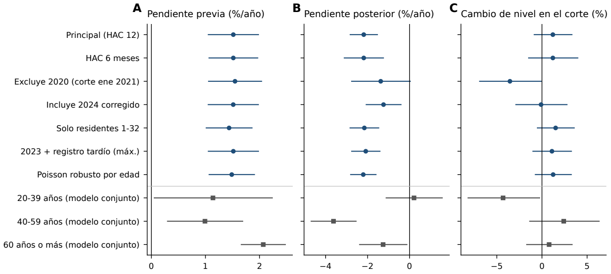


**Figura S4.** Variantes del análisis de tendencia de la TEE de cáncer de mama (IC 95 % de parámetros de la trayectoria, no intervalos de predicción). a: pendiente anual previa a marzo de 2020. b: pendiente anual posterior. c: cambio de nivel en el corte. Círculos: serie nacional; cuadrados: grupos de edad en el modelo conjunto con covarianza de Driscoll-Kraay. La tabla S19 reúne todas las variantes ejecutadas.


<p><small>Variantes C50 recalculadas; los parámetros e IC describen trayectorias, no incertidumbre predictiva.</small></p><details><summary>Datos de esta figura</summary><p><a href="../ejecuciones/figuras_revision/20261020T172839Z_5c70e4a4/c50/c50/tablas/tablaS_tendencia_ampliaciones.csv">../ejecuciones/figuras_revision/20261020T172839Z_5c70e4a4/c50/c50/tablas/tablaS_tendencia_ampliaciones.csv</a> · <a href="../ejecuciones/figuras_revision/20261020T172839Z_5c70e4a4/c50/c50/reproduccion/pk/exploracion_previa/estimaciones_ITS.csv">../ejecuciones/figuras_revision/20261020T172839Z_5c70e4a4/c50/c50/reproduccion/pk/exploracion_previa/estimaciones_ITS.csv</a></p></details>


```python
inventario.append(mostrar_figura(REPO, SALIDA, 'S5'))
```


<h3 id="figura-S5">Figura S5</h3><p><b>recalculado</b> · <a href="../ejecuciones/figuras_revision/20261020T172839Z_5c70e4a4/figuras/figuras/Figura_S5.pdf">PDF vectorial</a> · <a href="../src/c50/figuras_c50.py">Código del generador</a></p>


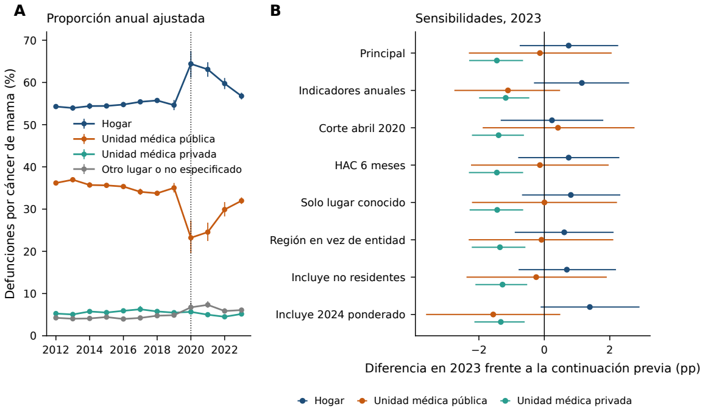


**Figura S5.** Lugar de defunción por cáncer de mama. a: proporción anual ajustada por edad quinquenal, entidad y mes (IC 95 %), 2012-2023. b: diferencia en 2023 frente a la continuación de la tendencia previa en las sensibilidades prefijadas (puntos porcentuales, IC 95 %; tabla S22).


<p><small>Modelos de lugar recalculados con 10 000 simulaciones; diferencias en puntos porcentuales.</small></p><details><summary>Datos de esta figura</summary><p><a href="../ejecuciones/figuras_revision/20261020T172839Z_5c70e4a4/c50/c50/tablas/tablaS_lugar_proporcion_ajustada_anual.csv">../ejecuciones/figuras_revision/20261020T172839Z_5c70e4a4/c50/c50/tablas/tablaS_lugar_proporcion_ajustada_anual.csv</a> · <a href="../ejecuciones/figuras_revision/20261020T172839Z_5c70e4a4/c50/c50/tablas/tablaS_lugar_proporciones_estandarizadas.csv">../ejecuciones/figuras_revision/20261020T172839Z_5c70e4a4/c50/c50/tablas/tablaS_lugar_proporciones_estandarizadas.csv</a></p></details>


```python
inventario.append(mostrar_tabla(REPO, SALIDA, DATOS, tablas, 'S22', plegada=True))
```


<details id="tabla-S22"><summary><b>Tabla S22. Diferencia ajustada frente a la continuación de la tendencia previa: análisis de sensibilidad de lugar de defunción.</b></summary><p><b>recalculado</b>. </p><p>Fuente: <a href="../ejecuciones/figuras_revision/20261020T172839Z_5c70e4a4/c50/c50/tablas/tablaS_lugar_proporciones_estandarizadas.csv">../ejecuciones/figuras_revision/20261020T172839Z_5c70e4a4/c50/c50/tablas/tablaS_lugar_proporciones_estandarizadas.csv</a> · <a href="../ejecuciones/figuras_revision/20261020T172839Z_5c70e4a4/tablas_notebook/Tabla_S22.csv">Exportar CSV</a></p><p><small>Código: c50: lugar_defuncion.py; numeros_v11.py · <a href="../scripts/gmm.py">Ejecutor</a></small></p><div style="overflow:auto;max-height:480px"><table border="1" class="dataframe">
  <thead>
    <tr style="text-align: right;">
      <th>periodo</th>
      <th>analisis</th>
      <th>desenlace</th>
      <th>2023</th>
      <th>mar-dic 2020</th>
    </tr>
  </thead>
  <tbody>
    <tr>
      <th></th>
      <td>anual_post</td>
      <td>Hogar</td>
      <td>1.1 (-0.3 a 2.6)</td>
      <td>11.3 (9.9 a 12.6)</td>
    </tr>
    <tr>
      <th></th>
      <td>anual_post</td>
      <td>Unidad privada</td>
      <td>-1.2 (-2.0 a -0.5)</td>
      <td>-0.6 (-1.1 a -0.1)</td>
    </tr>
    <tr>
      <th></th>
      <td>anual_post</td>
      <td>Unidad pública</td>
      <td>-1.1 (-2.7 a 0.5)</td>
      <td>-13.2 (-14.9 a -11.4)</td>
    </tr>
    <tr>
      <th></th>
      <td>principal</td>
      <td>Hogar</td>
      <td>0.7 (-0.8 a 2.3)</td>
      <td>11.0 (9.7 a 12.3)</td>
    </tr>
    <tr>
      <th></th>
      <td>principal</td>
      <td>Unidad privada</td>
      <td>-1.5 (-2.3 a -0.7)</td>
      <td>-0.9 (-1.5 a -0.3)</td>
    </tr>
    <tr>
      <th></th>
      <td>principal</td>
      <td>Unidad pública</td>
      <td>-0.1 (-2.3 a 2.1)</td>
      <td>-12.6 (-14.5 a -10.6)</td>
    </tr>
    <tr>
      <th></th>
      <td>sens_2024_ponderado_completitud</td>
      <td>Hogar</td>
      <td>1.4 (-0.1 a 2.9)</td>
      <td>10.7 (9.3 a 12.1)</td>
    </tr>
    <tr>
      <th></th>
      <td>sens_2024_ponderado_completitud</td>
      <td>Unidad privada</td>
      <td>-1.3 (-2.1 a -0.6)</td>
      <td>-0.9 (-1.6 a -0.4)</td>
    </tr>
    <tr>
      <th></th>
      <td>sens_2024_ponderado_completitud</td>
      <td>Unidad pública</td>
      <td>-1.6 (-3.6 a 0.5)</td>
      <td>-11.9 (-14.2 a -9.6)</td>
    </tr>
    <tr>
      <th></th>
      <td>sens_2024_sin_ponderar</td>
      <td>Hogar</td>
      <td>1.4 (-0.1 a 3.0)</td>
      <td>10.6 (9.2 a 12.1)</td>
    </tr>
    <tr>
      <th></th>
      <td>sens_2024_sin_ponderar</td>
      <td>Unidad privada</td>
      <td>-1.3 (-2.1 a -0.6)</td>
      <td>-0.9 (-1.6 a -0.4)</td>
    </tr>
    <tr>
      <th></th>
      <td>sens_2024_sin_ponderar</td>
      <td>Unidad pública</td>
      <td>-1.6 (-3.7 a 0.5)</td>
      <td>-11.9 (-14.2 a -9.5)</td>
    </tr>
    <tr>
      <th></th>
      <td>sens_HAC6</td>
      <td>Hogar</td>
      <td>0.7 (-0.8 a 2.3)</td>
      <td>11.0 (9.4 a 12.6)</td>
    </tr>
    <tr>
      <th></th>
      <td>sens_HAC6</td>
      <td>Unidad privada</td>
      <td>-1.5 (-2.3 a -0.6)</td>
      <td>-0.9 (-1.5 a -0.3)</td>
    </tr>
    <tr>
      <th></th>
      <td>sens_HAC6</td>
      <td>Unidad pública</td>
      <td>-0.1 (-2.2 a 2.0)</td>
      <td>-12.6 (-14.7 a -10.4)</td>
    </tr>
    <tr>
      <th></th>
      <td>sens_abril2020</td>
      <td>Hogar</td>
      <td>0.2 (-1.3 a 1.8)</td>
      <td>10.1 (9.0 a 11.1)</td>
    </tr>
    <tr>
      <th></th>
      <td>sens_abril2020</td>
      <td>Unidad privada</td>
      <td>-1.4 (-2.2 a -0.6)</td>
      <td>-0.8 (-1.3 a -0.3)</td>
    </tr>
    <tr>
      <th></th>
      <td>sens_abril2020</td>
      <td>Unidad pública</td>
      <td>0.4 (-1.9 a 2.8)</td>
      <td>-11.6 (-13.1 a -10.1)</td>
    </tr>
    <tr>
      <th></th>
      <td>sens_catalogo_alt</td>
      <td>Vía pública/otro</td>
      <td>0.3 (-0.4 a 1.1)</td>
      <td>1.7 (1.0 a 2.4)</td>
    </tr>
    <tr>
      <th></th>
      <td>sens_lugar_conocido</td>
      <td>Hogar</td>
      <td>0.8 (-0.7 a 2.3)</td>
      <td>11.6 (10.3 a 13.0)</td>
    </tr>
    <tr>
      <th></th>
      <td>sens_lugar_conocido</td>
      <td>Unidad privada</td>
      <td>-1.4 (-2.3 a -0.6)</td>
      <td>-0.8 (-1.4 a -0.3)</td>
    </tr>
    <tr>
      <th></th>
      <td>sens_lugar_conocido</td>
      <td>Unidad pública</td>
      <td>0.003 (-2.2 a 2.2)</td>
      <td>-12.5 (-14.4 a -10.5)</td>
    </tr>
    <tr>
      <th></th>
      <td>sens_no_residentes</td>
      <td>Hogar</td>
      <td>0.7 (-0.8 a 2.2)</td>
      <td>10.9 (9.6 a 12.2)</td>
    </tr>
    <tr>
      <th></th>
      <td>sens_no_residentes</td>
      <td>Unidad privada</td>
      <td>-1.3 (-2.1 a -0.5)</td>
      <td>-0.8 (-1.3 a -0.2)</td>
    </tr>
    <tr>
      <th></th>
      <td>sens_no_residentes</td>
      <td>Unidad pública</td>
      <td>-0.2 (-2.4 a 1.9)</td>
      <td>-12.7 (-14.6 a -10.7)</td>
    </tr>
    <tr>
      <th></th>
      <td>sens_region</td>
      <td>Hogar</td>
      <td>0.6 (-0.9 a 2.1)</td>
      <td>11.0 (9.6 a 12.3)</td>
    </tr>
    <tr>
      <th></th>
      <td>sens_region</td>
      <td>Unidad privada</td>
      <td>-1.4 (-2.2 a -0.6)</td>
      <td>-0.8 (-1.4 a -0.3)</td>
    </tr>
    <tr>
      <th></th>
      <td>sens_region</td>
      <td>Unidad pública</td>
      <td>-0.1 (-2.3 a 2.1)</td>
      <td>-12.6 (-14.5 a -10.6)</td>
    </tr>
  </tbody>
</table></div></details><p><small>Diferencias en puntos porcentuales frente a la continuación de la tendencia previa; IC 95 %. Se conservan las variantes inferenciales; los ajustes no estimables están documentados en el registro de modelos y sus diagnósticos.</small></p>


```python
inventario.append(mostrar_tabla(REPO, SALIDA, DATOS, tablas, 'S23', plegada=True))
```


<details id="tabla-S23"><summary><b>Tabla S23. Proporción anual ajustada de defunciones por cáncer de mama según lugar y tasa estandarizada por edad (TEE) de defunciones por lugar, 2012-2024.</b></summary><p><b>recalculado</b>. </p><p>Fuente: <a href="../ejecuciones/figuras_revision/20261020T172839Z_5c70e4a4/c50/c50/tablas/tablaS_lugar_proporcion_ajustada_anual.csv">../ejecuciones/figuras_revision/20261020T172839Z_5c70e4a4/c50/c50/tablas/tablaS_lugar_proporcion_ajustada_anual.csv</a> · <a href="../ejecuciones/figuras_revision/20261020T172839Z_5c70e4a4/c50/c50/tablas/tablaS_tasas_por_lugar_anuales.csv">../ejecuciones/figuras_revision/20261020T172839Z_5c70e4a4/c50/c50/tablas/tablaS_tasas_por_lugar_anuales.csv</a> · <a href="../ejecuciones/figuras_revision/20261020T172839Z_5c70e4a4/tablas_notebook/Tabla_S23.csv">Exportar CSV</a></p><p><small>Código: c50: lugar_defuncion.py; tablas_lugar.py · <a href="../scripts/gmm.py">Ejecutor</a></small></p><div style="overflow:auto;max-height:480px"><table border="1" class="dataframe">
  <thead>
    <tr style="text-align: right;">
      <th>anio</th>
      <th>Hogar</th>
      <th>Otro/NE</th>
      <th>Unidad privada</th>
      <th>Unidad pública</th>
      <th>TEE Hogar</th>
      <th>TEE Unidad médica (pública + privada)</th>
      <th>TEE Otro/NE</th>
      <th>TEE Total</th>
    </tr>
  </thead>
  <tbody>
    <tr>
      <td>2012</td>
      <td>54.3 (53.9 a 54.7)</td>
      <td>4.2 (4.0 a 4.6)</td>
      <td>5.3 (5.0 a 5.6)</td>
      <td>36.2 (35.7 a 36.7)</td>
      <td>8.95</td>
      <td>6.9</td>
      <td>0.7</td>
      <td>16.56</td>
    </tr>
    <tr>
      <td>2013</td>
      <td>53.9 (53.3 a 54.6)</td>
      <td>4.0 (3.5 a 4.7)</td>
      <td>5.0 (4.7 a 5.4)</td>
      <td>37.0 (36.4 a 37.5)</td>
      <td>8.57</td>
      <td>6.72</td>
      <td>0.64</td>
      <td>15.94</td>
    </tr>
    <tr>
      <td>2014</td>
      <td>54.4 (53.7 a 55.1)</td>
      <td>4.1 (4.0 a 4.3)</td>
      <td>5.7 (5.4 a 6.2)</td>
      <td>35.7 (35.1 a 36.3)</td>
      <td>8.97</td>
      <td>6.95</td>
      <td>0.67</td>
      <td>16.59</td>
    </tr>
    <tr>
      <td>2015</td>
      <td>54.4 (53.9 a 55.0)</td>
      <td>4.4 (4.2 a 4.7)</td>
      <td>5.5 (5.4 a 5.7)</td>
      <td>35.6 (35.2 a 36.1)</td>
      <td>9.16</td>
      <td>7.03</td>
      <td>0.74</td>
      <td>16.93</td>
    </tr>
    <tr>
      <td>2016</td>
      <td>54.8 (54.1 a 55.4)</td>
      <td>4.0 (3.8 a 4.2)</td>
      <td>5.9 (5.7 a 6.2)</td>
      <td>35.3 (34.9 a 35.8)</td>
      <td>9.51</td>
      <td>7.21</td>
      <td>0.69</td>
      <td>17.41</td>
    </tr>
    <tr>
      <td>2017</td>
      <td>55.4 (54.9 a 55.9)</td>
      <td>4.2 (4.0 a 4.5)</td>
      <td>6.3 (5.6 a 7.1)</td>
      <td>34.1 (33.4 a 34.8)</td>
      <td>9.67</td>
      <td>7.11</td>
      <td>0.75</td>
      <td>17.54</td>
    </tr>
    <tr>
      <td>2018</td>
      <td>55.7 (55.3 a 56.2)</td>
      <td>4.7 (4.5 a 5.1)</td>
      <td>5.8 (5.6 a 6.0)</td>
      <td>33.7 (33.2 a 34.3)</td>
      <td>9.91</td>
      <td>7.1</td>
      <td>0.85</td>
      <td>17.86</td>
    </tr>
    <tr>
      <td>2019</td>
      <td>54.6 (53.4 a 55.8)</td>
      <td>4.9 (4.7 a 5.1)</td>
      <td>5.5 (5.3 a 5.7)</td>
      <td>35.0 (33.9 a 36.2)</td>
      <td>9.85</td>
      <td>7.2</td>
      <td>0.89</td>
      <td>17.94</td>
    </tr>
    <tr>
      <td>2020</td>
      <td>64.4 (61.2 a 67.5)</td>
      <td>6.7 (5.8 a 7.9)</td>
      <td>5.7 (5.4 a 6.0)</td>
      <td>23.2 (19.5 a 27.3)</td>
      <td>11.84</td>
      <td>5.3</td>
      <td>1.24</td>
      <td>18.39</td>
    </tr>
    <tr>
      <td>2021</td>
      <td>63.1 (61.3 a 64.8)</td>
      <td>7.3 (6.7 a 8.2)</td>
      <td>5.0 (4.7 a 5.4)</td>
      <td>24.5 (22.4 a 26.8)</td>
      <td>11.34</td>
      <td>5.21</td>
      <td>1.33</td>
      <td>17.88</td>
    </tr>
    <tr>
      <td>2022</td>
      <td>59.7 (58.4 a 61.1)</td>
      <td>5.9 (5.4 a 6.5)</td>
      <td>4.5 (4.4 a 4.7)</td>
      <td>29.9 (28.3 a 31.7)</td>
      <td>10.42</td>
      <td>5.87</td>
      <td>1.02</td>
      <td>17.31</td>
    </tr>
    <tr>
      <td>2023</td>
      <td>56.8 (56.0 a 57.6)</td>
      <td>6.1 (5.9 a 6.3)</td>
      <td>5.2 (5.0 a 5.4)</td>
      <td>32.0 (31.2 a 32.8)</td>
      <td>9.79</td>
      <td>6.3</td>
      <td>1.05</td>
      <td>17.14</td>
    </tr>
    <tr>
      <td>2024</td>
      <td>—</td>
      <td>—</td>
      <td>—</td>
      <td>—</td>
      <td>9.53</td>
      <td>6.51</td>
      <td>1.14</td>
      <td>17.17</td>
    </tr>
  </tbody>
</table></div></details><p><small>Proporciones ajustadas: edad quinquenal, entidad y mes, 2012-2023. TEE por 100 000 mujeres-año; todas las residencias. 2024: observado sin corrección por registro tardío. Las tasas por lugar suman el total antes de redondear; los modelos binomiales independientes no necesariamente suman 100 %.</small></p>


```python
inventario.append(mostrar_tabla(REPO, SALIDA, DATOS, tablas, 'S24', plegada=True))
```


<details id="tabla-S24"><summary><b>Tabla S24. Diagnóstico de residuos de los modelos de serie temporal interrumpida de las TEE por lugar, 2012-2023.</b></summary><p><b>recalculado</b>. </p><p>Fuente: <a href="../ejecuciones/figuras_revision/20261020T172839Z_5c70e4a4/c50/c50/tablas/tablaS_tasas_por_lugar_diagnosticos.csv">../ejecuciones/figuras_revision/20261020T172839Z_5c70e4a4/c50/c50/tablas/tablaS_tasas_por_lugar_diagnosticos.csv</a> · <a href="../ejecuciones/figuras_revision/20261020T172839Z_5c70e4a4/tablas_notebook/Tabla_S24.csv">Exportar CSV</a></p><p><small>Código: c50: tablas_lugar.py · <a href="../scripts/gmm.py">Ejecutor</a></small></p><div style="overflow:auto;max-height:480px"><table border="1" class="dataframe">
  <thead>
    <tr style="text-align: right;">
      <th>lugar</th>
      <th>autocorrelacion_1</th>
      <th>Ljung-Box, p (6)</th>
      <th>Ljung-Box, p (12)</th>
      <th>Ljung-Box, p (24)</th>
    </tr>
  </thead>
  <tbody>
    <tr>
      <td>Hogar</td>
      <td>0.213155</td>
      <td>0.0748418</td>
      <td>0.173008</td>
      <td>0.172853</td>
    </tr>
    <tr>
      <td>Otro/NE</td>
      <td>0.216944</td>
      <td>0.00267775</td>
      <td>0.0428931</td>
      <td>0.0476033</td>
    </tr>
    <tr>
      <td>Total</td>
      <td>0.0633596</td>
      <td>0.61731</td>
      <td>0.44328</td>
      <td>0.172059</td>
    </tr>
    <tr>
      <td>Unidad médica (pública + privada)</td>
      <td>0.105926</td>
      <td>0.0883176</td>
      <td>0.00136656</td>
      <td>0.00378344</td>
    </tr>
  </tbody>
</table></div></details><p><small>Ljung-Box a 6, 12 y 24 meses: diagnóstico exploratorio sin corrección por multiplicidad. La covarianza HAC modifica los IC; no elimina autocorrelación ni corrige la forma del modelo.</small></p>


```python
inventario.append(mostrar_figura(REPO, SALIDA, 'S6'))
```


<h3 id="figura-S6">Figura S6</h3><p><b>recalculado</b> · <a href="../ejecuciones/figuras_revision/20261020T172839Z_5c70e4a4/figuras/figuras/Figura_S6.pdf">PDF vectorial</a> · <a href="../src/c50/figuras_c50.py">Código del generador</a></p>


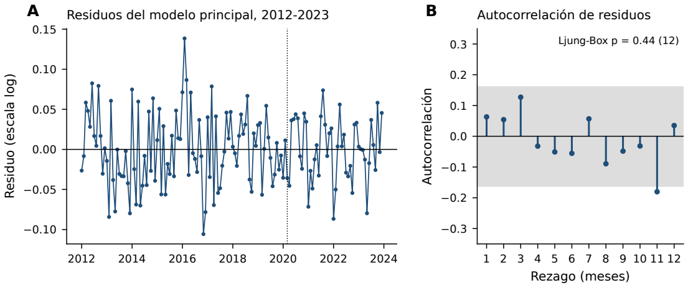


**Figura S6.** Diagnóstico del modelo principal de tendencia. a: residuos mensuales en escala logarítmica (línea punteada: marzo de 2020). b: autocorrelación de los residuos (banda: ± 1.96/√144).


<p><small>Residuos y diagnósticos del ajuste de tendencia recalculado; las bandas ACF son aproximadas.</small></p><details><summary>Datos de esta figura</summary><p><a href="../ejecuciones/figuras_revision/20261020T172839Z_5c70e4a4/c50/c50/resultados/residuos_ITS_principal.csv">../ejecuciones/figuras_revision/20261020T172839Z_5c70e4a4/c50/c50/resultados/residuos_ITS_principal.csv</a> · <a href="../ejecuciones/figuras_revision/20261020T172839Z_5c70e4a4/c50/c50/resultados/tendencia_ampliaciones.json">../ejecuciones/figuras_revision/20261020T172839Z_5c70e4a4/c50/c50/resultados/tendencia_ampliaciones.json</a></p></details>


### Tablas documentales

S13 y S16 son transcripciones estructuradas del suplemento, presentadas con Python. No se derivan de estimaciones estadísticas. S16 conserva las **52 entradas** de la adaptación TRIPOD+AI realizada por los autores; no se presenta como la lista oficial íntegra. Las versiones históricas de modelos indicadas en S13 corresponden al análisis original, no a las dependencias necesarias para este recálculo.


```python
inventario.append(mostrar_tabla(REPO, SALIDA, DATOS, tablas, 'S13', plegada=True))
```


<details id="tabla-S13"><summary><b>Tabla S13. Diferencias de implementación entre la evaluación comparativa y la aplicación al cáncer de mama.</b></summary><p><b>documental</b>. Contenido descriptivo incluido en el inventario del notebook; no deriva de un cálculo.</p><p>Fuente: <a href="documentos_fuente.json">documentos_fuente.json</a> · <a href="../ejecuciones/figuras_revision/20261020T172839Z_5c70e4a4/tablas_notebook/Tabla_S13.csv">Exportar CSV</a></p><p><small>Código: (sin generador de datos) · <a href="../scripts/gmm.py">Ejecutor</a></small></p><div style="overflow:auto;max-height:480px"><table border="1" class="dataframe">
<thead>
<tr style="text-align: right;">
<th>Aspecto</th>
<th>Evaluación comparativa</th>
<th>Aplicación al cáncer de mama</th>
</tr>
</thead>
<tbody>
<tr>
<td>Series</td>
<td>Conteos mensuales (2 870)</td>
<td>TEE mensual y conteos de cáncer de mama (11 series)</td>
</tr>
<tr>
<td>Transformación (clásicos)</td>
<td>log(y + 1); ingenuo en escala original (truncado en 0)</td>
<td>log(y); ingenuo en escala original</td>
</tr>
<tr>
<td>Trayectorias simuladas</td>
<td>500</td>
<td>2 000</td>
</tr>
<tr>
<td>Pronóstico puntual</td>
<td>Cuantil 0.5 de cada modelo</td>
<td>Clásicos: media retransformada; fundacionales: mediana; ensamble: mediana de los puntos</td>
</tr>
<tr>
<td>Semillas (publicado)</td>
<td>Por serie; SARIMA y ETS sin semilla</td>
<td>default_rng(2026); SARIMA y ETS sin semilla</td>
</tr>
<tr>
<td>Semillas (nueva ejecución, tabla S14)</td>
<td>SARIMA: default_rng(i); ETS: default_rng(i + 1)</td>
<td>SARIMA y ETS: default_rng(entero extraído de default_rng(2026))</td>
</tr>
<tr>
<td>Versiones</td>
<td>amazon/chronos-2 y amazon/chronos-bolt-base (chronos-forecasting 2.3.2); google/timesfm-2.5-200m-pytorch (timesfm 3.0.2); LightGBM 4.7.0; neuralforecast 3.2.2; statsmodels 0.15.0</td>
<td>Mismos modelos fundacionales y statsmodels</td>
</tr>
<tr>
<td>Edad</td>
<td>0-39, 40-64 y ≥ 65 años (todas las edades)</td>
<td>Mujeres ≥ 20 años; 20-39, 40-59 y ≥ 60 años</td>
</tr>
<tr>
<td>Fallos</td>
<td>Sustitución por log-lineal (0 casos)</td>
<td>Sin sustitución (0 fallos)</td>
</tr>
<tr>
<td>Orígenes de validación</td>
<td>3 anuales (36 meses) + 2 (48 meses)</td>
<td>9 trimestrales (36 meses) + 5 (48 meses)</td>
</tr>
<tr>
<td>Intervalos anuales</td>
<td>Conformal Mondrian por volumen, entre series</td>
<td>Conformal entre series con errores de conteos del conjunto de series (principal, nivel nominal); rango por serie (descriptivo)</td>
</tr>
<tr>
<td>Modelos</td>
<td>10</td>
<td>8: 4 clásicos, 3 fundacionales y ensamble; los globales solo en conteos del conjunto de series</td>
</tr>
</tbody>
</table></div></details><p><small>Ver métodos S1 y S2 del suplemento. Los métodos clásicos corresponden a la referencia 15 del manuscrito; Chronos-Bolt y TimesFM-2.5 a las referencias 16 y 17. Estas versiones documentan la implementación original; no son dependencias de recálculo del notebook.</small></p>


```python
inventario.append(mostrar_tabla(REPO, SALIDA, DATOS, tablas, 'S16', plegada=True))
```


<details id="tabla-S16"><summary><b>Tabla S16. Matriz adaptada de TRIPOD+AI (Collins et al., 2024; 27 ítems, 52 subítems) para este estudio ecológico de pronóstico de series de tiempo.</b></summary><p><b>documental</b>. Contenido descriptivo incluido en el inventario del notebook; no deriva de un cálculo.</p><p>Fuente: <a href="documentos_fuente.json">documentos_fuente.json</a> · <a href="../ejecuciones/figuras_revision/20261020T172839Z_5c70e4a4/tablas_notebook/Tabla_S16.csv">Exportar CSV</a></p><p><small>Código: (no incorporado: tripod_ai_aplicabilidad.csv pertenece a la edición del documento) · <a href="../scripts/gmm.py">Ejecutor</a></small></p><div style="overflow:auto;max-height:480px"><table border="1" class="dataframe">
<thead>
<tr style="text-align: right;">
<th>Sección (TRIPOD+AI)</th>
<th>Ítem</th>
<th>Aplicabilidad</th>
<th>Dónde se informa / justificación</th>
</tr>
</thead>
<tbody>
<tr>
<td>Título</td>
<td>1</td>
<td>Aplica</td>
<td>Título: IA, mortalidad esperada, evaluación comparativa y aplicación al cáncer de mama.</td>
</tr>
<tr>
<td>Resumen</td>
<td>2</td>
<td>Aplica (adaptado)</td>
<td>Resumen estructurado según GMM; la lista TRIPOD+AI para resúmenes no se aplicó ítem por ítem.</td>
</tr>
<tr>
<td>Antecedentes</td>
<td>3a</td>
<td>Aplica</td>
<td>Introducción: contexto y modelos clásicos habituales.</td>
</tr>
<tr>
<td>Antecedentes</td>
<td>3b</td>
<td>Aplica (adaptado)</td>
<td>Propósito: vigilancia poblacional de la mortalidad; usuarios: analistas de salud pública; no hay uso clínico individual.</td>
</tr>
<tr>
<td>Antecedentes</td>
<td>3c</td>
<td>Aplica (adaptado)</td>
<td>Diferencias por región y derechohabiencia descritas (resultados; tabla S12); sin análisis formal de desigualdades.</td>
</tr>
<tr>
<td>Objetivos</td>
<td>4</td>
<td>Aplica</td>
<td>Introducción, último párrafo (evaluación de modelos y aplicación).</td>
</tr>
<tr>
<td>Datos</td>
<td>5a</td>
<td>Aplica</td>
<td>INEGI, WPP 2024 y Censo 2020 (métodos; S10). S11a: microdatos C50 y reconstrucción de las series.</td>
</tr>
<tr>
<td>Datos</td>
<td>5b</td>
<td>Aplica</td>
<td>2012-2024; orígenes de validación de 2014 a 2016 y de aplicación en 2019 (figura 1). S11: lugar 2012-2023; 2024 solo sensibilidad y tasas observadas.</td>
</tr>
<tr>
<td>Participantes</td>
<td>6a</td>
<td>Aplica (adaptado)</td>
<td>Ámbito nacional y 32 entidades; unidades: series agregadas, no centros ni individuos.</td>
</tr>
<tr>
<td>Participantes</td>
<td>6b</td>
<td>Aplica (adaptado)</td>
<td>Criterios de inclusión de series y de registros (métodos; tabla S1; S10). S11a-b: mujeres ≥ 20 años, mes válido y residencia según análisis.</td>
</tr>
<tr>
<td>Participantes</td>
<td>6c</td>
<td>No aplica</td>
<td>Datos agregados de defunciones sin información de tratamientos.</td>
</tr>
<tr>
<td>Preparación de datos</td>
<td>7</td>
<td>Aplica</td>
<td>Exclusiones de registros, registro tardío de 2024 (S6) y redistribución de derechohabiencia no especificada (S7). S11a y S18: escenarios de registro tardío, sin imputación de faltantes conocidos.</td>
</tr>
<tr>
<td>Resultado</td>
<td>8a</td>
<td>Aplica</td>
<td>Defunciones o TEE mensuales; horizonte de 36- 48 meses. S11d: lugar de defunción y TEE por lugar como desenlaces exploratorios.</td>
</tr>
<tr>
<td>Resultado</td>
<td>8b</td>
<td>Aplica (adaptado)</td>
<td>Causa básica certificada y codificada (CIE-10) por el sistema de registro; el estudio no tuvo evaluadores.</td>
</tr>
<tr>
<td>Resultado</td>
<td>8c</td>
<td>No aplica</td>
<td>Registros administrativos generados antes del estudio.</td>
</tr>
<tr>
<td>Predictores</td>
<td>9a</td>
<td>Aplica (adaptado)</td>
<td>Historia de la propia serie; en modelos globales, también el conjunto de series (S1; S13).</td>
</tr>
<tr>
<td>Predictores</td>
<td>9b</td>
<td>Aplica (adaptado)</td>
<td>Definición de entradas por modelo (S1; S13).</td>
</tr>
<tr>
<td>Predictores</td>
<td>9c</td>
<td>No aplica</td>
<td>Sin medición subjetiva de predictores.</td>
</tr>
<tr>
<td>Tamaño de muestra</td>
<td>10</td>
<td>Aplica (adaptado)</td>
<td>2 870 series y 8 610 evaluaciones serie × origen; sin cálculo formal de tamaño. S11a y S18: selección por disponibilidad de registros; sin nuevo cálculo de tamaño.</td>
</tr>
<tr>
<td>Datos faltantes</td>
<td>11</td>
<td>Aplica</td>
<td>Registros sin sexo, mes o edad válidos excluidos; no especificados de derechohabiencia redistribuidos (S7). S11a-b: exclusiones documentadas y conservación de filas idénticas sin identificador.</td>
</tr>
<tr>
<td>Métodos analíticos</td>
<td>12a</td>
<td>Aplica</td>
<td>Orígenes móviles con entrenamiento y prueba separados en el tiempo (figura 1).</td>
</tr>
<tr>
<td>Métodos analíticos</td>
<td>12b</td>
<td>Aplica</td>
<td>Transformación logarítmica y escalas (S1). S11c: modelos de tendencia en logaritmo de la TEE.</td>
</tr>
<tr>
<td>Métodos analíticos</td>
<td>12c</td>
<td>Aplica</td>
<td>Modelos, versiones y parámetros (métodos; S1; S13; código). S11c-d: modelos exploratorios, covarianzas, simulación y versiones en código.</td>
</tr>
<tr>
<td>Métodos analíticos</td>
<td>12d</td>
<td>Aplica</td>
<td>Sensibilidad con 28 conglomerados de causa y por nivel (tabla S10). S11c-d y S19-S23: variantes de tendencia y lugar, sin selección por significación.</td>
</tr>
<tr>
<td>Métodos analíticos</td>
<td>12e</td>
<td>Aplica</td>
<td>WQL, cobertura, MASE, falsas alarmas y detección. S11c-d: parámetros e IC exploratorios, distintos de métricas predictivas.</td>
</tr>
<tr>
<td>Métodos analíticos</td>
<td>12f</td>
<td>Aplica</td>
<td>Recalibración conformal (tabla S6) y adaptación LoRA (tabla S4).</td>
</tr>
<tr>
<td>Métodos analíticos</td>
<td>12g</td>
<td>Aplica</td>
<td>Código y pronósticos guardados en el paquete de recálculo. Código y resultados de C50 incluidos en el paquete v11.</td>
</tr>
<tr>
<td>Desbalance de clases</td>
<td>13</td>
<td>Aplica</td>
<td>Solo el clasificador C50: objetivo binario sin reequilibrio; AUPRC y Brier en la tabla S5.</td>
</tr>
<tr>
<td>Equidad</td>
<td>14</td>
<td>Aplica (adaptado)</td>
<td>Resultados descriptivos por edad, región y derechohabiencia; no se aplicaron métodos de equidad.</td>
</tr>
<tr>
<td>Salida del modelo</td>
<td>15</td>
<td>Aplica</td>
<td>Cuantiles 0.1, 0.5 y 0.9; umbral de detección calibrado (S4).</td>
</tr>
<tr>
<td>Desarrollo frente a evaluación</td>
<td>16</td>
<td>Aplica</td>
<td>Diferencias entre evaluación comparativa y aplicación (tabla S13; cortes de edad).</td>
</tr>
<tr>
<td>Aprobación ética</td>
<td>17</td>
<td>Aplica (adaptado)</td>
<td>No requerida: análisis de datos públicos anonimizados (Declaraciones).</td>
</tr>
<tr>
<td>Ciencia abierta: financiamiento</td>
<td>18a</td>
<td>Aplica</td>
<td>Sin financiamiento.</td>
</tr>
<tr>
<td>Ciencia abierta: conflictos</td>
<td>18b</td>
<td>Aplica</td>
<td>Sin conflictos de intereses.</td>
</tr>
<tr>
<td>Ciencia abierta: protocolo</td>
<td>18c</td>
<td>No informado</td>
<td>Protocolo previo no informado. Plan exploratorio y adendas en S11; no fue preregistro.</td>
</tr>
<tr>
<td>Ciencia abierta: registro</td>
<td>18d</td>
<td>No informado</td>
<td>Registro previo no informado. S11 no tuvo registro prospectivo independiente.</td>
</tr>
<tr>
<td>Ciencia abierta: datos</td>
<td>18e</td>
<td>Aplica</td>
<td>Datos públicos (INEGI, WPP, Censo).</td>
</tr>
<tr>
<td>Ciencia abierta: código</td>
<td>18f</td>
<td>Aplica (adaptado)</td>
<td>Código, datos derivados, resultados y pronósticos: Analisis_y_pronosticos.zip, con manifiestos SHA-256.</td>
</tr>
<tr>
<td>Participación de pacientes y público</td>
<td>19</td>
<td>No informado</td>
<td>Participación de pacientes o público no informada.</td>
</tr>
<tr>
<td>Resultados: participantes</td>
<td>20a</td>
<td>Aplica (adaptado)</td>
<td>Flujo de series (figura 1b; tabla S1). S18: flujo de registros C50.</td>
</tr>
<tr>
<td>Resultados: participantes</td>
<td>20b</td>
<td>Aplica (adaptado)</td>
<td>Series por nivel y defunciones observadas (tabla S1; tabla 2). S17-S18: catálogo, conteos y rezago de registro.</td>
</tr>
<tr>
<td>Resultados: participantes</td>
<td>20c</td>
<td>Aplica (adaptado)</td>
<td>Diferencias de volumen y de implementación entre conjuntos (S13; estratos de volumen).</td>
</tr>
<tr>
<td>Desarrollo del modelo</td>
<td>21</td>
<td>Aplica</td>
<td>Número de series y evaluaciones por análisis; 9 orígenes en la serie de mama. S11a y S20: periodos y denominadores de los análisis exploratorios.</td>
</tr>
<tr>
<td>Especificación del modelo</td>
<td>22</td>
<td>Aplica (adaptado)</td>
<td>Modelos públicos con versión (S13) y código; no hay fórmula para individuos. S11c-d y código C50: especificación reproducible de los modelos exploratorios.</td>
</tr>
<tr>
<td>Desempeño del modelo</td>
<td>23a</td>
<td>Aplica</td>
<td>IC por bootstrap de conglomerados; resultados por nivel y subgrupo. S19- S23: IC marginales; Holm solo en familias de comparaciones por edad.</td>
</tr>
<tr>
<td>Desempeño del modelo</td>
<td>23b</td>
<td>Aplica</td>
<td>Tablas S10 y S10B. S11 y S19-S23: se documentan también diagnósticos y ajustes no válidos.</td>
</tr>
<tr>
<td>Actualización del modelo</td>
<td>24</td>
<td>Aplica</td>
<td>Tablas S4 y S6.</td>
</tr>
<tr>
<td>Interpretación</td>
<td>25</td>
<td>Aplica</td>
<td>Discusión. S11e: alcance exploratorio y ausencia de interpretación causal.</td>
</tr>
<tr>
<td>Limitaciones</td>
<td>26</td>
<td>Aplica</td>
<td>Discusión, párrafo de limitaciones. S11e: límites de registros, temporalidad e inferencia.</td>
</tr>
<tr>
<td>Uso en la práctica</td>
<td>27a</td>
<td>Aplica (adaptado)</td>
<td>Registro tardío y cambios de codificación (discusión; S6- S7). S11b-d: catálogos, registro tardío y separación del código 99.</td>
</tr>
<tr>
<td>Uso en la práctica</td>
<td>27b</td>
<td>No aplica</td>
<td>No se ofrece una herramienta para usuarios finales.</td>
</tr>
<tr>
<td>Uso en la práctica</td>
<td>27c</td>
<td>Aplica (adaptado)</td>
<td>Recomendaciones de uso en la discusión; sin agenda formal de investigación.</td>
</tr>
</tbody>
</table></div></details><p><small>Matriz adaptada por los autores a partir de la tabla 2 de TRIPOD+AI (referencia 26 del manuscrito); no es la lista oficial íntegra. Aplica (adaptado): equivalente para series agregadas. No aplica: presupone individuos o intervenciones ausentes en este diseño. No informado: información no proporcionada. APVP y localidad: S12 y tabla S25.</small></p>


<a id="balance"></a>
## 8. Comprobaciones, procedencia y límites

Esta última sección coteja las cifras principales, la cobertura documental y las comparaciones con las referencias. Las discrepancias de comparación se muestran y registran sin convertirlas en coincidencias; los errores de ejecución de un análisis detienen el recorrido. Un resultado guardado se identifica como tal y nunca cuenta como entrenamiento repetido. Los informes preservan las tolerancias originales de comparación; las excepciones editoriales o de auditoría se verifican con las reglas existentes del repositorio. En la validación de este entorno Linux se observaron diferencias pequeñas en el diagnóstico de convergencia `score_max_abs` de cuatro archivos C50; se conservan explícitamente como discrepancias. Las cifras del manuscrito se cotejan de forma independiente en la celda siguiente.


```python
numeros = cargar_json(B / "resultados/numeros_v9.json")
deteccion_ensamble = numeros["p2"]["D1"]["Ensamble (mediana)"]["det20"]
deteccion_loglineal = numeros["p2"]["D1"]["Log-lineal"]["det20"]
assert round(deteccion_ensamble, 1) == 22.2
assert round(deteccion_loglineal, 1) == 17.1
for anio, esperado in [(2022, -6.3), (2023, -7.8)]:
    fila = nacional[nacional.year == anio].iloc[0]
    assert round(fila.pscore, 1) == esperado
    assert fila.lo_todas <= 0 <= fila.hi_todas
comprobaciones = pd.DataFrame([
    {"Comprobación":"Series del corpus", "Valor":len(corpus)},
    {"Comprobación":"Detección +20 %, ensamble (%)", "Valor":round(deteccion_ensamble, 1)},
    {"Comprobación":"Detección +20 %, log-lineal (%)", "Valor":round(deteccion_loglineal, 1)},
    {"Comprobación":"APVP 2023", "Valor":apvp_2023},
    {"Comprobación":"APVP en 40–59 años (%)", "Valor":round(aporte_40_59, 1)},
    {"Comprobación":"Hogar rural, 2023 (%)", "Valor":round(local_2023.loc["< 2 500", "Hogar %"], 1)},
    {"Comprobación":"Hogar ≥100 000 habitantes, 2023 (%)", "Valor":round(local_2023.loc["≥ 100 000", "Hogar %"], 1)},
])
display(comprobaciones)
comprobaciones.to_csv(SALIDA / "comprobaciones_manuscrito.csv", index=False)
```


<div>
<style scoped>
    .dataframe tbody tr th:only-of-type {
        vertical-align: middle;
    }

    .dataframe tbody tr th {
        vertical-align: top;
    }

    .dataframe thead th {
        text-align: right;
    }
</style>
<table border="1" class="dataframe">
  <thead>
    <tr style="text-align: right;">
      <th></th>
      <th>Comprobación</th>
      <th>Valor</th>
    </tr>
  </thead>
  <tbody>
    <tr>
      <th>0</th>
      <td>Series del corpus</td>
      <td>2870.0</td>
    </tr>
    <tr>
      <th>1</th>
      <td>Detección +20 %, ensamble (%)</td>
      <td>22.2</td>
    </tr>
    <tr>
      <th>2</th>
      <td>Detección +20 %, log-lineal (%)</td>
      <td>17.1</td>
    </tr>
    <tr>
      <th>3</th>
      <td>APVP 2023</td>
      <td>120893.0</td>
    </tr>
    <tr>
      <th>4</th>
      <td>APVP en 40–59 años (%)</td>
      <td>65.2</td>
    </tr>
    <tr>
      <th>5</th>
      <td>Hogar rural, 2023 (%)</td>
      <td>70.2</td>
    </tr>
    <tr>
      <th>6</th>
      <td>Hogar ≥100 000 habitantes, 2023 (%)</td>
      <td>53.0</td>
    </tr>
  </tbody>
</table>
</div>


```python
registro = cerrar_reproduccion(REPO, SALIDA, DATOS, antes, inventario)
# Inventario con rutas, hashes, fuentes y código: CSV/JSON en la carpeta de salida.
display(HTML('<p><a href="../' + str(Path(os.path.relpath(SALIDA, REPO))) + '/inventario_reproduccion.csv">Inventario completo de reproducción</a></p>'))
```


<div>
<style scoped>
    .dataframe tbody tr th:only-of-type {
        vertical-align: middle;
    }

    .dataframe tbody tr th {
        vertical-align: top;
    }

    .dataframe thead th {
        text-align: right;
    }
</style>
<table border="1" class="dataframe">
  <thead>
    <tr style="text-align: right;">
      <th></th>
      <th>Módulo</th>
      <th>identico_bytes</th>
      <th>coincide_tolerancia</th>
      <th>identico_contenido</th>
      <th>sin_referencia_conocido_verificado</th>
      <th>difiere_conocido_verificado</th>
      <th>difiere</th>
      <th>no_generado_conocido_verificado</th>
    </tr>
  </thead>
  <tbody>
    <tr>
      <th>0</th>
      <td>benchmark</td>
      <td>57</td>
      <td>6</td>
      <td>4.0</td>
      <td>1.0</td>
      <td>1</td>
      <td>0.0</td>
      <td>0.0</td>
    </tr>
    <tr>
      <th>1</th>
      <td>c50</td>
      <td>12</td>
      <td>25</td>
      <td>0.0</td>
      <td>0.0</td>
      <td>1</td>
      <td>4.0</td>
      <td>1.0</td>
    </tr>
  </tbody>
</table>
</div>


<div>
<style scoped>
    .dataframe tbody tr th:only-of-type {
        vertical-align: middle;
    }

    .dataframe tbody tr th {
        vertical-align: top;
    }

    .dataframe thead th {
        text-align: right;
    }
</style>
<table border="1" class="dataframe">
  <thead>
    <tr style="text-align: right;">
      <th></th>
      <th>Productos presentados</th>
    </tr>
    <tr>
      <th>estado</th>
      <th></th>
    </tr>
  </thead>
  <tbody>
    <tr>
      <th>documental</th>
      <td>3</td>
    </tr>
    <tr>
      <th>recalculado</th>
      <td>46</td>
    </tr>
    <tr>
      <th>regenerado desde resultados guardados</th>
      <td>8</td>
    </tr>
  </tbody>
</table>
</div>


    Cobertura completa: 57 productos. Entradas y referencias intactas.
    Las excepciones conocidas se verificaron con las reglas existentes; no se ampliaron tolerancias.


<p><b>La comparación estricta contiene discrepancias:</b> c50: resultados/lugar_defuncion.json; c50: resultados/numeros_v11.json; c50: resultados/tendencia_ampliaciones.json; c50: tablas/tablaS_lugar_diagnosticos.csv. No se cuentan como coincidencias.</p>


<div>
<style scoped>
    .dataframe tbody tr th:only-of-type {
        vertical-align: middle;
    }

    .dataframe tbody tr th {
        vertical-align: top;
    }

    .dataframe thead th {
        text-align: right;
    }
</style>
<table border="1" class="dataframe">
  <thead>
    <tr style="text-align: right;">
      <th></th>
      <th>archivo</th>
      <th>tipo_campo</th>
      <th>diferencias</th>
      <th>diferencia_absoluta_maxima</th>
    </tr>
  </thead>
  <tbody>
    <tr>
      <th>0</th>
      <td>c50/resultados/lugar_defuncion.json</td>
      <td>score_max_abs</td>
      <td>35</td>
      <td>3.843065e-10</td>
    </tr>
    <tr>
      <th>1</th>
      <td>c50/resultados/numeros_v11.json</td>
      <td>score_max_abs</td>
      <td>36</td>
      <td>5.378013e-09</td>
    </tr>
    <tr>
      <th>2</th>
      <td>c50/resultados/tendencia_ampliaciones.json</td>
      <td>score_max_abs</td>
      <td>1</td>
      <td>5.378013e-09</td>
    </tr>
    <tr>
      <th>3</th>
      <td>c50/tablas/tablaS_lugar_diagnosticos.csv</td>
      <td>score_max_abs</td>
      <td>34</td>
      <td>3.843065e-10</td>
    </tr>
  </tbody>
</table>
</div>


    Consulte discrepancias_detalladas.csv: conserva cada campo y los dos valores, con las tolerancias originales.


<p><a href="../ejecuciones/figuras_revision/20261020T172839Z_5c70e4a4/inventario_reproduccion.csv">Inventario completo de reproducción</a></p>


### Qué permite comprobar esta ejecución

- La integridad de entradas y referencias, la ejecución completa de los análisis disponibles y la presentación de las 12 figuras y 45 tablas del inventario documental.
- La reconstrucción de los resultados del benchmark desde pronósticos guardados y de los análisis C50 desde el extracto distribuido, con sus comparaciones numéricas.
- El origen de cada producto, los comandos, versiones, tiempos y discrepancias en `registro_notebook.json`, `entornos.json`, los archivos `requirements_ejecutados_*.txt` y los registros por etapa.

### Límites de reproducibilidad

Los NPZ y los backtests de la aplicación a mama son insumos de etapas previas; no se vuelven a generar. Tampoco se repiten el entrenamiento de modelos, el ajuste fino, el piloto histórico ni ciertas etapas auxiliares sin generador recuperado. La revisión exacta de algunos pesos originales es desconocida. La reproducción aquí comienza desde los paquetes procesados; no reconstruye todo el corpus a partir de los microdatos nacionales completos del INEGI.

Las figuras conservan valores y artistas numéricos al actualizar sus rótulos. La tipografía y el render pueden diferir de macOS; los hashes de PDF incluyen metadatos y no son una prueba de equivalencia científica. La comparación del PNG histórico de S2 se registra como control tipográfico, separada de la equivalencia numérica.

Los análisis C50 son exploratorios y ecológicos. Los IP nominales de mama, los IC de modelos de tendencia y lugar, y los escenarios hipotéticos de desplazamiento temporal responden a preguntas distintas. Ninguno identifica por sí mismo un efecto causal de la pandemia.

### Referencias, datos y cita

La [matriz de trazabilidad](../docs/MATRIZ_TRAZABILIDAD.csv), la [guía técnica de reproducción](../docs/REPRODUCCION.md) y la [documentación de entrenamiento](../docs/ENTRENAMIENTO.md) amplían su procedencia. Para citar el software use [CITATION.cff](../CITATION.cff); las condiciones de uso se indican en [LICENCIAS.md](../LICENCIAS.md). Los DOI de software y datos están en el [README](../README.md).

[Volver al índice](#indice)
